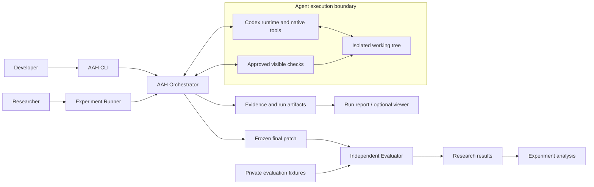
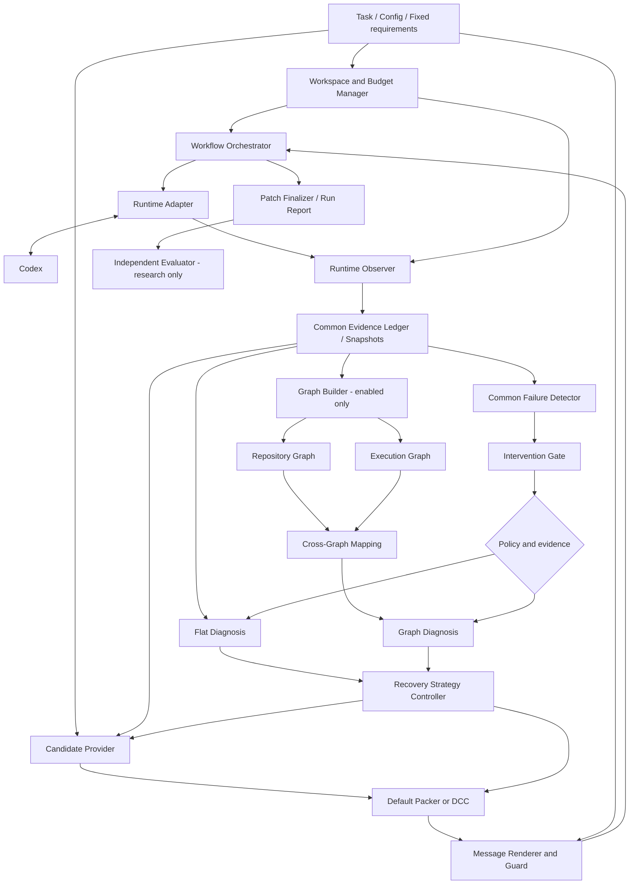
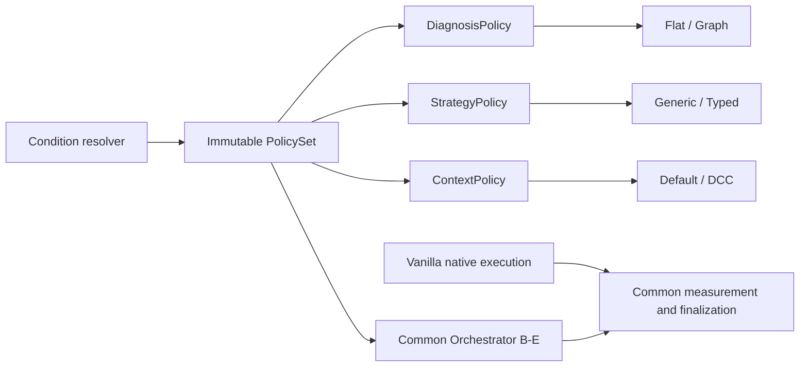
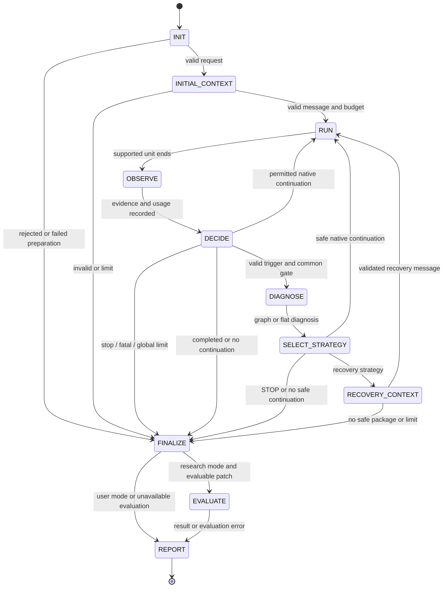
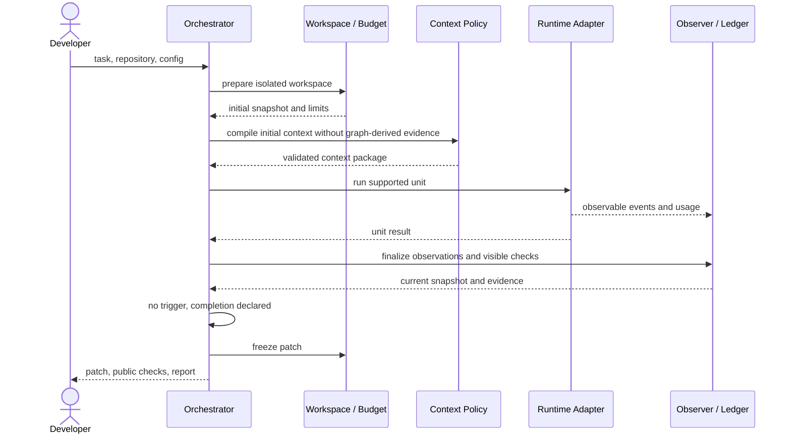
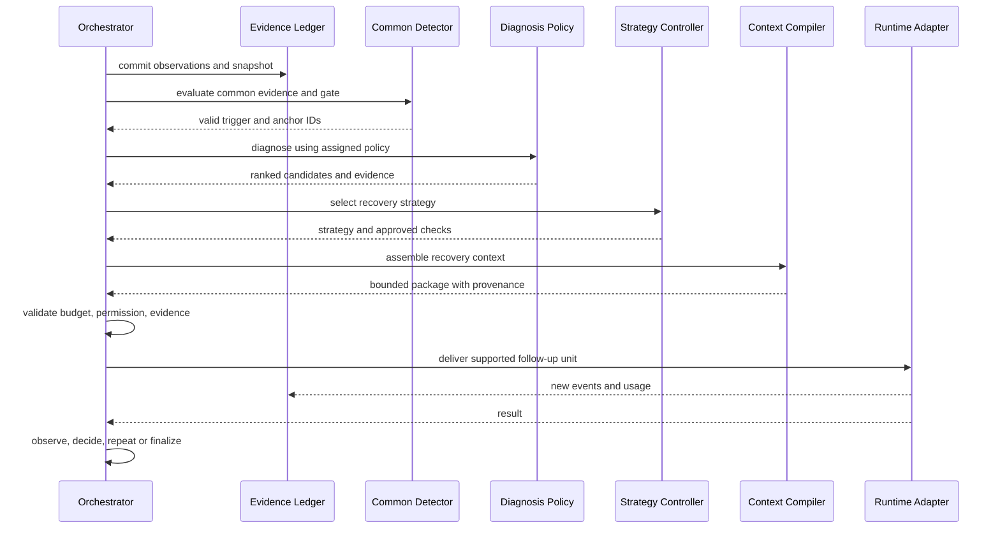
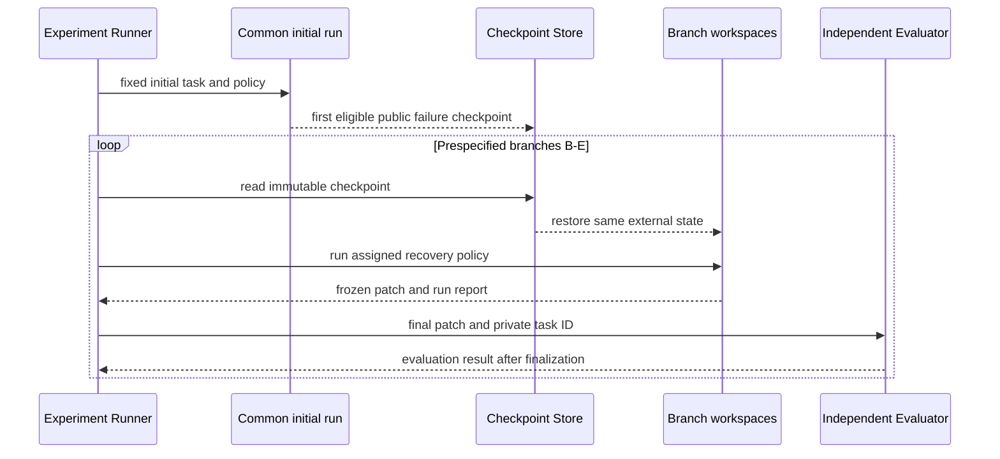
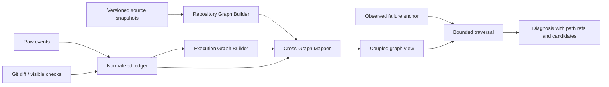
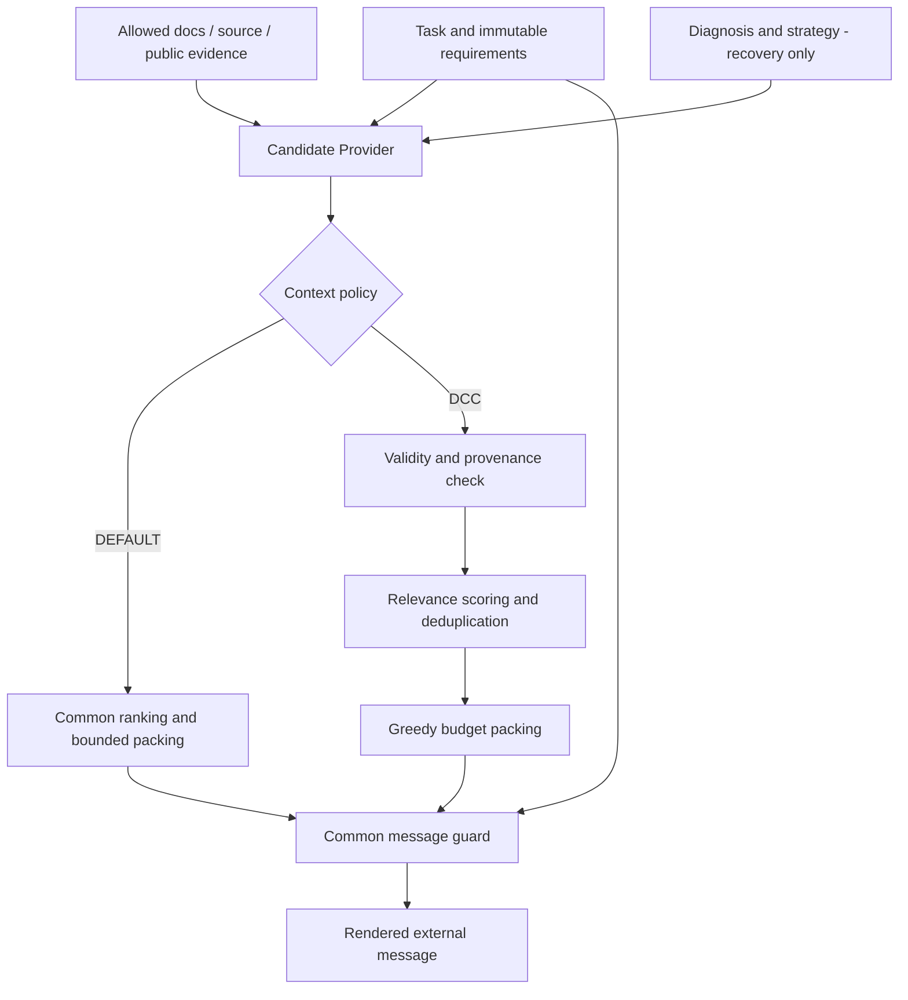

# Adaptive Agent Harness — 시스템 아키텍처 설계서

## 그래프 기반 실패 복구 및 동적 컨텍스트 최적화를 통한 코딩 에이전트의 신뢰성과 실행 효율 향상

**Adaptive Agent Harness: Graph-Guided Failure Recovery and Dynamic Context Optimization for Coding Agents**

| 항목 | 내용 |
| --- | --- |
| 프로젝트 | Adaptive Agent Harness (AAH, 가칭) |
| 수행 맥락 | 잇츠 스터디 5기 · Codex 기반 AI 코딩 에이전트 구축 |
| 문서 | `SYSTEM_ARCHITECTURE.md` |
| 버전 | v0.1.0 |
| 작성일 | 2026-11-24 |
| 상태 | 설계 초안 — 구현 및 런타임 기술 검증 전 |
| 상위 문서 | `RESEARCH_PROPOSAL.md`, `PROJECT_OVERVIEW.md`, `LITERATURE_REVIEW.md`, `METHODOLOGY.md` |
| 후속 문서 | `TECHNICAL_SPEC.md`, `EXPERIMENT_DESIGN.md`, `BENCHMARK_SPEC.md`, `EVALUATION_PROTOCOL.md`, `IMPLEMENTATION_PLAN.md` |

> 설계 목표: 공개 실행 증거를 바탕으로 Codex의 후속 실행 전략과 보조 컨텍스트를 선택적으로 변경하고, 그 효과를 공정하게 분리 검증할 수 있는 외부 실행 시스템을 구축한다.

---

## 1. 설계 목적과 범위

### 1.1. 시스템의 정체성

AAH는 새로운 코딩 모델이나 Codex 내부 엔진을 구현하는 프로젝트가 아니다. Codex가 이미 제공하는 코드 탐색·수정·테스트 능력을 유지하면서 외부에서 실행 상태를 관찰하고, 필요한 경우 실패 관련 증거와 복구 전략을 전달하는 단일 에이전트용 하네스다.

`METHODOLOGY.md`에서 정의한 공통 실패 감지, 평면/연결 그래프 진단, 복구 전략 선택, DCC 및 종료 정책을 독립적인 소프트웨어 모듈로 구현한다. 본 문서는 모듈 경계, 데이터 소유권, 제어 흐름, 실행 격리 및 장애 처리를 정의한다. 세부 알고리즘과 pilot 점수는 방법론을 따르고, 구체적인 클래스·함수 시그니처와 저장 스키마는 기술 명세서에서 확정한다.

### 1.2. 설계 원칙

| 원칙 | 아키텍처에 반영할 사항 |
| --- | --- |
| 문제 중심 | 엔지니어링 명칭이나 프레임워크 사용 자체를 목표로 하지 않는다. |
| 모듈 분리 | 런타임, 관측, 감지, 진단, 전략, 컨텍스트 정책을 분리한다. |
| 정책 통제 | B–E는 같은 외부 제어 환경에서 두 핵심 정책만 교체한다. |
| 관측 가능성 | 공개 증거 및 추정 상태를 구분하고 선택 이유를 추적할 수 있어야 한다. |
| 실패 안전성 | 근거 부족, 한도 도달, 취소 및 장애 시 안전한 fallback 또는 종료가 가능해야 한다. |
| 격리 | 원본 저장소와 평가 자료를 보호하고 실행별 상태를 독립시킨다. |
| 최소 구현 | 단일 프로세스 상태 머신과 로컬 데이터 저장을 우선한다. |

### 1.3. 범위

MVP는 Python 저장소의 테스트 가능한 버그 수정, 단일 Codex 런타임, 초기 및 복구 DCC, 이중 그래프의 연결, 공통 감지 및 턴 경계 복구, CLI와 독립 평가로 제한한다. 실시간 대시보드, 동적 워크플로 재배선, 멀티에이전트, 분산 실행 인프라, 강화학습 및 장기 메모리는 필수 범위에서 제외한다. 그래프 및 반복 구조는 필요한 곳에만 도입한다.

## 2. 시스템 컨텍스트와 경계



| 경계 | 책임 | 금지 사항 |
| --- | --- | --- |
| 사용자/CLI | 요청, 대상 저장소, 승인 검사, 설정 제출 | 승인되지 않은 권한 확대 |
| 하네스 제어부 | 실행 상태, 정책 선택, 예산, 로그, 종료 관리 | hidden test 참조, 모델 내부 상태 추정 |
| 에이전트 작업 환경 | 지정 작업 트리와 허용 도구에서 작업 | 원본 저장소 수정, 평가 자료 접근, 원격 자동 배포 |
| 독립 평가 환경 | 고정된 최종 패치를 깨끗한 기준 환경에 적용해 판정 | 실행 중 평가 결과를 에이전트나 복구 정책에 전달 |
| 분석/보고 환경 | 완료된 실행의 지표와 근거를 읽고 집계 | 원시 실행 기록을 소급 수정 |

일반 사용자 모드에는 독립 평가 자료가 없다. 사용자에게 공개 검사와 패치, 제한 및 경고를 반환한다. 연구 모드는 별도 실험 실행기와 평가기를 통해 최종 성능을 측정한다. 독립 평가기는 제어 흐름의 끝에서만 접근 가능하도록 설계한다.

## 3. 논리 아키텍처



그림은 논리 데이터 흐름이며 모든 노드가 동시에 실행된다는 뜻은 아니다. Workflow Orchestrator가 각 단계의 실행 시점을 결정한다. 초기 컨텍스트 구성은 실패 진단 없이 Candidate Provider와 Packer를 사용하며, 정상 진행 경로는 복구 컨텍스트 구성 노드를 거치지 않는다. 그래프 활성 조건에서만 그래프를 구축하고 갱신한다.

### 3.1. 엔지니어링 개념의 실제 위치

| 개념 | 구현상의 위치 |
| --- | --- |
| Harness Engineering | 전체 실행 환경, runtime adapter, workspace, 예산, 관측 및 평가 |
| Graph Engineering | 저장소·실행 증거 그래프, 연결, 실패 앵커 탐색과 제어 워크플로 |
| Context Engineering | Candidate Provider, 기본 패키징/DCC 및 외부 보조 정보 구성 |
| Loop Engineering | 관찰·검증·개입·재실행·종료의 피드백 제어 |
| Prompt Engineering | 선택된 전략과 증거의 일관된 메시지 렌더링 |

이 분류는 본 시스템의 설계상 관계다. 모든 개념에 대해 별도 독창성이나 성능 효과를 주장하지 않는다. 핵심 연구 정책은 그래프 기반 진단·전략과 컨텍스트 최적화이며 나머지는 이를 실행하기 위한 구조다.

## 4. 모듈 책임 및 인터페이스 경계

아래 인터페이스 명칭은 설계안이며 실제 언어 수준 계약은 `TECHNICAL_SPEC.md`에서 고정한다. 정책 모듈은 가능한 한 명시적 입력에 대한 결정 함수로 구현하고, 외부 실행·파일 변경은 전담 모듈을 통한다.

| 모듈 | 책임 | 입력 → 출력 | 주요 기능 |
| --- | --- | --- | --- |
| CLI / Config Loader | 입력 검증, 설정 해석 및 사용자 보고 | 요청·설정 → RunRequest | F01, F11 |
| Workspace Manager | 초기 저장소 복제, 실행별 작업 공간, 패치 고정 | RepositoryRef → WorkspaceHandle / Snapshot | F01 |
| Budget Manager | 한도·잔여량·사용량 관리, 다음 실행 허용 | Limits / Usage → BudgetDecision | F01, F10 |
| Workflow Orchestrator | 상태 전이, 정책 분기, 정상/복구/종료 제어 | RunRequest + 상태 → RunReport | F01, F10 |
| Runtime Adapter | 공개 인터페이스 기반 Codex 실행과 이벤트 수집 | TurnRequest → TurnResult / Events | F01, F02 |
| Runtime Observer | 이벤트 정규화, diff, 공개 검사, snapshot 연결 | TurnResult + Workspace → ObservationBatch | F02 |
| Evidence Ledger | 관측 원본과 정규화 증거 관리 | ObservationBatch → EvidenceView | F02 |
| Repository Graph Builder | AST 및 정적 관계 추출 | Snapshot → RepositoryGraph | F04 |
| Execution Graph Builder | 실행 사건과 관계 관리 | EvidenceView → ExecutionGraph | F05 |
| Cross-Graph Mapper | 버전 있는 코드-실행 관계 구성 | 두 그래프 + 증거 → CoupledGraphView | F06 |
| Failure Detector / Gate | T1–T5 분류 및 공통 개입 조건 | EvidenceView + 상태 → Trigger / GateDecision | F07 |
| Flat Diagnoser | 공통 원천의 평면 검색 | Trigger + EvidenceView → Diagnosis | F08 |
| Graph Diagnoser | 제한 탐색, 후보 및 경로 근거 산출 | Trigger + CoupledGraphView → Diagnosis | F08 |
| Recovery Controller | 유형별 또는 일반 전략 선택 | Trigger + Diagnosis → Strategy | F08 |
| Candidate Provider | 허용 후보 및 최소 근거 수집 | Task + Snapshot + Diagnosis → Candidates | F03, F09 |
| Context Compiler | DEFAULT / DCC 정책으로 보조 정보 구성 | Candidates + Strategy + Cap → ContextPackage | F03, F09 |
| Message Renderer / Guard | 공통 메시지 형식, 고정 지침·예산 검증 | Task + Strategy + ContextPackage → TurnRequest | F03, F09 |
| Artifact Store / Reporter | 원시 기록, 증거, 정책 근거, 리포트 보존 | RunArtifacts → Report | F11 |
| Experiment Runner | 비교군별 초기화 및 체크포인트 분기 | ExperimentManifest → RunRefs | F12, F14 |
| Independent Evaluator | 최종 패치의 독립 판정 | FrozenPatch + PrivateSpec → EvaluationResult | F12 |
| Result Viewer | 실제 실행 기록의 읽기 전용 시각화 | Report / Graph artifacts → View | F13 |

### 4.1. 의존성 방향

- CLI와 Experiment Runner는 공통 실행 서비스를 호출한다. 연구용 조건 지정은 실행 정책으로 주입한다.
- Orchestrator는 런타임과 정책의 추상 계약에 의존하며 특정 SDK 이벤트 형식에 직접 의존하지 않는다.
- Detector는 공통 EvidenceView만 받는다. 그래프 전용 거리·경로·후보 정보를 받지 않는다.
- Flat Diagnoser와 Graph Diagnoser는 공통 Diagnosis 형식을 사용하되 그래프 파생 필드는 graph 정책에서만 생성된다.
- Context Compiler는 전달받은 증거를 선별할 뿐 코드 수정, 도구 실행 및 전략 ID 변경 권한을 가지지 않는다.
- Recovery Controller는 검증 계획과 행동 지침을 구성할 뿐 Codex 도구를 직접 실행하지 않는다.
- Evaluator 및 private fixture는 제어부의 import 가능한 서비스 또는 조회 가능한 파일로 연결하지 않는다. 실험 실행기에서 종료 후 별도 실행 경계로 호출한다.
- Reporter와 Viewer는 기록을 읽으며 실행 정책을 역으로 변경하지 않는다.

### 4.2. 정책 주입 구조



A는 외부 복구 없이 네이티브 실행을 따르는 참조 경로다. 측정과 격리, 최종 평가 등 공통 인프라는 사용하되 추가 보조 컨텍스트를 주입하지 않는다. B–E는 서로 다른 소프트웨어를 만드는 대신 같은 실행 코드에 고정된 정책 조합을 주입한다.

## 5. 실행 상태와 데이터 계약

### 5.1. 핵심 상태 객체

| 객체 | 주요 내용 | 생성/소유자 |
| --- | --- | --- |
| RunRequest | run ID, task, repo, fixed requirements, condition, config hash | CLI / Experiment Runner |
| RunState | phase, turn index, snapshot ref, ledger ref, remaining budget, last intervention | Orchestrator |
| RuntimeCapabilities | 이벤트/후속 턴/세션/취소/사용량 관측 지원 및 검증 결과 | Runtime Adapter |
| ObservationBatch | 이벤트 ID, 관측 유형, 공개 검사, diff, 누락 상태, usage | Observer |
| SnapshotRef | repository ID, snapshot ID, commit, content manifest | Workspace Manager |
| EvidenceView | 읽기 전용 원천 증거 및 provenance | Evidence Ledger |
| CoupledGraphView | 버전 있는 코드·실행 그래프, 연결, 구축 상태 | Graph Service |
| Trigger | T1–T5, anchor IDs, 검증 근거, 상태 | Failure Detector |
| Diagnosis | 원인 후보, 순위, 관련 증거 ID, 경로 참조(해당 시), 불확실성 | Diagnoser |
| Strategy | 전략 ID, 목표, 대상, 검증 계획, 선택 이유 | Recovery Controller |
| ContextPackage | 최소 근거, 보조 후보, 출처, 선택/제외 이유, 길이 및 추정 방식 | Context Compiler |
| TurnRequest / Result | 실행 단위 입력, 세션 참조, 종료 상태, 공개 결과, usage | Renderer / Runtime Adapter |
| FrozenPatch / RunReport | 고정 패치, 종료 이유, 공개 검사, 비용, 경고 | Finalizer / Reporter |
| EvaluationResult | 독립 기능·회귀·필수 제약 검사, 평가 환경 상태 | Independent Evaluator |

`RunState`는 제어 상태의 단일 진실 원천이며, 큰 원시 로그나 그래프 전체를 상태 객체에 복사하지 않고 참조 ID를 보관하는 설계를 권장한다. 모든 상태는 하나의 run에 속한다. 객체 필드명과 enum, 직렬화 형식은 후속 기술 명세서에서 결정한다.

### 5.2. 데이터 불변조건

1. run ID와 초기 저장소, 설정 해시는 실행 중 변경하지 않는다.
2. 이벤트 ID는 런타임 원천 및 실행 단위 안에서 식별 가능해야 한다. 중복 수집은 정책 전에 제거한다.
3. snapshot ID가 다른 코드 심볼은 동일한 현재 노드로 자동 병합하지 않는다.
4. 관측하지 못한 파일 접근·실패·사용량을 부재 또는 0으로 해석하지 않는다.
5. 필수 요구사항과 실행 권한은 컨텍스트 최적화의 대상이 아니다.
6. 종료된 패치는 이후 평가 및 보고의 고정 입력이다. 독립 평가 과정의 변경은 에이전트 작업 트리로 반환하지 않는다.

## 6. Workflow Graph: 제어 상태 머신



A는 INIT 이후 초기 외부 컨텍스트를 생략하고 RUN으로 진입한다. DECIDE에서 외부 개입 없이 런타임 완료/지속/종료만 판단한다. 위 다이어그램의 EVALUATE는 전체 실행 시스템의 논리 단계이며 구현상 별도 프로세스에서 실행한다.

| 상태 | 진입 작업 | 정상 출력 및 전이 | 오류/한도 처리 |
| --- | --- | --- | --- |
| INIT | 설정·권한·런타임·workspace 검증, 비용 계측 시작 | INITIAL_CONTEXT 또는 A의 RUN | 준비 실패 기록, FINALIZE |
| INITIAL_CONTEXT | 기본/DCC 초기 패키지, 메시지 검사 | RUN | 공통 최소 근거 fallback 또는 종료 |
| RUN | 지원 실행 단위 수행, 제한 적용 | OBSERVE | 가능한 결과와 오류를 수집 후 OBSERVE |
| OBSERVE | 이벤트·diff·snapshot·공개 검사·비용 정규화, 활성 그래프 갱신 | DECIDE | 누락 표시, 안전하지 않으면 종료 분류 |
| DECIDE | 안전/전역 한도 우선 검사, 공통 트리거 및 게이트 | DIAGNOSE / RUN / FINALIZE | 불확실한 트리거는 강제 개입하지 않음 |
| DIAGNOSE | 그래프 또는 평면 증거 검색 | SELECT_STRATEGY | 그래프 오류는 평면 fallback 가능 |
| SELECT_STRATEGY | 유형별 또는 일반 전략 구성 | RECOVERY_CONTEXT | CONTINUE / STOP 처리 |
| RECOVERY_CONTEXT | 후보 수집, 정책 적용, 메시지·잔여량 검사 | RUN | 최소 근거 부족 시 일반 복구/종료 |
| FINALIZE | 추가 실행 중단, 안전한 패치 고정, 로그 정리 | EVALUATE / REPORT | 패치 미확보 또는 로그 장애 명시 |
| EVALUATE | 연구 환경에서 독립 검증 | REPORT | 평가 환경 오류 별도 기록 |
| REPORT | 리포트 생성 및 보존 | 종료 | 일부 결과만 복구 가능하면 경고 |

### 6.1. 전이 우선순위 및 개입 회계

안전 중단과 전체 한도 도달이 최우선이다. 이후 T1–T4 및 공통 개입 게이트를 평가한다. Codex 완료 선언에 공개 필수 검사 실패가 남으면 T4에 의해 복구할 수 있다. 최대 개입 횟수에 도달하면 추가 복구 지침은 금지하고 안전하고 지원되는 정상 지속만 허용한다. 새로운 관측 없이 동일 체크포인트에서 반복 개입하지 않는다.

개입 결정, 패키지 준비, 런타임 전달 및 관측 결과를 구분해 기록한다. 방법론의 최대 복구 횟수는 유효 패키지가 준비되고 후속 실행이 예약된 시점에 소진시키는 방식으로 설계한다. 실제 전달 실패는 별도 기록하며 자동으로 기회를 환급하지 않는다. 준비 단계의 실패도 계산 비용과 상태 전이 한도에는 포함한다. 정확한 계수 규약은 기술·평가 명세에서 확정한다.

### 6.2. 정상 종료와 성공의 분리

Codex 완료 선언, 공개 검사 통과, 실행 종료, 독립 평가 성공은 별도 필드다. 한도 도달 시에도 보존된 패치가 있으면 독립 평가할 수 있으며, 평가 결과로 성공 여부를 판정한다. 패치가 없거나 안전하게 고정할 수 없는 경우 판정 가능 여부와 이유를 기록한다. 평가 결과는 다음 복구 턴으로 되돌리지 않는다.

## 7. 주요 실행 시퀀스

### 7.1. 최초 실행 및 정상 완료



그래프 활성 조건에서는 초기 저장소 그래프 구축과 관측 후 갱신을 수행하고 그 비용을 기록한다. 최초 보조 패키지의 후보 및 점수에는 해당 그래프 결과를 사용하지 않는다. A는 외부 패키지를 구성하지 않고 네이티브 실행을 사용한다.

### 7.2. 실패 감지 및 복구



복구 지침은 모델에 대한 후속 작업 요청이며 특정 내부 도구 호출이나 강제 경로 실행을 보장하지 않는다. `performed / not_observed / contradicted / unknown`을 관측 범위에 따라 기록하여 전략 선택과 실제 행동 변화를 구분한다.

### 7.3. 독립 평가 및 공통 실패 체크포인트



공통 체크포인트는 작업 트리(관련 untracked 파일 포함), 실행 이력, 공개 실패 앵커, 원래 요청, 필수 지침, 잔여 한도 및 고정된 환경 식별자를 보존한다. B–E 각 분기의 workspace는 복제 후 독립적으로 수정된다. 분기별 그래프는 같은 원천 증거로 재구축한다. 체크포인트를 만드는 초기 정책은 실험 전에 고정하며 hidden test 결과를 선택 조건으로 사용하지 않는다.

세션 복제가 실제로 검증되지 않으면 모든 분기를 동일한 외부 상태와 동일한 공통 이력 요약을 입력으로 하는 새 세션에서 시작한다. 체크포인트는 외부 관측 상태의 동일성을 제공할 뿐 비공개 모델 추론 상태의 동일성을 보장하지 않는다. 초기 비용은 별도 보존하고 end-to-end 실험과 복구 전용 실험의 집계 규약을 구분한다.

## 8. Codex Runtime Adapter 설계

### 8.1. 교체 가능한 런타임 경계

SDK 또는 CLI 중 pilot에서 실제 기능을 확인한 하나를 MVP 기본 구현으로 선택한다. 모든 비즈니스 정책은 정규화된 인터페이스에만 의존한다. 어댑터가 Codex의 네이티브 실행을 대체하거나 비공개 추론 데이터를 요구해서는 안 된다.

| 계약(개념적 이름) | 역할 | 지원 확인 사항 |
| --- | --- | --- |
| `probe_capabilities` | 버전 및 검증된 기능 상태 반환 | 공개 이벤트, 후속 실행, 취소, 사용량 |
| `open_run` | 실행별 환경 및 세션 참조 준비 | cwd, 인증, 모델·설정 고정 |
| `run_unit` | 지원되는 한 실행 단위 수행 | 요청 전달, 이벤트 수집, 종료 분류 |
| `continue_unit` | 네이티브 지속 또는 외부 후속 메시지 전달 | 동일 세션 지원 여부 및 실제 전달 의미 |
| `cancel` | 지원되는 취소 또는 프로세스 정리 시도 | 취소 확인, 자식 프로세스 종료 |
| `close_run` | 세션·프로세스·임시 자원 정리 | 정리 결과 및 잔존 자원 |

이 명칭들은 프로젝트 자체의 인터페이스 제안이며 공식 Codex SDK의 메서드명 또는 실제 지원 계약을 의미하지 않는다. 미지원 기능은 조용히 성공 처리하지 않는다.

### 8.2. 세션 정책

| 모드 | 조건 | 처리 |
| --- | --- | --- |
| SAME_SESSION | 동일 세션의 후속 실행 전달과 로그 연계가 검증됨 | 세션을 유지하고 후속 지침을 전달 |
| NEW_SESSION | 동일 세션 유지 불가, 새 실행은 가능 | 공통 외부 이력 요약과 현재 작업 트리 제공 |
| POST_COMPLETION | 지원 실행 단위가 작업 종료까지임 | 종료 후 재실행으로만 복구 |
| UNSUPPORTED | 안전한 실행이나 필수 관측/복구 불가 | 해당 기능의 구현 검증 실패를 기록하고 범위 재검토 |

SAME_SESSION/NEW_SESSION은 상태 유지 방식이고 POST_COMPLETION은 개입 시점의 제한이다. 실제 설정에서는 별개의 capability로 표현할 수 있다. B–E에서 세션 유지 및 이력 구성 방식을 동일하게 고정한다. 비교 중 조건별로 유리한 세션 전략으로 자동 전환하지 않는다. 자연스러운 네이티브 지속이 지원되지 않으면 불필요한 후속 요청을 만들어내지 않는다.

### 8.3. 이벤트 정규화

- 원시 이벤트를 출처별로 보존하고 어댑터에서 공통 이벤트로 변환한다.
- 모르는 이벤트 종류는 UNKNOWN으로 기록하며 알려진 행동으로 강제 변환하지 않는다.
- 원시 메시지의 경로 및 명령이 실제 읽기·쓰기 수행의 증거인지 구별한다.
- 명령 출력, 종료 코드, 공개 검사 결과 및 테스트 실행 환경을 구분한다.
- 사용량 값이 누적치인지 단위별 증가량인지 pilot에서 확인한 뒤 중복 합산을 방지한다.
- 런타임 이벤트 순서가 불명확하면 수신 순서와 원천 순서를 구분하고 인과 관계를 추정하지 않는다.

### 8.4. 기술 검증 게이트

본실험 전에 최소 한 과제에서 실제 실행 이벤트 기록, Git diff 확인, 실패 이후 후속 지침 전달, 공개 검사 및 종료 보고가 연결되어야 한다. 다음 기능을 검증하지 못한 상태로 지원한다고 기술하지 않는다.

| 검증 ID | 확인할 사항 | 실패 시 조치 |
| --- | --- | --- |
| RT01 | 고정 모델·추론 설정과 런타임 버전으로 실행 | 유효한 런타임 후보 선정 |
| RT02 | 이벤트·결과·사용량 관측 범위 | 미관측 필드 및 대체 계측 기록 |
| RT03 | 동일 세션 또는 새 세션 후속 실행 | 공통 세션 정책 선정, 필요하면 완료 후 복구로 제한 |
| RT04 | 취소·시간 제한·자식 프로세스 정리 | 안전한 외부 격리 없이는 실행 금지 |
| RT05 | 필수 지침 자동 로딩·권한·작업 위치 일치 | 공통 로딩 정책 고정, 우회 접근 차단 |
| RT06 | 공개 검사 및 독립 평가 자료 분리 | 해결 전 실험 시작 금지 |
| RT07 | 토큰 측정·추정 및 상한 강제 범위 | 시간·턴 상한 사용 및 실제 토큰은 관측 지표로 보고 |

## 9. 그래프 및 증거 서브시스템

### 9.1. 원천에서 그래프로의 데이터 흐름



Repository Graph는 `FILE`, `FUNCTION`, `CLASS`, `TEST_FUNCTION`을 기본 노드로 사용한다. `CONTAINS`, `IMPORTS`, `CALLS`, `INHERITS`, `TESTS` 관계는 방법론 §5의 근거 및 해석 범위를 따른다. AST 파싱 실패 시 파일 노드는 보존하고 관계 추출 실패를 기록한다.

Execution Graph는 `SEARCH / FILE_ACCESS`, `COMMAND`, `CHANGE`, `TEST`, `FAILURE`, `INTERVENTION` 및 `NEXT`, `RETURNS`, `RETRIES`, `OBSERVED_AFTER`, `SAME_FAILURE_AS`를 방법론 §6에 따라 관리한다. 코드 연결은 `READS`, `CHANGES`, `TESTS_TARGET`, `FAILS_AT`, `SUSPECTS`로 표현하되 `SUSPECTS`는 파생 후보로만 보존하고 기본 탐색에서 제외한다.

### 9.2. 버전 관리 및 갱신 경계

| 시점 | 데이터 처리 |
| --- | --- |
| 최초 준비 | 초기 commit 및 관련 파일 manifest 고정; 활성 그래프만 구축 |
| 실행 단위 종료 | 작업 트리 스냅샷과 diff 확보, 원시 이벤트 정규화 |
| 관측 확정 | ledger 배치 저장 후 그래프 갱신, 구축 상태 기록 |
| 실패 진단 | 현재 snapshot 및 앵커와 일치하는 읽기 전용 그래프 사용 |
| 복구 실행 이후 | 새로운 이벤트 및 코드 버전 추가, 이전 증거는 역사 데이터로 보존 |
| 종료 | 분석에 필요한 그래프·경로·근거 참조 보존 |

그래프 갱신은 ledger와 snapshot 확정 이후 수행한다. 업데이트 도중 일부 실패하면 `partial` 또는 `unavailable` 상태를 명시한다. 이전 스냅샷의 완전한 그래프를 현재 그래프인 것처럼 전달하지 않는다. 턴 내부 특정 시점의 코드 버전이 불명확하면 `snapshot_unknown` 또는 전후 구간을 유지한다.

MVP는 작은 저장소에서 전체 AST 재구축 및 그래프 로컬 저장을 우선한다. 증분 갱신은 전체 재구축과 관계 결과를 비교하는 테스트가 확보되고 병목이 확인된 경우에만 확장한다. 기본 구현에서 그래프 데이터베이스는 필요하지 않다.

### 9.3. 탐색 서비스 계약

Graph Diagnoser는 방법론의 제한 탐색을 수행하고 `Diagnosis`와 `DiagnosisTrace`를 반환한다. 진단에는 후보 ID, 현재 코드 위치, 근거 ID, 경로 방향 및 관계 유형, 점수, 탐색 제한 도달 여부와 불확실성이 포함된다. `DiagnosisTrace`는 보고 및 ablation 검증용으로 보존한다. 원인 후보의 순위는 실제 결함 원인의 확률이 아니다.

탐색 깊이, 분기, 방문 상태, top-k는 방법론 §15의 pilot 후보를 사용한다(각각 4, 20, 200, 8). 비용 기반 탐색이 제한에서 종료되면 불완전한 탐색임을 표시한다. 공통 평면 진단은 traceback, 실패 지문, 관련 로그 및 diff, BM25 등을 사용하며 동일한 원천 접근과 후보 수 상한을 유지한다.

## 10. 컨텍스트 및 복구 서브시스템

### 10.1. 공통 정보 흐름



DEFAULT는 보조 정보가 없는 정책이 아니다. 공통 최소 근거와 기본 검색 또는 진단 순위에 따라 동일한 상한에서 단순 패키징한다. DCC는 유효성·관련성·중복·예산을 고려한 추가 정책을 적용한다. 초기 B/D의 기본 검색은 일치해야 하며 C/E 초기 DCC도 같은 입력·설정을 사용한다. 그래프 정보는 초기 패키징에서 금지하고 복구 단계에서만 사용할 수 있다.

### 10.2. 정책 책임 분리

| 단계 | 결정 사항 | 하지 않는 사항 |
| --- | --- | --- |
| Detector | 공개 관측에서 T1–T5 및 앵커 식별 | 그래프 근접도 기반 트리거 생성 |
| Diagnosis | 관련 증거와 코드 후보 및 연결 경로 | 원인 확정, 코드 자동 수정 |
| Strategy Controller | `REVIEW_REGRESSION`, `RELOCALIZE`, `REFRESH_EVIDENCE`, `GENERIC_RETRY`, `CONTINUE`, `STOP` 선택 | 근거를 패키징하거나 권한 변경 |
| Candidate Provider | 현재/역사 원천과 진단 후보를 보조 정보로 구성 | hidden test 조회, 필수 지침을 보조로 이동 |
| Context Compiler | 보조 정보 선별 및 직렬화 크기 검증 | 전략 ID 변경, Codex 내부 이력 수정 |
| Message Guard | 공통 형식·필수 조건·예산·권한 검사 | 새 원인 후보 생성 |

구체적 전략을 뒷받침할 최소 근거가 보조 예산에 들어가지 않으면 compiler가 실패 상태를 반환하고 Orchestrator가 공통 fallback을 통해 일반 복구 전략을 재요청하거나 종료한다. 같은 상태의 무한 재패키징은 금지한다. 실제 런타임 전달 직전에 고정 요구사항과 승인된 검사 ID를 다시 검사한다.

### 10.3. 메시지 구성과 컨텍스트 상한

초기 및 복구 패키지는 공통 외부 메시지 렌더러를 사용한다. 복구의 경우 필수 요구사항, 원래 요청, 전략 ID·목표, 관측 실패와 이전 시도, 출처·버전이 있는 보조 근거, 가설 및 다음 공개 검사 순서로 구성한다. B–E의 메시지 역할과 형식을 동일하게 유지한다.

보조 컨텍스트 상한에는 출처 라벨, 구분자 및 전략 지침의 외부 추가 메시지 오버헤드를 포함한다. 초기·복구 각각 2,048 토큰은 방법론의 pilot 추정 상한이며 모델 전체 컨텍스트 길이나 전체 실행 토큰 한도와 다르다. 필수 지침과 요청은 별도 고정 영역이며 전체 실행 비용에는 포함된다. 실제 `AGENTS.md` 자동 로딩 및 중복 주입 여부는 런타임 기술 검증에서 확인한다.

## 11. 실험 환경 및 비교군 격리

### 11.1. 정책 매핑

| 조건 | 최초 외부 컨텍스트 | 외부 감지/개입 | 복구 진단 | 복구 전략 | 복구 패키징 |
| --- | --- | --- | --- | --- | --- | --- |
| A Vanilla Codex | 없음 | 없음 | 없음 | 네이티브 | 네이티브 |
| B Flat Retry | DEFAULT | 공통 | Flat | GENERIC_RETRY | DEFAULT |
| C Context-only | DCC | 공통 | Flat | GENERIC_RETRY | DCC |
| D Graph-only | DEFAULT | 공통 | Graph | Typed / fallback | DEFAULT |
| E Adaptive Agent Harness | DCC | 공통 | Graph | Typed / fallback | DCC |

A의 관측 로그 및 최종 평가를 위한 공통 측정은 허용되지만 외부 복구 개입은 금지한다. B–E는 같은 실패 감지 규칙과 게이트, 승인 검사 및 실행 기회를 적용한다. 같은 원천 코드와 문서, 공개 로그를 사용할 수 있어야 하며 정책별 파생 정보만 다르게 한다. 그래프 비활성 조건은 graph service를 실행 정책에 연결하지 않는다. 분석용 그래프가 필요하면 실행 종료 후 별도 생성하고 방법별 실행 비용과 구별한다.

### 11.2. 정책 오염 방지 테스트

| 테스트 | 검증 사항 |
| --- | --- |
| Initial parity | 같은 최초 상태에서 B/D 및 C/E의 초기 보조 패키지 동일 |
| Trigger parity | 같은 ledger·검사·상태에서 B–E 트리거 및 앵커 동일 |
| No graph leakage | B/C가 graph 거리, 경로, 파생 후보 및 유형별 전략을 받지 않음 |
| No DCC leakage | B/D가 DCC 전용 유효성 점수·중복 제거·한계 효용 패킹을 사용하지 않음 |
| Baseline isolation | A에 외부 초기 패키지 및 복구 지침이 전달되지 않음 |
| Evidence parity | 비교군에서 원천 접근 및 허용 검사 범위 일치 |
| Evaluation isolation | 모든 실행의 정책에 hidden test 및 최종 판정이 유입되지 않음 |
| Budget parity | B–E의 공통 한도·세션 정책 및 복구 기회 일치 |

### 11.3. 구성 요소 제거 실험 확장 지점

`Unlinked`는 두 그래프를 사용하되 명시적 그래프 간 탐색을 제거하고 독립 시작점에서 후보를 검색·결합한다. 전략 분리 실험에서는 같은 그래프 진단과 DCC 패키지를 한 번 고정하여 일반형/유형별 전략 메시지만 교체한다. 이때 전략 텍스트 교체에 따른 전체 길이를 확인하고 양쪽이 공통 상한을 충족하도록 한다. 초기 DCC만 또는 복구 DCC만 적용하는 조건은 컨텍스트 정책을 단계별로 설정할 수 있게 한다.

이 확장 지점은 방법론 §13의 P1 실험을 지원하기 위한 설계다. 본실험에서 필요한 실제 과제 수와 우선순위는 `EXPERIMENT_DESIGN.md`에서 확정한다. 모든 ablation을 MVP 기능 완료 조건으로 요구하지 않는다.

## 12. 물리 구성, 저장 구조 및 모듈 배치

### 12.1. MVP 배포 구성

단일 로컬 Python 애플리케이션을 기본으로 한다. Orchestrator와 로컬 정책 모듈은 한 제어 프로세스에서 실행한다. Codex 런타임과 공개 검사는 제한된 작업 환경에서 수행하며, 독립 평가기는 별도의 권한 및 파일 접근 경계를 가진 실행 환경에서 수행한다. 독립 평가기는 평가 전용 입력을 받아 최종 결과만 반환한다.

| 영역 | 우선 기술 후보 | 도입 기준 |
| --- | --- | --- |
| Workflow | Python 상태 머신 | 조건부 전이 및 종료를 명확하게 구현 |
| Runtime | Codex SDK 또는 CLI | RT01–RT07 검증 결과로 선택 |
| Graph | AST, NetworkX | 로컬 타입 관계 구축 및 제한 탐색 |
| Context | BM25, 메타데이터, 규칙 및 greedy packing | 방법론에 정의한 기본 정책과 DCC 구현 |
| Workspace | Git 및 적절히 격리된 실행 환경(Docker 후보) | 원본 보호와 허용 범위 제한을 검증 |
| Persistence | JSONL, JSON, CSV | append 기반 기록 및 재현 가능한 결과 |
| Evaluation | pytest, 독립 검사 스크립트 | 평가 환경 및 테스트 격리 |
| Viewer | CLI, 정적 HTML 또는 Streamlit | 핵심 기능 완료 후 실제 기록 시각화 |

Git worktree 또는 임시 폴더만으로는 보안 격리가 보장되지 않는다. 접근 제어 및 실행 권한, 환경 변수, 네트워크 정책을 별도로 검증해야 한다. SQLite, LangGraph, 별도 API 서버 및 메시지 큐는 실제 필요가 확인되기 전까지 도입하지 않는다.

### 12.2. 저장소 모듈 배치안

```text
adaptive-agent-harness/
├── README.md
├── AGENTS.md
├── docs/
├── configs/
├── src/aah/
│   ├── cli/                 # 입력 및 사용자 명령
│   ├── domain/              # 공통 상태·계약·정책 열거형
│   ├── workflow/            # 상태 머신, 실행 조정, 예산
│   ├── runtime/             # Codex adapter와 observer
│   ├── workspace/           # 격리 준비, snapshot, patch
│   ├── evidence/            # 원천 로그 및 정규화 ledger
│   ├── graphs/              # repository, execution, mapping
│   ├── diagnosis/           # detector, gate, flat/graph diagnosis
│   ├── recovery/            # 전략 카탈로그 및 선택
│   ├── context/             # candidate, default, DCC, renderer
│   └── reporting/           # artifacts, run report
├── experiments/             # condition resolver, runner, checkpoint protocol
├── evaluation/              # 독립 평가 실행기 계약과 테스트
├── benchmarks/              # 공개 과제 및 개발용 fixture
├── analysis/                # 집계, 통계 및 선택적 viewer
├── tests/                   # 단위, 계약, 통합, 정책 격리 테스트
└── results/                 # 생성된 실행 자료 (기본 git 제외)
```

이 디렉터리 구조는 신규 설계안이다. 실제 패키지 구조는 기술 명세에서 확정한다. 평가기의 코드를 저장소에 둔다고 해도 정답 패치 및 private fixture를 에이전트 작업 환경에 복사하거나 마운트하지 않는다. 연구 대상 저장소와 AAH 구현 저장소는 별도 경계로 취급한다. 실제 private 자료는 평가 전용 경로와 접근 정책을 사용한다.

### 12.3. 실행 산출물의 논리 레이아웃

```text
results/<experiment-id>/<run-id>/
├── manifest.json            # 요청, 조건, 버전, 환경, 한도
├── events.raw.jsonl         # 런타임 원시 이벤트 (제한 접근)
├── evidence.jsonl           # 정규화 증거 및 관측 상태
├── transitions.jsonl        # 상태 전이 및 이유
├── snapshots/               # manifest, diff 및 복원 참조
├── graphs/                  # 활성 조건의 버전 그래프와 경로 trace
├── interventions.jsonl      # 트리거, 전략, 전달 여부, fallback
├── context.jsonl            # 후보, 선택·제외 이유, 길이
├── usage.jsonl              # 단계별 사용량 및 시간
├── final.patch              # 고정 최종 패치
└── report.json              # 공개 결과 및 종료 상태
```

독립 평가 자료와 결과는 위 에이전트 접근용 경계 밖의 별도 디렉터리에서 보존한다. 실제 경로, 로그 스키마, 압축 및 보존 기간은 기술 명세서에서 확정한다. 보고서에는 자격 증명, 개인정보 또는 민감한 원시 데이터를 그대로 포함하지 않는다.

### 12.4. 기록 일관성과 재현성

- 실행마다 별도 ID와 저장 경로를 사용하고 실패 실행도 보존한다.
- 로그는 append-only를 기본으로 하고 필요한 수정은 원래 기록을 덮어쓰지 않는 정정 이벤트로 남긴다.
- 주요 manifest와 최종 패치는 임시 파일을 거쳐 원자적으로 확정하는 방식을 권장한다. 비정상 종료 시 incomplete 표시를 남긴다.
- 그래프와 컨텍스트 기록은 원천 event ID 및 snapshot ID로 연결하고 정책·설정 해시를 기록한다.
- 원시 로그와 공유 가능한 비식별 산출물을 분리한다. 정리 정책으로 복구와 재현에 필요한 자료를 실수로 삭제하지 않도록 검토한다.
- 중단된 실행의 재개 기능은 MVP에서 보장하지 않는다. 재실행은 새 run ID와 초기 상태를 사용하며 이전 실행의 결과를 대체하지 않는다.

## 13. 예산, 실행 제한 및 계측

Budget Manager는 실제 강제 가능한 한도와 단순 측정값을 구분한다. 전체 시간은 작업 준비의 비용 측정 시작부터 패치 고정까지 공통 경계를 적용하고, 별도 평가기의 시간과 보고서 생성 시간은 단계별로 기록한다. 최종 통계에 포함할 구체적인 시간 경계는 평가 프로토콜에서 확정한다. 그래프 구축·갱신·탐색, DCC 계산 및 fallback도 방법별 전체 실행 비용에서 빠뜨리지 않는다.

| 자원 | 제한 또는 기록 방식 |
| --- | --- |
| Wall-clock | 공통 종료 시한 및 안전 정리 시간 확보; 실제 초과 기록 |
| 실행 단위/턴 | 실제 지원 단위 기준의 공통 상한 |
| 복구 개입 | B–E 공통 상한, pilot 후보 2회 |
| 상태 전이 | 런타임 호출 없는 내부 순환까지 제한하는 안전 한도 (값은 기술 검증 후 결정) |
| 보조 정보 | 초기·복구 각 2,048 추정 토큰의 pilot 상한 |
| 모델 토큰 | 계측 및 강제 지원 범위 확인; 미관측은 결측 |
| 그래프 탐색 | 방법론의 깊이·분기·방문 상한 적용 |
| 비용 | 모델 실행과 추가 호출, 로컬 처리, 실제 과금과 추정액 분리 |

다음 실행이나 그래프 작업을 시작하기 전에 잔여 예산을 확인하고, 실행 중 실제 사용량을 갱신한다. 토큰 제한을 정확히 강제할 수 없으면 시간·턴을 공통 강제 한도로 사용한다. 제한 초과가 관측되면 숨기지 않고 실험 결과에 표시한다. 정상 종료에도 최종 기록을 위해 필요한 시간을 확보하되 방법별 한도 규칙을 다르게 적용하지 않는다.

## 14. 장애 처리 및 안전한 종료

| 장애 또는 상태 | 처리 정책 | 기록/결과 |
| --- | --- | --- |
| 잘못된 설정 또는 미승인 작업 경로 | 실행하지 않고 입력 오류 반환 | 준비 실패, 원인 |
| 인증/연결 실패 | 제한된 정리 후 종료 | runtime 장애, 관측 비용 |
| 미지원 이벤트·파싱 실패 | raw 보존, unknown 처리 | 계측 누락 |
| 파일/심볼 정적 분석 실패 | 파일 노드 유지, 부분 그래프 또는 flat fallback | 파싱 오류 및 fallback |
| 버전 불일치 | 역사 정보로 보존, 현재 사실로 사용 금지 | stale/uncertain 표시 |
| 실패 근거 부족 | 구체 전략 강제 금지; 공통 게이트에 따른 일반 재시도 또는 무개입 | 판단 근거 및 선택 |
| 최소 근거가 상한 초과 | 공통 fallback 또는 종료, 필수 지침 보존 | 패키징 실패 및 비용 |
| 후속 실행 미지원 | 검증된 대체 세션 정책 또는 종료 | 실제 지원 범위 |
| 전체 시간/턴 한도 | 추가 호출 중지, 가능한 취소·정리 | limit, 부분 패치 |
| 사용자가 취소 | 추가 실행 금지, 프로세스 및 workspace 정리 | canceled, 부분 관측 |
| 명령 종료 코드 비정상 | 검사 종류와 오류를 구분해 관측 | assertion/환경/unknown 구분 |
| 평가 환경 장애 | 에이전트 복구로 전달하지 않음 | independent evaluation error |
| 패치 고정·로그 저장 실패 | 성공으로 표시하지 않고 가능한 기록 반환 | artifact error / incomplete |

### 14.1. 종료 상태와 결과의 구분

종료 사유는 완료 선언, 전체 한도, 취소, 안전 위반, 실행 장애, 지속 불가 등으로 구분한다. 세부 enum은 기술 명세에서 확정한다. 이 사유와 공개 검사 판정, 평가기의 판정을 독립적으로 기록한다. 타임아웃 또는 에이전트 실패를 임의로 실험에서 제외하지 않으며, 플랫폼 및 인프라 오류의 재시도/제외 기준은 실험 전에 별도로 정의한다.

### 14.2. Fallback 정책의 공정성

그래프 활성 조건에서 부분 그래프 또는 진단 불가로 평면 전략에 전환하더라도 원래 배정된 실험군은 유지한다. DCC 처리 실패와 최소 근거 부족 시 적용하는 공통 fallback도 동일하게 기록한다. 런타임 연결 장애를 숨기기 위한 무제한 재시도는 금지하며, 외부 인프라 재시도와 모델 작업 복구를 다른 사건으로 집계한다. Fallback이 많다면 구현 가능성이나 정책의 한계 자체를 분석해야 한다.

## 15. 보안 및 평가 격리

### 15.1. 권한과 신뢰 경계

| 보호 대상 | 설계 요구사항 |
| --- | --- |
| 원본 저장소 | 실행별 복제본만 수정하고 원본 자동 변경 금지 |
| 인증 정보 | 필요한 최소 런타임에만 전달; 로그, 코드, 패키지에서 제외 |
| 파일 경로 | 정규화 및 허용 경계 검사; symlink 및 경로 탈출 방지 |
| 실행 명령 | 승인된 공개 검사 및 공통 도구 권한 유지; 외부 명령은 검증된 실행 환경에서만 수행 |
| 네트워크 | 필요한 모델 연결과 작업 환경의 네트워크 권한을 구분하고 검증 |
| 외부 정보 | 문서·로그·코드에 포함된 텍스트는 증거로만 취급, 권한 부여로 해석하지 않음 |
| 평가 자료 | private test, 정답 패치, 기준 결과를 에이전트·정책에서 접근 불가하게 유지 |
| 결과 변경 | 패치 검토와 실제 적용·commit·push는 사용자 승인 이후 별도 작업 |

필수 지침, 정책 및 도구 권한은 런타임이 제공하는 강제 수단으로 유지해야 한다. 프롬프트에 금지를 작성하는 것만으로 안전한 격리가 구현되었다고 판단하지 않는다. 평가 환경에서 실행하는 제출 패치도 신뢰되지 않은 코드이므로 독립 평가기 자체의 판정 파일·정답과 쓰기 권한을 분리하고 가능한 최소 권한을 적용한다.

### 15.2. 격리 검증

작업 환경에서 private fixture, 호스트 비밀정보, 원본 저장소 및 승인되지 않은 경로를 접근할 수 없는지 통합 테스트로 검증한다. 검사 명령 또는 diff가 외부 입력을 통해 권한을 우회하지 않는지도 확인한다. 실제 격리가 성립하지 않으면 해당 연구 실행을 시작하지 않는다. 모든 조건에서 동일한 제한을 적용한다.

## 16. 사용자 인터페이스 및 보고

기존 프로젝트 설명서의 CLI 인터페이스를 유지한다. 아래 명령은 설계 예시이며 아직 구현된 명령이 아니다.

```bash
adaptive-codex run \
  --repo ./my-project \
  --task "로그인 실패 횟수에 따른 계정 잠금 오류 수정" \
  --config configs/default.yaml
```

실험 실행기에는 과제 목록·조건·반복·예산의 manifest를 입력하고 결과를 자동 집계하는 인터페이스를 제공한다. 세부 명령어와 옵션은 기술 명세서에서 정의한다.

일반 사용자 리포트는 run ID, 고정 설정, 종료 이유, 패치 및 변경 파일, 공개 검사 상태, 개입 전략 및 근거, 보조 컨텍스트 크기, 관측 비용, 경고를 표시한다. 비교 시연은 동일한 실제 과제의 A–E 로그를 불러와 실행 경로와 공개/독립 평가 결과를 구분해서 보여 준다. 가상의 데이터로 시연하는 경우 이를 명시하며, 성능을 과장하지 않는다. 실시간 UI는 P1이고 정적 보고서로도 AC09를 충족할 수 있다.

## 17. 구현 순서와 통합 테스트

### 17.1. Vertical slice 우선

| 단계 | 구현 대상 | 완료 확인 |
| --- | --- | --- |
| S0 | Runtime probe, workspace, 공개 검사, 독립 평가 경계 | 한 과제의 실제 기본 실행과 패치 판정 |
| S1 | 공통 상태 머신, evidence ledger, 기본 패키징 및 일반 재시도 | A/B 경로, 종료 및 fallback 통합 검증 |
| S2 | 초기·복구 DCC 및 공통 메시지 guard | B/C 차이와 초기 정책 일치 검증 |
| S3 | 코드/실행 그래프, 연결, 그래프 진단과 유형별 전략 | D 경로에서 실패 앵커→후속 메시지 추적 |
| S4 | E 통합, 비교군 주입, 체크포인트 분기 및 계측 | 동일 과제에서 A–E 실행 가능, 독립 평가 분리 |
| S5 | 정책 고정, 결과 뷰어 및 가능한 ablation | 실제 로그 기반 시연 및 재현성 검증 |

그래프와 DCC의 개발은 공통 데이터 계약 합의 후 병행할 수 있다. 역할 분담은 프로젝트 설명서의 Runtime & Harness, Graph & Recovery, Context & Evaluation 제안과 연결한다. 세부 일정 및 담당자 확정은 구현 계획에서 수행한다.

### 17.2. 테스트 계층

| 계층 | 핵심 테스트 |
| --- | --- |
| 단위 | 지문 정규화, AST 추출, 연결 검증, 깊이 제한, DCC 예산, 전이 조건 |
| 계약 | mock adapter 이벤트, 상태·후보·전략 형식, unknown 및 오류 응답 |
| 통합 | 한 과제에서 최초 실행→관측→실패→후속 실행→종료 연결 |
| 정책 격리 | 초기 패키지 동일성, 공통 트리거, 그래프/DCC 유출 방지 |
| 장애 | 취소, runtime 오류, 그래프 부분 실패, 상한 초과, 관측 누락 |
| 보안 | 원본·private fixture 접근 차단 및 권한 불변 |
| 실험 | 동일 체크포인트 분기, 결과 보존, 조건·환경·한도 기록 |
| 실제 런타임 | mock이 아닌 Codex 실행 및 후속 지침 전달 (AC01, AC04) |

가짜 런타임과 고정 fixture는 제어 흐름 및 계약 테스트에 사용한다. 실제 런타임 테스트나 연구 성능 평가를 대체하지 않는다.

### 17.3. 상위 완료 기준 추적

| 아키텍처 확인 항목 | 프로젝트 기준 | 방법론 기준 |
| --- | --- | --- |
| 실제 실행, 초기 패키지 및 고정 요구 | AC01, AC02 | M01, M07, M08 |
| 버전 그래프, 증거와 제한 탐색 | AC03 | M02, M03, M04 |
| 트리거, 전략 및 후속 실행 | AC04 | M05, M07, M08 |
| 정상 종료와 장애 처리 | AC05, AC06 | M04, M09 |
| 사용 가능한 실행 보고서 | AC07 | M11 |
| 비교군 및 독립 평가 격리 | AC08 | M06, M10 |
| 실제 근거 기반 결과 설명 | AC09 | M11 |

## 18. 주요 설계 결정 및 미확정 사항

| 결정 | 채택한 방향 | 상태/이유 |
| --- | --- | --- |
| AD01 | 단일 Python 상태 머신 | 제안: 단순한 실행 경계, 외부 워크플로 프레임워크 불필요 |
| AD02 | 교체 가능한 Codex adapter | 제안: SDK/CLI 세부 차이를 정책에서 분리 |
| AD03 | 공통 ledger 후 그래프 구축 | 방법론 반영: 원천 관측 일치 및 공정한 비교 |
| AD04 | 그래프 활성 조건만 관계 계산 | 방법론 반영: 정책 누출과 비용 왜곡 방지 |
| AD05 | 초기 DCC에 그래프 정보 미사용 | 방법론 반영: 초기 정책 효과 분리 |
| AD06 | 독립된 진단·전략·패키징 | 선행연구 검토 반영: 구성요소별 효과 검증 |
| AD07 | 로컬 파일 기반 append 기록 | 제안: MVP 운영 단순화 |
| AD08 | 별도 독립 평가 실행 환경 | 필수: 평가 자료 및 피드백 유출 방지 |
| AD09 | 체크포인트 외부 상태 복제 | 내부 세션 복제는 지원 확인 전 전제하지 않음 |
| AD10 | 고정 워크플로의 조건부 경로 선택 | 동적 재배선 대신 문제 해결에 필요한 적응성에 집중 |

미확정 사항은 다음 문서 또는 기술 검증에서 결정한다.

| 항목 | 결정 시점 |
| --- | --- |
| SDK/CLI, 모델 ID, 실제 관측 단위·취소·사용량 | runtime pilot 후 기술 명세 확정 |
| 모듈별 구체 인터페이스·스키마·설정값 | `TECHNICAL_SPEC.md` |
| 실제 작업 환경 및 OS, 인증·네트워크 격리 | 기술 검증 및 기술 명세 |
| 시간·턴·복구 카운트의 정확한 경계 | 기술 명세 및 평가 프로토콜 |
| 실험 과제 수, 반복, 체크포인트 및 ablation 우선순위 | `EXPERIMENT_DESIGN.md`, `BENCHMARK_SPEC.md` |
| 지표 계산, 결측, 장애 판정 및 제외 기준 | `EVALUATION_PROTOCOL.md` |
| 역할, 세부 일정, 통합 순서와 완료 조건 | `IMPLEMENTATION_PLAN.md` |

## 19. 문서 추적성 및 한계

본 설계서는 현재 저장소에 제공된 상위 연구 문서를 직접 확인하여 작성했다. 새로운 외부 기술 문서 검증, 실제 Codex 연결, 소프트웨어 구현, 보안 테스트 및 성능 실험은 수행하지 않았다. 문서에 제안된 아키텍처는 확정된 제품의 현행 구조가 아니다.

| 근거 문서 | 참조 위치 | 반영 내용 |
| --- | --- | --- |
| `RESEARCH_PROPOSAL.md` | §3, §6, §8–10 | 연구 범위, 실행 구조, 비교군 및 CLI, 수행 계획 |
| `PROJECT_OVERVIEW.md` | §4–6, §10–12 | F01–F14, 사용자 경험, 비기능 요구, AC01–AC09 및 팀 협업 |
| `LITERATURE_REVIEW.md` | §5–7, §10 | 직접 중복 위험, 전략/정보 분리 실험, 기술 검증 범위 |
| `METHODOLOGY.md` | §2–11, §13–17 | 알고리즘, 그래프와 증거, 공통 감지, DCC, 상태 전이, 비교군, 계측, M01–M11 |

새롭게 제안한 항목은 모듈·데이터 객체 명칭, 상태 머신 세부 장애 분기, 물리 배치, 산출물 레이아웃, 기록 원칙, RT01–RT07 검증 게이트, AD01–AD10 결정 목록이다. 이들은 구현 편의성과 재현성을 위한 설계 후보로서 후속 기술 명세 및 pilot에서 조정할 수 있다. 기존 연구 방법론의 정책과 pilot 수치, 연구 질문 및 비교군을 임의로 변경하지 않는다.

---

**최종 아키텍처:** 공통 외부 실행 하네스 안에서 관측 상태를 수집하고, 실패가 발생하면 분리된 진단·전략·컨텍스트 정책을 적용하여 지원되는 후속 Codex 실행으로 연결한다. 모든 종료 결과와 비용을 보존하고 연구 모드에서만 독립 평가한다.

**설계의 우선순위:** 엔지니어링 개념의 수가 아니라, 최소한의 구현으로 실제 실행과 공정한 비교 실험을 끝까지 완성할 수 있는가.
