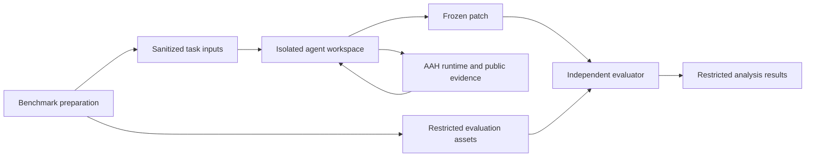
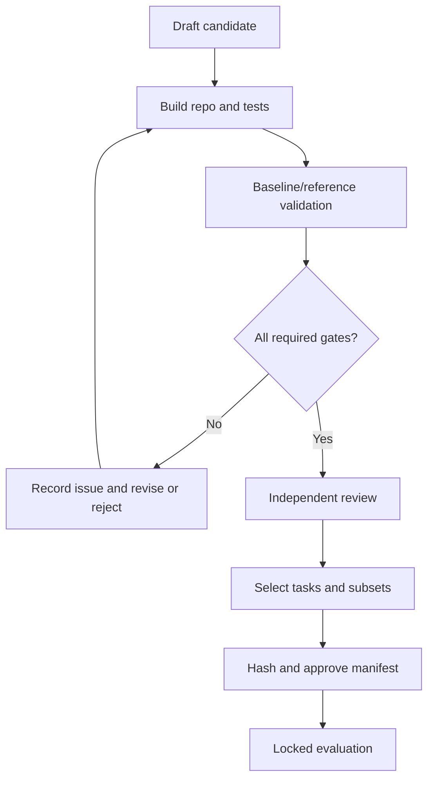

# Adaptive Agent Harness — 벤치마크 명세서 (Benchmark Specification)

## 그래프 기반 실패 복구 및 동적 컨텍스트 최적화를 통한 코딩 에이전트의 신뢰성과 실행 효율 향상

| 항목 | 내용 |
| --- | --- |
| 프로젝트 | Adaptive Agent Harness (AAH) |
| 수행 맥락 | 잇츠 스터디 5기 · Codex 기반 AI 코딩 에이전트 구축 |
| 작성일 | 2026-11-25 |
| 버전 | v0.1.0 |
| 상태 | 과제 설계 및 편입 기준 초안 — 데이터셋 미구축, 평가 집합 미동결 |
| 선행 문서 | RESEARCH_PROPOSAL.md, PROJECT_OVERVIEW.md, LITERATURE_REVIEW.md, METHODOLOGY.md, SYSTEM_ARCHITECTURE.md, TECHNICAL_SPEC.md, EXPERIMENT_DESIGN.md |
| 후속 문서 | EVALUATION_PROTOCOL.md, IMPLEMENTATION_PLAN.md |

> **목적:** 동일한 Codex가 서로 다른 외부 실행 정책에서 수행할 저장소 수준의 개발 과제를 정의하고, 작업의 정확성과 회귀 방지, 필수 지침 준수를 독립적으로 평가할 수 있는 재현 가능한 벤치마크를 구축한다.

본 문서는 벤치마크의 구성 및 품질 계약을 정의한다. 실제 과제 저장소, 정답 패치, hidden test 및 공개 데이터셋 인스턴스는 아직 생성하거나 실행 검증하지 않았다. 아래 AAH 자체 과제 ID와 저장소 이름은 구현을 위한 예약 식별자이며, 공개 과제 슬롯 역시 실제 upstream instance ID가 아니다. 평가 편입은 검증 후 동결 절차에 따른다.

---

## 1. 설계 목적 및 원칙

### 1.1. 무엇을 평가하는가?

| 연구 대상 | 벤치마크에서 필요한 조건 | 관측 대상 |
| --- | --- | --- |
| 초기 DCC | 필수 지침과 선별 가능한 보조 문서가 함께 존재 | 성공률, 지침 준수, 전체 비용 |
| 복구 DCC | 오류, diff, 이전 시도와 현재 코드 증거가 존재할 수 있는 작업 | 복구율, 선택된 정보와 사용량 |
| Graph 기반 복구 | 코드 의존성 및 공개 실행 증거로 분석 가능한 저장소 | 복구율, 관계 탐색 및 행동 변화 |
| 전략 선택 | 단일 오류 원인 외에도 여러 탐색 경로가 가능한 작업 | 동일 증거에 대한 복구 전략의 효과 |
| 통합 하네스 | 정상 성공부터 정체·실패·종료까지 실제 실행 | 전체 성공률, 비용, 부작용 |

평가 대상은 모델의 새로운 코딩 능력이 아니라 외부 정책의 효과다. 하네스에 유리한 실패를 강제로 만드는 것을 목표로 하지 않는다. 정상 문서와 단순 과제도 포함하여 개입이 불필요한 상황에서의 비용을 평가한다.

### 1.2. 설계 원칙

1. **동일 원천 접근:** A–E 모두 같은 작업 요청, 초기 저장소, 필수 지침, 원본 보조 문서와 허용된 도구를 사용한다. 선택된 외부 보조 정보만 정책에 따라 다르다.
2. **행동 기반 정답:** 특정 코드 문자열이나 참조 패치 일치가 아니라 요구된 동작과 기존 기능의 보존을 검증한다.
3. **독립 평가:** 실제 정답 패치 및 private tests는 에이전트, DCC, 그래프 구축기와 실행 제어부에서 접근할 수 없다.
4. **사전 고정:** 과제 목록, 문서 상태, 테스트와 검증 환경은 평가 결과 열람 전에 동결한다.
5. **자연 실패 우선:** 공통 실패 체크포인트는 자연 실행에서 확보하며 인위적 replay/주입과 구별한다.
6. **현실적 다양성:** 자체 과제와 공개 소프트웨어 이슈를 구분하고 과제·저장소 간 상관성을 기록한다.
7. **검증 우선:** 통과한 참조 패치 하나가 과제 타당성을 완전히 보장하지 않는다. 대안 구현 가능성과 테스트 강건성도 확인한다.

## 2. 벤치마크 구성과 실험 연계

### 2.1. 집합 정의

`EXPERIMENT_DESIGN.md` §5, §7–9의 구성 및 규모를 계승한다.

| 집합 | 규모 후보 | 목적 | 본실험 분모 |
| --- | ---: | --- | --- |
| Smoke | 1–2개 | 환경·런타임·평가 연결 확인 | 제외 |
| Dev/Pilot | 5–8개 | DCC/감지/복구 정책 및 예산 조정 | 제외 |
| Main | 20–24개 | A–E End-to-end 비교 | 포함 |
| Checkpoint | 최대 24개 source 시도에서 12개 적격 상태 목표(Full) | B–E 공통 실패 분기 | 별도 |
| Ablation | 사전 지정 부분집합, P1 목표 8개 과제 또는 체크포인트/항목 | 세부 메커니즘 효과 | 별도 |
| Demo | Dev 또는 별도 시연용 과제 | 재현 가능한 설명 및 시연 | 제외 |

Smoke가 Dev의 일부인 것은 허용한다. Main과 Checkpoint의 underlying task가 겹치면 결과를 독립 표본으로 합산하지 않는다. Demo는 본실험의 유리한 결과를 보고 과제를 교체하는 수단으로 사용하지 않는다. Main 사례를 사후 설명 자료로 사용할 경우 선택 근거와 전체 결과를 함께 제시한다.

### 2.2. Main Full 계획

| 대표 과제 유형 | 자체 신규 | 공개 후보 | 합계 |
| --- | ---: | ---: | ---: |
| SINGLE — 단일 파일 버그 | 4 | 2 | 6 |
| DEPENDENCY — 파일 간 의존성 버그 | 4 | 2 | 6 |
| REGRESSION — 회귀 위험 수정 | 4 | 2 | 6 |
| COMPOSITE — 복합 수정 | 4 | 2 | 6 |
| 합계 | 16 | 8 | 24 |

24개 × 5조건 × 2회 = 240 E2E runs. 반복은 독립 과제 수를 늘리지 않는다. 체크포인트 source 및 분기, ablation, pilot은 별도 실행이다. 기존 실험설계의 200회 Core, 120회 Reduced, 40회 Emergency 대안을 유지한다.

### 2.3. 문서 상태 배분

Main Full의 잠정 목표는 정상 12, 중복·무관 6, 명시적 구버전 6이다. 공개 과제의 상태를 임의로 조작해 목표에 맞추지 않는다. 아래는 공개 8개가 정상으로 검증되는 경우에만 성립하는 **자체 과제 설계안**이다.

| 상태 | 자체 계획 | 공개 예시 가정 | 합계 |
| --- | ---: | ---: | ---: |
| NORMAL | 4 | 8 | 12 |
| NOISY | 6 | 0 | 6 |
| STALE | 6 | 0 | 6 |
| 합계 | 16 | 8 | 24 |

공개 과제가 다른 상태로 분류되거나 판정할 수 없는 경우 UNKNOWN/MIXED 태그를 허용하고 실제 분포를 보고한다. 평가 전에만 배분을 조정할 수 있다. 공개 과제 교체 시에도 같은 원칙을 적용한다. 자체 과제의 상태와 버그의 유형·난이도가 혼재하므로 이 기본 집합만으로 문서 교란의 인과적 효과를 주장하지 않는다.

문서 상태의 순수 효과를 검증하려면 별도 paired variant 실험을 사전 계획한다. 동일 bug의 문서 변형은 같은 `task_family_id`로 묶고 분석에서 독립 표본으로 세지 않는다. 핵심 Main에는 family당 하나의 문서 버전을 우선한다.

### 2.4. 예산 축소용 과제 선택

새로운 제안: 24개 슬롯에서 대표 유형별 5개(Core), 3개(Reduced), 2개(Emergency)를 목표로 사전 선택한다. 공개 과제가 실제 준비된 경우 유형별 공개 슬롯을 최소 하나 유지하도록 노력하되 필수 조건으로 강제하지 않는다. 유형별 quota와 출처·문서 분포에 맞추어 사전 고정한 순서로 선택하고 결과를 기록한다. seed 후보는 실행설계와 동일한 20261125이지만 선택 seed와 실행 순서 seed는 별도 필드다.

축소안과 공개 대체는 Main 성능 관측 전에 결정한다. 예산 소진으로 동결 후 미실행이 발생하면 원래 manifest를 변경하지 않고 `NOT_RUN_BUDGET`으로 보고한다.

## 3. 과제 분류 체계

### 3.1. 대표 유형과 보조 태그

| 유형 | 조작적 정의 | 포함 예시 | 주의 |
| --- | --- | --- | --- |
| SINGLE | 요구 동작의 핵심 수정이 하나의 구현 파일/모듈에 국한될 수 있음 | 경계값, 파싱, 예외 처리 | 테스트 파일 수로 분류하지 않음 |
| DEPENDENCY | 서로 다른 구현 요소의 계약 또는 의존성을 이해해야 해결 가능 | 호출자와 저장층의 반환 규약, 상태 전달 | 실제 패치가 한 파일이어도 가능 |
| REGRESSION | 신규 동작과 기존 동작의 공존이 핵심이며 별도 회귀 검증이 존재 | 호환성, 기본 정책 유지 | 실제 실행에서 회귀가 관측된다는 뜻 아님 |
| COMPOSITE | 여러 요구 또는 경계를 동시에 만족해야 함 | 데이터 변환·저장·오류 처리 결합 | 무조건 대규모 과제로 만들지 않음 |

대표 유형은 하나만 기록하고 `tags`로 나머지 특성을 기록한다. 후보가 여러 유형에 걸치면 과제 요구와 참조 동작을 기준으로 COMPOSITE → REGRESSION → DEPENDENCY → SINGLE 순으로 검토하되, 다중 요구가 사실상 회귀 하나인 사례는 REGRESSION으로 분류할 수 있다. 분류 이유와 리뷰어를 기록한다. 정답 패치 파일 수만을 절대 기준으로 삼지 않는다.

### 3.2. 사전 난이도

난이도는 Codex의 실제 성공률을 사용하지 않고 평가 준비자가 사전 코딩 요구를 기준으로 부여한다. 아래 값은 신규 분류 제안이다.

| 차원 | 0 | 1 | 2 |
| --- | --- | --- | --- |
| 구조 범위 | 단일 함수/모듈 | 2–3개 관련 구현 요소 | 다중 계층 또는 4개 이상 요소 |
| 요구 복잡성 | 하나의 명확한 동작 | 동작+경계 또는 호환성 | 복수의 상호작용하는 요구 |
| 상태/검증 범위 | 순수 함수 중심 | 저장/상태/복수 테스트 | 여러 단계의 상태·통합 검증 |

합계 0–2: LOW, 3–4: MEDIUM, 5–6: HIGH로 잠정 분류한다. 평가 준비용 분류로서 모델 체감 난이도와 동일하지 않다. 관련 코드 위치, 참조 수정 내용 및 상세 평가 기준을 근거로 만든 메타데이터는 private 영역에만 보관한다. 실제 수행 결과 기반 난이도는 별도 사후 분석이며 과제 선정에 반영하지 않는다.

### 3.3. 실패 유형과의 관계

| 감지 ID | 자연 실행에서의 정의 | 벤치마크가 제공할 기회 |
| --- | --- | --- |
| T1 REPEATED_FAILURE | 비교 가능한 공개 검사에서 동일 실패 지문 반복 및 개선 없음 | 안정적인 test_id, assertion 또는 오류 지문 |
| T2 STAGNATION | 관측 가능한 탐색 반복과 새 증거·실질 진전 부족 | 현실적인 탐색 후보와 코드/문서 의존성 |
| T3 REGRESSION | 이전 PASS였던 비교 가능한 공개 검사가 FAIL | 기존 기능을 보호하는 공개 회귀 검사 |
| T4 INCOMPLETE_AT_DONE | 완료 선언 시 공개 필수 검사 실패 | 작업 완료를 판단할 공개 검사 |
| T5 | 불충분한 관측·검사 장애 등 방법론상 불확실 상태 | 오류 상태를 명확히 분리하는 실행기 |

T1–T4의 실제 발생 여부는 에이전트 행동에 달려 있다. 과제 설계 시 `hypothesized_trigger_ids`를 private 메타데이터에 기록할 수 있지만 실제 trigger ID를 대신하지 않는다. 실제 감지 임계값 및 gate는 `METHODOLOGY.md` §7과 동결된 설정을 따른다. 같은 버그에서 다른 유형의 실패가 발생하거나 아무런 실패 없이 성공할 수 있다.

## 4. 자체 신규 벤치마크: AAH-Suite (가칭)

### 4.1. 저장소 후보

새롭게 제안하는 소규모 Python 저장소 네 개다. 실제 공개 프로젝트가 아닌 팀이 직접 작성할 fixture다. 기능이 유사한 여러 복제 저장소를 만드는 대신 독립적인 도메인과 테스트를 구성한다.

| repo_id | 도메인 | 기능 구성 후보 |
| --- | --- | --- |
| R-AUTH | 계정·인증 | 로그인, 잠금, 세션, 정책, in-memory 저장 |
| R-ORDER | 주문·재고 | 주문 생성/변경, 할인, 재고 예약, 취소 |
| R-INGEST | 데이터 처리 | CSV/JSON 파싱, 스키마 정규화, 배치 수집, 결과 저장 |
| R-SCHED | 작업 스케줄링 | 작업 큐, 재시도, 시간 정책, 상태 기록 |

각 저장소는 Python 패키지 구조, README, 명시적인 사용자 계약, public tests와 보조 문서를 제공한다. 초기 권장 규모는 구현 파일 6–15개, 구현 코드 300–1,000 LOC 수준으로 검토한다. 이 수치는 신규 작업량 가이드이며 최소 품질 기준이나 강제 목표가 아니다. 표준 라이브러리와 pytest를 우선하고 외부 서비스, 실제 계정, 실제 개인 데이터는 사용하지 않는다. 시간/난수는 주입 가능한 clock/seed로 제어한다.

각 Main 과제는 다른 초기 커밋을 가진 독립 workspace에서 실행하며, 동일 저장소에서 다른 과제의 fix commit·참조 패치·hidden tests에 접근할 수 없어야 한다. 단순히 하나의 Git repo에서 checkout만 바꾸는 것으로 정답 격리를 보장하지 않는다. history에 다른 과제 정답이 포함될 수 있으므로 별도 sanitized snapshot/bundle을 사용한다.

### 4.2. 자체 Main 예약 과제 카탈로그

아래는 **구현 전 과제 명세 카드**다. 실제 문제 요청은 관찰 가능한 증상, 재현 조건, 원하는 동작과 필수 제약만 포함한다. 표의 코드 경계·예상 실패·검증 의도는 평가자용 설계이며 에이전트 입력으로 그대로 전달하지 않는다. 실제 테스트 ID·코드 위치·커밋은 구현 후 채운다.

| task_id | 저장소 | 대표 유형 | 문서 상태 | 사용자 요구 요약 | private 검증 설계 요약 |
| --- | --- | --- | --- | --- | --- |
| AAH-S01 | R-AUTH | SINGLE | NORMAL | 잠금 만료 시각과 정확히 일치하는 시점에 다시 로그인 가능하도록 수정 | 직전/정확한 경계/직후, 기존 유효 잠금 보존 |
| AAH-S02 | R-ORDER | SINGLE | NOISY | 소수 단가 주문의 합계 반올림 오차 수정 | 정해진 통화 반올림, 다수 수량, 0값 |
| AAH-S03 | R-INGEST | SINGLE | STALE | CSV의 빈 선택 필드와 숫자 0을 구분하여 보존 | null·빈값·0·잘못된 값의 명시된 계약 |
| AAH-S04 | R-SCHED | SINGLE | NOISY | 허용 재시도 횟수에서 한 번 더 실행되는 버그 수정 | 최초 시도 포함 여부, 상한 0/1/N, 성공 후 중단 |
| AAH-D01 | R-AUTH | DEPENDENCY | STALE | 비밀번호 변경 후 기존 세션이 무효화되도록 수정 | 여러 세션, 새 세션, 사용자 간 격리 |
| AAH-D02 | R-ORDER | DEPENDENCY | NORMAL | 주문 취소 후 예약 재고가 정확히 반환되도록 수정 | 취소 상태와 예약 저장층, 반복 취소 시 중복 반환 방지 |
| AAH-D03 | R-INGEST | DEPENDENCY | NOISY | 정규화된 레코드 ID가 중복 검사와 저장에서 일치하도록 수정 | 대소문자 등 명시된 정규화, 서로 다른 ID, 배치 간 중복 |
| AAH-D04 | R-SCHED | DEPENDENCY | STALE | 재시작 후에도 예정된 다음 실행 시각을 일관되게 복원 | 저장/복원, 지연 작업, 중복 큐 등록 방지 |
| AAH-R01 | R-AUTH | REGRESSION | NOISY | 성공 로그인 시 실패 카운터 초기화하되 활성 잠금은 해제하지 않음 | 일반 성공/실패, 활성 잠금과 관리자 해제 정책 보존 |
| AAH-R02 | R-ORDER | REGRESSION | STALE | 주문별 정액 할인 적용 시 기존 비율 할인 정책을 유지 | 기본 정책, 할인 합산 계약, 할인 상한 및 음수 방지 |
| AAH-R03 | R-INGEST | REGRESSION | NORMAL | 신규 날짜 형식 지원과 기존 형식·오류 처리 호환성 유지 | 신규/기존 입력, 경계 날짜, 잘못된 값 |
| AAH-R04 | R-SCHED | REGRESSION | NOISY | 재시도 지연을 조정하면서 우선순위 및 취소 동작 유지 | 동률 우선순위, 취소된 작업, 재시도 간격 |
| AAH-C01 | R-AUTH | COMPOSITE | STALE | 로그아웃 전체 세션 기능의 누락된 상태 갱신과 반복 호출 처리 수정 | 사용자별 세션, 반복 요청, 기존 단일 로그아웃 보존 |
| AAH-C02 | R-ORDER | COMPOSITE | NOISY | 여러 상품 주문에서 부분 실패가 발생하면 예약 및 주문 상태가 일관되게 유지되도록 수정 | 부분 실패, 재실행, 복수 상품, 성공 경로 |
| AAH-C03 | R-INGEST | COMPOSITE | STALE | 잘못된 레코드가 섞인 배치의 유효 레코드 보존 및 오류 보고 수정 | 복수 오류, 순서, 중복, 재시도 및 기존 입력 계약 |
| AAH-C04 | R-SCHED | COMPOSITE | NORMAL | 실패한 작업의 재시도·최종 실패 상태·재시작 복원을 일관되게 처리 | 성공 재시도, 상한 도달, 복원, 동일 작업 중복 실행 방지 |

총 16개: SINGLE/DEPENDENCY/REGRESSION/COMPOSITE 각각 4개, NORMAL 4개, NOISY 6개, STALE 6개. 저장소별 4개 과제다. 구체적인 시나리오와 규칙은 작성자·리뷰어가 모호성을 제거한 후 고정한다. 실제 기능 명세가 아직 없으므로 위 문구는 완성된 issue가 아니다. 예를 들어 AAH-S02의 통화 정밀도와 반올림 모드, AAH-S04의 재시도 정의는 사용자에게 공개할 계약에서 명시해야 한다.

### 4.3. 개발용 과제 예약안

Main과 underlying bug가 중복되지 않는 별도 fixture 또는 별도 저장소를 사용한다. 평가용 코드·정답이 개발 에이전트의 작업 지침이나 재사용 경험에 들어가지 않게 한다.

| task_id | 설계 후보 | 용도 |
| --- | --- | --- |
| DEV-01 | 소형 문자열 포매터의 공백 처리 버그 | Smoke, patch round-trip, 평가기 |
| DEV-02 | 간단한 캐시 만료 처리 | Smoke/공개 검사 및 snapshot |
| DEV-03 | 설정 로더와 소비자 사이의 타입 계약 | 그래프 구축 및 경로 매핑 |
| DEV-04 | 리포트 집계 중 누락 항목 및 기존 동작 보존 | 공개 회귀 검사 및 T3 replay |
| DEV-05 | 파일 변환 오류 처리 | DCC 유효성 및 문서 패키징 |
| DEV-06 | 작업 의존성과 중복 실행 방지 | 자연 체크포인트 탐색 |
| DEV-07 | 여러 정책의 우선순위 처리 | 선택적 복구 및 비용 검증 |
| DEV-08 | 설정 버전 마이그레이션 | 오래된 안내, fallback, 종료 테스트 |

Pilot 5–8개 선택은 평가 과제와 무관하게 진행한다. T1–T4의 강제 replay fixture는 정책 단위 테스트에 사용할 수 있지만 자연 실패율 통계에 포함하지 않는다.

## 5. 공개 벤치마크 선정

### 5.1. 후보 자료 검토 (2026-11-25)

| 후보 | 검토 이유 | 이번 연구에서의 제한 |
| --- | --- | --- |
| SWE-Bench Pro V2 [B1–B3] | 2026-09-22 개정 공개 집합, 공식 자료에 Python 과제 237개와 검증기/컨테이너 구성 제공 | 대규모·비용 높은 과제 가능성, 공식 locked protocol과 AAH 정책의 호환 검증 필요 |
| SWE-bench-Live (Python) [B4–B5] | 지속 갱신되는 실제 이슈 데이터 및 평가 도구 제공 | dataset revision을 고정해야 하며 최신 데이터도 학습 노출 없음이 보장되지 않음 |
| SWE-bench Lite / Verified [B6–B8] | Docker 기반 실행 및 기존 F2P/P2P 평가 계약 활용 가능 | Verified는 OpenAI가 테스트 품질·오염 문제를 지적하며 점수 보고를 중단한 집합; 보조 및 연동 검증에 한정 |

우선 Pro V2의 Python 과제를 검토하고, 환경 구축 또는 공개 검사 확보가 현실적으로 어렵다면 Live의 Python 과제를 검토한다. Lite/Verified는 간단한 환경 연동 및 제한적인 보조 평가의 예비 후보로 남긴다. 이 순서는 새 제안이며 실제 실행 가능성을 확인한 뒤 평가 전에 결정한다. 두 공개 데이터셋에서 비슷한 이슈를 중복 선정하지 않는다.

Pro V2의 공식 배포에는 reference solution과 verifier가 포함된 task 자료가 있으므로 그 전체 디렉터리를 에이전트에 마운트해서는 안 된다. AAH 자체 프로토콜과 공식 locked evaluation이 달라지는 경우 AAH의 비교 실험으로만 보고하며 공식 리더보드 점수나 전체 benchmark resolved rate라고 표시하지 않는다.

### 5.2. 공개 과제 편입 기준

| 항목 | 편입 조건 |
| --- | --- |
| 언어 | Python 구현이 핵심이며 AST 기반 그래프 적용 가능 |
| 문제 | 실제 이슈와 초기 코드 및 평가 계약이 존재 |
| 재현 | 고정 revision/image/환경에서 초기 상태 및 기준 패치 검증 가능 |
| 품질 | 기능 검증 실패→통과와 기존 기능 통과 유지 확인; 문제 설명이 요구 동작을 충분히 전달 |
| 공개 검사 | 기존 저장소 테스트 등 합법적으로 볼 수 있는 검사로 runtime 증거 확보 가능 |
| 격리 | gold/test patch, 미래 커밋 및 원격 정답 조회 차단 가능 |
| 비용 | pilot에서 확정한 공통 시간·자원 한도 및 이미지 구축 범위에 부합 |
| 권리 | 데이터·코드·이미지·테스트 이용 및 공개 범위 검토 |
| 독립성 | 자체/다른 공개 과제와 중복 issue/bug family가 아님 |

최초 실행에서 특정 모델이 실패해야 한다는 조건은 없다. 공개 검사를 hidden test에서 추출하거나 변형하여 만들지 않는다. 기존 테스트만으로 공개 실패 지문을 얻기 어려워도 유효한 E2E 과제일 수 있으나 이번 혼합 벤치마크에서는 관측 가능성을 사전 기록하고 checkpoint 후보 여부를 명시한다. 모든 공개 과제에 동일한 안전 및 평가 격리를 적용할 수 없다면 해당 과제를 편입하지 않는다.

### 5.3. 공개 슬롯 및 실제 instance 선택 절차

| 슬롯 | 대표 유형 | 우선 데이터셋 후보 | 상태 |
| --- | --- | --- | --- |
| PUB-S01, PUB-S02 | SINGLE | Pro V2 / Live | 실제 instance 미선정 |
| PUB-D01, PUB-D02 | DEPENDENCY | Pro V2 / Live | 실제 instance 미선정 |
| PUB-R01, PUB-R02 | REGRESSION | Pro V2 / Live | 실제 instance 미선정 |
| PUB-C01, PUB-C02 | COMPOSITE | Pro V2 / Live | 실제 instance 미선정 |

선정 절차:

1. 평가 준비 담당자가 공식 배포 revision, config/split, upstream instance ID, repo 및 commit을 기록한다.
2. Python 여부, 권리, 환경, 공개 검사 가용성, 테스트 타당성을 사전 기준으로 점검한다. 평가 담당자만 reference patch와 verifier에 접근한다.
3. 유형·난이도·문서 상태를 Codex 평가 결과 없이 태깅한다. 동일 family를 중복 제거한다.
4. 적격 후보를 유형별로 정렬한 후 고정 seed로 순서를 생성한다. 저장소 다양성 제약은 먼저 정의하고 선택 기록을 남긴다. 공개 슬롯당 대체 후보 순서도 기록한다.
5. 실제 환경과 정답 격리를 검증한 뒤 `task_manifest`에 ID를 바인딩한다. 편입 실패의 이유를 `candidate_registry`에 남긴다.
6. 8개 목표에 못 미치면 평가 전 동일 유형의 자체 신규 대체 과제로 충원하거나 실험 규모를 축소한다. 본실험 결과를 열람한 뒤에는 대체하지 않는다.

`PUB-*`는 AAH 내부 슬롯이다. upstream instance ID와 데이터셋 revision은 미확정이며 현재 문서에서 임의로 생성하지 않는다. 공개 source 선택 과정은 hidden test나 참조 patch를 모델에게 전달하는 작업과 분리한다.

### 5.4. 공개 자료 adapter

SWE-bench 계열은 issue/problem statement, 초기 저장소, instance identifier와 평가용 patch/tests를 구분하는 계약을 가진다 [B6–B7]. 실제 필드 이름 및 평가 방식은 배포별로 다르므로 adapter를 별도로 둔다.

| 영역 | agent-facing 추출 | private 유지 |
| --- | --- | --- |
| Pro V2 | 공개 문제 요청, 승인된 코드 snapshot, 기존 검사 안내 | verifier, reference solution, 평가 스크립트 및 보호 경로 |
| Live / Lite / Verified | issue, base snapshot, 승인된 기존 검사 | test_patch, gold patch, F2P/P2P 목록 중 비공개로 지정한 평가 항목 |

`hints_text` 등 추가 upstream 정보는 해당 프로토콜에서 허용되는지 검토한 후 공통 초기 입력 또는 보조 후보로 사전에 확정한다. 정답을 직접 유출하는 필드는 제외한다. 데이터셋의 행 전체를 runtime에 전달하지 않는다. 원격 저장소 접근, Git 미래 ref 및 데이터셋 다운로드는 agent tool 경계에서 차단하고 모델 서비스에 필요한 통신만 별도 승인한다.

## 6. 컨텍스트 문서 설계

### 6.1. 필수 지침과 보조 정보

| 자료 | 예시 | 모든 조건에서의 처리 |
| --- | --- | --- |
| 사용자 요청 | 수정 목표, 관찰된 증상, 명확한 동작 요구 | 고정 |
| 필수 규칙 | 보안, 실행 권한, 변경 금지 경로, 필수 호환성 | 고정; DCC 삭제 불가 |
| 보조 문서 | 개발 안내, 테스트 위치, 모듈 구조, 관련 예제 | 원본 접근 공통; 외부 패키징만 조건별 |
| 동적 증거 | 공개 오류 로그, diff, 과거 시도, 현재 코드 | 실행 중 생성; 조건별 검색/패키징 |
| 평가 전용 정보 | 참조 구현, 숨은 테스트 및 기대값, 평가 리포트 | 모든 실행 정책에서 차단 |

필수 요구를 보조 문서에만 넣으면 DCC에 의한 누락이 인위적인 평가 장애가 된다. 중요한 요구는 공통 요청·필수 지침으로 명시한다. `AGENTS.md`는 실제 runtime 자동 로딩이 적용되는 경우 모든 조건에서 동일하게 유지한다. 노이즈 실험을 위해 자동 로딩되는 필수 지침 파일을 변조하지 않는다.

### 6.2. 문서 상태 작성 규칙

| 상태 | 작성 방식 | 제외할 사례 |
| --- | --- | --- |
| NORMAL | 정확한 현재 개발 안내와 합리적인 관련 정보 | 정답 수정 위치와 패치 자체를 직접 제공 |
| NOISY | 관련 없는 다른 모듈 설명 또는 자연스러운 중복 안내를 추가 | 무의미한 토큰 채우기, 권한 변경, malicious prompt injection |
| STALE | 과거 코드의 경로·심볼·정책 설명을 출처·버전 정보와 함께 유지 | 날짜만 오래된 유효 문서를 무효라고 표시, 필수 요구의 은닉 |
| MIXED/UNKNOWN | 공개 원본에서 상태가 복합적이거나 판단 근거가 부족 | DCC 결과를 보고 사후에 상태를 변경 |

NOISY/STALE은 의도적으로 설계한 환경임을 보고한다. 관련 문서 수, 전체 후보 토큰, 중복군, 유효·폐기 여부, 현재 참조 대상 존재 여부를 기록한다. 자연스러운 노이즈와 명시적 구버전 정보를 사용하며 경쟁 방법에 고의적으로 해로운 명령을 배치하지 않는다. B/D에서도 공통 안전 가드를 적용한다. DCC의 보조 유효성 검사 효과와 안전 가드 효과를 구분한다.

새 가이드: 자체 과제당 일반 보조 문서 3–8개, 구조적 chunk 10–30개 정도에서 시작한다. 실제 규모는 pilot에서 정하고 동결한다. 후보 전체가 2,048 토큰을 초과할 수 있으나 기본 패키지 상한 및 원본 접근은 B–E에 동일하다. AB7 Static 비교를 수행하는 별도 subset은 전체 보조 풀이 cap을 만족해야 한다. 무조건 전체 문서를 길게 만들어 DCC의 상대적 이득을 유도하지 않는다.

### 6.3. 보조 안내 metadata 예시

```yaml
candidate_id: order-doc-reservation-v1
kind: optional_guidance
source: docs/reservation-v1.md
scope: src/order/inventory.py
revision: v1
status: superseded
superseded_by: docs/reservation-v2.md
provenance: observed
```

이 예시는 공개 가능한 원천 metadata다. `status`는 문서에 실제 확인 가능한 폐기 표시가 있을 때만 부여하고, 컴파일러의 `Validity` enum(CURRENT/INVALID/HISTORICAL/UNCERTAIN) 판단은 방법론에 따라 별도로 계산한다. 실제 `Candidate`의 snapshot_id, content_hash, text, evidence_ids 등은 runtime에서 생성한다. private ground-truth annotation을 이 필드에 복사하지 않는다.

## 7. 공개 검사 및 독립 평가 테스트

### 7.1. 테스트 계층

| 계층 | 목적 | agent 접근 | 최종 성공 조건 |
| --- | --- | --- | --- |
| P-FUNC | 증상 재현 및 기본 기능의 공개 검사 | 허용 | 단독으로 충분하지 않음 |
| P-REG | 기존 기능 보호용 공개 검사 | 허용 | T3 등의 관측 근거 |
| H-FUNC | 공개 요구사항의 독립 기능·경계 사례 검증 | 금지 | 필수 |
| H-REG | 기존 동작 및 호환성의 독립 회귀 검증 | 금지 | 필수 |
| H-COMPLIANCE | 사전에 공개된 필수 제약의 독립 검증 | 금지 | 필수 |

공개 테스트와 hidden test가 같은 계약을 검증할 수는 있으나 hidden test의 구체적인 fixture, assertion, 기대값, 파일 및 상세 판정 결과는 노출하지 않는다. 공개 요구를 넘어서는 숨은 기능을 합격 요건으로 만들지 않는다.

### 7.2. Fail-to-Pass / Pass-to-Pass

자체 과제는 적어도 하나의 의미 있는 기능 실패 사례와 하나 이상의 기존 동작 유지 사례를 포함한다. 아래는 평가 준비용 필수 진리표다.

| 준비용 상태 | 기능 F2P | 회귀 P2P | 필수 제약 |
| --- | --- | --- | --- |
| 초기 buggy snapshot | 최소 하나 의도된 FAIL | 지정된 P2P 모두 PASS | 과제 요구의 일부 미충족 가능; 공통 환경/권한 자체는 유효 |
| 정상 reference patch 적용 | 모두 PASS | 모두 PASS | 모두 PASS |
| 일부만 수정한 불완전 patch | 적어도 하나의 적절한 평가 항목 FAIL | PASS 또는 FAIL | 결과대로 기록 |
| 합리적인 대안 수정 | 모든 요구 충족 시 PASS | PASS | PASS |
| 테스트 무력화·제약 위반 patch | 기능 결과와 무관하게 보호/제약 검사에서 검출 | 결과대로 기록 | FAIL |

공개 과제는 upstream의 F2P/P2P 또는 verifier 계약을 우선 존중하며 AAH 추가 검증이 있다면 별도 기록한다. 참조 패치에 대한 exact diff match를 성공 조건으로 사용하지 않는다. 실제 reference가 통과하지 않거나 기존 유지 테스트가 초기부터 실패하면 테스트 또는 task를 동결 전에 수정/제외하고 이유를 기록한다.

### 7.3. 과제 카드 예시: AAH-D02 (평가 준비자용)

**공개 issue 초안:** 주문이 성공적으로 취소됐는데 재고가 이전 수준으로 반환되지 않는 경우가 있다. 취소된 주문의 예약 수량은 한 번만 해제되어야 한다. 이미 취소된 주문을 다시 취소하더라도 재고가 중복 증가해서는 안 된다. 취소할 수 없는 상태의 처리 방식은 기존 문서의 계약을 유지한다.

| 구분 | 준비용 검증 의도 |
| --- | --- |
| P-FUNC | 정상 주문 후 취소 시 예약이 해제되는지 |
| P-REG | 기존 주문 생성 및 재고 예약이 유지되는지 |
| H-FUNC | 다중 상품, 반복 취소, 다른 주문의 재고 격리 |
| H-REG | 실패한 주문, 이미 완료된 주문 등 기존 계약 유지 |
| H-COMPLIANCE | 공개된 보호 경로·환경 규칙 준수 |

이 검증 표는 작성자용이며 최종 hidden tests의 상세 ID와 fixture는 private 저장소에서만 구현한다. 공개 issue의 도메인 요구 자체는 에이전트에게 충분히 설명해야 한다. 저장소 구현에 따라 테스트 계획을 조정하고 정답·대안 구현 검증을 먼저 수행한다.

### 7.4. 공개 검사 실행 계약

`TECHNICAL_SPEC.md` §6.3의 `CheckResult`, `TestCaseResult`, `FailureFingerprint`를 따른다. 공개 check는 실행 가능한 고정 argv, cwd, timeout, parser, test ID로 정의하고 공통 일정에 따라 quiescent workspace에서 실행한다.

- 동일 check_id/test_id, 검사 버전, 설정과 환경에서만 PASS→FAIL 또는 지문 반복을 판단한다.
- 공개 검사 스크립트는 평가자가 관리하는 승인본을 사용한다. agent가 수정한 테스트 결과만 신뢰하지 않는다.
- 공개 테스트 파일 수정이 과제 요구에 필요한 경우 변경 허용 경로를 명시하고 원본 승인 검사의 보존본으로도 평가한다.
- 실행 오류, parser 실패, timeout을 assertion 실패와 구별한다. 관측 부족을 근거로 임의의 개별 테스트 결과를 생성하지 않는다.
- A의 공개 검사는 외부 복구 메시지에 사용하지 않는다. B–E의 검사 일정과 정보 접근은 공통이다.

공개 검사 결과는 실행 중 복구에 사용해도 되지만, 독립 최종 평가 결과는 run 종료 뒤 분석에만 연결한다.

### 7.5. 테스트 강건성

과제별 baseline, reference, 불완전 수정 및 대안 구현을 검증한다. 신규 권장 품질 기준으로 각 과제에서 최소 한 개의 합리적인 부분 수정 또는 mutation을 검출하도록 한다. 모든 가능 mutation을 검출하거나 mutation score가 높다는 것이 타당성을 완전히 보장하지는 않는다. 과제에 적합한 사례가 없으면 리뷰 사유를 기록한다.

또한 고정 테스트 이름·하드코딩된 특정 입력만 맞춘 수정, 예외를 무조건 삼키는 수정, 테스트 discovery 변경, fixture 손상 등의 대표 실패를 고려한다. evaluator가 테스트를 재설치하고 신뢰된 실행 진입점을 사용하도록 설계한다. 합리적인 다른 구현 스타일을 불필요하게 금지하지 않는다.

## 8. 데이터 모델 및 저장 구조

### 8.1. 경계별 저장 구조

```text
adaptive-agent-harness/
├── benchmarks/                     # 공개/개발용 자산만 버전 관리
│   ├── schemas/
│   ├── smoke/
│   ├── dev/
│   ├── adapters/
│   └── registry_templates/
├── configs/
└── experiments/

<restricted benchmark store>/      # 별도 ACL 및 별도 마운트
├── manifests/
│   ├── task_manifest.json
│   ├── candidate_registry.jsonl
│   ├── split_registry.json
│   └── subset_manifest.json
├── agent_inputs/
│   └── <task_id>/
│       ├── task.json
│       ├── snapshot.bundle
│       └── public_checks.json
├── private_evaluation/
│   └── <private_task_id>/
│       ├── evaluation_spec.json
│       ├── hidden_tests/
│       ├── reference.patch
│       └── validation_report.json
└── checkpoint_registry/            # 실행 제어부가 승인된 공통 외부 상태만 사용
```

경로는 논리적 구조의 제안이며 접근 차단은 디렉터리 이름이 아니라 권한 및 실행 환경으로 보장한다. agent workspace에는 허용된 원본 snapshot, 공개 정보와 도구만 배치한다. 제어부는 public task spec과 승인된 외부 증거를 읽지만 private evaluation store에 접근하지 않는다. 실험 관리자가 분리된 평가 서비스에 patch와 opaque ID를 전달한다. Main의 정답 파일을 프로젝트 Git history에 올리지 않는다.

### 8.2. Agent-facing TaskSpec

다음 JSON은 아직 실행 불가능한 **초안 예시**다. `null`은 동결 전 실제 값으로 채워야 한다. 실제 스키마에서 `RepositoryRef`, `FixedRequirements`, 승인 검사 필드와 연결한다. 스펙 전체를 모델 메시지에 직렬화하지 않는다.

```json
{
  "schema_version": "1.0",
  "task_id": "AAH-D02",
  "repo_id": "R-ORDER",
  "initial_commit": null,
  "snapshot_ref": null,
  "snapshot_hash": null,
  "task": "주문 취소 시 예약 재고가 정확히 한 번 반환되도록 수정한다. 기존 주문 상태 정책을 유지한다.",
  "mandatory_text": "기존 공개 계약과 보안 규칙을 유지한다. 승인된 구현 경로만 변경한다.",
  "mandatory_hash": null,
  "permission_profile_id": null,
  "approved_check_ids": ["order-cancel-public", "order-regression-public"],
  "public_checks_ref": "public_checks.json",
  "optional_context_sources": ["docs/"],
  "environment_id": null,
  "environment_hash": null
}
```

| 필드 | 계약 |
| --- | --- |
| task_id / repo_id | 불변 내부 ID; upstream ID와 구분 |
| initial_commit / snapshot_hash | 승인된 초기 코드와 실제 배치 파일 검증 |
| task / mandatory_text / mandatory_hash | 동일 요구 및 고정 지침 확인 |
| approved_check_ids / public_checks_ref | 공통 공개 검사 허용 목록 |
| optional_context_sources | DCC 및 DEFAULT 공통 원천 범위 |
| permission_profile_id | 고정 실행 권한, 변경 허용 범위 |
| environment_id / environment_hash | 환경 및 의존성 식별 |

유형·난이도·문서 상태, 예상 원인, reference 위치, 예상 트리거는 연구 메타데이터다. 정책 입력으로 전달하지 않는다. 모델은 공개 issue, 필수 지침, 조건별 보조 패키지 및 일반 도구만 사용한다.

### 8.3. PublicCheckSpec

```yaml
schema_version: '1.0'
checks:
  - check_id: order-cancel-public
    kind: P-FUNC
    argv: [python, -m, pytest, -q, tests/test_cancel.py]
    cwd: .
    timeout_ms: 30000
    parser_id: pytest_v1
    required: true
    check_version: '1'
    trusted_test_ref: null
    trusted_test_hash: null
  - check_id: order-regression-public
    kind: P-REG
    argv: [python, -m, pytest, -q, tests/test_order.py]
    cwd: .
    timeout_ms: 30000
    parser_id: pytest_v1
    required: true
    check_version: '1'
    trusted_test_ref: null
    trusted_test_hash: null
```

위 명령, 파일명 및 timeout은 구현 예시다. 실제 승인 명령과 parser는 pilot에서 검증한다. `trusted_test_ref/hash`는 제어부가 접근하는 공개 승인 검사 사본 참조이며 private test가 아니다. 참조 해시를 노출해도 되는지 별도 판단하고 불필요한 제어부 경로는 에이전트에 전달하지 않는다. `required`는 T4 및 공개 검증 계약에 쓰이며 최종 private 평가의 대체 값이 아니다. shell 문자열을 직접 실행하지 않고 argv 및 cwd를 허용 목록으로 검증한다.

### 8.4. Restricted EvaluationSpec

```json
{
  "schema_version": "1.0",
  "private_task_id": "eval-AAH-D02",
  "task_id": "AAH-D02",
  "base_commit": null,
  "evaluation_environment_hash": null,
  "adapter_id": "aah_pytest_v1",
  "functional_suite_ref": "hidden_tests/functional/",
  "regression_suite_ref": "hidden_tests/regression/",
  "instruction_suite_ref": "hidden_tests/compliance/",
  "reference_patch_ref": "reference.patch",
  "reference_patch_hash": null,
  "test_bundle_hash": null,
  "protected_paths": [],
  "allowed_change_paths": [],
  "validation_report_ref": "validation_report.json"
}
```

`protected_paths` 및 `allowed_change_paths`는 공개된 정책과 일치해야 한다. 위 빈 배열은 미작성 값으로서 모든 파일 변경을 허용한다는 의미가 아니다. 실제 적용 의미를 동결 전에 결정하고 검증한다. 이 계약은 evaluator 전용이며 `IndependentEvaluator.evaluate(FrozenPatch, private_task_id)`에 대응한다. private task ID와 상세 결과는 제어부가 사용하는 `RunRequest` 또는 context package에 추가하지 않는다.

### 8.5. Research Registry 및 Manifest

| 레코드 | 필수 필드 후보 |
| --- | --- |
| CandidateRegistry | candidate_id, source, upstream_id?, revision?, repo_id, eligibility_checks, review_status, rejection_reason?, reviewer_id, review_at |
| TaskRegistry | task_id, task_family_id, repo_id, split, source, primary_type, tags, difficulty, doc_state, doc_state_origin, snapshot_hash, environment_hash, public_spec_hash, private_spec_hash, validation_status |
| PublicSourceRef | dataset_id, dataset_revision, config, split, instance_id, repository, base_commit, image_digest, evaluator_version, license_review_ref |
| TaskManifest | schema_version, benchmark_version, manifest_id, selected_task_ids, ordered_task_refs, split_registry_hash, public_specs_hash, restricted_evaluator_mapping_ref, selection_seed, source_order, approved_at |
| SubsetManifest | parent_manifest_hash, subset_id, protocol, task_ids/checkpoint_ids, selection_rule, selection_seed, approval_record |
| ValidationReport | task_id, snapshot_hash, test_bundle_hash, baseline_result_ref, reference_result_ref, partial_patch_result_ref, alternative_review, isolation_report_ref, reviewer_id, status, blockers |

연구 레지스트리의 상세 태그와 private hash는 분석/평가 관리자용이다. execution-facing projection에서는 필요한 ID와 공개 입력만 전달한다. `ExperimentManifest.task_manifest_ref/hash`는 승인된 실행용 manifest를 참조하며 평가 관리자는 별도 매핑을 사용한다. task spec, snapshot, environment, test bundle 중 하나라도 변경되면 새 버전 및 해시를 생성한다. 해시는 canonical JSON/파일 manifest 및 SHA-256 사용을 제안하며 직렬화 규칙은 구현 단계에서 고정한다.

## 9. 평가 환경 및 데이터 격리

### 9.1. 실행 경계



평가기로부터 runtime 방향의 판정 반환 경로는 없다. 공개 검사와 독립 평가의 파일·프로세스·권한을 분리한다. 분석자는 완료 후 run_id로 결과를 연결한다.

### 9.2. 환경 고정 항목

- OS/아키텍처, Python 및 의존성 버전, 이미지 digest 또는 검증된 환경 해시.
- Git base commit 및 실제 파일 상태, 허용·보호 경로, symlink와 untracked 파일 정책.
- 공개/독립 검사 명령, 실행 시간 및 메모리 상한, parser/evaluator 버전.
- locale, timezone, clock, random seed, 테스트 병렬성, 외부 서비스 대체 fixture.
- 모델 서비스 통신과 소프트웨어 작업 환경 네트워크를 구분하는 승인 권한 프로필.

환경 설치 및 dependency cache 구축은 에이전트가 실행하기 전 별도 승인 절차에서 수행한다. 에이전트에게 package 관리자나 네트워크를 무제한 허용하지 않는다. Windows 호스트 등을 사용하는 경우 Linux 컨테이너 실행 및 파일 권한·경로 의미를 실제 검증한다. 컨테이너가 존재한다고 완전한 보안 경계가 자동 확보되는 것은 아니다.

### 9.3. 정답 누출 방지 검사

| ID | 검사 | 통과 조건 |
| --- | --- | --- |
| ISO-01 | private 파일 및 환경 변수 접근 시도 | agent/runtime/graph/DCC에서 접근 불가 |
| ISO-02 | Git refs/history/object 탐색 | 정답 및 미래 commit/object 미배치 |
| ISO-03 | symlink/상위 경로/공유 마운트 점검 | 승인된 파일 경계 밖으로 이동 불가 |
| ISO-04 | 외부 repo, 데이터셋, 정답 PR 접근 | 작업 환경에서 접근 불가 |
| ISO-05 | evaluator 결과 접근 | run 종료 뒤 별도 분석 서비스에서만 접근 |
| ISO-06 | 반복/조건별 workspace | 이전 patch, logs, session 및 cache 누출 없음 |
| ISO-07 | 개발용/평가용 자료 | 개발 agent 및 평가 task 작성 세션의 혼용 없음 |
| ISO-08 | 테스트 변경 및 평가 무력화 | 신뢰된 evaluator가 보호 자산 및 실행 진입점을 복원/검증 |

ISO-01~08은 벤치마크 수용 기준용 신규 ID이며 기술 명세의 기존 테스트 ID를 대체하지 않는다. 검증에 실제 비밀키를 사용하지 않고 식별 가능한 canary fixture를 활용한다. 실패 시 단순 권한 완화로 우회하지 않고 해당 환경/과제의 편입을 중단한다. 공개 과제의 학습 데이터 오염 가능성은 이 격리만으로 제거되지 않는다.

### 9.4. 독립 평가 실행 방식

1. 승인된 clean base와 독립 평가 환경을 생성한다.
2. FrozenPatch의 base commit, patch hash, changed paths를 확인한다.
3. patch를 적용하고 평가 계약에 따라 보호 테스트·fixture·환경을 복원한다.
4. 기능, 회귀, 필수 제약 검사 결과를 각각 기록한다.
5. 독립 평가 결과를 restricted output으로 저장한다. 전체 PASS는 모든 요구 검사 충족 시에만 부여한다.

평가용 patch 적용 실패와 평가 인프라 오류를 구별한다. 정상 Codex 실행이 timeout되어도 안전하게 고정 가능한 patch가 있으면 사전 정의된 동일 절차로 평가한다. 자세한 상태 코드와 성공률 분모는 `EXPERIMENT_DESIGN.md` §10–12 및 후속 `EVALUATION_PROTOCOL.md`를 따른다. 사용자 모드에는 숨은 테스트 최종 판정이 없으며 공개 검사 결과만 제공한다.

## 10. 실패 체크포인트 확보 및 재현

### 10.1. 자연 발생 상태 확보

실험설계 §7을 그대로 따른다. Main 또는 사전에 지정한 평가 과제에서 B와 동일한 DEFAULT 초기 컨텍스트로 source run을 시작한다. 첫 적격 T1–T4 신호까지 외부 복구를 제공하지 않는다. source는 Main의 특정 결과를 사후 골라 재사용한 것이 아니어야 한다.

| 상태 | 처리 |
| --- | --- |
| 적격 트리거 및 snapshot/예산 확인 | 첫 checkpoint 고정 |
| 정상 완료 또는 트리거 미발생 | 발생하지 않은 사례로 기록 |
| 트리거는 있으나 budget/gate 미충족 | 부적격 사유 기록 |
| T5 또는 인프라 장애 | 자연 실패 집합에서 분리 |
| 복원 불일치/격리 실패 | checkpoint 무효, 원인 보존 |

T3→T1→T2→T4 우선순위는 기존 방법론과 고정 설정을 따른다. Full 계획은 과제당 source 최대 1회, 최대 24개 시도, 최초 적격 상태 최대 12개 목표다. Main 20개 또는 축소안에서는 사전에 승인한 source 순서와 상한을 적용한다. 12개보다 많이 적격이면 source 순서 기준 첫 12개를 선택한다. 적게 확보되면 전부 사용하고 발생률 및 수집 비용을 보고한다. 목표에 맞추기 위해 숨은 평가 결과를 보거나 테스트를 고의 실패시키지 않는다.

### 10.2. 체크포인트 레코드

`TECHNICAL_SPEC.md` §13.2와 동일한 `CheckpointRecord` 필드를 사용한다.

| 필드 그룹 | 확인할 항목 |
| --- | --- |
| 식별 | checkpoint_id, source_run_id, task_id, initial_policy_hash |
| snapshot | snapshot_id, workspace_bundle_ref/hash |
| 증거 | common_evidence_ref/hash, trigger_ids, anchor_ids |
| 고정 요구 | fixed_requirements_hash, common_history_ref/hash |
| 환경/예산 | environment_hash, remaining_limits, initial_usage_refs |
| 세션 복제 | session_clone_verified |

추가 registry 필드로 `source_order`, `eligibility_status`, `reason_codes`, `protocol_id`, `restore_validation_ref`를 기록한다. 이는 CheckpointRecord의 기존 필드를 바꾸지 않는 운영 메타데이터다.

### 10.3. 분기 상태 재현

B–E 각 분기에서 tracked/untracked/삭제 파일을 포함한 동일 snapshot을 복원하고 hash를 확인한다. 동일 공통 증거·이력·필수 지침·잔여 한도를 제공한다. 각 조건의 그래프와 DCC 결과는 독립적으로 계산한다. 내부 세션 복제가 검증되지 않으면 모든 조건을 NEW_SESSION 및 동일 공통 요약으로 실행한다. 이 경우 동일 외부 상태 비교라고 표현하고 내부 모델 상태 복제라고 주장하지 않는다.

source에서 사용된 비용과 checkpoint 복원·분기 비용을 구분한다. source 비용은 실제 프로젝트 지출에 한 번만 포함한다. 분석은 checkpoint 단위의 paired 비교를 사용한다.

### 10.4. 인위적 실패 fixture

단위/통합 테스트에서는 고정 공개 오류 로그, 반복 탐색 이벤트, 회귀 발생 diff, 불완전 종료 이벤트를 replay하여 T1–T4 및 fallback을 테스트할 수 있다. 이 fixture는 `SYNTHETIC_REPLAY`라는 별도 protocol 분류로 관리한다(신규 운영 분류, 기존 실험 protocol enum과 별도). 실제 모델 실행에 오류를 강제 주입하는 확장 실험도 별도 사전 설계와 집단으로 수행한다. 자연 실패 복구율의 표본으로 합산하지 않는다.

## 11. 과제 품질 검증 및 수용 게이트

### 11.1. 검증 체크리스트

| ID | 검증 | 완료 조건 |
| --- | --- | --- |
| BQ01 | 요구사항 | issue가 재현 조건, 기대 동작 및 제약을 전달 |
| BQ02 | 초기 상태 | 깨끗한 baseline에서 의도한 기능 FAIL과 지정 P2P PASS |
| BQ03 | reference | 고정 환경에서 전체 기능·회귀·제약 PASS |
| BQ04 | 테스트 타당성 | 공개 요구를 넘어서는 숨은 요구 없음; 코드 exact match 불필요 |
| BQ05 | 불완전 수정 | 합리적 부분 수정/mutation을 최소 한 건 검출하거나 리뷰 사유 기록 |
| BQ06 | 대안 구현 | 가능하면 대안 patch 통과 확인; 불가능하면 행동 계약 리뷰 |
| BQ07 | 공개 검사 | 고정 ID·명령·환경에서 안정적으로 파싱 및 재실행 |
| BQ08 | 반복 안정성 | baseline/reference 각각 최소 2회 반복해 기대 결과 일치(새 권장 최소값) |
| BQ09 | 격리 | 적용 가능한 ISO-01~08 통과 |
| BQ10 | 원천 정보 동등성 | A–E의 입력 원천, 필수 지침 및 접근 권한 동일 |
| BQ11 | 문서 상태 | 상태·출처·적용 범위·필수/보조 분리 검토 |
| BQ12 | 분리 및 중복 | family/저장소/공개 issue 중복과 split 경계 확인 |
| BQ13 | 권리 및 운영 | 라이선스, 이미지 및 비용 적합성, 재현 가능성 검토 |
| BQ14 | 동료 리뷰 | 작성자 이외 리뷰어의 승인 및 근거 기록 |

2회 반복은 환경 안정성 점검의 시작값이지 flaky test가 없음을 증명하지 않는다. 실패하거나 불확실한 검사에는 추가 반복 또는 수정이 필요하다. 모든 필수 게이트를 충족한 과제만 Main에 편입한다. `BQ05/BQ06`의 대안이 현실적으로 불가능한 경우 지정 리뷰 절차를 문서화해야 한다.

### 11.2. 검증 기록 상태

- `DRAFT`: 설계 카드만 존재.
- `BUILT`: snapshot, issue, 검사 및 reference 구현 완료.
- `VALIDATING`: 품질 검사 진행 중.
- `APPROVED`: 필수 게이트 통과, 동결 대상 가능.
- `REJECTED`: 편입 조건 불충족 및 이유 기록.
- `LOCKED`: manifest에 포함되어 버전 동결 완료.

상태 값은 데이터 준비용 신규 enum이다. 실행 결과 PASS/FAIL 또는 기술 명세의 runtime 상태와 섞지 않는다. APPROVED는 실제 에이전트 성능에 대한 판단이 아니다.

### 11.3. 동결 및 변경 규칙



동결 전에 snapshot 및 테스트 해시, split, 실제 과제 ID, 공개 검사 목록, 비용 계획, source 순서, subset 선정 규칙을 확정한다. Main 결과를 보면서 난이도·노이즈·기대값을 조정하지 않는다. 동결 후 중대한 과제 결함이 발견되면 원 결과를 보존하고 실험설계 §12에 따라 모든 조건에 공통 적용되는 독립 리뷰를 진행한다. 필요한 수정은 별도 benchmark version으로 관리한다. 낮은 성공률이나 checkpoint 미발생 자체는 과제 결함 또는 제외 사유가 아니다.

## 12. 실험 실행용 산출물 및 분석 연결

| 산출물 | 책임 | 사용 목적 |
| --- | --- | --- |
| task_manifest.json | benchmark curator | 공통 E2E 과제 집합 |
| public task specs + snapshots | benchmark curator | 실행기 입력 |
| public_checks.json | curator/runtime 담당 | 관측 가능한 검증 |
| private evaluation specs | evaluator 담당 | 독립 patch 검증 |
| candidate_registry.jsonl | curator | 선정·제외 근거 |
| validation_report.json | 작성자+리뷰어 | 과제 품질 확인 |
| split/subset manifests | 연구 담당 | 과제 독립성 및 사전 선택 |
| checkpoint_registry.jsonl | 실험 실행기 | 공통 실패 집합 및 발생률 |
| schedule.csv | 실험 실행기 | 조건별 반복·순서 고정 |
| per-task aggregate | 분석 담당 | 유형별·출처별·문서 상태별 효과 |

A–E의 주 분석에는 동일 Main task 집합을 적용한다. 실패 유형과 난이도는 층화/탐색 분석에 사용하며, 그래프가 특정 실패를 복구했다는 사례만 모아 일반 성능으로 보고하지 않는다. 공개 benchmark subset 결과와 자체 benchmark 결과, 정상과 교란 문서 환경 결과를 분리해 제시한다. 동일 저장소와 family의 상관성도 기록하여 과제 단위 분석 및 저장소 수준 민감도 분석에 연결한다.

## 13. 팀 협업 및 구축 계획

기존 3인 역할 분담은 유지하고 과제 작성 및 평가 리뷰를 공통 작업으로 연결한다. 아래 책임과 시간 배분은 구현 준비용 제안이다.

| 역할 | 벤치마크 구축 책임 | 완료 증빙 |
| --- | --- | --- |
| Runtime/Harness | Smoke, 격리 환경, snapshot 재현, 공개 검사 adapter | capability 및 ISO 검증 기록 |
| Graph/Recovery | 구조적으로 의미 있는 의존성 과제, 공개 실패 증거, replay fixture | graph 및 trigger 단위 검증 기록 |
| Context | 필수/보조 문서 분리, NORMAL/NOISY/STALE 작성과 검토 | 후보 목록 및 문서 상태 검증 기록 |
| 공동 | 독립 테스트/참조 구현 작성, 상호 리뷰, 공개 과제 선정, 동결 | BQ 보고서 및 승인 manifest |

팀원이 만든 과제를 다른 팀원이 리뷰하고, 실제 평가 agent를 개발하는 세션에 Main reference를 노출하지 않는다. 소규모 팀에서 사람 수준의 완전 블라인드가 어렵다면 이를 한계로 기록하고 사전 동결 및 접근 권한을 우선한다.

구축 순서: (1) Smoke 1–2개 및 독립 평가 경계, (2) Dev 5–8개와 정책 pilot, (3) 자체 Main 저장소·과제 병렬 작성, (4) 공개 adapter와 후보 검증, (5) 과제/환경 및 subset 동결. 목표 수량을 맞추기 위해 품질 게이트를 생략하지 않는다. 실험설계의 Full/Core/Reduced/Emergency 선택은 pilot 비용 및 실제 준비 상태를 기준으로 동결 전에 결정한다.

## 14. 범위, 한계 및 완료 기준

### 14.1. 한계

- 자체 과제는 제한된 도메인과 소규모 저장소 중심이다. 실제 산업 저장소 전체로 일반화할 수 없다.
- 의도적 문서 교란은 자연 발생 노이즈의 분포를 대표하지 않을 수 있다. 정상/자체/공개 결과를 구분한다.
- 공개 데이터는 학습 오염 가능성이 있다. 최신 공개 과제도 미노출을 보장하지 않는다.
- 작은 과제 수와 저장소 공유는 추정 정밀도를 제한한다. 반복 실행이 독립 과제 수를 늘리지 않는다.
- 최신 Codex가 대부분 과제에 성공하면 자연 실패 체크포인트가 부족할 수 있다. 이는 결과이며 임의 실패 주입으로 숨기지 않는다.
- 정적 그래프는 Python 동적 호출을 완전히 파악하지 못한다. 벤치마크는 불확실한 관계를 실제 원인으로 간주하지 않는다.
- Pro V2/Live의 실제 환경 실행, 데이터·코드 이용 권리 및 AAH 호환성은 아직 검증하지 않았다.

### 14.2. 벤치마크 준비 완료 기준

- [ ] Smoke 및 Dev/Pilot fixture가 준비되고 실제 실행/평가가 검증됨.
- [ ] 선택한 규모의 Main 과제 및 출처·유형·문서 상태 목록이 확정됨.
- [ ] 전체 편입 과제가 BQ 필수 게이트를 통과함.
- [ ] 실제 snapshot, commit, 환경, 승인 검사 및 private 테스트 해시가 확정됨.
- [ ] 평가자 전용 자료와 agent/runtime 경계의 격리가 확인됨.
- [ ] 공개 과제의 revision, instance ID, 권리 및 evaluator 계약이 검증됨(편입한 경우).
- [ ] 사전 선택/대체/제외 근거 및 subset/source 순서가 기록됨.
- [ ] Main 평가 결과 열람 전에 팀 승인 및 manifest 동결이 완료됨.

## 15. 미확정 사항 및 후속 문서

| 결정 항목 | 현재 상태 | 후속 조치 |
| --- | --- | --- |
| 자체 저장소와 과제 16개 | 신규 설계안 | 구현 및 BQ 검증 |
| 공개 instance ID 8개 | 슬롯만 정의 | Pro V2/Live 후보 탐색 및 환경 검증 |
| Main 24/20/12/8 규모 | 기존 실험설계 후보 | pilot 및 예산 이후 고정 |
| 문서 상태 12/6/6 | 기존 목표, 공개 상태에 따라 달라짐 | 실제 분포 및 교란 기록 |
| 난이도 점수 및 승인 게이트 | 신규 운영안 | 팀 리뷰 후 동결 |
| 공개 검사 timeout/parser | 예시 | 실제 환경 검증 |
| 평가 상태·분모·비용 구현 | 상위 실험설계 참조 | EVALUATION_PROTOCOL.md에서 상세화 |
| 작업 배분 및 구현 일정 | 초안 | IMPLEMENTATION_PLAN.md에서 확정 |

본 문서는 앞선 7개 문서를 수정하지 않는다. 변경이 필요할 경우 영향을 받는 연구 질문·실험 조건·기술 계약을 명시하고 팀 검토를 거친다. `EVALUATION_PROTOCOL.md`는 이 명세의 테스트 계층, TaskManifest, CheckpointRecord, 독립 평가 계약을 사용해 상태 판정, 집계 및 통계 재현 절차를 구체화한다.

## 16. 참고자료 및 설계 추적성

### 16.1. 외부 자료 (2026-11-25 공개 자료 확인)

- [B1] Scale Labs. *SWE-Bench Pro V2: A Cleaner, Harder-to-Game Leaderboard* (2026-09-22). https://labs.scale.com/blog/swe-bench-pro-v2
- [B2] ScaleAI. *SWE-bench_Pro* dataset card. https://huggingface.co/datasets/ScaleAI/SWE-bench_Pro
- [B3] ScaleAI. *SWE-bench_Pro-os* — evaluation artifacts and tooling. https://github.com/scaleapi/SWE-bench_Pro-os
- [B4] Microsoft. *SWE-bench-Live* — official repository. https://github.com/microsoft/SWE-bench-Live
- [B5] SWE-bench-Live. Python dataset card. https://huggingface.co/datasets/SWE-bench-Live/SWE-bench-Live
- [B6] Jimenez et al. *SWE-bench: Can Language Models Resolve Real-World GitHub Issues?* ICLR 2024; official repository and dataset guide. https://github.com/SWE-bench/SWE-bench/blob/main/docs/guides/datasets.md
- [B7] SWE-bench. *Evaluation guide*. https://www.swebench.com/SWE-bench/guides/evaluation/
- [B8] OpenAI. *Why we no longer evaluate SWE-bench Verified* (2026-02-23). https://openai.com/index/why-we-no-longer-evaluate-swe-bench-verified/

공식 데이터셋 카드 및 배포 설명을 후보 검토 근거로 사용하였다. 특정 instance의 실행 성공, 라이선스 적합성, contamination 여부 또는 공식 평가 호환성까지 확인했다는 뜻은 아니다. 실제 사용할 배포 revision, 이미지 digest 및 evaluator 버전은 별도 기록한다.

### 16.2. 기존 문서와의 연결

| 상위 문서 | 유지/반영한 내용 |
| --- | --- |
| RESEARCH_PROPOSAL.md | 연구 질문, Codex 단일 모델, 자체+공개 과제, 테스트 기반 평가 |
| PROJECT_OVERVIEW.md | 실제 저장소 적용, 자동 평가와 사용자/연구 모드 구분 |
| LITERATURE_REVIEW.md | 공개 benchmark 오염·타당성 한계, 독립 실험 필요성 |
| METHODOLOGY.md §7, §10, §13, §15 | T1–T5, 필수/보조 정보 분리, 정책별 비교, pilot 파라미터 |
| SYSTEM_ARCHITECTURE.md | 실행 및 독립 평가 경계, snapshot, evidence ledger |
| TECHNICAL_SPEC.md §3, §6, §13 | RunRequest/FixedRequirements, CheckResult, ExperimentManifest/CheckpointRecord/EvaluationResult |
| EXPERIMENT_DESIGN.md §5–9, §10–13 | 24개 배분, split, A–E, 공통 체크포인트, ablation, 비용/동결/제외 규칙 |

---

**핵심 원칙:** 모델이나 제안 정책이 잘 풀 수 있도록 정답을 설계하는 것이 아니라, 동일한 실제 개발 문제에서 각 정책의 강점과 한계가 공정하게 드러나도록 평가 환경을 설계한다.
