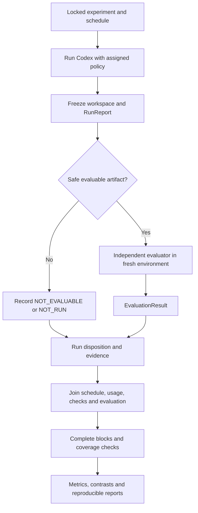

# Adaptive Agent Harness — 평가 프로토콜 (Evaluation Protocol)

## 그래프 기반 실패 복구 및 동적 컨텍스트 최적화를 통한 코딩 에이전트의 신뢰성과 실행 효율 향상

**English title:** Adaptive Agent Harness: Graph-Guided Failure Recovery and Dynamic Context Optimization for Coding Agents

| 항목 | 내용 |
| --- | --- |
| 프로젝트 | Adaptive Agent Harness (AAH) |
| 수행 맥락 | 잇츠 스터디 5기 · Codex 기반 AI 코딩 에이전트 구축 |
| 작성일 | 2026-11-25 |
| 버전 | v0.1.0 |
| 상태 | 평가 구현 명세 초안 — Pilot 및 팀 승인 후 동결 |
| 선행 문서 | RESEARCH_PROPOSAL.md, PROJECT_OVERVIEW.md, LITERATURE_REVIEW.md, METHODOLOGY.md, SYSTEM_ARCHITECTURE.md, TECHNICAL_SPEC.md, EXPERIMENT_DESIGN.md, BENCHMARK_SPEC.md |
| 후속 문서 | IMPLEMENTATION_PLAN.md, EXPERIMENT_LOG.md, RESULTS_ANALYSIS.md, FINAL_REPORT.md |

> **평가 목적:** 동일 Codex와 공통 실행 제약에서 동적 컨텍스트 최적화 및 그래프 기반 복구의 효과를 공정하고 재현 가능하게 측정한다. 에이전트의 자체 완료 선언이 아니라 독립 검증 결과로 성공을 판정하고, 실패 비용과 외부 하네스 오버헤드까지 포함한다.

본 문서는 실행 결과가 아니다. `EXPERIMENT_DESIGN.md`의 비교군, 주 분석, 추정 대상 및 분모와 `TECHNICAL_SPEC.md`의 실행·데이터 계약을 유지한다. 새로운 분석용 상태 코드, 상세 기록 형식, 평가 처리 절차와 테스트 ID는 구현 제안이며 Pilot에서 검증하고 고정한다. 실제 평가기, 과제, 런타임 사용량 및 비용 지원 여부는 아직 검증되지 않았다.

---

## 1. 평가 범위 및 원칙

### 1.1. 문서 책임

| 문서 | 책임 |
| --- | --- |
| EXPERIMENT_DESIGN | 무엇을 어떤 조건과 표본에서 비교하는가 |
| BENCHMARK_SPEC | 어떤 과제와 테스트가 평가 자격을 가지는가 |
| TECHNICAL_SPEC | 런타임·스냅샷·패치·평가기 인터페이스는 무엇인가 |
| EVALUATION_PROTOCOL (본 문서) | 평가 결과를 어떻게 판정, 계측, 집계, 분석, 보고하는가 |

선행 문서의 연구 질문이나 비교군을 본 문서에서 임의로 바꾸지 않는다. 충돌이나 미정 사항은 §17에 기록하고 승인된 변경만 새 실험 버전에 반영한다.

### 1.2. 평가 원칙

- 동일한 초기 코드, 공개 요구사항, 필수 지침, 모델·추론 설정, 접근 권한 및 사전에 확정한 평가기를 적용한다.
- 공개 검사는 복구 과정에 사용 가능하지만, hidden test 및 최종 판정은 실행 정책과 완전히 분리한다.
- 성공은 기능·회귀·필수 제약의 통과를 의미한다. 텍스트 답변의 설득력이나 reference patch와의 일치 정도로 대신하지 않는다.
- 실패한 실행의 비용, 하네스 자체의 오류 및 fallback, 타임아웃을 누락하지 않는다.
- 미관측 값은 0이 아니다. 관측 가능 범위와 결측 사유를 보고한다.
- 과제 내 반복 및 공통 체크포인트 분기를 독립 과제로 취급하지 않는다.
- 모든 계획 슬롯과 시도 이력은 결과와 관계없이 보존한다. 모델 성능을 이유로 재실행하거나 과제를 제외하지 않는다.

### 1.3. 평가 계층

| 계층 | 사용 시점 | 책임 | 실행 정책 접근 |
| --- | --- | --- | --- |
| Runtime observation | 실행 중 | 도구 이벤트, snapshot, diff, 공개 검사, usage | 허용된 공개 정보만 |
| Public verification | 실행 단위 종료 후 | 증상 및 기존 기능의 관측 가능한 검증 | 허용; A에는 외부 복구 메시지를 전달하지 않음 |
| Independent evaluation | 최종 패치 고정 및 실행 종료 후 | 기능·회귀·필수 제약 판정 | 금지 |
| Statistical analysis | 독립 평가 종료 후 | 비교군별 집계, 대비 및 불확실성 분석 | 금지 |

## 2. 연구 질문 및 프로토콜 연결

| 질문 | 평가 | 주요 결과 | 핵심 대비 |
| --- | --- | --- | --- |
| RQ1/H1 | E2E | 성공당 모델 토큰, 성공률, 준수율 | B→C, D→E |
| RQ2/H2 | 공통 실패 체크포인트 | 최종 복구 성공률 | B→D, C→E |
| RQ3/H3 | E2E 및 요인 분석 | 성공률, 성공당 비용, 상호작용 | C→E, D→E, B–E |
| RQ4/H4 | Ablation | 연결·전략·DCC 요소별 효과 | AB1–AB9 중 실제 수행한 조건 |
| RQ5 | 탐색적 분석 | 유형별 효과, 개입 부작용 | 공통 상태 비교 및 실패 사례 |
| 실용 참조 | E2E | 기본 사용 대비 전체 시스템 가치 | A→E |

| 비교군 | 초기 컨텍스트 | 진단 | 복구 전략 | 복구 컨텍스트 |
| --- | --- | --- | --- | --- |
| A Vanilla Codex | NONE | NONE | NATIVE | NONE |
| B Flat Retry | DEFAULT | FLAT | GENERIC | DEFAULT |
| C Context-only | DCC | FLAT | GENERIC | DCC |
| D Graph-only | DEFAULT | GRAPH | TYPED | DEFAULT |
| E Adaptive Agent Harness | DCC | GRAPH | TYPED | DCC |

B–E는 같은 외부 실패 감지 및 복구 기회와 원천 증거 접근을 사용한다. A는 별도 실용 참조이며 2×2 요인 분석에서 제외한다. B/C에 그래프 파생 정보가, B/D에 DCC 전용 정책이 전달되어서는 안 된다. 평가기는 조건별로 다른 테스트나 합격 기준을 사용하지 않는다.

### 2.1. 분석 단위와 ID

- E2E의 계획 슬롯: `(experiment_id, task_id, condition, repetition)`.
- Checkpoint 분기 슬롯: `(experiment_id, checkpoint_id, condition, repetition)`; 원래 source는 별도 `source_run_id`로 참조.
- Ablation 슬롯: 별도 실험 ID와 variant, task 또는 checkpoint ID, 반복 번호의 조합.
- 실행 시도는 고유 `run_id`를 가진다. 인프라 대체 시 원 run ID를 보존하며 동일 슬롯에 새 attempt를 연결한다.
- 분석의 기본 독립 단위는 task family다. 같은 과제의 조건과 반복, 같은 family의 체크포인트는 함께 군집화한다.

## 3. 실행-평가-분석 파이프라인



실험 실행기는 `RunReport`를 불변 상태로 확정한 뒤, 독립 평가기 측으로 패치와 opaque private task ID를 전달한다. 평가기가 에이전트의 살아 있는 세션이나 작업 디렉터리에 직접 연결되어서는 안 된다. 최종 평가 후 동일 run을 복구 루프로 되돌리는 전이는 존재하지 않는다. 실험 관리자가 다른 조건을 실행할 때도 이전 조건의 hidden 결과를 정책 입력으로 사용하지 않는다.

### 3.1. 평가 시작 전 게이트

| 게이트 | 검사 |
| --- | --- |
| Lock | 실험·과제 manifest, config, 모델·런타임, 평가 이미지 및 테스트 버전 해시 |
| Quality | BQ01–BQ14 및 승인된 과제 상태 LOCKED 확인 |
| Isolation | BENCHMARK_SPEC의 ISO-01~08 및 TECHNICAL_SPEC의 적용 가능한 격리 검사 통과 |
| Runtime | RT01–RT07의 실제 지원 범위 기록; 미검증 필수 기능은 차단 |
| Parity | A–E 조건 매핑, 공통 감지·증거·예산·테스트 동일성 확인 |
| Accounting | monotonic 계측, token usage mode, 중복 제거 및 missing 규칙 확인 |
| Analysis lock | 주 대비, 분석 seed, 결측·대체 정책 및 분석 코드 버전 확정 |

준비 실패는 성능 저하로 위장하지 않는다. 보안·격리 위반이 확인되면 관련 실행을 중지하고 원인을 검토한다. 평가가 유효하지 않은 상태에서 결과를 확정하지 않는다.

## 4. 독립 평가기 (Independent Evaluator)

### 4.1. 입력과 실행 환경

`TECHNICAL_SPEC.md` §13.3의 논리 인터페이스를 유지한다.

```python
class IndependentEvaluator(Protocol):
    def evaluate(self, patch: FrozenPatch,
                 private_task_id: str) -> EvaluationResult: ...
```

`FrozenPatch`는 `run_id`, `base_commit`, `snapshot_id`, `patch_ref`, `patch_hash`, `changed_paths`, `applicable`을 포함한다. 평가기는 `BENCHMARK_SPEC.md` §8.4의 제한된 EvaluationSpec에서 base commit, test bundle hash, evaluator adapter, 기능·회귀·준수 검사, 권한 정책을 읽는다. reference patch는 검증 준비용이며 제출된 패치를 평가할 때 자동 적용하지 않는다.

| 절차 | 수행 내용 | 실패 시 |
| --- | --- | --- |
| 입력 확인 | run ID, task 매핑, patch/base/environment hash 검증 | 명세 오류·artifact 오류 분류 |
| 환경 초기화 | 승인된 깨끗한 기준 snapshot과 고정 의존성 준비 | 독립 환경 오류 검토 |
| 패치 검사 | 실제 diff의 경로·변경 범위·적용 가능성 확인 | 패치 결함 또는 환경 오류 구분 |
| 패치 적용 | 기준 코드에 제출 패치만 적용 | 올바른 기준에서 적용 불가면 FAIL 후보 |
| 제약 검사 | 공개된 필수 규칙, 보호 경로, 테스트 무력화 여부 확인 | 제약 불통과 시 FAIL |
| 기능 검증 | H-FUNC 또는 upstream F2P/verifier 실행 | 결과 코드와 근거 저장 |
| 회귀 검증 | H-REG 또는 upstream P2P 실행 | 결과 코드와 근거 저장 |
| 판정 및 정리 | 불변 결과 기록, 프로세스/임시 환경 정리 | 안전한 종료 여부와 오류 기록 |

`FrozenPatch.applicable`은 제어부의 사전 검사이며 독립 적용 결과를 대체하지 않는다. tracked/untracked/삭제 등 실제 제출 변경을 포함한 패치 계약을 검증한다. 변경 없음도 안전하게 고정된 빈 패치라면 평가 가능하다. 초기 baseline이 의도한 평가에서 FAIL하는지는 BQ02에서 이미 확인해야 한다.

### 4.2. 테스트 계층 및 보호

| 코드 | 판정 대상 | 조건 |
| --- | --- | --- |
| P-FUNC | 공개 증상 및 기본 기능 | 복구 입력 가능, 최종 성공의 충분조건 아님 |
| P-REG | 공개 기존 동작 | 비교 가능한 전후 결과로 T3 등 감지 |
| H-FUNC | 공개된 기능 요구와 경계 사례 | 모든 필수 검사 PASS 필요 |
| H-REG | 기존 동작 및 호환성 | 모든 필수 검사 PASS 필요 |
| H-COMPLIANCE | 공개된 필수 제약 | 모든 필수 검사 PASS 필요 |

공개 과제는 upstream F2P/P2P 또는 verifier의 공식 계약을 우선한다. upstream 결과와 AAH 추가 제약 검사 결과를 개별 기록하고, AAH 종합 판정과 upstream 판정을 혼동하지 않는다. 최종 성공 조건에 포함할 검사는 과제 동결 전에 지정한다. 숨은 기능 요구나 exact diff match는 금지한다.

평가 스크립트, fixture, 기대값, reference patch, 평가 결과를 실행 workspace나 정책 로그에 넣지 않는다. 평가기 환경에서도 제출 코드가 평가기 자체의 판정 파일, 다른 과제 자료 또는 정답에 접근·변조하지 못하도록 실제 격리 방식을 검증한다. 디렉터리 분리만으로 격리를 보장했다고 주장하지 않는다. 별도 환경에서 제출 코드를 실행할 수 있는 안전한 검증이 확보되지 않으면 해당 과제/실행을 중단한다.

### 4.3. 테스트 실행 및 시간 제한

- 명령, 환경 변수 허용 범위, parser, 테스트 버전, 실행 제한은 private spec의 승인된 값으로 고정한다. 셸 문자열의 임의 실행을 금지한다.
- 공개 검사는 `CheckResult`/`TestCaseResult` 계약과 승인된 원본 사본을 따른다. 에이전트가 변경한 테스트만 실행해 통과를 선언하지 않는다.
- 기능·회귀·준수 검사는 상호 오염이 없도록 초기화하거나 검증된 순서로 실행한다. 독립 환경 준비 및 정리 비용을 평가기 시간으로 기록한다.
- 과제별 timeout은 baseline/reference의 안정성과 필요 자원에 근거해 Pilot에서 결정한다. 후보 코드 자체의 무한 루프·예산 초과와 평가기 또는 호스트 장애를 구분한다.
- 안전한 범위에서는 세 검사 결과를 모두 수집한다. 안전 위반으로 실행할 수 없는 경우 남은 검사는 NOT_RUN으로 기록하며 임의 PASS/FAIL을 만들지 않는다.

### 4.4. 결과 판정 규칙

기술 명세의 `EvaluationStatus`를 유지한다: `PASS`, `FAIL`, `INFRA_ERROR`, `NOT_EVALUABLE`, `NOT_RUN`. 다음 표는 이 값을 어떻게 사용할지 정의한다. 세부 suite 상태는 기존 CheckStatus의 값(PASS/FAIL/TIMEOUT/INFRA_ERROR/NOT_RUN/UNKNOWN)을 재사용하는 구현 제안이다.

| 상황 | EvaluationStatus | suite 상태 및 사유 |
| --- | --- | --- |
| 기능·회귀·준수 필수 검사 모두 PASS | PASS | 세 suite 모두 PASS |
| 하나 이상의 확정된 요구 위반 | FAIL | 해당 suite FAIL, 나머지는 실제 결과 |
| 깨끗한 승인 기준에서 패치 적용 불가 | FAIL | PATCH_APPLY_REJECTED; suite NOT_RUN 가능 |
| 후보 코드 문제로 평가 timeout이 확정됨 | FAIL | 해당 suite TIMEOUT; CANDIDATE_TEST_TIMEOUT |
| 평가 환경 이상으로 판정 신뢰 불가 | INFRA_ERROR | 실제 관측 suite 유지; EVALUATOR_ENV_ERROR 등 |
| 안전하게 고정된 artifact 없음 | NOT_EVALUABLE | 제어부 사유와 별도 기록 |
| 실행/평가 자체 미수행 | NOT_RUN | 예정 슬롯 및 사유 유지 |

신뢰할 수 있는 FAIL이 이미 확인되었고 이후 장애가 그 FAIL의 타당성을 훼손하지 않는 경우, 전체 FAIL 판정은 유지할 수 있다. 장애가 FAIL의 근거에 영향을 미치거나 원인 구분이 불가능하면 INFRA_ERROR 또는 판정 검토 대상으로 둔다. 이 우선순위는 신규 세부 규칙으로 동결 전 테스트한다. 판정이 불완전하면 절대 PASS를 부여하지 않는다.

### 4.5. EvaluationResult 예시

```json
{
  "schema_version": "1.0",
  "run_id": "example-run-001",
  "task_id": "AAH-D02",
  "patch_hash": null,
  "evaluation_environment_hash": null,
  "status": "FAIL",
  "functional_status": "PASS",
  "regression_status": "FAIL",
  "instruction_status": "PASS",
  "duration_ms": 12000,
  "error_code": "REGRESSION_FAILURE",
  "restricted_details_ref": null
}
```

설계용 가상 예시다. `null`인 필수 해시 및 restricted reference는 실제 평가 시 계약을 충족해야 한다. 기존 EvaluationResult 필드를 보존하고 `error_code`의 구체적인 vocabulary를 §5에서 제안한다. per-test 상세 판정은 제한된 평가 저장소에 별도 기록한다. 원시 stderr 및 hidden assertion은 공유 리포트에서 제외한다.

## 5. 결과 상태, 결측, 제외 및 재실행

### 5.1. 세 가지 상태의 분리

| 상태 계층 | 예 | 의미 |
| --- | --- | --- |
| RunReport.stop_reason | COMPLETED, GLOBAL_LIMIT, CANCELED, RUNTIME_ERROR, ARTIFACT_ERROR 등 | 에이전트 실행이 왜 종료되었는가 |
| EvaluationResult.status | PASS, FAIL, INFRA_ERROR, NOT_EVALUABLE, NOT_RUN | 제출 산출물에 대한 독립 판정 |
| AnalysisDisposition (신규 분석 상태) | VALID_SUCCESS, VALID_FAILURE, MISSING_INFRA, NOT_RUN_BUDGET 등 | 계획 슬롯이 어떤 분석 분모에 들어가는가 |

예를 들어 GLOBAL_LIMIT으로 끝나도 마지막 패치가 모든 테스트를 통과하면 유효 성공이다. 반대로 COMPLETED 선언 뒤 hidden 회귀가 실패하면 유효 실패다. 기술 명세의 상태 enum을 덮어쓰지 않고 분석용 상태를 별도 생성한다.

### 5.2. 슬롯 판정 매핑

| 분석 상태(제안) | Y/Z | 기준 |
| --- | --- | --- |
| VALID_SUCCESS | 1 | 타당한 독립 PASS |
| VALID_FAILURE | 0 | 타당한 독립 FAIL 또는 방법 책임의 산출물 미생성/안전한 고정 실패 |
| MISSING_INFRA | null | 공통 외부 공급자·호스트·평가기 장애로 유효 판정 불가 |
| MISSING_EXTERNAL_CANCEL | null | 성능과 무관한 외부 취소, 사전 규칙과 증거 충족 |
| NOT_RUN_BUDGET | null | 전역 프로젝트 예산으로 해당 슬롯 미시작 |
| NOT_RUN_OTHER | null | 안전 중단·승인 부족 등 기타 미시작 |
| INVALID_TASK | null | 독립 리뷰로 전체 과제 무효 확인; 모든 조건에 동일 적용 |
| PENDING_REVIEW | null | 원인/책임 불명확; 최종 분석 전 해결 또는 결측 공개 |

다음 매핑은 책임 경계에 따라 적용한다.

| 관측 상황 | 처리 |
| --- | --- |
| 모델·정책의 잘못된 명령, 테스트 실패, 그래프/DCC fallback | 일반 유효 실행, 최종 평가 반영 |
| 실행 한도 소진 및 마지막 패치 존재 | 독립 평가 결과로 Y 부여 |
| 실행 한도 소진 및 방법 책임으로 패치 없음 | VALID_FAILURE |
| 방법이 만든 패치의 적용 실패, 보호 경로 위반 | VALID_FAILURE |
| 정책 자체의 artifact 기록 실패 | VALID_FAILURE; 비용 관측 여부 별도 |
| 원인이 공통 환경 오류로 확인된 patch/evaluation 장애 | MISSING_INFRA |
| 사용량만 누락 | Y/Z는 유지, 비용 지표만 null |
| 사용자 취소 또는 안전 위반 | 책임을 검토; 정책 자체의 위반은 VALID_FAILURE |

`RUNTIME_UNAVAILABLE`, `PROCESS_NOT_QUIESCENT`, `ARTIFACT_WRITE_FAILED`, `EVALUATION_INFRA_ERROR` 등의 코드만으로 제외하지 않는다. 공통 환경에 기인한 것인지 방법 고유의 오류인지 근거를 저장한다. 외부 원인과 정책 원인이 혼재하면 독립 리뷰로 처리한다.

### 5.3. 상세 사유 코드 및 리뷰

신규 분석용 `reason_code` 후보: `FUNCTIONAL_FAILURE`, `REGRESSION_FAILURE`, `INSTRUCTION_VIOLATION`, `PATCH_APPLY_REJECTED`, `CANDIDATE_TEST_TIMEOUT`, `POLICY_ARTIFACT_FAILURE`, `NO_SAFE_ARTIFACT`, `PROVIDER_OUTAGE`, `AUTH_ENV_FAILURE`, `EVALUATOR_ENV_ERROR`, `EXTERNAL_CANCEL`, `PROJECT_BUDGET_EXHAUSTED`, `TASK_DEFECT`, `UNRESOLVED_CAUSE`. 이 목록은 runtime의 ErrorInfo.code를 대체하지 않으며 여러 원인 참조를 함께 저장할 수 있다.

리뷰 기록은 slot ID, run ID, 관측 근거, 원래 상태, 판정 상태, 책임 경계, 리뷰어, 승인 시각을 포함한다. 가능하면 조건 및 성능 집계에 접근하지 않는 리뷰어가 확인한다. 불가능하면 비맹검임을 기록한다. 사후 과제 결함은 해당 과제의 모든 조건에 같은 규칙을 적용한다.

### 5.4. 재실행과 비용 회계

원칙적으로 자동 재실행하지 않는다. EXPERIMENT_DESIGN §12.2의 외부 인프라 오류에 대한 최대 1회 대체 실행은 **Pilot 후 승인할 운영안**이다. 원 시도와 대체 시도를 모두 보존하고, 동일 슬롯에서는 사전 승인된 대체 규칙에 따라 유효한 최종 판정 하나만 선택한다. 성능 실패, 시간 초과, 낮은 점수, 높은 비용은 대체 사유가 아니다.

성공률 및 paired 분석은 슬롯 단위로 계산하고 실제 프로젝트 지출은 모든 실제 시도를 합산한다. 주 CPS의 비용은 선택된 유효 슬롯 실행의 비용을 사용하며, 제외된 인프라 시도 및 대체 비용을 더한 운영 관점 CPS를 별도로 보고한다(신규 상세 규칙). 어떤 비용도 원시 회계에서 삭제하지 않는다. 대체 정책을 사용하지 않으면 이 구분은 해당하지 않는다.

## 6. 핵심 성능 지표

### 6.1. Task Success Rate (TSR)

과제 i, 조건 c, 반복 r의 유효 판정을 `Y_icr ∈ {0,1}`로 정의한다.

$$
\bar Y_{ic}=\frac{1}{R_{ic}}\sum_r Y_{icr},\qquad p_c=\frac{1}{N}\sum_i\bar Y_{ic}.
$$

주 분석은 대비에 필요한 사전 지정 반복 슬롯이 유효한 공통 과제 블록을 사용한다. N은 해당 공통 과제 수다. 전체 유효 run 비율 `sum(Y)/n_valid`도 별도로 보고하며, 반복 수가 불균형하면 두 값이 다를 수 있음을 명시한다. N=0은 N/A다. 예정·실행·유효·성공·실패·결측 수를 항상 함께 제시한다.

### 6.2. Failure Recovery Rate (FRR)

$$
FRR_c=\frac{1}{J}\sum_{j=1}^{J}Z_{jc}.
$$

Z는 공통 적격 체크포인트에서 분기한 정책의 최종 독립 통과 여부이며 J는 해당 대비에 필요한 유효 분기를 가진 공통 체크포인트 수다. 전체 적격 및 선정 checkpoint 수와 대비별 J를 구분한다. 첫 개입 뒤 공개 검사 통과는 최종 복구 성공의 대체가 아니다.

- source에서 eligible checkpoint가 발생하지 않은 사례는 FRR 분모에서 제외하되 발생률 및 확보 비용에 포함한다.
- T5, 단순 외부 장애, 인위적 주입 실패는 자연 발생 집단과 분리한다.
- 동일 외부 snapshot, 원천 증거, 공통 이력, 세션 정책 및 잔여 한도 검증을 통과한 경우만 비교한다.
- source 상태는 관측 가능한 실패 신호이지 hidden test 실패를 직접 확인한 상태는 아니다.
- E2E 내 조건별 자연 실패 후 성공률은 초기 DCC가 실패 집단을 변화시킬 수 있으므로 기술 통계로만 보고한다.

### 6.3. Instruction Compliance Rate

사전에 공개된 필수 제약의 독립 검사에서 모두 PASS한 실행 비율. 유효한 준수 판정만 분모로 사용하며 FAIL·UNKNOWN·NOT_RUN의 의미를 구분한다. 필수 제약 위반이 실행 중 확인된 경우 준수 실패로 기록할 수 있다. 기능 PASS여도 준수 FAIL이면 전체 성공은 아니다. 평가 가능한 패치가 없는 실행에 준수 PASS를 부여하지 않는다. 예정 슬롯 대비 준수 판정 coverage 및 전체 유효 실행에서 확인된 위반 수를 함께 보고한다. 결측 준수 결과에 대한 보수적 민감도 분석을 수행할 수 있다.

## 7. 토큰 및 비용 계측

### 7.1. UsageRecord 계약

`TECHNICAL_SPEC.md` §11.2의 `UsageRecord` 필드를 유지한다. 모든 추가 모델 호출(컨텍스트 구성, 진단, 요약 등을 모델로 수행하는 경우)은 동일 ledger에 별도 stage로 기록한다. 로컬 BM25/AST/DCC 처리는 모델 토큰을 사용하지 않더라도 시간 및 자원 오버헤드가 존재한다.

```json
{
  "schema_version": "1.0",
  "usage_id": "example-usage-001",
  "run_id": "example-run-001",
  "turn_id": "example-turn-001",
  "stage": "INITIAL",
  "source": "runtime_adapter",
  "usage_mode": "DELTA",
  "input_tokens": 10000,
  "cached_input_tokens": 2000,
  "output_tokens": 1500,
  "reasoning_tokens": 400,
  "total_tokens": 11500,
  "elapsed_ms": 30000,
  "cost_amount": null,
  "currency": null,
  "cost_kind": "UNKNOWN",
  "coverage": "example_only",
  "raw_ref": null
}
```

위 수치는 가상 fixture이며 cached 및 reasoning이 각각 input/output에 포함되는 **가정하의 예시**다. 실제 포함 관계 및 usage mode는 RT07에서 검증한다. `coverage`의 wire 형식은 runtime probe와 구현 시 확정하며 이 예시로 공급자 필드를 단정하지 않는다.

### 7.2. 토큰 정규화 규칙

| 경우 | 집계 방식 |
| --- | --- |
| DELTA | 확인된 고유 사용량 이벤트를 1회씩 합산 |
| CUMULATIVE | 동일 scope의 검증된 연속 누적치 차분; scope 초기화·재개 경계 기록 |
| UNKNOWN | 원시 이벤트 보존, 해당 집계 null 또는 부분 관측 |
| cached input이 input의 부분집합 | total에 다시 더하지 않음 |
| reasoning이 output의 부분집합 | total에 다시 더하지 않음 |
| 포함 관계 불명확 | 추정 합산 금지; 제공 total 의미 검증 또는 결측 |
| 중복 수신/동일 이벤트 재처리 | 원시 기록 보존, 정규화 ID 기준 1회 집계 |
| 취소·타임아웃·추가 호출 | 가능한 실제 사용량 포함; 누락분은 0이 아님 |

일부 호출의 사용량이 확인되지 않으면 known subtotal을 진단용으로 저장하되 전체 토큰으로 표시하지 않는다. 에이전트별 제공 total의 범위가 다르면 공통 관측 범위가 확보되기 전 비용 비교를 제한한다. DCC가 계산한 2,048 보조 토큰 상한은 추정기 기반 패키지 한도이며 실제 모델 입력/전체 실행 토큰과 다르다.

### 7.3. 비용 종류 및 공식

| 비용 구분 | 측정 단위 | 주의 |
| --- | --- | --- |
| 모델 토큰 | tokens | 주 P-R1의 비용 단위, 관측 완전성 필수 |
| 실제 과금 | 통화와 decimal 금액 | 공급자 측 실제 청구가 run에 귀속 가능한 경우 |
| 추정 과금 | 통화와 decimal 금액 | 모델·가격·유효 일자·캐시 요율 및 추정식 기록 |
| 크레딧/구독 사용량 | 확인 가능한 고유 단위 | 통화 또는 토큰으로 근거 없이 환산하지 않음 |
| 로컬 자원 | elapsed time 등 | 모델 사용량과 별개, 선택적으로 CPU/메모리 기록 |

가격표나 크레딧 환산률은 본 명세에서 임의로 고정하지 않는다. 실제 계정의 가격·관측 범위가 확정되면 별도 versioned price sheet를 저장한다. 추정 비용과 실제 비용은 절대로 합산하지 않는다. 요금이 입력/캐시/출력으로 나뉘고 각각이 확인된 경우에만 해당 공식에 적용한다.

### 7.4. Cost per Success (CPS)

$$
CPS_c=\frac{\sum_{i,r} C_{icr}}{\sum_{i,r}Y_{icr}}.
$$

분자는 성공뿐 아니라 유효 실패 실행의 전체 비용을 포함한다. 분모는 동일 집합의 성공 수다. 토큰 CPS, 실제 금액 CPS, 추정 금액 CPS를 각각 계산한다. 대비에 사용하는 조건의 공통 과제·반복 및 관측 비용 범위를 일치시킨다. 비용이 결측인 슬롯을 0으로 대체하거나 분자에서만 제거하지 않는다. 성공 0건이면 유한 CPS를 계산하지 않고 `NO_SUCCESS` 사유를 기록한다. 비용 감소율은 기준 CPS가 유한한 양수일 때만 계산한다.

### 7.5. 체크포인트 비용 분리

| 회계 | 계산 |
| --- | --- |
| source 비용 | 실제 source 시도 전체; checkpoint 미발생 포함 |
| branch 비용 | restore 완료 후 공통 정책 준비 시작부터 종료까지; restore 비용 별도 |
| 사용자 관점 재구성 | 해당 source 비용 + 해당 branch 비용 (+ 별도 restore 항목 명시) |
| 실제 프로젝트 비용 | 모든 실제 source 및 branch, restore, pilot, ablation, 승인 대체 시도, 기타 실제 지출 합 |

동일 source를 B–E가 공유하더라도 실제 프로젝트 지출에는 한 번만 계산한다. 재구성 비용을 네 조건에 표시하는 것은 비교를 위한 가상 단독 실행 관점이며 합산 지출이 아니다.

## 8. 시간 및 오버헤드 계측

| 지표 | 시작/종료 | 단위 |
| --- | --- | --- |
| Runtime Wall Time | 공통 요청 검증 시작 직전 → 패치 고정 또는 안전 종료 | ms |
| Evaluator Time | 독립 평가 시작 → 판정 및 평가 처리 종료 | ms |
| End-to-End Time | runtime + evaluator; 중간 대기/준비 포함 여부 명시 | ms |
| Checkpoint Branch Time | restore 완료 후 공통 준비 시작 → 종료 | ms |
| Restore Time | checkpoint 복원 시작 → 검증 완료 | ms |
| Local Overhead | snapshot, graph build/query, DCC, 공개 검사, fallback 등 단계별 | ms |
| Queue/Wait Time | 실행 대기·rate limit 등 관측 가능한 구간 | ms |

monotonic clock의 duration을 사용하고 UTC 시각은 감사 및 순서 확인 용도로 저장한다. 동시에 실행한 단계의 duration 합을 wall time으로 사용하지 않는다. 실제 총 경과 시간과 단계별 누적 시간은 별도다. 모델 응답 시간에는 관측 가능한 네트워크/대기 시간이 포함될 수 있음을 표시한다. 평가 시간은 모든 조건에서 같은 계측 경계를 적용하고 실행 제어부 예산과 구분한다.

전체 모델 토큰 한도는 `observe_only`인지 실제 강제 가능한지 기록한다. 강제 미검증이면 같은 턴·시간·개입 상한을 통제했다고 표현하고 동일 토큰 하드 예산이라고 하지 않는다. 예산 초과와 정리 reserve 초과는 별도 경고로 기록한다.

## 9. 행동 및 복구 메커니즘 지표

실행 성능 지표만으로 그래프 탐색 또는 컨텍스트 정책이 왜 효과적인지 설명하기 어렵다. 다음 지표는 해당 메커니즘을 분석하기 위한 보조 지표이며 독립 평가의 성공 조건을 바꾸지 않는다.

| 지표 | 분자 또는 측정값 | 분모/관측 범위 |
| --- | --- | --- |
| Tool Calls | 고유한 관측 도구 호출 수 | 관측 가능한 이벤트 종류; 결과 이벤트와 중복 계수 금지 |
| Exploration Redundancy | 중복 탐색으로 분류된 관측 행동 | 비교 가능한 탐색 행동 수 |
| Trigger Rate | T1–T4가 1회 이상 발생한 run | 공통 감지의 관측이 유효한 run |
| Intervention Rate | 전달 확인된 개입이 1회 이상인 run | 전체 해당 run; 전달 불명확 coverage 별도 |
| Fallback Rate | 기본 복구로 대체된 개입 결정 | 개입 결정 수 |
| Strategy Adherence | performed/not_observed/contradicted/unknown별 수 | 전략 전달이 확인된 개입 및 관측 범위 |
| Selected Context Tokens | 실제 전달용 외부 보조 패키지 추정 토큰 | 초기·복구를 별도 집계; 전체 모델 입력 아님 |
| Fault Localization (선택) | 검증된 원인 위치가 진단 Top-k에 포함된 사례 | 신뢰 가능한 원인 위치 및 후보 관측이 모두 있는 사례 |
| Diagnostic Coverage | 유효 앵커, 연결, 후보 provenance 및 그래프 상태 | 분석 대상 run/개입, 각 분모 명시 |
| Harmful Intervention | 개입 후 확인된 새 공개 실패 또는 기존 검사 악화 | 비교 가능한 전후 검사가 존재하는 개입 |

분모가 0이면 N/A이며 관측 불충분은 별도 표시한다. A에 외부 개입이 없다는 것은 구조상 0이지만, 그래프 진단·전략 수행률과 같이 해당 정책이 없는 지표는 N/A로 표시한다. A에 T1–T4를 실행 중 개입용으로 적용하지 않으며, 원시 증거를 바탕으로 한 사후 감지 분석이 가능한 경우 별도 오프라인 지표로 구분한다.

### 9.1. 중복 탐색 및 실패 지문

METHODOLOGY의 반복 행동 정규화 규칙, 공개 `CheckResult` 및 `FailureFingerprint`를 사용한다. 같은 파일을 다시 읽더라도 snapshot이 변경되었거나 새로운 범위·증거가 추가되었다면 단순 중복으로 단정하지 않는다. T2의 최근 6개 행동 및 0.67 임계값은 Pilot 후보이며 정확히 4/6과의 경계 차이는 EXPERIMENT_DESIGN §13에 따라 동결 전에 해결한다. 반복 비율은 트리거가 발생했는지와 별도로 실행 전체의 비교 가능한 행동을 사용하여 계산한다. 확인되지 않은 행동은 분모에 강제로 넣지 않는다.

### 9.2. 전략 수행과 전달 상태

`interventions.jsonl`의 DECIDED, PACKAGE_READY, RESERVED, DELIVERED, DELIVERY_FAILED, OUTCOME_OBSERVED와 UNKNOWN_DELIVERY를 구분한다. 예약과 실제 전달 횟수는 서로 같지 않을 수 있다. 수행률 판단은 METHODOLOGY에서 정한 전략별 공개 관측 조건을 따른다. 모델의 답변에서 수행했다고 주장한 것만으로 performed를 부여하지 않는다. 관측 가능성이 낮은 전략은 `unknown` 또는 `not_observed`로 표시하고 실제 미수행으로 해석하지 않는다.

### 9.3. 개입의 악화 및 이득

동일 check/test ID, 검사 버전 및 환경에서 개입 전후를 비교하여 다음 상태를 기록한다(신규 진단용 label).

| 상태 | 의미 |
| --- | --- |
| IMPROVED | 기존 FAIL에서 PASS로 변경 |
| WORSENED | 기존 PASS에서 FAIL로 변경 또는 동일 검사 집합에서 새 실패 확인 |
| MIXED | 개선과 악화가 함께 관측 |
| UNCHANGED | 비교 가능한 검사 결과 변화 없음 |
| UNKNOWN | 전후 검사 불일치, 누락, 평가 환경 오류 등 |

MIXED는 악화 포함으로 집계할 때 별도 건수도 함께 표시한다. 다음 관측 가능한 실행 단위의 종료 검사와 마지막 공개 검사 결과를 각각 저장한다. 이후 추가 개입을 거친 결과를 첫 전략 단독의 인과적 효과로 주장하지 않는다. 직접적인 비교는 공통 체크포인트의 정책 간 최종 결과 및 동일 검사 변화 차이를 이용한다. 관측상의 악화가 곧 외부 개입 때문에 발생했다는 증거는 아니다.

### 9.4. 그래프 및 컨텍스트의 진단 기록

그래프: snapshot/graph version, 노드·엣지 수, observed/inferred/unknown 관계, 탐색 앵커, 방문 수, 후보 수, cross-graph 경로 존재 여부, fallback 사유, build/query duration을 수집한다. 정적 분석 후보를 실제 원인으로 단정하지 않는다. 원인 위치가 확정된 private annotation은 분석에만 사용하고 그래프에 주입하지 않는다.

컨텍스트: 후보 수, 단계별 선택/제외 사유, CURRENT/INVALID/HISTORICAL/UNCERTAIN 분류, 중복 패널티, 추정 토큰 수, 선택 출처, 패키지 전달 hash 및 guard를 기록한다. 비교는 동일 필수 지침 및 원천 후보 범위를 전제로 한다. 필수 지침 누락 여부와 보조 정보 절감 효과를 구분한다.

## 10. 데이터 수집 및 집계 스키마

### 10.1. 원천 및 조인 키

| 파일/레코드 | 키 | 주요 용도 |
| --- | --- | --- |
| schedule.csv | 계획 slot/block, task/condition/repetition, run_id | 계획 분모 및 미실행 확인 |
| manifest.json | run_id | 설정 및 환경 정합성 |
| report.json | run_id | 종료 사유, frozen patch, 실행 시간 |
| checks.jsonl | run_id, check_result_id | 공개 검사 결과와 비교 |
| evidence.jsonl | run_id, evidence ID | 행동·탐색 및 관측 범위 |
| interventions.jsonl | run_id, intervention_id, lifecycle event | 개입 전달 및 후속 결과 |
| context.jsonl | run_id, package ID | 보조 컨텍스트 사용량 및 정책 |
| usage.jsonl | run_id, usage_id | 실제 모델 사용량 및 비용 |
| checkpoint_registry.jsonl | checkpoint_id, source_run_id | 공통 실패 및 source 회계 |
| EvaluationResult | run_id, task_id, patch_hash | 독립 성공 판정 |
| TaskRegistry | task_id, task_family_id, repo_id | 층화·군집 분석 |

계획 schedule에서 시작하는 left join을 사용하여 실행되지 않은 슬롯을 누락하지 않는다. 동일 run에 중복된 최종 판정이나 불일치 patch hash가 존재하면 자동으로 임의 결과를 선택하지 않고 검토 대상으로 지정한다. 분석 결과는 실행 제어부와 다른 권한 영역에서 생성한다.

### 10.2. 분석용 표준 테이블 (신규 제안)

| 테이블 | 행 단위 | 핵심 필드 |
| --- | --- | --- |
| run_status.csv | 계획 슬롯 1개 | slot_id, experiment_id, protocol, task_id, task_family_id, repo_id, condition, repetition, selected_run_id?, checkpoint_id?, disposition, reason_code?, y?, stop_reason?, evaluation_status? |
| run_attempts.csv | 실제 시도 1개 | run_id, slot_id, attempt_index, replacement_of?, disposition, reason_code, selected_for_analysis |
| run_metrics.csv | 선택된 슬롯 1개 | slot_id, run_id?, model_tokens?, known_token_subtotal?, usage_coverage, actual_cost?, estimated_cost?, currency?, runtime_ms?, evaluator_ms?, compliance?, tool_calls?, redundancy_n?, redundancy_d? |
| checkpoint_summary.csv | source 시도 1개 | source_run_id, task_id, eligible, checkpoint_id?, selected, trigger_ids, acquisition_status, source_tokens?, source_ms? |
| intervention_metrics.csv | 개입 1개 | run_id, intervention_id, delivery_status, strategy_id, fallback, adherence, public_delta, comparable_checks |
| metric_summary.csv | 조건×지표×분석 집합 | metric_id, condition, analysis_set_id, value?, numerator?, denominator?, unit, coverage, missing_reason? |
| paired_contrasts.csv | 대비×지표 | contrast_id, metric_id, analysis_set_id, n_tasks, n_clusters, effect?, ci_lower?, ci_upper?, unit, undefined_replicates, interpretation_status |
| analysis_sets.json | 분석 집합 정의 | set ID, 포함 task/slot/checkpoint ID, 제외 사유, config hash |

기존 원천 계약을 바꾸지 않고 위 테이블로 projection한다. nullable 숫자는 CSV 빈 값, JSON null로 저장한다. 0이나 문자열 N/A를 숫자 필드에 섞지 않는다. 금액은 decimal 문자열과 통화, 경과 시간은 정수 ms, 토큰은 음이 아닌 정수로 관리한다. `slot_id`는 실험·프로토콜·대상·조건·반복의 canonical key를 이용한 안정적인 식별자 구현을 제안한다.

### 10.3. 데이터 무결성 검사

- Main의 A–E 조건, 반복 및 예정 과제 수가 잠긴 manifest와 일치하는지 확인한다.
- 슬롯별 선택 판정은 최대 하나, run_id는 고유하며 replacement는 동일 슬롯을 참조해야 한다.
- 유효 성공은 EvaluationResult PASS와 일치해야 한다. 방법 책임으로 평가 불가능한 유효 실패를 별도 사유로 검증한다.
- 모든 평가의 base/patch/environment/test bundle hash 및 task mapping이 일치해야 한다.
- 사용량의 중복, 음수, 누적치 역전, 불명확한 범위를 검사한다. 불일치 시 해당 값은 결측 처리하거나 검토한다.
- Checkpoint의 모든 분기가 동일 외부 상태와 한도를 사용했는지 확인한다.
- 비활성 정책의 파생 데이터 사용, hidden 결과 접근, 비인가 artifact 변경을 탐지하는 기존 계약 테스트와 연계한다.

## 11. 분석 집합 및 통계 분석

### 11.1. 주 대비 및 지표

EXPERIMENT_DESIGN §2.1의 주 분석 가족을 유지한다. 다음 대비는 사전 동결 대상이다.

| 대비 ID | 프로토콜 | 효과 정의 | 개선 방향 |
| --- | --- | --- | --- |
| P-R1 | E2E | CPS_C − CPS_B (관측 모델 토큰) | 음수 |
| P-R2 | Checkpoint | FRR_D − FRR_B | 양수 |
| P-R3 | E2E | p_E − max(p_C,p_D) | 양수 |

P-R3은 `min(p_E-p_C,p_E-p_D)`와 같다. 단독 두 대비를 같은 공통 과제 집합에서 각각 계산해 함께 보고한다. H1의 성공률·필수 제약 준수는 비용 감소와 함께 판단한다. 비용만 줄었거나 E가 한 조건보다 개선되었다는 이유로 전체 가설을 지지했다고 하지 않는다.

### 11.2. 완전 블록과 결측 민감도

주 paired 분석은 해당 대비의 모든 조건과 예정 반복이 유효한 공통 블록을 사용한다. B–E 요인 분석은 네 조건이 모두 필요한 공통 블록, P-R3은 C/D/E 공통 블록을 사용한다. CPS는 비용까지 완전한 공통 블록을 별도 생성한다. 비용 결측 때문에 성공률 분석의 유효 슬롯까지 삭제하지 않는다. 서로 다른 분석 집합의 수치를 직접 결합할 때는 범위 차이를 명시한다.

관측된 유효 run 전체의 성공률을 별도로 제공한다. 미실행·인프라 결측에 대해 전체 실패/전체 성공 및 조건별 유리·불리 가정의 대비 범위를 계산할 수 있다. 예를 들어 계획 10건 중 6 PASS, 2 FAIL, 2 missing이면 유효 비율은 6/8, 계획 분모의 보수적 범위는 6/10~8/10이다. 이는 통계적 신뢰구간이 아니다. 조건별 결측 편차가 크면 complete-case 결과의 일반화를 제한한다.

### 11.3. Paired 효과 및 2×2 요인

$$
\Delta_{a\to b}=\frac{1}{N}\sum_i(\bar Y_{ib}-\bar Y_{ia}).
$$

$$
\Delta_C=\frac{(p_C-p_B)+(p_E-p_D)}{2},\qquad
\Delta_G=\frac{(p_D-p_B)+(p_E-p_C)}{2}.
$$

$$
\Delta_{int}=p_E-p_D-p_C+p_B.
$$

성공률과 FRR의 가법적 척도에서 효과를 산출하고 %p로 보고한다. A는 요인 분석에 포함하지 않는다. 그래프 요인은 그래프 증거 선택과 유형별 전략의 묶음이며 cross-graph mapping 단독의 효과가 아니다. Checkpoint의 DCC 요인은 복구 DCC만을 의미한다. E가 C,D보다 높더라도 가법 상호작용이 양수라는 뜻은 아니다. 비용의 비율 지표 CPS는 표본별로 분자·분모를 다시 계산한 뒤 대비한다.

### 11.4. Paired cluster bootstrap

기존 계획의 기본값을 유지한다: 10,000회, 분석 seed 20261126, 양측 95% percentile 구간. 같은 task family의 모든 조건과 반복을 하나의 클러스터로 재표집한다. 한 클러스터가 여러 번 뽑히면 해당 multiplicity를 보존하고 groupby로 중복을 제거하지 않는다. 지표의 과제별 동등 가중 및 반복 평균은 원 정의를 유지한다.

```python
# 의사코드: 실제 분석 함수는 테스트 및 version lock 필요
blocks = select_complete_blocks(rows, contrast.required_conditions,
                                require_cost=contrast.requires_cost)
clusters = group_by_task_family(blocks)
if not clusters:
    return unavailable("NO_COMPLETE_BLOCKS")
point = statistic(blocks)
rng = make_rng(seed=20261126)
values = []
for _ in range(10_000):
    sampled = sample_with_replacement(clusters, len(clusters), rng)
    rows_b = concatenate_with_unique_draw_ids(sampled)
    values.append(statistic(rows_b))
return summarize_with_undefined_count(point, values, alpha=0.05)
```

bootstrap 표본에 성공이 0인 조건이 있어 CPS가 정의되지 않으면 해당 표본을 조용히 제외하지 않는다. 무정의 표본 수/비율을 보고하고, 유한한 양측 구간을 정당화할 수 없는 경우 결론 불충분으로 표시한다. 신규 보수적 구현안으로 CPS 대비에 무정의 replicate가 하나라도 있으면 주 유한 percentile 구간을 보류하고 원 지표와 비율을 보고한다. 보다 세분화된 처리 규칙이 필요하면 Pilot에서 승인한다. 작은 표본 또는 경계 성공률에서는 구간 자체가 불안정하므로 원 분자·분모, task별 차이와 함께 해석한다.

저장소 수준 상관을 검토하기 위해 가능한 경우 repository cluster bootstrap을 보조 분석으로 수행하고, 저장소 수가 작으면 leave-one-repository-out 결과를 제공한다. 반복 run을 독립 표본으로 간주하는 두 비율 z-test는 사용하지 않는다.

### 11.5. 유의성 검정 및 비열등성

주 결과는 효과 크기와 불확실성 구간이다. 선택적 paired permutation 등 검정 수행 여부 및 가정은 Pilot 후 고정한다. 수행 시 주 가족에 Holm 보정을 적용하고, P-R3의 두 단독 대비 모두를 지지해야 하는 교집합 검정은 구성 대비를 정당하게 결합한다(유효한 단측 검정이 모두 확보된 경우 두 p값의 최대값을 가족 수준 보정에 사용하는 구현 후보). 교환가능성 등 가정이 충족되지 않으면 p값을 생략한다. 일반적인 95% 구간은 동시 보정 구간이 아님을 명시한다.

성공률 허용 손실 폭 5%p는 기존 문서의 검토 후보이며 동결된 기준이 아니다. 비열등성을 검증하려면 허용 폭을 결과 열람 전에 정당화하고 적절한 하한 판단 및 분석 집합을 지정한다. 비용 감소와 비유의한 성공률 차이만으로 성능 유지·비열등성을 주장하지 않는다. 필수 제약 위반을 허용하는 정책으로 해석하지 않는다.

### 11.6. 탐색 및 ablation 해석

AB1 Cross-Graph Mapping 제거, AB2 Typed vs Generic, AB3 초기/복구 DCC 분리, AB4 그래프 기반 vs 평면 검색을 우선 고려한다. 추가 AB5–AB9는 자원 및 실험설계의 승인 범위 안에서 수행한다. 해당 구성 요소가 실제로 조작되고 나머지 조건이 통제된 경우만 독립 효과를 주장한다. 특히 AB2에서는 동일 진단·보조 evidence를 유지하고 전략 메시지만 교체하는 계약을 검증한다.

자체/공개, 정상/노이즈/구버전, 과제 유형 및 관측 실패 유형별 결과는 표본 수와 분모를 함께 제시한다. 자연 발생과 인위적 실패, 초기 실패가 관측된 조건별 하위집단을 구분한다. 적은 표본에서는 사례 설명을 우선하며 사후 발견을 주 가설로 바꾸지 않는다.

## 12. 집계 예시 및 계산 검증

다음 표는 평가 함수의 단위 테스트에 활용할 가상 수치이며 연구 결과가 아니다. 4개 과제, 각 조건 1회, 결측 없음이라는 단순한 상황을 가정한다.

| 과제 | B 성공/토큰 | C 성공/토큰 | D 성공/토큰 | E 성공/토큰 |
| --- | --- | --- | --- | --- |
| q1 | 1 / 100 | 1 / 80 | 1 / 110 | 1 / 90 |
| q2 | 0 / 200 | 0 / 140 | 1 / 150 | 1 / 120 |
| q3 | 1 / 150 | 1 / 100 | 0 / 180 | 1 / 110 |
| q4 | 0 / 250 | 1 / 180 | 1 / 170 | 1 / 130 |
| 합계 | 2 / 700 | 3 / 500 | 3 / 610 | 4 / 450 |

| 지표 | B | C | D | E |
| --- | ---: | ---: | ---: | ---: |
| TSR | 50% | 75% | 75% | 100% |
| CPS (tokens/success) | 350 | 166.67 | 203.33 | 112.50 |

- Context 주효과: ((0.75−0.50)+(1.00−0.75))/2 = 25%p.
- Graph 주효과: ((0.75−0.50)+(1.00−0.75))/2 = 25%p.
- 상호작용: 1.00−0.75−0.75+0.50 = 0%p.
- P-R3: 1.00−max(0.75,0.75) = 25%p.
- B 대비 C의 CPS 감소율: (350−500/3)/350 ≈ 52.38%.

이 예시는 E가 가장 높지만 양의 상호작용은 없을 수 있음을 보여 준다. q4의 실패 비용을 분자에서 제외하면 B의 CPS가 인위적으로 낮아지므로 테스트에서 이를 방지한다. C의 q2 사용량이 결측인 별도 fixture에서는 C 전체 CPS를 완전한 값으로 출력하지 않아야 하며, B/C 비용 비교는 비용 관측이 완전한 공통 블록으로 다시 산출하고 집합 변경을 기록해야 한다. 성공률은 그대로 유지한다.

## 13. 구현 모듈과 분석 인터페이스

`TECHNICAL_SPEC.md` 및 기존 CLI 계약을 변경하지 않는다. 평가/분석 측 내부 모듈은 다음과 같이 확장하는 것을 제안한다.

```text
evaluation/                     # 격리된 평가 계층
├── adapters/                    # 자체 pytest / 승인된 upstream verifier
├── patch_validation.py
├── suite_runner.py
├── evaluator.py
└── result_store.py
analysis/                       # 실행 제어부와 분리
├── ingest.py
├── dispositions.py
├── accounting.py
├── metrics.py
├── analysis_sets.py
├── contrasts.py
├── bootstrap.py
└── report.py
```

| 인터페이스 후보 | 입력 | 출력 |
| --- | --- | --- |
| validate_evaluation_input | FrozenPatch, private spec | 유효 여부 및 상세 사유 |
| execute_suite | 격리된 patch 환경, 승인 suite | suite 상태와 제한된 상세 결과 |
| IndependentEvaluator.evaluate | FrozenPatch, private_task_id | EvaluationResult |
| resolve_disposition | 계획 슬롯, 시도, 독립 판정, 리뷰 기록 | AnalysisDisposition 및 y? |
| normalize_usage | UsageRecord 목록, capability | 관측 합계, coverage, 결측 사유 |
| build_analysis_set | 슬롯 결과, 대비, 필요 지표 | 공통 블록 및 제외 목록 |
| compute_metrics | 분석 집합, 지표 정의 | 조건별 값 및 분자/분모 |
| compute_contrast | 공통 블록, 대비 ID | 효과와 단위 |
| bootstrap_contrast | 공통 블록, 고정 분석 설정 | 구간, 무정의 수 |
| render_report | 검증된 표와 대비 | 표, 도표, 분석 provenance |

평가·분석 로직은 모델 호출 없이 결정론적으로 계산하는 것을 기본으로 한다. 부트스트랩과 같은 의사난수 처리는 seed와 소프트웨어 버전을 기록한다. 분석 코드를 다시 실행해도 모델 실행이나 평가 재시도를 자동 발생시키지 않는다. 다음은 신규 내부 분석 설정 예시이며 실제 CLI 또는 확정 스키마를 의미하지 않는다.

```yaml
schema_version: '1.0'
analysis_seed: 20261126
bootstrap:
  iterations: 10000
  confidence: 0.95
  cluster_key: task_family_id
  interval: percentile
  undefined_cps_policy: withhold_finite_interval
primary_contrasts: [P-R1, P-R2, P-R3]
primary_blocks: complete
optional_inference:
  significance_tests: null
  multiple_comparison: holm
  noninferiority_margin: null
missing:
  infrastructure_replacement_limit: null
  never_impute_cost_as_zero: true
```

`null`은 미정 값이다. 분석 설정의 동결과 검증 없이는 확인적 결과를 생성하지 않는다. 기존 `adaptive-codex experiment --manifest ...`는 독립 평가 결과와 run refs를 남기며, 분석 재실행 명령을 추가할 경우 별도 구현 명세 및 테스트로 확정한다.

## 14. 평가 및 분석 테스트 요구사항

아래 EP ID는 신규 제안이며 기존 TECHNICAL_SPEC의 테스트 ID와 중복되더라도 별도의 추적성을 유지한다. 실제 통과한 테스트 목록이 아니다.

| ID | 시험 | 기대 결과 |
| --- | --- | --- |
| EP01 | baseline/reference | 의도한 기능 FAIL 및 P2P 유지 / 전체 PASS |
| EP02 | 기능만 성공, 회귀 실패 | 최종 FAIL |
| EP03 | 기능·회귀 PASS, 필수 제약 FAIL | 최종 FAIL |
| EP04 | COMPLETED 뒤 평가 FAIL | VALID_FAILURE |
| EP05 | GLOBAL_LIMIT 뒤 유효 PASS | VALID_SUCCESS |
| EP06 | 방법 책임의 패치 미생성 | NOT_EVALUABLE + VALID_FAILURE |
| EP07 | 공통 환경 오류 | MISSING_INFRA; Y=null |
| EP08 | 빈 패치 및 적용 실패 | 빈 패치 평가 가능; 후보 적용 결함 FAIL |
| EP09 | unknown suite | 확정 PASS 금지 |
| EP10 | 후보 timeout vs 호스트 timeout | 책임에 따라 FAIL/INFRA_ERROR 구분 |
| EP11 | 동일 슬롯 인프라 대체 | 원 기록 유지, 분석 판정 최대 하나 |
| EP12 | 예산 소진 미실행 | NOT_RUN_BUDGET 계획 슬롯 보존 |
| EP13 | 토큰 중복 DELTA | 고유 이벤트 1회 집계 |
| EP14 | 누적 usage와 재개 | 검증된 scope만 차분; 불명확하면 결측 |
| EP15 | cached/reasoning 포함 관계 | 중복 합산 금지 |
| EP16 | usage 결측 | 알려진 부분값 별도; 전체 비용 null; Y 유지 |
| EP17 | 실패 포함 CPS | §12의 기대값 일치 |
| EP18 | 성공 0건 | 유한 CPS 없음; NO_SUCCESS |
| EP19 | E2E 공통 블록 | 결측 조건이 있는 블록의 포함 여부 일치 |
| EP20 | task 반복 불균형 | 과제 평균과 유효 run 비율 구분 |
| EP21 | checkpoint source 비용 | 실제 지출 한 번만 합산 |
| EP22 | checkpoint 미발생/미복원 | FRR 적격 집합 및 source 기록 분리 |
| EP23 | 2×2 효과 | §12의 25%p/25%p/0%p 일치 |
| EP24 | cluster bootstrap 중복 추출 | 같은 family 전체 유지, draw multiplicity 보존 |
| EP25 | bootstrap zero success | 무정의 표본 수 보고 및 구간 보류 규칙 적용 |
| EP26 | 공개 검사 전후 불일치 | UNKNOWN; 인위적인 악화 판정 금지 |
| EP27 | 개입 예약 vs 실제 전달 | 개입율 계산에서 구분 |
| EP28 | 평가 및 분석 정보 격리 | 에이전트/제어부 hidden 자료 및 결과 접근 실패 |
| EP29 | 비인가 상태 변경 | patch/report/판정 hash 불일치 검출 |
| EP30 | 결과 재집계 | 동일 원천·설정·버전에서 동일 집계 산출 |

EP01과 EP28은 mock만으로 승인하지 않는다. 실제 평가 과제와 격리 환경을 검증해야 하며, RT01–RT07 및 BQ01–BQ14의 선행 게이트를 대체하지 않는다. 통계 및 계측 fixture는 외부 모델 없이 먼저 검증하고, 이후 실제 Codex smoke run을 사용해 로그 계약을 점검한다.

## 15. 보고서 및 시각화 요구사항

| 산출물 | 포함 항목 |
| --- | --- |
| 실행 상태 표 | 예정·미실행·실행·유효·성공·실패·인프라 오류 및 대체 횟수 |
| 주요 결과 표 | A–E TSR, 성공당 토큰, 시간, 준수율, coverage 및 분석 집합 |
| 복구 결과 표 | source 시도·적격·선정·분기 수, B–E FRR, 복원·source 비용 |
| 효과 그림 | paired 대비 및 95% 구간, 2×2 효과, 비용-성공률 trade-off |
| 메커니즘 분석 | 트리거, graph 진단, 전략, 컨텍스트, 반복 탐색, 공개 검사 변화 |
| 사례 비교 | 동일 과제/공통 실패 상태의 성공 및 실패 사례, fallback·오개입 포함 |
| 한계 및 감사 기록 | 결측·제외·실험 버전 변경, 비용 범위, 관측 및 격리 한계 |

발표에서는 단순한 성공 데모보다 실패 감지부터 전략 및 정보 재구성까지의 증거 경로를 보여 준다. 사례는 전체 정량 결과를 대체하지 않는다. 비용 절감 수치는 실패를 포함한 전체 비용인지 초기 보조 컨텍스트 토큰인지 구분한다. 일반 사용자용 RunReport에는 private 판정이 포함되지 않으며, 연구용 보고서 공개 시 민감정보 및 데이터 라이선스를 검토한다. 가상 데모 수치를 실제 실험 결과로 사용하지 않는다.

## 16. 평가 동결 및 완료 조건

### 16.1. 사전 동결 체크리스트

- [ ] 모든 Main 과제가 BQ 게이트와 독립 리뷰를 통과하고 LOCKED 상태다.
- [ ] 모델·runtime·환경·정책·실험·benchmark·evaluator·분석 버전 및 해시를 고정했다.
- [ ] A–E parity와 checkpoint 복원 및 정보 접근 경계를 실제 검증했다.
- [ ] 공개 검사와 hidden 검사의 승인 계약, 시간 제한 및 suite 판정 규칙을 확정했다.
- [ ] token usage mode, coverage, 비용 단위, 추정 가격 및 실제 과금 구분을 검증했다.
- [ ] 주 대비, 분석 집합, bootstrap, 검정 및 비열등성 수행 여부를 결정했다.
- [ ] 대체 시도 및 결측·제외 규칙과 실험 규모를 승인했다.
- [ ] EP01–EP30의 적용 범위와 통과/차단 상태를 기록했다.

### 16.2. 최종 평가 완료 기준

1. 계획 schedule 전체가 보존되고 모든 슬롯의 실행/미실행/결측/유효 결과를 설명할 수 있다.
2. 모든 평가 결과와 사용량이 정확한 run ID 및 patch hash에 연결된다.
3. 주 대비별 공통 분석 집합 및 누락 사유가 재현 가능하다.
4. 결과를 원시 자료에서 다시 계산할 수 있으며 비용 및 불확실성의 한계를 명시한다.
5. 실제 개선이 관측되지 않아도 실패 원인과 적용 조건을 보고한다. 목표 성능을 달성하지 못했다고 평가 결과를 수정하지 않는다.

## 17. 미확정 사항, 한계 및 설계 추적성

| 항목 | 현 상태 / 결정 필요 |
| --- | --- |
| 실제 Codex 모델 및 runtime usage | RT07 포함 Pilot에서 지원 범위 확인; 토큰 강제 가능 여부 미정 |
| 자체 및 공개 과제 | BENCHMARK_SPEC의 설계 단계; 실제 hidden suite, instance, 검증 결과 필요 |
| 세션 복제 및 source boundary | 미검증 시 공통 NEW_SESSION; 실제 경계에서 복구 가능성 확인 |
| 정확한 비용 단위 및 가격 | 계정과 공급자의 실제 관측 지원에 따름 |
| suite timeout 및 runner 격리 | 과제별 검증 후 동결; 제출 코드의 평가기 접근 차단 확인 필요 |
| 대체 시도 | 인프라 한정 최대 1회 후보; 승인 전 기본 자동 재실행 없음 |
| CPS 부트스트랩 무정의 처리 | 보수적 구간 보류는 신규 제안; Pilot 전 최종 승인 필요 |
| 비열등성 및 검정 | 허용 손실 폭·검정 가정·실행 여부 미확정 |
| 표본 및 통계 정밀도 | 계획된 20–24개 과제는 검정력을 보장하지 않음; checkpoint 확보율 미정 |
| 준수·행동 지표의 관측 범위 | 공개 이벤트와 독립 검사에서 실제 확인 가능한 범위로 제한 |

### 17.1. 출처 및 추적성

| 설계 항목 | 기반 문서 |
| --- | --- |
| 연구 질문 및 성공·비용 평가의 목적 | RESEARCH_PROPOSAL §5, §8; PROJECT_OVERVIEW §9 |
| 차별화 및 세부 효과 분리 | LITERATURE_REVIEW §6, §8; METHODOLOGY §13 |
| 감지·전략·DCC 및 로그 계약 | METHODOLOGY §7, §9–11, §14–15 |
| 격리 및 모듈 구조 | SYSTEM_ARCHITECTURE §11–15 |
| enum, evaluator 및 usage | TECHNICAL_SPEC §3, §6.3, §11–13, §16 |
| 비교군, 분모, 통계 및 결측 | EXPERIMENT_DESIGN §2–4, §6–13 |
| 기능·회귀·제약, private spec 및 품질 | BENCHMARK_SPEC §7–11 |

본 문서는 위 프로젝트 내부 문서를 기반으로 작성했으며 외부 문헌의 신규 조사나 실제 Codex 계측을 수행한 문서가 아니다. 분석용 상태, 테이블과 reason code, 평가 우선순위, 대체 시도 비용 분리, 무정의 CPS 구간 보류, EP 테스트 및 내부 분석 모듈은 후속 구현을 위한 제안이다. 기존 파일을 수정하지 않았으며 변경 승인이 필요한 항목은 IMPLEMENTATION_PLAN 및 동결 기록에서 관리한다.
