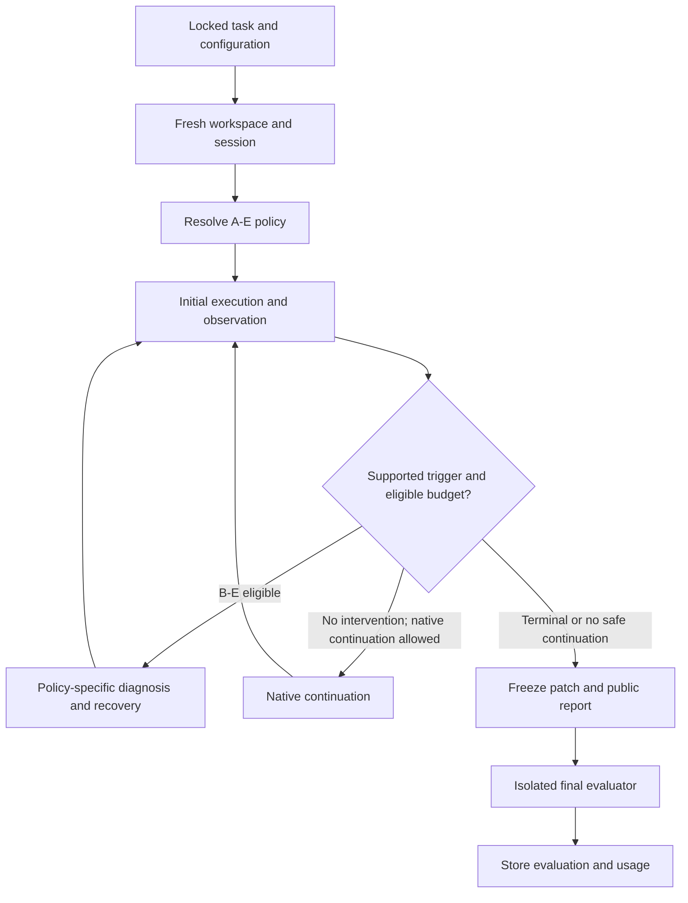
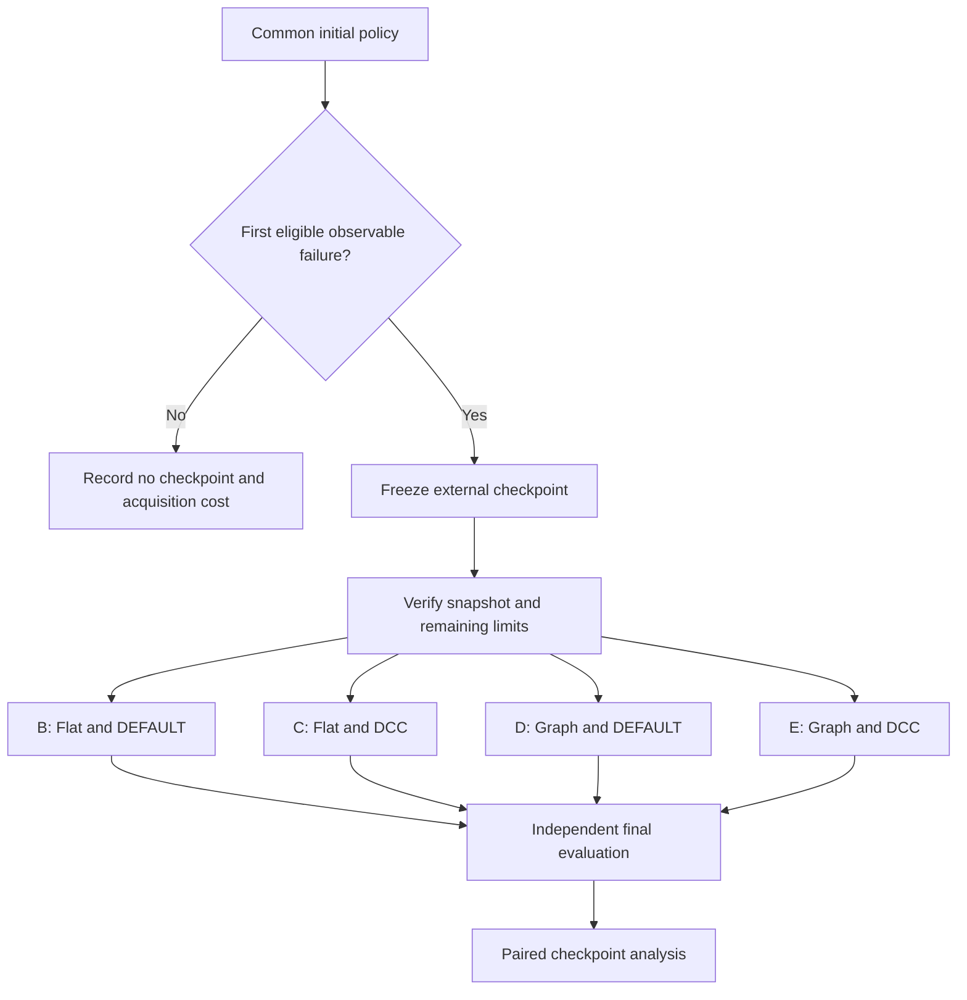

# Adaptive Agent Harness — 실험설계서 (Experiment Design)

## 그래프 기반 실패 복구 및 동적 컨텍스트 최적화를 통한 코딩 에이전트의 신뢰성과 실행 효율 향상

**English title:** Adaptive Agent Harness: Graph-Guided Failure Recovery and Dynamic Context Optimization for Coding Agents

| 항목 | 내용 |
| --- | --- |
| 프로젝트 | Adaptive Agent Harness (AAH) |
| 수행 맥락 | 잇츠 스터디 5기 · Codex 기반 AI 코딩 에이전트 구축 |
| 연구 유형 | 통제된 비교 실험 및 실험적 시스템 연구 |
| 작성일 | 2026-11-25 |
| 버전 | v0.1.0 |
| 상태 | 사전 실험 계획 초안 — Pilot 및 팀 승인 후 동결 예정 |
| 연구 대상 | 동일한 OpenAI Codex 모델을 사용하는 단일 에이전트 |
| 선행 문서 | RESEARCH_PROPOSAL.md, PROJECT_OVERVIEW.md, LITERATURE_REVIEW.md, METHODOLOGY.md, SYSTEM_ARCHITECTURE.md, TECHNICAL_SPEC.md |
| 후속 문서 | BENCHMARK_SPEC.md, EVALUATION_PROTOCOL.md, IMPLEMENTATION_PLAN.md |

> **실험의 목적:** 그래프 기반 복구와 동적 컨텍스트 최적화가 각각, 그리고 함께 적용되었을 때 코딩 에이전트의 성공률, 실패 복구율, 성공당 비용 및 부작용을 얼마나 변화시키는지 동일한 모델과 공통 실행 제약 아래 검증한다.

본 문서는 실행 결과가 아닌 사전 계획이다. 기존 문서의 A–E 비교군, 정책 ID, 방법론을 유지한다. 표본 수, 분석 기준 및 추가 실험 운영값 중 새롭게 제안하는 항목은 명시적으로 구분한다. 실제 모델, 비용, 격리 및 런타임 지원 수준을 확인하기 전에는 실험 설정이 동결되었다고 간주하지 않는다.

---

## 1. 목적 및 검증 범위

### 1.1. 실험으로 답할 질문

1. 외부 보조 정보를 동적으로 구성하는 DCC가 전체 실행 비용을 개선하는가?
2. 코드 구조와 관측 실행 증거를 연결한 복구 정책이 일반 재시도보다 효과적인가?
3. 두 정책을 함께 사용하면 단독 정책보다 추가적인 실용적 이득을 얻는가?
4. 그래프 간 연결, 전략 변경, 컨텍스트 구성 중 어떤 메커니즘이 이득을 만드는가?
5. 개입이 효과적인 상황과 불필요하거나 해로운 상황은 무엇인가?

연구의 목적은 모든 엔지니어링 명칭의 효과를 개별적으로 증명하는 것이 아니다. Harness 및 Loop는 공통 실행과 피드백 구조로 구현하고, 핵심 실험 조작은 Graph 기반 복구와 DCC에 집중한다. Prompt 구성은 실험군별 지침 전달 계약의 일부다.

### 1.2. 검증 범위 및 제외

| 포함 | 제외 또는 후속 연구 |
| --- | --- |
| 동일 모델의 외부 정책 비교 | 모델 재학습·파인튜닝 효과 |
| Python 저장소의 테스트 가능한 수정 과제 | 모든 언어와 개발 환경으로 일반화 |
| 관측 가능한 이벤트 및 공개 검사 기반 실패 진단 | 비공개 내부 추론 및 완전한 인과적 실패 원인 복원 |
| 최초 실행과 복구 경계의 컨텍스트 구성 | 모델 내부 컨텍스트 직접 수정 |
| 고정 상태 머신 내 전략·경로 변화 | 워크플로 자체의 실시간 재배선 |
| 독립 평가, 비용 및 실패 분석 | 선행 시스템을 재현하지 않은 상태에서 SOTA 우위 주장 |

## 2. 연구 질문, 가설 및 비교 계획

기존 제안서 §5의 RQ/H를 유지하며, 관측 가능한 추정 대상(estimand)을 구체화한다.

| ID | 가설 및 연구 질문 | 주 비교 | 결과 변수 | 분류 |
| --- | --- | --- | --- | --- |
| RQ1/H1 | DCC는 성공당 비용을 줄이고 성공률·필수 지침 준수의 실질적 저하를 최소화하는가? | E2E B→C, D→E | 성공당 관측 모델 토큰, 전체 성공률, 지침 준수 | 핵심 |
| RQ2/H2 | 그래프 복구가 일반 재시도보다 효과적인가? | Checkpoint B→D, C→E | 최종 복구 성공률 | 핵심 |
| RQ3/H3 | 결합 정책이 단독 정책보다 추가 이득을 제공하는가? | E2E C→E, D→E; B–E 요인 비교 | 성공률, 성공당 비용 | 핵심 |
| RQ4/H4 | 명시적 연결과 세부 컨텍스트 정책이 추가 가치를 제공하는가? | E→Unlinked, Typed vs Generic, DCC ablation | 복구율, 행동 변화, 비용 | 구성요소 분석 |
| RQ5 | 어느 유형에서 효과적이며 개입 부작용은 무엇인가? | 사전 정의한 유형별 분석, 공통 상태 비교 | 개입률, 악화율, 실패 유형별 효과 | 탐색적 |
| 실용 참조 | 일반적인 Codex 사용 대비 AAH의 가치가 있는가? | E2E A→E | 성공률, 시간, 비용, 사용자 관점 보고 | 핵심 참조 |

**해석 규칙:** H1은 비용 감소만으로 성공했다고 판정하지 않는다. 성공률과 제약 준수도 함께 평가한다. H2는 자연 발생한 공통 실패 체크포인트에서의 복구 정책 효과를 우선한다. H3은 E가 두 단독 조건보다 유리한지와 양의 상호작용 여부를 구분한다. H4의 세부 주장은 해당 ablation을 실제 수행했을 때만 가능하다.

### 2.1. 주 분석 및 다중 비교의 범위

새로운 분석 제안으로 다음 세 대비를 주 분석 가족(primary family)으로 지정한다. 본실험 시작 전에 팀이 승인하고 분석계획 해시를 고정한다.

| 대비 ID | 결과 | 대비 | 방향 |
| --- | --- | --- | --- |
| P-R1 | E2E 성공당 모델 토큰 | B 대비 C | 감소 |
| P-R2 | Checkpoint 복구율 | B 대비 D | 증가 |
| P-R3 | E2E 성공률 | E 성공률에서 더 높은 단독 성공률 `max(C,D)`를 뺀 차이 | 증가 |

P-R3은 `p_E - max(p_C,p_D) = min(p_E-p_C,p_E-p_D)`로 정의하며 각 단독 비교도 함께 보고한다. 비용 면의 추가 이득, C→E의 복구율, A→E 실용 참조, 요인별 주효과와 상호작용은 계획된 보조 분석이다. P-R3가 지지되지 않아도 비용 개선과 성공률 손실을 별도로 보고할 수 있다. 이를 사후에 주 가설 성공으로 바꾸지 않는다.

효과 크기와 불확실성 구간을 중심으로 평가한다. 유의성 검정을 수행할 경우 가족 단위 Holm 보정 계획을 적용하며, P-R3의 단독 두 비교를 모두 지지해야 하는 교집합 검정으로 구성한다. 충분한 표본 및 검정 가정이 확보되지 않으면 p값을 생략하고 기술적·탐색적 분석으로 보고한다.

## 3. 실험 변수와 통제

### 3.1. 독립변수 (Independent Variables)

| 변수 | 수준 | 설명 |
| --- | --- | --- |
| C: DCC 정책 | OFF / ON | 최초 및 복구 보조 컨텍스트 최적화 여부 |
| G: Graph 복구 정책 | OFF / ON | 그래프 증거 선택 및 유형별 전략 결정 여부 |
| 기본 사용 참조 | Native | 별도 외부 개입이 없는 Vanilla Codex |

C와 G는 B–E의 요인이다. 기본 사용 참조 A는 두 요인 이외의 외부 구조 차이도 가지므로 요인 분석에 넣지 않는다. 초기 DCC와 복구 DCC를 각각 분리하는 것은 별도 ablation이다.

### 3.2. 종속변수 (Dependent Variables)

- 주 지표: Task Success Rate, Failure Recovery Rate, Cost per Success.
- 효율 지표: 전체 관측 모델 토큰, 전체 시간, 도구 호출 수, 외부 처리 시간.
- 신뢰성: Instruction Compliance, 공개 검사 악화, 회귀 및 오개입.
- 메커니즘: Selected Context Tokens, Exploration Redundancy, Strategy Adherence, 그래프 탐색 규모, 증거 유효성, 선택적 Fault Localization.

정확한 상태 코드, 평가 함수 및 비용 집계 구현은 후속 `EVALUATION_PROTOCOL.md`에서 확정한다. 이 문서의 추정 대상·분모·통제 조건을 바꾸는 변경은 실험 버전 변경으로 처리한다.

### 3.3. 통제변수 (Control Variables)

| 범주 | 고정 항목 | 확인 방법 |
| --- | --- | --- |
| 모델 | 모델 ID, 추론 설정, 런타임 버전 및 인증 유형 | runtime probe, manifest |
| 과제 | 사용자 요청, 초기 커밋, snapshot, 문서 상태 | task manifest hash |
| 환경 | OS/이미지, 의존성, 작업 경로 정책, 자원 및 네트워크 | environment hash |
| 권한 | 파일 접근, native tools, 필수 지침 및 보안 가드 | config 및 격리 테스트 |
| 예산 | 전체 시간, 실행 단위 상한, 정리 reserve, 지원 시 모델 토큰 상한 | budget ledger |
| 개입(B–E) | T1–T4, 우선순위, gate, 개입 시점, 최대 복구 기회 | trigger parity |
| 컨텍스트(B–E) | 원천 후보 접근, 보조 패키지 상한, 필수 정보, 렌더링 형식 | package/manifest 검사 |
| 검증 | 공개 검사 목록·버전 및 private 평가 | check IDs, evaluator hash |
| 관측 | usage 수집 방식, 로그 필드, 이벤트 지원 범위 | capability report |
| 실행 순서 | 과제·반복별 균형화 및 고정 seed | execution schedule |

실제 주입 토큰, 실행 횟수, 도구 호출 수, 경과 시간 및 선택된 후보는 정책의 결과이므로 동일하게 강제하지 않는다. 그래프 구축·DCC 실행의 오버헤드도 처리 시간에 포함한다. 런타임이 정확한 토큰 상한 강제를 지원하지 않으면 `observe_only`로 고정하고 결과에서 '동일 토큰 예산'이라고 주장하지 않는다.

### 3.4. 사전 정의할 층화 및 조절변수

작업 유형(단일 파일/다중 파일/회귀 위험/복합 수정), 자료 출처(자체/공개), 문서 상태(정상/노이즈/명시적 구버전), 관측 실패 유형(T1–T4)을 기록한다. 초기 난이도는 파일 수·의존성 범위·테스트 범위 등 결과를 보지 않고 정의 가능한 기준으로 분류한다. 유형은 중복 태그와 대표 층을 구분한다. 특정 조건의 실행 결과로 분류한 실패 난이도는 사후 설명 변수이며 사전 무작위화 층으로 사용하지 않는다.

## 4. 비교군 및 2×2 요인 설계

### 4.1. 실험군 매핑

| 조건 | 최초 보조 정보 | 외부 감지/복구 | 진단 | 전략 | 복구 패키지 |
| --- | --- | --- | --- | --- | --- |
| A Vanilla Codex | NONE | 없음 | NONE | NATIVE | NONE |
| B Flat Retry | DEFAULT | 공통 | FLAT | GENERIC | DEFAULT |
| C Context-only | DCC | 공통 | FLAT | GENERIC | DCC |
| D Graph-only | DEFAULT | 공통 | GRAPH | TYPED | DEFAULT |
| E Adaptive Agent Harness | DCC | 공통 | GRAPH | TYPED | DCC |

`GENERIC`의 기본 전략 ID는 `GENERIC_RETRY`이며, `TYPED`의 후보는 `REVIEW_REGRESSION`, `RELOCALIZE`, `REFRESH_EVIDENCE` 및 근거 부족 시 `GENERIC_RETRY`다. `CONTINUE`, `STOP`은 공통 안전·종료 제어와 함께 적용된다. A는 Codex의 네이티브 자체 탐색·수정·테스트 및 내부 반복 기능을 그대로 사용한다.

### 4.2. 요인 배치

| | G=0: Flat | G=1: Graph |
| --- | --- | --- |
| C=0: DEFAULT | B | D |
| C=1: DCC | C | E |

B는 빈 재시도나 고의로 약화한 프롬프트가 아니다. 공개 오류 지문, 관련 diff, 이전 시도, 현재 파일·문서 등 공통 원천을 평면 검색 및 기본 패키징으로 제공한다. 구체적인 DEFAULT 순서와 tie-break는 방법론 및 기술 명세를 따르며 pilot에서 고정한다.

D는 그래프 경로에 근거한 후보 순서 및 유형별 지침을 사용할 수 있지만 DCC의 유효성 가중치, 중복 패널티, 한계 효용 기반 패킹을 사용하지 않는다. B/C는 그래프 거리, 경로, 파생 후보, 유형별 전략을 받지 않는다. 모든 조건에 권한·비밀정보 제거·필수 지침 가드를 적용한다. 공통 안전 가드를 제거하는 ablation은 하지 않는다.

### 4.3. 동일성 및 정책 격리 검증

| 사전 테스트 | 기대 결과 |
| --- | --- |
| Initial parity | 동일 초기 상태의 B/D 패키지 및 C/E 패키지가 메시지 수준에서 동일 |
| Trigger parity | 동일 ledger, snapshot, 공개 검사에서 B–E 감지 결과와 앵커 일치 |
| Graph isolation | B/C에서 그래프 파생 정보 및 유형별 전략 미사용 |
| DCC isolation | B/D에서 DCC 전용 점수 및 중복 제거 미사용 |
| Native baseline | A에 외부 초기 패키지 및 복구 지침 없음 |
| Evidence parity | 원천 코드·문서·공개 이력·검사 접근 범위 동일 |
| Budget parity | B–E의 시간, 실행 단위, 개입 상한 및 실행 경계 동일 |
| Private evaluation isolation | 어떤 실행 정책에서도 hidden test·정답·최종 판정 접근 불가 |

실행 후 분석용 그래프를 별도 구축하는 것은 허용하되 실행 시 정책 입력이 아니며 비용을 별도 표기한다. 비활성 정책의 결과물을 생성해 다른 조건의 실행에 제공하지 않는다.

### 4.4. 비교의 의미

| 비교 | 해석 가능 범위 |
| --- | --- |
| A→E | 전체 하네스의 실용 효과; 구성요소 하나의 효과 아님 |
| B→C | Flat 조건에서 초기·복구 DCC 전체 효과 |
| D→E | Graph 조건에서 초기·복구 DCC 전체 효과 |
| B→D | DEFAULT에서 그래프 증거 선택+전략 선택 묶음 효과 |
| C→E | DCC에서 그래프 증거 선택+전략 선택 묶음 효과 |
| B–E | 두 정책의 주효과, 가법적 상호작용 |

A–E만으로 Cross-Graph Mapping 또는 유형별 전략 지침의 순수한 효과를 구분할 수 없다. 해당 주장은 §8의 별도 실험에 한정한다.

## 5. 평가 과제 및 표본 구성

### 5.1. 개발용과 평가용 분리

| 집합 | 목적 | 규모 후보 | 본실험 사용 |
| --- | --- | --- | --- |
| Smoke | 실제 Codex 연동, 공개 검사, patch freeze, 독립 평가 검증 | 1–2개 | 제외 |
| Dev/Pilot | 정책 점수·임계값·환경·비용 조정 | 5–8개 | 제외 |
| Main | 모든 A–E 조건의 일반 평가 | 20–24개 | 포함 |
| Checkpoint | Main 또는 사전 지정한 별도 평가 과제에서 공통 자연 실패 확보 | 확보 가능 수에 따름 | 프로토콜별 분리 |
| Ablation | 사전 고정한 평가 부분집합/체크포인트 | §8·§9 참고 | 해당 분석만 |

Smoke 과제를 Dev의 일부로 사용하는 것은 허용하되 Main에 재사용하지 않는다. Checkpoint용 과제를 Main과 공유할 경우 결과를 서로 독립 표본으로 합산하지 않는다. 과제별 여러 문서 변형이나 동일 저장소의 다수 과제도 상관성이 있으므로 관련 task family/repo ID를 기록한다.

### 5.2. 과제 구성 제안

기존 문서는 20–24개 과제와 자체·공개 과제 혼합을 제안하되 정확한 비율을 정하지 않았다. 다음은 구현 및 실험 준비를 위한 신규 목표 배분이며 `BENCHMARK_SPEC.md`에서 과제 ID를 확정한다.

| 주 유형 | 자체 신규 | 공개 후보 | 합계 (24개 기준) |
| --- | ---: | ---: | ---: |
| 단일 파일 버그 | 4 | 2 | 6 |
| 파일 간 의존성 버그 | 4 | 2 | 6 |
| 회귀 위험 수정 | 4 | 2 | 6 |
| 복합 수정 | 4 | 2 | 6 |
| 합계 | 16 | 8 | 24 |

문서 상태는 가능하면 정상 12, 중복·무관 6, 명시적으로 오래된 보조 안내 6을 목표로 한다. 이 비율은 고정된 실데이터 특성이 아니라 자체 신규 과제에서 조건을 설계하기 위한 후보이며, 공개 과제의 실제 문서 상태는 임의 분류하지 않는다. 문서를 의도적으로 교란한 경우 별도 표시한다. 자료 출처별 분석 및 정상 문서 환경 결과를 함께 제시하여 인위적 노이즈 조건이 전체 결론을 좌우하는지 확인한다.

동일 underlying bug의 문서 변형은 같은 task family로 묶으며 개발/평가 경계를 넘지 않도록 한다. 가능하면 서로 다른 저장소를 사용하고, 여러 과제가 같은 저장소에 속할 경우 저장소 수준 민감도 분석을 추가한다. 공개 SWE-bench 계열 후보는 실제 실행, 라이선스, 정답 유출 및 평가 타당성을 확인한 경우만 포함한다. 공개 과제가 준비되지 않으면 결과를 보기 전에 자체 과제로 대체하고 변경 이유를 기록한다.

### 5.3. 사전 품질 검사

- 초기 버그 상태가 관련 검증에서 실패하는지, 기준 패치가 기능·회귀·제약 검증을 통과하는지 확인.
- 테스트가 특정 정답 패치의 구현 형태만 강제하지 않는지 리뷰.
- 공개 검사와 private evaluator의 경계 및 실제 접근 차단 확인.
- 명령·의존성·외부 네트워크 없이 재현 가능한 환경 확보.
- 보조 정보는 필수 규칙과 명확히 분리하고 출처·버전·적용 범위를 기록.
- 중복 과제, 평가 환경 오류, 과제 설명의 모호성 및 라이선스 검토.

Main의 테스트 품질 문제는 모델 성능을 확인하기 전에 가능한 한 해결한다. 동결 이후 결함이 발견되면 원래 결과를 보존하고 §12의 공통 규칙으로 처리한다.

## 6. Protocol 1 — End-to-end Evaluation

### 6.1. 목적과 실험 단위

개발자가 동일한 과제를 처음부터 실행할 때 정책별 최종 성공률, 비용 및 개입 부작용이 달라지는지 평가한다. 단일 관측 단위는 `task_id × condition × repetition`의 실행(run)이다. 추론 및 불확실성 분석의 기본 단위는 과제이며 반복은 과제 안에 중첩된다. 최초 성공 사례와 개입이 발생하지 않은 사례도 포함한다.

### 6.2. 실행 순서



1. Manifest로 과제·조건·반복·실행 순서 및 설정 해시를 확인한다.
2. 동일 초기 커밋 및 필수 지침에서 독립 workspace와 새 세션을 생성한다.
3. 조건에 해당하는 최초 컨텍스트 정책을 실행한다.
4. 공통 runtime 및 공개 관측 계약에 따라 Codex를 실행한다. A는 외부 개입 없이 네이티브 실행한다.
5. B–E는 공통 T1–T4와 gate를 적용하고 조건별 정책으로 후속 지침을 구성한다.
6. 전체 한도 또는 종료 조건에 도달하면 실행을 종료하고 가능한 최종 패치를 고정한다.
7. 제어부가 접근할 수 없는 독립 평가 환경에서 최종 패치를 평가한다.
8. 원시 기록, 사용량, 결과 상태, 설정 및 artifact hash를 저장한다.

Hidden test 결과는 어떤 경우에도 후속 수정에 사용하지 않는다. 평가 불합격을 근거로 동일 run을 재시작하지 않는다. A에서도 같은 전역 실행 제약과 측정 범위를 적용한다. 외부 관측 또는 평가 비용이 A의 네이티브 행동을 변경하지 않도록 한다.

### 6.3. 반복과 실행 순서

기본 계획은 조건별 2회 독립 실행이다. 모델 seed 지원 여부와 무관하게 새로운 세션과 작업 환경을 사용한다. 동일 과제의 모든 조건을 한 블록으로 묶고, 반복별 조건 순서를 고정한 schedule에 따라 균형화한다.

새롭게 제안하는 스케줄은 5조건 Williams형 균형 배열(홀수 조건이므로 기본 순열의 순환 이동 5개와 각각의 역순, 총 10개)을 과제·반복 블록에 배정하는 방식이다. 예: 기본 순서 A,B,E,C,D 및 순환 이동 후 역순. seed 후보는 20261125이며 이는 실행 순서의 재현용일 뿐 모델 샘플링 seed가 아니다. 층별 배정과 총 실행 블록에서 각 조건의 순서 위치 편차를 점검하고 schedule.csv를 사전 생성한다. 제공 모델이 시간에 따라 바뀌는 경우 조건을 한꺼번에 몰아서 실행하지 않고 블록 단위로 분산한다.

동시 실행은 격리 및 자원 경합 검증 후 결정한다. 실제 rate limit, 캐시 상태, CPU/GPU/네트워크 경합을 로그에 남기며, 시간 측정의 공정성을 위해 기본은 동일한 동시성 수준으로 고정한다.

### 6.4. 주요 결과와 추정 범위

모든 예정 실행의 상태를 공개한다. 각 조건의 전체 성공률·비용과 A→E 대비를 제시한다. 실패가 관측된 실행만을 골라 조건별 복구율을 비교하면 DCC가 초기 실패 집단을 변화시킬 수 있어 선택 편향이 생긴다. 그러므로 E2E의 조건별 자연 실패 후 성공률은 기술 통계로만 제시하고, 복구 정책의 비교는 Protocol 2를 우선한다.

## 7. Protocol 2 — Common Failure Checkpoint Evaluation

### 7.1. 목적

같은 외부 실패 상태에서 복구 정책만 다르게 적용하는 비교다. 초기 DCC에 의해 실패 빈도와 종류가 달라지는 문제를 완화한다. 내부 모델 상태까지 복제되었다고 주장하지 않으며 세션 복제 가능성은 capability probe로 판단한다.

### 7.2. 공통 실패 상태 확보

새로운 실행 계획으로, 사전 지정한 평가 과제 순서에서 **B의 DEFAULT 초기 컨텍스트와 동일한 공통 초기 정책**을 사용하되 첫 eligible trigger까지 외부 복구 지침을 전달하지 않는 source run을 수행한다. source run을 Main의 특정 조건에서 선택해 재사용하지 않는다. 첫 eligible 지점에서 멈출 수 있는 공개 실행 경계를 확보해야 한다.

eligible 기준은 T1–T4의 관측 가능한 증거, 동일 gate, 남은 실행 단위와 시간, 안전한 snapshot 복원 가능성이다. T5 또는 단순 인프라 장애를 자연 실패 체크포인트로 편입하지 않는다. 이미 정상 완료했거나 트리거가 없거나 복구 예산이 없는 source run은 수집 실패/미발생으로 기록한다. 사후 평가 결과로 고르지 않는다. 트리거가 여러 개인 경우 공통 우선순위 T3→T1→T2→T4를 pilot 고정값에 따라 적용한다.

원칙적으로 과제당 첫 eligible 자연 실패 1개를 사용한다(새 제안). 여러 source 반복이 필요하면 사전 정한 반복 수와 순서에서 첫 eligible 상태를 사용한다. 발생하지 않은 과제와 소진한 비용을 함께 보고한다. 인위적으로 주입한 실패는 별도 protocol ID로 실행하고 자연 발생 집단의 분모에 합치지 않는다.

### 7.3. CheckpointRecord 필수 계약

`TECHNICAL_SPEC.md` §13.2의 필드를 유지한다.

| 정보 | 필드/검증 |
| --- | --- |
| 식별 | checkpoint_id, source_run_id, task_id, initial_policy_hash |
| 작업 상태 | snapshot_id, workspace_bundle_ref/hash; 관련 tracked/untracked/삭제 복원 |
| 공통 증거 | common_evidence_ref/hash, trigger_ids, anchor_ids |
| 공통 지침 | fixed_requirements_hash, common_history_ref/hash |
| 환경·예산 | environment_hash, remaining_limits, initial_usage_refs |
| 세션 | session_clone_verified |

restore 후 파일 상태 및 snapshot hash를 확인한다. 동일한 실패 지문과 공개 이력 입력을 사용하며, 정책별 그래프 및 컨텍스트는 각각 재계산한다. 평가 테스트, 원본 private task spec, 정답 패치의 복제는 금지한다.

### 7.4. 분기 실행

복원 진입은 [TECHNICAL_SPEC §11.1·13.2](../design/TECHNICAL_SPEC.md)의 RESTORE_VERIFY와 동결 트리거를 사용한다. branch는 최초 DCC·새 작업 턴을 재실행하지 않는다. “첫 eligible”은 고정 프로파일에서 실제 관측 가능한 quiescent 경계에서 확인한 최초 상태다.



각 분기는 동일한 source snapshot, 공통 이력, 필수 지침, 공개 증거 및 잔여 예산을 제공한다. 내부 세션 복제가 검증되지 않으면 모든 분기에 동일한 `NEW_SESSION` 정책 및 동일 공통 이력 요약을 사용한다. 이때 공통 이력 요약은 특정 정책의 graph-derived 정보나 DCC 결과를 미리 포함하지 않는다. 분기 초기에는 기존 실패 트리거에 해당하는 복구 정책을 수행한다. 이 시점에 최초 DCC를 별도 수행하지 않으며 C/E의 DCC 조작은 복구 패키지에 적용된다.

잔여 실행 시간, 턴, 복구 기회는 checkpoint에서 고정하며 분기별 비용 시작점은 restore 완료 후 공통 정책 준비 시작 시점으로 통일한다. 복원 비용도 별도 기록하여 사용자 관점의 총비용을 재구성할 수 있게 한다. 모든 분기는 독립 workspace, run ID 및 세션 정책을 사용한다. 분기 순서는 균형 배열 또는 사전 seed로 무작위화한다. 각 checkpoint에서 B–E를 한 세트로 처리한다.

### 7.5. 결과 및 비용 회계

- 최종 복구 성공률: 공통 checkpoint 집합에서 독립 평가 PASS 비율.
- 1차 개입 뒤 공개 검사 개선, 전략 수행, 최종 복구는 별도 지표다.
- 동일한 source 상태에서 분기하므로 조건별 성공률 차이는 해당 관측 가능한 초기 상태의 정책 효과로 해석한다.
- 초기 source 비용은 실제 프로젝트 지출에서 한 번만 계상한다. 분기별 사용자 관점 재구성 비용은 `공통 source 비용 + 해당 분기 비용`으로 표시하되 이를 실제 지출 합과 구분한다.
- 선택된 checkpoint의 대표성은 발생률, 트리거 유형, 원천 과제 유형, 세션 정책 및 남은 예산 분포로 제시한다.

## 8. Protocol 3 — Ablation Study

### 8.1. 우선순위

선행연구 분석 §6과 방법론 §13의 권고를 반영한다. P0은 A–E 본실험 및 공통 실패 평가다. P1은 선행 방법과 차별성을 검증하는 데 직접 관련된 항목이다. P2는 자원이 허용할 때만 수행한다.

| ID | 우선순위 | 조작 및 대조 | 분석 대상 |
| --- | --- | --- | --- |
| AB1 | P1 | E vs Unlinked | 명시적 그래프 간 연결 효과 |
| AB2 | P1 | Typed vs Generic, 동일 증거 패키지 | 전략 지침 변경의 독립적 효과 |
| AB3 | P1 | Initial-only / Recovery-only / Both / Neither | DCC 적용 시점별 효과 |
| AB4 | P1 | 연결 그래프 vs 평면, 같은 원천 접근·공통 전략 | 관계 구조 기반 검색의 추가 효과 |
| AB5 | P2 | Repo-only / Exec-only / Dual | 각 그래프의 기여 |
| AB6 | P2 | DCC without validity / without dedup | 세부 컨텍스트 선별 효과 |
| AB7 | P2 | Static / Retrieval-only / DCC | 기존 JEC 비교 질문 |
| AB8 | P2 | 의미 있는 연결 vs 연결 수를 맞춘 무작위 연결 | 관계 의미의 기여(탐색) |
| AB9 | 조건부 | 가까운 선행 방법 재현 | 직접 상대 비교 |

기존 제안서에서 우선했던 평면 비교를 AB4로 유지하고, 문헌 검토에서 추가된 전략 분리 AB2를 별도 지정한다. 추가 실험은 새로운 조건 ID 및 manifest를 사용하며 기본 A–E 매핑을 바꾸지 않는다.

### 8.2. AB1 — Cross-Graph Mapping

공통 checkpoint에서 연결된 그래프 조건(E)과 `Unlinked`를 비교한다. 두 그래프의 원본 노드 및 내부 엣지, 원천 정보 접근, 탐색 깊이와 방문 상한, DCC 정책, 전략 결정 코드, 메시지 형식 및 예산은 동일하게 유지한다. Unlinked에서는 명시적 cross-graph traversal을 비활성화하고 두 그래프를 독립적인 평면 실패 키/경로 앵커에서 탐색해 사전 정의된 순위 병합 규칙으로 후보를 구성한다. 연결을 제거한다고 원천 파일이나 로그 접근을 제한하지 않는다. 탐색 상태 총량의 상한은 양쪽에 동일하게 적용한다.

후보와 전략의 변화는 연결 제거의 결과다. 따라서 이 대비는 연결을 사용한 전체 복구 정책의 조건부 효과이지, 동일한 최종 지침 아래 그래프 구조만 바꾼 효과는 아니다. 복구율, 후보 품질, 탐색 비용, 중복 탐색을 기록한다.

### 8.3. AB2 — Typed Strategy vs Generic Strategy

AB2는 동일 checkpoint·그래프 진단에서 증거 블록/순서/출처를 한 번 생성해 해시로 고정한다. 선택에 사용할 공통 전략 기준 및 공동 준비 비용 귀속은 Pilot 후보이며 OD-18에서 승인한다. 두 분기는 같은 증거 바이트를 소비한다. 변경은 전략 ID·목표와 사전 명시된 전략별 다음 행동 텍스트에 한정되고 검사 권한·후보·결과가 달라지지 않는다. 실제 두 렌더의 cap을 **어느 분기도 실행하기 전에** 같은 추정기로 확인한다. 양쪽이 유효한 쌍만 시작하고 차단된 쌍·공동 준비 비용을 기록한다. 쌍별 차단·결측 분석 규칙은 사전 승인한다. 패딩이나 분기별 후보 재선정은 금지한다.

**주 AB2 분석:** 첫 후속 실행 1단위의 결과를 고정하여 공개 검사 변화 및 사전에 정의한 Strategy Adherence를 평가한다. 해당 시점의 패치를 독립적으로 평가하는 별도 one-step 실험을 실시할 경우 그 이후 복구는 수행하지 않는다. **보조 분석:** 다단계 복구를 비교할 경우 첫 지침 이후의 정책을 양쪽 동일하게 고정하고 실제 잔여 한도를 적용한다. Typed 정책이 GENERIC으로 fallback하는 상태도 포함하고 빈도와 결과를 보고한다(정책 배정 기준). 실제로 유형별 지침이 전달된 부분집합 결과는 사후 선택임을 표시한다.

### 8.4. AB3 — DCC 적용 시점

그래프 복구를 ON으로 고정한다. 최초 및 복구 패키징에 대해 두 요인을 교차한다.

| 조건 | 최초 | 복구 |
| --- | --- | --- |
| Neither (D) | DEFAULT | DEFAULT |
| Initial-only | DCC | DEFAULT |
| Recovery-only | DEFAULT | DCC |
| Both (E) | DCC | DCC |

E2E에서 네 조건을 비교하며, 동일 과제·설정·반복의 D/E 결과를 재사용할 때는 동결된 동일 구현 버전과 schedule block 요건을 충족해야 한다. 초기 DCC는 실패 발생 집단도 변화시키므로 조건별 자연 실패 복구율을 순수 효과로 사용하지 않는다. 복구 단계에 한정한 정책 효과는 공통 checkpoint D/E 비교를 함께 참조한다.

### 8.5. AB4–AB9 운영

AB4는 Graph와 Flat에서 동일 원천 후보 풀, 공통 전략 `GENERIC_RETRY`, 공통 패키징(DCC) 및 상한을 사용한다. 전략을 통제했으므로 검색 방식의 차이를 평가한다. 그래프 파생 관련도는 그래프 검색 처리의 일부이며 비그래프 조건에서 사용하지 않는다. AB5는 원천 접근을 유지하고 특정 그래프 탐색만 제거한다. AB6에서 유효성 가중·보조 안내 필터와 공통 보안 가드를 구분하며 후자는 유지한다. AB7의 Static 조건은 보조 풀 전체 제공이 공통 cap에 맞는 사전 구성 과제에서만 실행하고, 길이가 다른 조건은 별도 비용 비교로 표시한다. AB8은 무작위 엣지를 실제 코드 관계라고 모델에 주장하지 않도록 실험 전용 안전한 제어 조건에서만 검토한다. AB9는 실제 공개 구현 및 지원 범위가 검증되면 별도 계획을 작성한다.

AB1/AB2를 수행하지 않으면 관계 연결 또는 전략 변경의 순수 효과를 주장하지 않는다. 모든 ablation의 미수행 여부와 이유를 최종 보고서에 기록한다.

## 9. 실험 규모, 비용 및 실행 우선순위

### 9.1. 실행 횟수 계획

기존 제안서의 Main 20–24개 × 5조건 × 2회(200–240회)를 유지한다. 아래 checkpoint·ablation 규모는 본 문서에서 추가 제안하며, 확보율과 실제 잔여 예산을 보고 **평가 결과 열람 전에** 확정한다. 실행(run) 1회는 모델 호출 1회와 동일하지 않다.

| 단계 | 기본 규모 | 실행 수 | 비고 |
| --- | --- | ---: | --- |
| Smoke | 1–2개 과제 | probe 및 반복 검증에 따름 | 실제 런타임과 격리 확인 |
| Pilot | 개발용 5–8개 × 5조건 × 1회 | 25–40 | 일부 replay, 설정 조정, checkpoint 검증 별도 |
| Main (E2E) | 24개 × 5조건 × 2회 | 240 | 20개로 축소 시 200 |
| Checkpoint acquisition | 평가 과제 최대 24개 × 1회 | 최대 24 | 첫 eligible trigger에서 고정 |
| Checkpoint branches | 목표 12개 checkpoint × 4조건 × 1회 | 목표 48 | 실제 발생 수에 따라 변동 |
| AB1 | 목표 8개 checkpoint × 2조건 | 16 | E를 동일 조건에서 재실행하는 보수적 계산 |
| AB2 | 목표 8개 checkpoint × 2조건 | 16 | 1차 개입 전용 분기 |
| AB3 | 목표 8개 과제 × 4조건 | 32 | D/E 재사용 전에는 32회로 산정 |
| AB4 | 목표 8개 checkpoint × 2조건 | 16 | 자원 부족 시 후순위 |
| AB5–AB9 | 별도 승인 | 미정 | 핵심 결과 이후 검토 |

Main 240회, source 최대 24회 및 분기 48회이면 P0 평가 실행은 최대 계획상 312회다(목표 checkpoint 수를 달성한다고 가정). P1의 AB1–AB4까지 모두 별도 실행하면 80회가 추가되어 392회이며, pilot·smoke·개발 호출은 별도다. Main 200회로 축소하는 경우 동일한 다른 예산을 가정하면 272회/352회다. 목표 checkpoint 12개를 확보할 수 있다는 보장은 없고, 더 적은 경우 확보된 전체 적격 상태를 사용한다. 12개보다 많은 경우 사전 고정한 source 순서의 첫 12개를 선택하고 나머지의 적격 여부도 기록한다. 실행 수는 비용이 아니라 계획용 수량이다.

### 9.2. 사전 축소안

| 계획 | Main | Checkpoint | P1 |
| --- | ---: | --- | --- |
| Full | 24 × 5 × 2 = 240 | 12개 목표, B–E | AB1–AB4 |
| Core | 20 × 5 × 2 = 200 | 8–12개 목표, B–E | AB1, AB2 우선 |
| Reduced | 12 × 5 × 2 = 120 | 최대 6–8개 목표, B–E | 가능 시 AB2 |
| Emergency / exploratory | 8 × 5 × 1 = 40 | 가능한 공통 상태, B–E | 생략 가능 |

Reduced/Emergency 규모는 새 대안이다. 과제 수가 감소하면 적용 조건의 일반화와 신뢰구간 정밀도가 크게 제한된다. Emergency는 본래 규모의 확인적 실험이 아니라 탐색적 MVP 평가로 명시한다. 동일 조건 내 일부 좋은 run만 남기는 방식으로 예산을 축소하지 않는다.

### 9.3. 비용 산정 및 중단 규칙

각 단계별 실행당 실제 관측 사용량과 시간을 pilot에서 측정한다. 단위가 일치하는 경우 다음 산식을 사용한다.

$$
\widehat C_{total}=\sum_{s,c} n_{s,c}\widehat c_{s,c}+C_{probe}+C_{dev}+C_{reserve}.
$$

- $s$: 실험 단계(Main, source, branch, ablation 등), $c$: 조건.
- $n_{s,c}$: 예정 실행 수, $\widehat c_{s,c}$: 단계·조건별 실행 비용 추정치.
- reserve는 실제 사용 가능한 프로젝트 자원의 20%를 잠정 권고한다. 모델 요금, 크레딧, 시간은 단위별로 독립 계산한다.

실행당 평균 및 중앙값 외에 상위 비용 사례(충분한 pilot이면 p90)를 기록하여 긴 복구 실행의 위험을 추정한다. Checkpoint source와 분기는 별도로 측정하고, 그래프/DCC의 로컬 시간 및 추가 모델 사용량도 포함한다. 추정 비용과 실제 차감액을 섞지 않는다. 정확한 금액을 확인할 수 없다면 토큰 또는 측정 가능한 차감량만 사용한다.

예산 부족 가능성이 확인되면 평가 전에 Full/Core/Reduced 중 하나를 선택한다. 동결 이후에는 프로젝트 전체 하드 상한에 따라 중단하며, 미실행 run을 `NOT_RUN_BUDGET`으로 표시한다. 완료된 블록과 불완전 블록을 별도로 보고하고, 불완전 블록을 임의로 채우거나 선택적으로 폐기하지 않는다. 평가 결과를 보고 조기 종료하는 정책은 본 계획에 포함하지 않는다. 안전·권한 위반 또는 공급자 장애 시에는 결과와 무관한 공통 중단 규칙을 사용한다.

### 9.4. 표본 정밀도에 대한 사전 고려

20–24개 과제에 2회 반복하는 규모는 실험적 시스템 연구의 현실적 목표이지 충분한 검정력의 증명이 아니다. 예를 들어 서로 독립인 24개 과제의 단일 이진 결과에서 성공률 50% 부근의 단순 정규근사 95% 오차 범위는 약 ±20%p다. 실제 paired 대비의 정밀도는 조건 간 불일치율과 과제 내 반복·저장소 상관에 따라 달라진다. 이 수치를 paired 효과의 신뢰구간으로 사용하지 않는다.

Pilot의 과제별 차이 분포로 예상 정밀도를 추정할 수 있으나 작은 pilot의 효과 크기를 확정된 모수로 사용하지 않는다. 평가 전 희망 효과 크기와 가능한 표본 수를 기록한다. 실패 체크포인트가 적으면 H2의 분석도 탐색적으로 제한한다. 반복 횟수 증가만으로 독립 과제 수 부족을 해결할 수 없다.

## 10. 평가 지표 및 산출 방식

후속 `EVALUATION_PROTOCOL.md`에서 구체적인 평가 스크립트, 상태 매핑 및 로그 필드를 정의한다. 아래는 실험 설계에서 변경할 수 없는 주요 분모와 해석 원칙이다.

### 10.1. 성공 및 복구

과제 $i$, 조건 $c$, 반복 $r$의 최종 평가 결과를 $Y_{icr}\in\{0,1\}$로 정의한다. 기능, 회귀, 필수 제약을 모두 만족하면 1이다. 공개 테스트 통과나 에이전트 완료 선언은 그 자체로 성공을 의미하지 않는다.

$$
\bar Y_{ic}=\frac{1}{R_{ic}}\sum_r Y_{icr},\qquad p_c=\frac{1}{N}\sum_i\bar Y_{ic}.
$$

여기서 N은 분석에 포함한 공통 과제 수, $R_{ic}$는 사전 정의한 유효 반복 수다. 모든 반복이 완전하면 전체 run 성공 비율과 일치한다. 결측이 있는 경우 과제별 평균에 동등 가중을 부여한 결과와 전체 유효 run 비율을 구분한다. 주 paired 분석의 결측 기준은 §12를 따른다.

Checkpoint $j$에서의 정책별 최종 통과값을 $Z_{jc}$라 하면

$$
FRR_c=\frac{1}{J}\sum_{j=1}^{J} Z_{jc}.
$$

J는 [EVALUATION_PROTOCOL §6.2](EVALUATION_PROTOCOL.md)의 대비별 공통 유효 branch가 있는 checkpoint 수다. 적격·선택·유효·미확보와 acquisition 비용은 별도 집계한다. 공개 T1–T4로 선정한 상태의 최종 독립 PASS 비율이며, 선정 시점의 hidden FAIL→PASS나 비개입 대비 효과로 해석하지 않는다.

### 10.2. 비용 및 시간

$$
CPS_c=\frac{\sum_{i,r} C_{icr}}{\sum_{i,r}Y_{icr}}.
$$

$C_{icr}$는 동일 단위의 전체 실행 비용이며 성공하지 못한 실행 비용도 포함한다. 토큰, 실제 통화 비용(가능할 때), 추정 통화 비용(가능할 때)을 각각 보고한다. 실제 과금, 구독 크레딧 및 토큰 환산치를 동일 단위로 합치지 않는다. 성공이 0건이면 CPS는 유한값으로 계산하지 않는다. 비용이 결측인 실행을 0으로 처리하지 않는다. 주 P-R1은 완전한 공통 사용량 관측 범위에서 평가하고, 결측이 큰 경우 판단 보류 및 민감도 분석을 적용한다.

| 지표 | 산식 또는 계측 범위 |
| --- | --- |
| End-to-End Token Usage | 초기·후속·추가 모델 호출의 확인 가능한 사용량 합; cached/reasoning 중복 합산 금지 |
| Runtime Wall Time | 공통 요청 검증 시작부터 패치 고정 또는 안전 종료까지 |
| Evaluator Time | 독립 평가 시작부터 판정까지; 별도 계측 |
| End-to-End Time | 실행 시간 + 독립 평가 시간; 대기 및 준비 시간 포함 범위를 명시 |
| Local Overhead | snapshot, graph build/query, DCC, 공개 검사, fallback 경과 시간 |
| Selected Context Tokens | 외부 보조 정보 패키지의 추정 토큰 수; 실제 모델 입력과 구분 |

시작·종료 시점은 TECHNICAL_SPEC §11.2의 monotonic 기록 계약을 따른다. 겹쳐 실행되는 단계 시간을 중복 합산해 wall time을 만들지 않는다. 모델 token cap이 observe-only이면 실측 사용량을 기록하되 실제 초과 자체를 hard cap 위반으로 분류하지 않는다.

### 10.3. 신뢰성 및 메커니즘 지표

| 지표 | 정의 및 해석 |
| --- | --- |
| Instruction Compliance | 필수 제약 검사 전체 통과 비율, 기능 결과와 별도 보고 |
| Tool Calls | 관측 가능한 도구 호출 수, runtime 지원 범위 표시 |
| Exploration Redundancy | 중복으로 판단한 탐색 행동 수 / 비교 가능한 탐색 행동 수; 분모 0은 N/A |
| Trigger Rate | 관측 가능한 T1–T4 발생 run / 유효 탐지 관측 run. 범위 전체에 대한 coverage 및 A의 사후 관측을 별도 표시 |
| Intervention Rate | 전달 확인된 개입이 1회 이상 있는 run / 전체 run; 예약·전달·실패 구분 |
| Fallback Rate | 기본 복구로 대체된 개입 결정 / 개입 결정 수 |
| Strategy Adherence | performed / not_observed / contradicted / unknown; 관측 불충분을 미수행으로 단정 금지 |
| Fault Localization | 검증된 원인 위치가 있는 사례의 후보 Top-k 포함률; patch 위치를 원인 정답으로 자동 지정하지 않음 |
| Harmful Intervention | 개입 뒤 새 공개 실패 또는 기존 검사 악화, 공통 checkpoint 대조군 차이 별도 |
| Diagnostic Coverage | graph 구축·연결·앵커 및 candidate provenance가 관측된 범위 |

Harmful Intervention은 관측상의 악화와 정책에 의한 악화를 구분한다. 개입된 run만의 악화율을 보고 원인을 단정하지 않으며 공통 checkpoint에서의 대조군 차이를 우선한다. 동일 검사 ID와 환경에서 비교 가능한 전후 결과만 악화 판정에 사용한다.

## 11. 통계 분석 계획

### 11.1. 기본 보고

조건별로 예정·실행·유효·성공·실패·인프라 오류·미실행 수, 과제 수 및 반복 수를 먼저 보고한다. 성공률과 FRR은 절대 비율 및 절대 차이(%p), 비용은 평균·중앙값·IQR 및 성공당 비용, 시간은 평균·중앙값·IQR로 보고한다. 비용 감소율은 비교 기준의 유한 양수 비용이 있는 경우에만 계산한다.

### 11.2. Paired 비교

각 과제에 대해 반복 평균을 계산한 뒤 비교한다.

$$
\Delta_{a\to b}=\frac{1}{N}\sum_{i=1}^N(\bar Y_{ib}-\bar Y_{ia}).
$$

Checkpoint에서는 동일 checkpoint의 분기를 paired unit으로 사용한다. 한 underlying task family에서 여러 checkpoint가 생기면 family 수준 군집을 유지한다. 반복 run을 독립 표본으로 사용한 일반적인 두 비율 z-test는 주 분석으로 사용하지 않는다.

### 11.3. 2×2 요인 효과

B=(0,0), C=(1,0), D=(0,1), E=(1,1)이며 첫 번째 요인은 DCC, 두 번째는 Graph다. 성공률 또는 FRR의 가법적 척도에서 다음을 계산한다.

$$
\Delta_C=\frac{(p_C-p_B)+(p_E-p_D)}{2},\qquad
\Delta_G=\frac{(p_D-p_B)+(p_E-p_C)}{2}.
$$

$$
\Delta_{int}=(p_E-p_D)-(p_C-p_B)=p_E-p_D-p_C+p_B.
$$

각 조건 효과 및 상호작용은 같은 과제/체크포인트 집합에서 계산한다. A는 요인에 포함하지 않는다. E가 C와 D보다 모두 높은 것과 양의 상호작용은 서로 다른 조건이다. 비용의 경우 비용 단위에서 별도 효과를 계산하고 방향을 명시한다. 성공당 비용은 비율 지표이므로 이 식의 해석을 자동으로 동일하게 적용하지 않는다. 대신 부트스트랩에서 조건별 CPS와 그 대비를 다시 계산한다. Checkpoint의 C 효과는 초기 DCC가 아닌 복구 DCC 효과다.

### 11.4. Paired cluster bootstrap

새롭게 제안하는 기본 분석 설정은 bootstrap 10,000회, 분석용 seed 20261126, 양측 95% percentile 구간이다. 실행 순서 seed와 분석 seed는 서로 다른 역할을 가진다.

```python
# 개념 의사코드: 각 task family의 모든 조건과 반복을 함께 재표집한다.
point = statistic(complete_blocks)
replicates = []
for b in range(10_000):
    sampled_clusters = sample_with_replacement(cluster_ids, len(cluster_ids), rng)
    sample = concatenate_clusters(sampled_clusters, preserve_multiplicity=True)
    replicates.append(statistic(sample))
ci = percentile(replicates, [2.5, 97.5])
```

동일 task family의 조건·반복을 함께 뽑고, 같은 클러스터가 여러 번 뽑혔을 때 중복을 유지한다. 단일 과제별 독립 family이면 task bootstrap과 같다. 저장소 간 상관이 중요하고 저장소가 충분하면 repository cluster bootstrap을 민감도 분석으로 추가한다. 저장소 수가 너무 적으면 신뢰할 만한 저장소 수준 구간으로 주장하지 않고 leave-one-repository-out 결과를 보여준다.

CPS의 bootstrap 표본에서 성공 건수가 0인 경우 ratio가 정의되지 않음을 표시한다. 해당 replicate를 조용히 버려 좁은 구간을 만들지 않는다. 무정의 표본 수/비율을 보고하고, 양측 유한 구간을 지지할 수 없으면 CPS 구간을 결론 불충분으로 처리한다. 작은 표본, 특히 checkpoint 수가 작거나 성공률이 경계값에 가까울 경우 percentile 구간은 불안정할 수 있으므로 관측 분자·분모와 raw paired 차이를 함께 제시한다.

### 11.5. 검정, 비열등성 및 해석

[EVALUATION_PROTOCOL §11](EVALUATION_PROTOCOL.md)의 H1/H3 해석, 최소 유효 표본/coverage, P-R3 동률 추론의 승인 규칙이 기준이다. P-R3 점추정과 기존 주 대비를 유지한다. 허용 손실·유효 표본 및 분석 방법은 OD-08/10에서 동결 전 승인한다.

- 주 결과는 효과 크기와 95% 구간이다. H2/H3의 성공률 개선은 차이의 방향과 불확실성으로 해석한다.
- 선택적 검정 수행 여부는 pilot 후 동결 전에 결정한다. 가정이 충족될 경우 과제 군집 단위의 paired permutation 또는 적절한 paired 분석을 사용하고 그 검정 가정과 다중 비교 방법을 고정한다. 조건별 반복에 대한 독립성은 가정하지 않는다.
- H1의 성공률 및 필수 지침 준수에 대한 실질적 허용 손실 폭은 동결 전에 정당화한다. 기존 통합 제안서는 값 자체를 미확정으로 두었다. 본 문서는 성공률 5%p를 검토 후보로만 둔다. 보안·필수 제약을 완화하는 허용 기준은 아니다.
- 예를 들어 성공률의 비열등성을 주장하려면 사전 지정한 허용 손실 폭과 그에 맞는 하한 판단 기준을 충족해야 한다. 유의한 감소가 없다는 이유만으로 비열등성을 주장하지 않는다. 근거가 부족하면 관측된 차이와 결론 불충분을 명시한다.
- RQ4 및 RQ5는 구성요소/탐색 분석이며, 모든 비교를 주 가설과 같은 확인적 결과로 표현하지 않는다.

### 11.6. 하위집단 및 실패 분석

자체/공개, 정상/노이즈/구버전, 단일/다중 파일, 트리거 유형별 효과를 탐색한다. 집단별 N, 성공 분자·분모, 비용 및 효과 차이를 함께 제공한다. 표본이 희소하면 개별 사례를 기술하고 효과를 일반화하지 않는다. 동일 관측을 여러 그룹에 넣을 때는 중복 태그임을 명시한다. 추가 발견을 사후 가설로 기록한다.

## 12. 실패, 결측, 제외 및 변경 규칙

### 12.1. 기본 분류표

| 발생 상황 | 분석 처리 |
| --- | --- |
| 기능·회귀·필수 제약 불통과 | 유효 실패, Y=0 |
| 에이전트 시간/턴/복구 예산 소진 | 유효 실행; 고정 가능한 패치 평가 결과에 따라 Y 부여, 평가 가능한 산출물이 없으면 모델/정책 실패로 기록 |
| 에이전트가 잘못된 명령·의존성을 선택하여 실패 | 유효 실패 또는 최종 평가 결과 반영 |
| 공통 환경에서 재현되는 공급자 장애·인증 실패·평가기 장애 | 사전 정의된 인프라 오류; 별도 분류 |
| 제안 방법의 그래프/DCC 오류 또는 fallback | 방법 자체의 동작 결과; 일반적으로 제외 금지 |
| 패치 생성·고정 실패가 방법 자체에서 발생 | 방법 실패로 처리; 원인 및 비용 기록 |
| 사용량 필드 미관측 | 해당 지표 missing; 성공 지표는 관측 가능하면 유지 |
| 실행 예산 부족으로 시작하지 못함 | NOT_RUN_BUDGET; 실패 성공률의 일반 분모와 구분 |
| 사용자 취소·안전 종료 | 사유·책임 경계를 기록; 정책 자체의 실패를 인프라로 바꾸지 않음 |

기술 명세의 `CONFIG_INVALID`, `ISOLATION_UNVERIFIED`, `AUTH_FAILED`, `RUNTIME_UNAVAILABLE`, `PROCESS_NOT_QUIESCENT`, `EVALUATION_INFRA_ERROR` 등을 평가 상태와 일대일로 자동 대응시키지 않는다. 실제 원인과 사전에 정의한 책임 경계로 분류한다. 분류가 불확실하면 원시 근거를 남기고 독립 리뷰를 진행한다. 분류 규칙은 `EVALUATION_PROTOCOL.md`에서 구체화한다.

### 12.2. 재실행 정책

원칙적으로 자동 재실행은 하지 않는다. 동결 전에 승인한 외부 인프라 오류에 한해 원래 run을 보존하고 같은 조건·과제·반복 슬롯에서 최대 1회 대체 실행하는 운영안을 검토한다. 이 1회는 새 제안이며 전역 프로젝트 예산에 포함한다. 모델 오류, 타임아웃, 복구 실패 또는 낮은 성능은 재실행 사유가 아니다. 원 run과 대체 run을 모두 성공률 분모에 중복 삽입하지 않는다. 인프라 오류가 반복되면 해당 블록을 결측으로 남긴다. 동일하게 적용할 판단 기준과 상한을 pilot 후 고정한다.

### 12.3. 결측 및 민감도 분석

주 paired 분석은 대비에 필요한 조건 및 사전 정의된 반복 슬롯이 유효하게 존재하는 공통 과제 블록을 기본으로 한다. 2×2 상호작용은 B–E의 공통 블록, A–E 비교는 해당 두 조건의 공통 블록을 사용한다. 관측된 유효 run 전체의 성공률도 별도로 보고한다. 완전 블록 분석의 포함 과제 ID와 제외 사유를 공개한다.

인프라·미실행 등 결과가 없는 예정 run은 주 분석에 자동으로 0 또는 1을 넣지 않는다. 다만 missing을 전부 실패 또는 성공으로 가정한 범위 및 비교군별 불리/유리 가정의 대비 범위를 민감도 분석으로 제시할 수 있다. 정책별 결측 차이가 크면 complete-case 대비의 해석을 제한한다. 사용량 결측도 별도 커버리지와 조건별 분포를 보고한다.

### 12.4. 동결 이후 변경

평가 과제, 모델 ID, 추론 설정, 평가 테스트, 정책 가중치, 감지 임계값을 사후 수정하지 않는다. 보안 결함·평가 오류·공급자 버전 변경 때문에 수정이 필요한 경우 실험을 중단하고 원래 기록을 보존한다. 새로운 experiment/version ID로 변경된 구성과 이유를 명시한다. 과제 자체가 무효라면 그 과제의 모든 조건에 동일 규칙을 적용하고 결과를 본 뒤 특정 조건만 제거하지 않는다. 이전 실험과 새 실험을 무조건 합산하지 않는다.

## 13. Pilot 및 동결 계획

### 13.1. 유지할 초기 설정

다음은 METHODOLOGY §15, TECHNICAL_SPEC §4에서 유지한 **pilot 시작값**이다.

| 항목 | 값 |
| --- | --- |
| 반복 실패 T1 | k=2 |
| 탐색 정체 T2 | 최근 6개 관측 행동, 중복 비율 0.67 |
| Trigger priority | T3, T1, T2, T4 |
| Graph max depth / visited / branching | 4 / 200 / 20 |
| Graph top-k | 8 |
| 기본 엣지 비용 / 추정 penalty | 1 / 1 |
| Graph score weights | 0.4 / 0.3 / 0.15 / 0.15 |
| DCC initial weights | 0.5 / 0.3 / 0.2 / 0 |
| DCC recovery weights | 0.25 / 0.2 / 0.2 / 0.35 |
| DCC duplicate penalty | 0.2 |
| BM25 k1 / b | 1.5 / 0.75 (기술 명세 후보) |
| 보조 컨텍스트 상한 | 초기·복구 각각 2,048 추정 토큰 |
| 최대 외부 복구 개입 | 2회 |
| 상태 전이 상한 | 100 (기술 명세 후보) |
| 정리 reserve | 15초 (기술 명세 후보) |

T2 비율 0.67은 정확히 4/6(약 0.6667)보다 크다. 현재 명세의 비교 연산을 그대로 구현하면 경계 차이가 생기므로 pilot에서 `>= 0.67` 또는 명시적 `>= 4/6` 중 하나를 확정하고 테스트한다. 사후 성과에 따라 반올림 규칙을 변경하지 않는다. 전체 wall time, max_turns, token_limit_mode, estimator는 실제 런타임 확인 후 고정한다.

### 13.2. Pilot 완료 기준

| 확인 항목 | 완료 조건 |
| --- | --- |
| 실제 Codex 연동 | RT01–RT07 결과 및 지원/미지원 구분; 공개 이벤트·사용량·제어 경계 확인 |
| 평가 독립성 | 실제 hidden test 및 정답 접근 차단 검증 |
| 핵심 비교 | A–E 모두 실행·평가·보고 가능 |
| 정책 격리 | §4.3 테스트 통과 |
| 복구 경계 | 최소 1개 관측 실패에서 실제 후속 턴 전달 및 재관측 |
| Checkpoint | 복원 hash 일치, 분기별 동일 외부 상태, 공통 세션 정책 검증 |
| 계측 | 사용량 범위, 비용 단위, 결측 정책 및 wall time 계측 검증 |
| 규모 결정 | 실행당 소요 자원, 실패 확보율, 프로젝트 가용량 기록 |
| 안전 | 고립 환경, 프로세스 정리, 로그 민감정보 가드 검증 |

Pilot에서 실패가 관측되지 않으면 개발용 과제의 복잡도와 공개 검증 범위를 검토한다. Main 과제 결과를 미리 보고 실패를 만들기 위한 조정을 하지 않는다. 실제 런타임에서 핵심 복구 경계가 지원되지 않으면 턴 단위 외부 실행으로 범위를 명시하고 실험 조건을 재검토한다. 검증되지 않은 기능을 지원하는 것으로 표시하지 않는다.

### 13.3. Freeze checklist

- [ ] 평가용 task manifest 및 benchmark version 확정.
- [ ] source checkpoint 획득 순서와 최대 시도 수, 최대 수 확정.
- [ ] 실제 model ID / reasoning / CLI 또는 SDK version / capability report 기록.
- [ ] 환경, 권한, 공개 검사, 토큰 추정기, 전역 실행 상한 고정.
- [ ] 감지, 전략, 그래프 탐색, DCC 및 DEFAULT 파라미터 동결.
- [ ] Full/Core/Reduced/Emergency 및 실제 P1 집합 선정.
- [ ] 실행 순서 schedule 및 seed 생성·검증.
- [ ] 주 대비, 허용 손실 폭 결정 여부, 검정/구간 방법, 제외·결측 규칙 확정.
- [ ] 비용 관측·캐시·중단 정책 확정.
- [ ] 팀원 교차 검토 및 Git commit / config hash 기록.

본 문서 v0.1.0 작성만으로 위 체크리스트가 완료된 것은 아니다.

## 14. 실험 자동화와 재현성

### 14.1. Manifest 예시

아래 YAML은 TECHNICAL_SPEC §13.1의 ExperimentManifest 필드를 유지한 예시다. `null` 값은 실행 전 실제 값으로 대체한다. 스키마를 구현하지 않은 상태의 명세이며 실행 가능한 확정 설정이 아니다.

```yaml
experiment_id: aah-main-v1
schema_version: "1.0"
protocol: end_to_end
task_manifest_ref: benchmarks/manifests/main.yaml
task_manifest_hash: null
conditions: [A, B, C, D, E]
repetitions: 2
execution_order_seed: 20261125
locked_config_ref: configs/locked/main.yaml
config_hash: null
runtime_probe_ref: null
environment_hash: null
code_version: null
output_root: results/aah-main-v1
```

Checkpoint 및 ablation은 별도의 manifest, condition mapping 및 schedule artifact를 사용한다. source와 분기의 식별자 및 hashes를 연결하고 원래 run을 덮어쓰지 않는다. `NEW_SESSION` 여부와 source history hash는 checkpoint 결과에 필수로 저장한다.

### 14.2. 실행 스케줄과 명령

```bash
# 명령은 TECHNICAL_SPEC §14의 구현 예정 계약이다.
adaptive-codex probe --config configs/pilot.yaml
adaptive-codex experiment --manifest configs/experiments/main.yaml
adaptive-codex experiment --manifest configs/experiments/checkpoint.yaml
```

```text
schedule.csv
experiment_id,protocol,slot_id,block_id,slot_role,task_id,checkpoint_id,variant_id,condition,repetition,order_index
```

`slot_role`은 `END_TO_END`, `CHECKPOINT_SOURCE`, `CHECKPOINT_BRANCH`, `ABLATION` 중 하나다. `slot_id`는 계획 단위의 안정 ID다. E2E는 task·반복, source는 계획 task·순서, checkpoint/AB는 승인된 대상·variant·반복에서 해당 블록이 정해진다. 적용되지 않는 키는 빈 값이다. `run_id`는 실제 시도에만 생성한다. append-only attempt 기록은 `slot_id,run_id,attempt_index,replacement_of` 및 승인 참조를 보존하며, 선택 시도는 최대 하나다. schedule→attempt left join으로 미실행을 보존하고 실제 raw/evaluator 결과만 run_id로 조인한다.

G2에서는 이미 식별 가능한 slot과 자연 checkpoint의 source 순서·eligibility·cap·subset seed/규칙, 미확보 처리만 잠근다. source 단계가 끝난 뒤 성능 결과를 열람하지 않고 그 규칙으로 checkpoint/AB의 구체 slot을 결정해 부모 동결 hash와 파생 schedule hash를 기록한다. 미확보로 slot이 생성되지 않은 항목은 source/획득 레지스트리에 기록한다. 생성됐으나 예산으로 미실행한 slot은 `NOT_RUN_BUDGET`으로 둔다.

### 14.3. 산출물 구조

```text
results/<experiment-id>/
├── experiment_manifest.json
├── schedule.csv
├── <run-id>/
│   ├── manifest.json
│   ├── events.raw.jsonl
│   ├── evidence.jsonl
│   ├── checks.jsonl
│   ├── transitions.jsonl
│   ├── snapshots/
│   ├── graphs/
│   ├── interventions.jsonl
│   ├── context.jsonl
│   ├── usage.jsonl
│   ├── final.patch
│   └── report.json
└── analysis/                         # 실험 제어·평가 측 저장소
    ├── run_status.csv
    ├── metric_summary.csv
    ├── paired_contrasts.csv
    ├── analysis_config.json
    └── figures/
```

경로 예시는 실험 분석 계층을 추가한 제안이다. 실제 private 판정·상세 결과와 제한된 raw payload는 기술 명세의 별도 접근 제어 경계를 유지한다. 에이전트와 작업 workspace는 analysis 결과, private evaluator 및 다른 run의 패치에 접근하지 못한다. 분석용 데이터의 공개 여부는 개인정보, 비밀정보, 라이선스를 검토하고 결정한다.

## 15. 결과 보고 및 발표 설계

### 15.1. 핵심 결과 표 (템플릿)

아래 셀은 측정 전이므로 모두 TBD다. 임의 개선 수치를 채우지 않는다.

| 조건 | 예정/유효 run | 성공 수 | 성공률 | 관측 토큰 중앙값 | 성공당 토큰 | 시간 중앙값 | 지침 준수 |
| --- | --- | --- | --- | --- | --- | --- | --- |
| A | TBD | TBD | TBD | TBD | TBD | TBD | TBD |
| B | TBD | TBD | TBD | TBD | TBD | TBD | TBD |
| C | TBD | TBD | TBD | TBD | TBD | TBD | TBD |
| D | TBD | TBD | TBD | TBD | TBD | TBD | TBD |
| E | TBD | TBD | TBD | TBD | TBD | TBD | TBD |

| 대비 | 효과 크기 | 95% 구간 | 공통 과제/체크포인트 수 | 해석 |
| --- | --- | --- | --- | --- |
| B→C 성공당 토큰 | TBD | TBD | TBD | TBD |
| B→D FRR | TBD | TBD | TBD | TBD |
| C→E 성공률 | TBD | TBD | TBD | TBD |
| D→E 성공률 | TBD | TBD | TBD | TBD |
| B–E 상호작용 | TBD | TBD | TBD | TBD |
| A→E 성공률 및 비용 | TBD | TBD | TBD | TBD |

Checkpoint 별도 표에 source 시도 수, 적격 확보율, trigger 분포, session policy, 각 분기 성공 수 및 비용을 함께 기록한다. 같은 run을 E2E와 checkpoint 독립 표본으로 합치지 않는다.

### 15.2. 시각화와 사례 선택

1. A–E 전체 성공률 및 불확실성 구간.
2. 공통 checkpoint B–E 복구율 및 paired 차이.
3. 비용-성공률 관계와 성공당 비용; 0 성공 조건은 N/A 표시.
4. 개입률, fallback, 공개 검사 악화 및 관측 범위.
5. AB1/AB2 결과(수행한 경우) 및 그래프 기반 진단·컨텍스트 근거.
6. 대표 성공과 부정적 사례의 실제 이벤트 흐름.

사례 선택 규칙은 성공한 제안법의 사례만 보여주지 않도록 한다. 예시 후보로 A/B 실패–E 성공, A/B 성공–E 실패, 모든 조건 실패, 외부 개입 없이 성공한 경우를 기록하고 각 유형의 최초 적격 사례 또는 사전 정의된 대표성 기준을 사용한다. 시연이 실제 실험과 다른 환경에서 재실행되었으면 별도 표시한다.

### 15.3. 심사 기준과 증빙

| 심사 기준 | 배점 | 실험 및 구현 증빙 |
| --- | ---: | --- |
| 문제정의·필요성 | 15 | Pilot에서 관측된 실제 반복 실패·비용 문제, 과제와 목표 정의 |
| AI 기술 활용도 | 25 | 실제 Codex 이벤트·후속 턴 연동, 상태 적응형 지침 전달, 비교 실험 |
| 구현 완성도 | 25 | 통합 실행 및 평가, 격리 검증, 재현 가능한 결과 artifact |
| 실용성 | 15 | A→E 성공률·비용·시간, 일반 저장소 CLI 적용 사례 |
| 학습과정·협업 | 10 | 역할별 구현·교차 검토·실험 설정 및 변경 기록 |
| 차별성·확장성 | 10 | 선행연구 대비 메커니즘 명확화, AB1/AB2, 적용 조건 및 한계 |

수상이나 특정 개선 수치는 보장하지 않는다. 실제 결과가 가설을 지지하지 않더라도 개선이 없는 조건과 실패 원인, 개입 비용을 보고한다.

## 16. 연구 타당성 위협 및 대응

| 위협 | 대응 및 남는 한계 |
| --- | --- |
| 내부 타당성: 실험군 정책 누출 | 정책 격리 테스트, 해시, 동일 공통 입력; 실제 비공개 내부 컨텍스트는 완전 관찰 불가 |
| 초기 DCC에 따른 실패 집단 변화 | 공통 source checkpoint 사용; 해당 집단 외 일반화 제한 |
| 모델 비결정성/버전 변경 | 반복, 균형 순서, 버전 기록; 원격 모델 불변성 보장 불가 |
| 정보량과 그래프 효과 혼동 | 원천 접근·상한 통제, AB1/AB4; 실제 선택 정보 차이는 정책 결과 |
| 유형별 전략과 증거 선택 혼동 | AB2 동일 패키지 비교; 미수행 시 묶음 효과로만 보고 |
| 공개 벤치마크 데이터 오염 | 자체 신규 과제, 출처별 결과 분리; 오염 부재 보장 불가 |
| 비현실적 문서 노이즈 | 일반 문서 환경과 인위적 조건 구분; 실제 분포를 대표하지 않을 수 있음 |
| 정적 분석의 불완전성 | provenance, 신뢰도, fallback 및 coverage 기록 |
| 작은 표본과 상관성 | paired cluster 분석, raw 분모 및 불확실성, 탐색적 해석 |
| 평가의 구현 편향 | 대안 패치 검토 및 독립 테스트; 모든 실제 요구 충족을 증명하지는 못함 |
| 계측 불완전 | usage mode 및 missing coverage, 관측 범위를 명시 |
| 과도한 오버헤드 | 전체 비용 및 시간 집계, 정상 실행의 오개입 분석 |
| 외부 타당성 | 단일 Codex 모델과 Python 저장소 범위로 주장 제한 |

## 17. 실행 일정 및 역할

기존 통합 제안서의 잠정 일정(11/30 활동 종료, 12/16 발표 예정)을 유지하되 실제 마감 및 크레딧 사용 가능 기간은 별도 확인한다. 다음은 실험 관점의 계획이며 날짜는 공식 확정 일정이 아니다.

| 기간 (2026년, 잠정) | 작업 | 완료 근거 |
| --- | --- | --- |
| 11/25–11/26 | 실험설계·벤치마크·평가 계약 작성, runtime probe | 명세 및 capability 결과 |
| 11/27–11/30 | 통합 MVP, smoke 및 초기 pilot | 실제 실행·평가 로그 |
| 12/01–12/04 | Pilot 완료, 과제·환경 검증, 규모·설정 동결 | locked manifest, schedule, 리뷰 |
| 12/05–12/09 | P0 Main 및 checkpoint | 원시 run 및 독립 판정 |
| 12/10–12/12 | 가용 P1 ablation, 분석 | 결과표, 불확실성, 사례 |
| 12/13–12/15 | 보고서·재현 안내·시연 | 발표 자료 및 실제 artifact |

| 담당 영역 | 실험 책임 |
| --- | --- |
| Runtime & Harness | 실행 경계, usage, workspace, schedule, 오류 및 예산 처리 |
| Graph & Recovery | 트리거 및 진단 로그 검증, AB1/AB2/AB4, 실패 사례 분석 |
| Context & Evaluation | DCC 대비, AB3 및 DCC ablation, 데이터 집계와 paired 분석 |
| 공동 | 평가 과제/테스트 교차 리뷰, 동결 승인, 변경·실패 기록, 보고서 검토 |

실제 사람별 배정은 팀 합의 후 확정한다. 가능하면 평가 자료 작성과 정책 조정을 분리하고, 소규모 팀에서 완전한 블라인딩이 어렵다면 접근 로그 및 상호 리뷰로 제한한다.

## 18. 완료 기준 및 후속 문서

### 18.1. 실험 완료와 연구 가설의 구분

실험 완료는 사전 정의된 설정에서 실행·판정·계측·분석을 수행하고 원시 기록과 한계를 남겼음을 의미한다. 가설이 지지되었음을 의미하지 않는다. 최소 완료 기준은 다음과 같다.

- [ ] 고정한 모든 핵심 조건의 실제 Codex 실행 결과 확보(미실행 및 실패 포함 공개).
- [ ] 공통 실패 상태 확보 여부와 분기 실험 결과 또는 확보 불가 이유 기록.
- [ ] 독립 평가 및 정책 격리 테스트 근거 보존.
- [ ] 전체 비용·시간·계측 범위 및 결측 보고.
- [ ] paired 대비 및 가능한 불확실성 분석, 부정적 사례 분석.
- [ ] 실제 수행한 ablation과 미수행 항목의 주장 범위 구분.
- [ ] 실험 버전·코드·환경·설정·분석 재현 절차 제공.

### 18.2. 후속 문서 책임

| 문서 | 확정할 내용 |
| --- | --- |
| BENCHMARK_SPEC.md | 실제 task ID, repo, 과제 유형, public checks, private 평가 경계, manifest 및 품질 검증 |
| EVALUATION_PROTOCOL.md | 판정 상태, 정확한 지표 산식/분모, 시간·비용 집계, 결측 및 오류 매핑, 평가기 구현과 분석 출력 |
| IMPLEMENTATION_PLAN.md | 실험 자동화 구현 순서, 담당자, 작업 의존성, 일정 및 완료 조건 |
| EXPERIMENT_LOG.md | 실제 pilot 결과, 변경 사유, lock 기록, 예산 및 실험 상태 |
| RESULTS_ANALYSIS.md | 실제 측정값, 효과 크기, 불확실성, 실패 및 한계 |

## 19. 문서 추적성 및 미확정 사항

| 기준 문서 | 본 문서에 반영된 내용 |
| --- | --- |
| RESEARCH_PROPOSAL.md §5, §8, §10 | RQ/H, A–E, 두 프로토콜, 20–24개 × 2회, 공통 일정 및 역할 |
| PROJECT_OVERVIEW.md §9, §11 | 제품 효용, 핵심 비교군, 구현 및 연구 완료 구분 |
| LITERATURE_REVIEW.md §6 | 전략 분리, 그래프 연결, 동일 증거 및 평가 격리의 우선순위 |
| METHODOLOGY.md §7, §9, §13, §15 | T1–T4, 전략 ID, 정책 매핑, pilot 파라미터 |
| SYSTEM_ARCHITECTURE.md §11, §13, §15 | 정책 격리, 예산 계측, 독립 평가 경계 |
| TECHNICAL_SPEC.md §4, §11–14, §16, §18 | 실행 설정, 로그, manifest, checkpoint, CLI, 테스트 계약 |

새롭게 제안한 사항은 primary 대비, checkpoint 공통 초기 정책과 최대 획득 순서, 과제 배분 후보, ablation 규모, 축소안, 실행 순서 seed 및 균형 배열, bootstrap 설정, 제한된 인프라 대체 실행, 20% 비용 reserve 등이다. 팀 승인과 pilot 실측 후 확정한다. 기존 파일은 수정하지 않았다. 정확한 모델, 토큰 강제 지원, 실제 비용, 격리 프로파일, 과제 ID, 일정 및 효과 크기는 아직 확인되지 않았다. 이 문서는 새로운 문헌 검증이나 실험 수행 결과를 포함하지 않는다.

---

**문서 상태:** v0.1.0 / 사전 실험설계 초안. 본실험 실행 전 `Freeze checklist`를 완료하고 승인된 버전을 잠근다.
