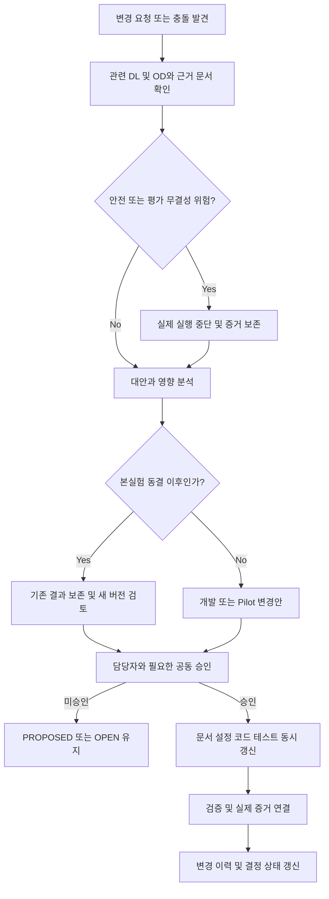

# Adaptive Agent Harness — 기술적 의사결정 기록서 (Decision Log)

## 그래프 기반 실패 복구 및 동적 컨텍스트 최적화를 통한 코딩 에이전트의 신뢰성과 실행 효율 향상

| 항목 | 내용 |
| --- | --- |
| 문서 | DECISION_LOG.md |
| 버전 | v0.1.0 |
| 작성일 | 2026-11-25 |
| 수행 맥락 | 잇츠 스터디 5기 — Codex 기반 AI 코딩 에이전트 구축 |
| 상태 | 기존 설계의 소급 정리 및 변경 관리 초안; 팀 승인·구현 검증·Main 동결 전 |
| 관리 | RH / GR / CE 공동; 실제 조정 담당자 미정 |
| 기준 | 기존 13개 연구·설계·운영 문서; 초기 JEC 및 DualGraph-Recover 제안서는 배경 자료 |

> 이 문서는 왜 특정 설계를 선택했는지, 무엇을 아직 결정하지 않았는지, 향후 어떤 절차로 변경할지를 기록한다. 문서에 기록된 설계와 실제 팀의 합의, 구현 결과 및 실험 증거를 혼동하지 않는다.

## 1. 목적 및 적용 원칙

- 연구의 핵심 질문과 시스템 설계의 일관성을 유지한다. 엔지니어링 개념이나 프레임워크 자체의 도입을 성과로 간주하지 않는다.
- 선택한 방식과 대안을 비교하고, 얻는 이점뿐 아니라 비용·제약·반증 가능성을 기록한다.
- 기술 선택의 변경이 연구 변수, 대조군의 공정성, 보안, 평가 및 재현성에 미치는 영향을 추적한다.
- Codex가 제안한 변경과 사람이 승인한 결정을 구분한다. 승인되지 않은 제안을 근거로 실험 설정이나 평가 기준을 변경하지 않는다.
- 본실험 이후에는 불리한 결과를 삭제하거나 정책을 사후 조정하여 이전 실행과 합치지 않는다.

초기 기록은 기존 문서에서 확인한 설계 방향을 소급 정리한 것이다. 개별 결정의 회의 날짜, 실제 논의 참석자, 팀 합의, 실험에 의한 근거는 제공된 문서에서 확인되지 않으므로 기입하지 않는다. 아래 대안과 trade-off 중 기존 문서에서 직접 설명하지 않은 부분은 본 문서의 분석적 정리이며, 실제 회의에서 해당 대안이 논의되었다는 뜻이 아니다.

## 2. 상태 및 식별 체계

### 2.1. 결정 상태

| 상태 | 의미 |
| --- | --- |
| DOCUMENTED | 기준 문서에 반영된 설계 방향. 팀 승인 또는 구현 완료를 의미하지 않음 |
| PROPOSED | 검토용 선택안. 적용 전 담당자 및 필요한 승인 확인 |
| OPEN | 선택 또는 기술 검증이 남은 항목 |
| APPROVED | 실제 승인자·일자·근거가 기록된 결정 |
| REJECTED | 검토 후 명시적으로 채택하지 않기로 승인한 결정 |
| SUPERSEDED | 이후 승인된 결정으로 대체됨; 기존 이력 보존 |

결정 상태와 구현·실험 상태는 별도 필드로 관리한다.

| 별도 필드 | 값 예시 |
| --- | --- |
| Verification | NOT_VERIFIED / PARTIAL / VERIFIED / FAILED |
| Freeze | NOT_FROZEN / FROZEN / SUPERSEDED_VERSION |
| Approval evidence | 회의록, 승인된 PR, 실제 커밋 등; 없으면 미확인 |
| Implementation evidence | 테스트 ID, 실제 명령·결과, run ID, artifact hash |

현재 아래의 모든 초기 결정은 실제 승인 증빙이 미확인이고, 구현 검증 및 Main 동결을 확인하지 못했다. `DOCUMENTED`는 설계에 이미 반영되었다는 의미에서만 사용한다. 제외 범위 또한 과거에 정식으로 기각했다는 증거가 없는 한 `REJECTED`로 표시하지 않는다.

### 2.2. ID 규칙

- `DL-001`부터 순차 발급한다. 이미 사용한 ID는 재사용하지 않는다.
- `OD-01`은 아직 결정할 사항(Open Decision)의 추적 ID다. 해결되면 승인된 DL 항목을 연결한다.
- 기존 아키텍처의 AD01–AD10은 변경하지 않고 DL과 대응시킨다.
- 기존 IP01–IP36, G0–G5, F/AC/M 및 테스트 ID를 그대로 참조한다. DL은 기존 요구사항 ID의 대체물이 아니다.

## 3. 초기 결정 인덱스

| ID | 영역 | 결정 요약 | 상태 | 책임 역할 |
| --- | --- | --- | --- | --- |
| DL-001 | 연구 | JEC + DualGraph-Recover 통합 | DOCUMENTED | 공동 |
| DL-002 | 연구 | 실패 조건화 정책의 실증 검증 중심 | DOCUMENTED | 공동 |
| DL-003 | 범위 | 단일 Codex, Python, 버그 수정 중심 | DOCUMENTED | 공동 |
| DL-004 | 제품 | CLI 기반 실행 최적화 도구 + 평가 자산 | DOCUMENTED | RH/CE |
| DL-005 | 실행 | Python 상태 머신 및 고정 워크플로 | DOCUMENTED | RH |
| DL-006 | 실행 | 교체 가능한 Runtime Adapter, CLI 우선 검증 | DOCUMENTED | RH |
| DL-007 | 증거 | 공통 Evidence Ledger와 관측 경계 | DOCUMENTED | RH/GR |
| DL-008 | 그래프 | AST 기반 Repository + Execution Graph 및 연결 | DOCUMENTED | GR |
| DL-009 | 그래프 | 그래프 활성 조건에서만 관계 탐색 | DOCUMENTED | GR/RH |
| DL-010 | 감지 | 공통 규칙 기반 선택적 개입 | DOCUMENTED | RH/GR |
| DL-011 | 복구 | 진단, 전략, 패키징 분리 | DOCUMENTED | GR/CE |
| DL-012 | 복구 | 제한된 피드백 루프 및 공통 fallback | DOCUMENTED | RH/GR |
| DL-013 | 컨텍스트 | 필수 지침 보존, 보조 정보만 선별 | DOCUMENTED | CE |
| DL-014 | 컨텍스트 | 초기·복구 DCC, 최초에는 그래프 정보 미사용 | DOCUMENTED | CE/GR |
| DL-015 | 컨텍스트 | BM25·규칙·greedy packing의 MVP | DOCUMENTED | CE |
| DL-016 | 저장 | 로컬 append 기반 기록 및 스냅샷 | DOCUMENTED | RH |
| DL-017 | 보안 | 개발·실험·독립 평가의 분리 | DOCUMENTED | RH/CE |
| DL-018 | 실험 | A–E 및 B–E 2×2 정책 설계 | DOCUMENTED | 공동 |
| DL-019 | 실험 | E2E + 공통 실패 체크포인트 | DOCUMENTED | 공동 |
| DL-020 | 실험 | 구성요소별 ablation과 주장 범위 제한 | DOCUMENTED | GR/CE |
| DL-021 | 데이터 | 자체 신규 과제 + 공개 Python 과제 | DOCUMENTED | 공동 |
| DL-022 | 평가 | 기능·회귀·필수 제약의 독립 판정 | DOCUMENTED | CE |
| DL-023 | 계측 | 성공/실패 전체 비용 및 관측 한계 공개 | DOCUMENTED | RH/CE |
| DL-024 | 분석 | Paired 분석, 요인 효과, 클러스터 bootstrap | DOCUMENTED | CE |
| DL-025 | 운영 | Pilot 검증 후 규모·정책 동결 | DOCUMENTED | 공동 |
| DL-026 | 운영 | 결측 및 제한적 인프라 대체 실행 | DOCUMENTED | RH/CE |
| DL-027 | 개발 | Vertical slice 우선, 3인 병렬 개발 | DOCUMENTED | 공동 |
| DL-028 | 개발 | AGENTS 기반 계약·검증 및 교차 리뷰 | DOCUMENTED | 공동 |
| DL-029 | 발표 | 실제 로그 replay 및 정량 결과 우선 | DOCUMENTED | 공동 |
| DL-030 | 문서 | 중앙 결정 로그와 승인·버전 추적 | PROPOSED | 공동 |

책임 역할은 기존 RH/GR/CE 정의를 따른다. 공동 결정은 세 역할의 검토가 필요하다. 실제 담당자는 TEAM_ROLES.md에서 확정한다.

## 4. 연구 및 제품 관련 결정

### DL-001 — 하나의 적응형 하네스로 통합

- 배경: JEC는 실행 전 보조 컨텍스트 선별을, DualGraph-Recover는 코드·실행 그래프 기반 실패 대응을 제안했다.
- 결정: AAH에서 동일 DCC를 초기 및 복구 시점에 활용하며, 그래프 기반 진단 및 전략 선택과 연결한다. 연구 대상은 모델 학습이 아닌 외부 실행 정책이다.
- 대안: 두 프로젝트 독립 수행, 단순 기능 병렬 결합.
- 이유 및 대가: 작업 상태에 필요한 정보와 행동을 함께 결정하는 문제로 통합할 수 있으나 구현과 비교 조건이 복잡해진다.
- 검증: A–E와 AB3, RQ1–RQ3. 개별 모듈의 이득과 결합 효과를 구분한다.
- 근거: RESEARCH_PROPOSAL_context.md §7; RESEARCH_PROPOSAL_graph.md §7.5; RESEARCH_PROPOSAL.md §5–8; METHODOLOGY.md §10, §13. 두 구안은 현재 저장소에 첨부되지 않은 역사 자료다.

### DL-002 — 실증적 기여를 중심으로 차별화

- 결정: 이중 그래프나 동적 컨텍스트의 최초 발명이라는 주장 대신, 공통 실패 상태에서 관계 기반 진단·전략·DCC의 효과를 분리 검증한다.
- 대안: 기술 개념의 조합 자체를 신규성으로 주장; 모든 유사 연구를 직접 재현.
- 이유 및 대가: LITERATURE_REVIEW의 MemTrace, AgentTether 등 유사 연구 분석은 넓은 최초성 주장을 약화한다. 직접 재현을 하지 못하면 기존 방법보다 우수하다는 일반적 결론을 제한해야 한다.
- 검증: AB1/AB2/AB4, 가능한 경우 AB9; 실제 연구 결과와 미수행 실험을 공개한다.
- 근거: LITERATURE_REVIEW.md §4.2, §6, §8–9; EXPERIMENT_DESIGN.md §8.
- 주의: 이 결정 로그는 해당 문헌 검토 문서의 결론을 인용한 것이며 논문 원문을 새로 검증한 기록은 아니다.

### DL-003 — 제한된 연구 범위

- 결정: 단일 Codex와 Python 저장소의 테스트 가능한 버그 수정 중심으로 MVP를 구성한다. 다른 언어·모델, 멀티에이전트, 장기 경험 학습, 학습 기반 정책은 확장 후보로 남긴다.
- 대안: 처음부터 범용 에이전트 플랫폼 구축.
- 이유 및 대가: 3인 팀의 검증 가능한 범위를 유지하고 통제 변수를 줄인다. 범용성과 다른 언어에서의 효과는 주장할 수 없다.
- 검증: PROJECT_OVERVIEW의 수용 기준 및 G1/G2; 평가 범위 명시.
- 근거: RESEARCH_PROPOSAL.md §3; PROJECT_OVERVIEW.md §3, §17; IMPLEMENTATION_PLAN.md §2.

### DL-004 — 실제 사용 가능한 결과물

- 결정: 개발자의 저장소를 대상으로 하는 CLI 기반 하네스, 실행 보고서 및 자동 평가 자산을 제공하는 방향. GUI·대시보드는 필수 구현보다 후순위다.
- 대안: 연구 노트북만 제공, 처음부터 웹 서비스 구축.
- 이유 및 대가: 실용성·재현성과 구현 완성도를 함께 보여줄 수 있지만 제품 수준의 범용 설치·배포까지 보장하지 않는다.
- 검증: F/AC 요구사항, 실제 CLI smoke 및 G1/G5.
- 근거: PROJECT_OVERVIEW.md §3–7, §11, §14; TECHNICAL_SPEC.md §14; README.md.

## 5. 런타임, 그래프 및 복구 관련 결정

### DL-005 — 단일 상태 머신과 고정된 조건부 워크플로 (AD01, AD10)

- 결정: Python 상태 머신으로 실행·관찰·판단·복구·종료를 제어한다. 조건에 따른 경로 및 전략 변경은 수행하지만 워크플로 자체를 재배선하지 않는다.
- 대안: LangGraph 등의 외부 워크플로 도구를 필수화하거나 동적으로 노드·엣지를 재구성.
- 이유 및 대가: 단순한 상태 전이와 정책 격리 테스트가 가능하다. 복잡한 분산·멀티에이전트 오케스트레이션은 지원 범위 밖이다.
- 검증: 상태 전이, 종료 우선순위, `REPORT` 이후 호출 금지, G1.
- 근거: SYSTEM_ARCHITECTURE.md §6, §18; TECHNICAL_SPEC.md §11; AGENTS.md §5.3.

### DL-006 — Runtime Adapter 및 실제 지원 범위 검증 (AD02)

- 결정: Codex 연동 세부 구현을 Runtime Adapter로 분리한다. CLI를 먼저 검증하고 SDK를 대안으로 검토한다. 공개 실행 경계의 관측 및 후속 턴 제어만 전제한다.
- 대안: 런타임 기능 직접 결합, 내부 모델 추론·세션 복원까지 제어한다고 가정.
- 이유 및 대가: API 차이의 파급을 줄일 수 있지만 실제 기능의 제약은 해결되지 않는다. 정확한 버전·인증·resume·usage는 OD-01에서 검증한다.
- 검증: RT01–RT07 및 G0. 모의 adapter 성공은 실제 런타임 검증이 아니다.
- 근거: SYSTEM_ARCHITECTURE.md §8, §18; TECHNICAL_SPEC.md §6, §18; IMPLEMENTATION_PLAN.md S0.

### DL-007 — 공통 Evidence Ledger (AD03)

- 결정: 공개 이벤트, Git diff, 스냅샷 및 공개 검사 결과를 공통 원천 기록으로 사용한다. 원시 이벤트를 보존하고 파싱 불가를 unknown으로 처리한다.
- 대안: 각 정책이 독립 로그를 수집하거나 모델의 비공개 추론을 이용.
- 이유 및 대가: 원천 증거 접근의 동일성과 근거 추적성을 높인다. 공개되지 않는 행동과 추론은 알 수 없으며, 미관측을 부정으로 해석할 수 없다.
- 검증: 공통 증거 hash·이벤트 ID·스냅샷 추적, 누락 및 파싱 실패 테스트.
- 근거: METHODOLOGY.md §4, §6; SYSTEM_ARCHITECTURE.md §9, §18; AGENTS.md §5.2.

### DL-008 — 연결된 이중 그래프와 근거 관리

- 결정: Python AST와 NetworkX MultiDiGraph를 이용하는 MVP 설계. Repository Graph는 코드 구조, Execution Graph는 관측 실행 증거를 나타내며 Cross-Graph Mapping으로 연결한다.
- 대안: 평면 로그, 단일 그래프, 별도 그래프 DB, 완전한 동적 프로그램 분석.
- 이유 및 대가: 실패 앵커에서 코드와 행동 관계를 함께 탐색할 수 있는 가설을 구현한다. 정적 호출 분석 및 버전 매핑의 불완전성이 존재한다.
- 제약: 관측과 추정 관계 분리, snapshot ID·출처 보존. 시간적 선후를 인과로 표시하지 않으며 SUSPECTS는 원인 후보로 취급한다.
- 검증: 그래프 스키마 테스트, 제한된 탐색 및 AB1/AB4/AB5.
- 근거: METHODOLOGY.md §5–8; TECHNICAL_SPEC.md §8; AGENTS.md §5.2.

### DL-009 — 그래프 정책 격리 (AD04)

- 결정: A/B/C에서 정책 그래프 호출 0을 유지한다. D/E의 그래프에서 파생한 점수·후보·전략을 C로 전달하지 않는다. 공통 ledger는 공유 계약이지 정책 결과 공유를 의미하지 않는다.
- 대안: 모든 군에서 그래프를 구축하고 일부 결과만 숨김.
- 이유 및 대가: 비교군 오염과 오버헤드 왜곡을 줄인다. 정책별 실행 기록의 상세도는 다를 수 있다.
- 검증: TECHNICAL_SPEC §16의 격리 테스트, B/D 및 C/E 초기 패키지 parity, 비용 계측.
- 근거: SYSTEM_ARCHITECTURE.md §11, §18; AGENTS.md §5.1.

### DL-010 — 규칙 기반 실패 감지 및 선택적 개입

- 결정: B–E에 동일 T1–T5 감지 규칙과 게이트를 적용한다. 반복 실패·정체·회귀·완료 후 공개 검사 실패에 조건화하고 T5 UNKNOWN/INFRA는 정상 복구 대상과 구분한다.
- 대안: 모든 턴 개입, 최초 실패마다 개입, 학습된 실패 예측기.
- 이유 및 대가: 재현성과 원인 비교가 용이하다. 정상적인 반복 작업을 정체로 오판하거나 숨은 실패를 놓칠 수 있다.
- 검증: T1–T5 경계 및 trigger 우선순위 테스트, 개입률과 악화 사례 분석. 임계값은 OD-04에서 확정한다.
- 근거: METHODOLOGY.md §7, §15; TECHNICAL_SPEC.md §9; AGENTS.md §5.3.

### DL-011 — 진단과 전략, 패키징 분리 (AD06)

- 결정: 진단이 근거·후보를 제공하면 Recovery Controller가 기존 전략 ID(`REVIEW_REGRESSION`, `RELOCALIZE`, `REFRESH_EVIDENCE`, `GENERIC_RETRY`, `CONTINUE`, `STOP`)를 결정한다. DCC는 전략을 변경하지 않는다.
- 대안: 하나의 LLM 호출 또는 단일 모듈에서 진단·전략·지침을 모두 생성.
- 이유 및 대가: 단계별 근거 및 AB2의 독립 효과를 분석할 수 있다. 모듈 사이의 계약·전달 오류를 별도로 관리해야 한다.
- 검증: 전략 ID와 전달 증거 로그, AB2의 고정 증거 패키지 비교; 제안된 지침과 실제 행동 구분.
- 근거: METHODOLOGY.md §8–10, §13; SYSTEM_ARCHITECTURE.md §10, §18; EXPERIMENT_DESIGN.md §8.3.

### DL-012 — 제한된 실행 루프 및 fallback

- 결정: 새 관측에 기반해 복구를 반복하고 공통 시간·턴·복구 상한 및 안전 종료 조건을 적용한다. 동일 checkpoint 중복 개입 금지. 근거 부족이나 그래프 오류의 공통 fallback은 원 조건에 귀속한다.
- 대안: 무제한 재시도, 실패할 때마다 세션 초기화, fallback 결과를 다른 비교군으로 이동.
- 이유 및 대가: 비용 폭주와 선택 편향을 제한한다. 예산상 해결할 수 있는 문제를 조기 종료할 수도 있다.
- 검증: 복구 카운트, 새 관측, 중단·프로세스 정리, fallback 비용 및 원래 배정 유지.
- 근거: METHODOLOGY.md §11; SYSTEM_ARCHITECTURE.md §13–14; TECHNICAL_SPEC.md §11; AGENTS.md §5.3.

## 6. 컨텍스트, 저장 및 보안 관련 결정

### DL-013 — 필수 지침과 보조 정보 분리

- 결정: 사용자 요구사항, 권한 및 필수 저장소 지침은 보존한다. DCC는 승인된 보조 정보 후보만 선택·제외한다. 원본 저장소 탐색 권한은 제한하지 않는다.
- 대안: 입력 길이 감소를 위해 전체 지침을 압축하거나 삭제; 검색된 파일만 접근 허용.
- 이유 및 대가: 작업 정확성과 필수 제약을 유지하고 비용 효과를 공정하게 측정한다. 필수 영역이 크면 최적화 가능한 범위는 줄어든다.
- 검증: 필수 지침 hash, 공통 접근 범위, 지침 준수율 및 유효성 판단 기록.
- 근거: METHODOLOGY.md §10; TECHNICAL_SPEC.md §10; AGENTS.md §5.4.

### DL-014 — 두 시점의 DCC 및 초기 graph-free 정책 (AD05)

- 결정: C/E의 초기 및 복구 패키지에 DCC를 적용한다. 초기 DCC에는 그래프 파생 정보를 사용하지 않는다. 실패 이후 E의 DCC에만 그래프 진단과 유형별 전략이 전달된다. D에서도 그래프 진단 순위를 DEFAULT가 이용할 수 있다.
- 대안: 처음부터 모든 군의 DCC가 그래프를 사용; 초기와 복구 최적화를 하나의 효과로만 평가.
- 이유 및 대가: 최초 패키지 동일성 및 요인 분리를 유지한다. 초기 그래프 검색의 잠재적 이득은 이번 설계로 판단할 수 없다.
- 검증: B/D 및 C/E 초기 parity, C의 graph-derived 정보 누출 검사, AB3.
- 근거: SYSTEM_ARCHITECTURE.md §11, §18; METHODOLOGY.md §10, §13; AGENTS.md §5.1.

### DL-015 — 경량 DCC와 보조 토큰 예산

- 결정: BM25, 경로·심볼·유효성 및 실패 관련 점수, 중복 패널티, greedy packing을 사용한다. DEFAULT/DCC의 공통 상한과 최소 보호 근거를 유지하고 직렬화 비용까지 검사한다.
- 대안: LLM 기반 압축·리랭킹, 학습된 점수, 정교한 전역 최적화, 벡터 DB 필수화.
- 이유 및 대가: 로컬 비용과 재현성, 선택 이유 추적에 유리한 시작점이다. 의미 검색이나 전역 최적해를 보장하지 않는다.
- 검증: 예산·유효성·중복·결정적 정렬 테스트, AB6/AB7. 토큰 추정값과 실제 usage 구분.
- 근거: METHODOLOGY.md §10, §15; TECHNICAL_SPEC.md §10; AGENTS.md §5.4.

### DL-016 — 로컬 append 기록 (AD07)

- 결정: MVP는 JSON/JSONL/CSV와 Git 기반 스냅샷 및 실행별 산출물을 사용한다. 원시 기록을 보존하고 패치·설정·증거 식별자를 연결한다.
- 대안: 원격 DB·그래프 DB·별도 서버를 기본 의존성으로 구축.
- 이유 및 대가: 소규모 실행과 재현 가능한 파일 배포에 적합하다. 동시 쓰기·충돌·저장 실패·대규모 검색은 별도 관리해야 한다.
- 검증: 스키마, 저장 실패 처리, run ID 충돌 방지, 무결성 및 복원 검사.
- 근거: SYSTEM_ARCHITECTURE.md §12, §18; TECHNICAL_SPEC.md §7, §12.

### DL-017 — 보안과 독립 평가 경계 (AD08)

- 결정: AAH 개발 환경, 평가 대상 workspace, private 평가 환경을 분리한다. 개발용 AGENTS와 정답/hidden test/자격 증명이 평가 대상에 유입되지 않도록 하고 제출 코드도 private 평가 자료에 접근하지 못하도록 검증한다.
- 대안: 동일 저장소에서 경로·파일 이름·.gitignore로만 분리.
- 이유 및 대가: 정답 유출 및 데이터 변조를 방지한다. 실제 격리 프로파일의 구축 비용과 검증이 필요하다.
- 검증: G0의 실제 안전 게이트, 경로 탈출·symlink·비밀 접근·평가 파일 변조·취소 처리. 미검증 시 실제 실행 중단.
- 근거: SYSTEM_ARCHITECTURE.md §15, §18; TECHNICAL_SPEC.md §15; BENCHMARK_SPEC.md §9; AGENTS.md §6.

## 7. 실험 및 평가 관련 결정

### DL-018 — 강한 기준군 및 2×2 설계

- 결정: A는 실제 기본 Codex 참조군, B–E는 공통 감지 및 외부 실행 한도 아래 2×2 요인 설계. 모델·권한·원천 접근·메시지 형식·최대 복구 기회를 통제한다.
- 대안: Vanilla와 제안법 E만 비교; 기준군에 적은 정보나 작은 예산 부여.
- 이유 및 대가: 단순 재시도 효과와 두 정책의 효과를 분리할 수 있다. Graph 요인은 그래프 검색과 전략 선택의 묶음이고 DCC 요인은 E2E에서 초기+복구의 묶음이다.
- 근거: TECHNICAL_SPEC.md §4.3; EXPERIMENT_DESIGN.md §4; AGENTS.md §5.1.

| 조건 | Initial | Diagnosis | Strategy | Recovery context | 외부 개입 |
| --- | --- | --- | --- | --- | --- |
| A | NONE | NONE | NATIVE | NONE | false |
| B | DEFAULT | FLAT | GENERIC | DEFAULT | true |
| C | DCC | FLAT | GENERIC | DCC | true |
| D | DEFAULT | GRAPH | TYPED | DEFAULT | true |
| E | DCC | GRAPH | TYPED | DCC | true |

검증: 조건 resolver, 정책 호출·입력 parity 및 격리 테스트. A–E 대비는 전체 제품 효과이며 B–E만 요인 분석에 포함한다.

### DL-019 — 공통 실패 체크포인트 분기 (AD09)

- 결정: E2E와 별개로 B와 같은 초기 DEFAULT 정책에서 첫 적격 자연 실패를 확보하고 B–E에 공통 외부 상태·이력·예산을 제공한다. 내부 세션 복제가 미검증이면 공통 NEW_SESSION으로 분기한다.
- 대안: 조건별 자연 실패 사례를 사후 매칭; 인위적 실패를 자연 발생 상태와 합산.
- 이유 및 대가: 동일 관측 상태에서 정책 비교가 가능하나 모델의 내부 상태까지 동일하다고 할 수 없다. 실패 미발생과 획득 비용도 기록해야 한다.
- 검증: snapshot/hash, 이력·예산 동일성, 최초 eligible trigger, branch별 독립 workspace; 자연 발생 실패와 인위적 fixture 별도 보고.
- 근거: SYSTEM_ARCHITECTURE.md §18; EXPERIMENT_DESIGN.md §7; BENCHMARK_SPEC.md §10.

### DL-020 — 구성 요소별 검증과 주장 제한

- 결정: AB1(연결 제거), AB2(동일 패키지에서 전략 지침 교체), AB3(DCC 적용 시점 분리), AB4(공통 전략 아래 graph vs flat 검색)를 P1으로 둔다. AB5–AB9는 P2/조건부 확장이다.
- 대안: A–E 결과만으로 연결·전략·검색 알고리즘의 독립 효과를 모두 주장.
- 이유 및 대가: 메커니즘의 기여를 구분할 수 있으나 추가 실험 비용이 든다. AB2의 주 분석은 첫 후속 실행 1단위이며 다단계 분석의 후속 정책은 통제한다.
- 검증: 각 AB의 독립 manifest, 조작 대상 외 조건 동일성, 미수행 및 fallback 비율 보고.
- 근거: LITERATURE_REVIEW.md §6; METHODOLOGY.md §13; EXPERIMENT_DESIGN.md §8.

### DL-021 — 자체 신규 과제와 공개 과제 병행

- 결정: Main 24개 기준 자체 AAH-Suite 16개와 공개 Python 8개를 목표로 한다. 단일 파일·의존성·회귀 위험·복합 수정 및 문서 상태를 분류한다. Pro V2를 우선 검토하고 Live를 대안으로 둔다.
- 대안: 자체 과제만 사용, SWE-bench Verified 단독 사용, 모든 공개 과제를 동일 난이도로 취급.
- 이유 및 대가: 신규 과제의 통제와 공개 과제의 현실성을 함께 평가한다. 자체 과제는 대표성 및 설계 편향, 공개 과제는 학습 노출 및 환경 재현 위험이 있다.
- 검증: BQ 검증, 개발/평가 분리, 실제 instance ID·라이선스·환경 동결. 현재 과제의 실제 구현 및 공개 과제 선정은 OD-06/07로 남긴다.
- 근거: BENCHMARK_SPEC.md §2–6, §11, §15; EXPERIMENT_DESIGN.md §5.

### DL-022 — 독립 성공 판정 및 실행 종료 상태 분리

- 결정: 최종 패치를 고정하고 기능·회귀·필수 제약 검사를 모두 통과한 경우에만 성공으로 판정한다. 에이전트 완료 선언과 평가 PASS는 다르다. 제한 종료 시에도 평가 가능한 마지막 패치를 독립 평가한다.
- 대안: 모델 자체 성공 판정, 공개 테스트만 사용, 모든 timeout을 평가 없이 실패 또는 제외.
- 이유 및 대가: 요구사항과 회귀를 검증할 수 있으나 평가 테스트가 완전한 정답 판별기는 아니다. 정상 대안 패치를 허용하는 검사가 필요하다.
- 검증: reference/base 및 대안 패치 검사, EP01–EP30의 판정·격리 계약.
- 근거: BENCHMARK_SPEC.md §7, §11; EVALUATION_PROTOCOL.md §4–6, §14.

### DL-023 — 전체 사용량과 비용 계측

- 결정: 성공·실패 실행의 전체 비용을 포함한 Cost per Success(CPS), 전체 모델 사용량, 벽시계 시간 및 로컬 오버헤드를 측정한다. 모델 토큰·과금·구독 차감·추정값을 구분한다.
- 대안: 최초 입력 토큰 또는 성공 실행의 평균 비용만 비교.
- 이유 및 대가: 실제 절감 여부를 검증할 수 있다. runtime이 usage 또는 강제 토큰 한도를 제공하지 않는다면 해석 범위가 제한된다.
- 검증: usage 필드의 중복·결측·cache·추정 여부, source/branch 비용 및 restore 비용 구분. `observe_only`는 엄밀한 동일 토큰 제한이 아니다.
- 근거: TECHNICAL_SPEC.md §11.2; EXPERIMENT_DESIGN.md §10; EVALUATION_PROTOCOL.md §6–8.

### DL-024 — 과제 단위 paired 분석과 요인 효과

- 결정: 주 대비 P-R1(CPS_C−CPS_B), P-R2(FRR_D−FRR_B), P-R3(p_E−max(p_C,p_D))를 사전 동결 대상으로 둔다. Task Family paired cluster bootstrap 10,000회, 95% 구간, seed 20261126은 계획 후보이며 P-R3의 유효한 추론 방식은 OD-10에서 정한다.
- 대안: 반복 run을 독립 표본으로 계산; 유리한 비교군만 보고; E가 단독 조건보다 높으면 상호작용이 양수라고 판단.
- 이유 및 대가: 과제별 상관 및 paired 구조를 반영한다. 적은 클러스터와 경계 성공률에서는 구간이 불안정하다. CPS가 무정의인 bootstrap의 처리는 OD-10에서 승인한다.
- 검증: EP 집계 테스트, 동일 블록의 요인 효과, 결측 민감도, 실제 분자·분모 공개. 비열등성 5%p와 검정/Holm 적용 여부는 아직 동결 전이다.
- 근거: EXPERIMENT_DESIGN.md §2.1, §11; EVALUATION_PROTOCOL.md §11.

### DL-025 — Pilot 후 동결 및 규모 선택

- 결정: 24 또는 20개 × 5조건 × 2회 Main을 우선 검토하고 Pilot 비용·자연 실패 빈도에 따라 12개 또는 8개 탐색안으로 축소할 수 있다. 규모 결정은 평가 결과 열람 전 수행한다.
- 대안: 전 범위 무조건 실행, 중간 결과에 따라 유리한 과제만 추가/제외.
- 이유 및 대가: 실현 가능성을 확보한다. 작은 규모는 통계 정밀도와 일반화를 제한하며 Emergency는 탐색적 평가다.
- 검증: G2 승인과 freeze manifest, 과제/정책/모델/예산/분석 계획 hash, 계획 대비 미실행 및 reserve 기록.
- 근거: EXPERIMENT_DESIGN.md §9, §13; IMPLEMENTATION_PLAN.md §9, §11; README.md 벤치마크 및 규모.

### DL-026 — 실패·결측·대체 실행 구분

- 결정: 정책 오류, 타임아웃, 낮은 성능을 이유로 결과를 제거하지 않는다. 사용량 결측은 관측 가능한 성공률까지 삭제하지 않는다. 외부 인프라 장애에 한한 최대 1회 대체 실행은 승인 전 후보이며 기본 자동 재실행은 없다.
- 대안: 실패를 모두 재실행, 모든 미실행을 유효 실패로 자동 처리, 결측 비용을 0으로 채움.
- 이유 및 대가: 선택 편향을 제한한다. complete block 감소와 결측 패턴에 따른 해석 제한이 발생할 수 있다.
- 검증: 원 run과 대체 run 기록, 슬롯 중복 방지, EVALUATION_PROTOCOL의 분석 상태 및 비용 회계, 민감도 분석.
- 근거: EXPERIMENT_DESIGN.md §12; EVALUATION_PROTOCOL.md §5, §10–11, §17.

## 8. 개발, 협업 및 제출 관련 결정

### DL-027 — Vertical slice와 병렬 개발

- 결정: S0에서 실제 Codex 실행·workspace·독립 평가를 먼저 확보하고 S1 기본 실행과 S2/S3 모듈을 병렬 개발한다. S4에서 통합, S5에서 Pilot·동결을 진행한다. RH/GR/CE의 공통 계약과 IP01–IP36을 유지한다.
- 대안: 복잡한 그래프나 UI부터 독립 구축; 마지막에 실제 런타임과 연결.
- 이유 및 대가: 치명적 연동 및 격리 제약을 조기에 확인한다. 공통 계약 준비가 병목이 될 수 있다.
- 검증: G0–G5 및 IP별 완료 기준, 교차 리뷰. 실제 일정·이름은 미확정이다.
- 근거: IMPLEMENTATION_PLAN.md §3, §5–10; TEAM_ROLES.md §3–9.

### DL-028 — Codex 개발 지침 및 승인

- 결정: AGENTS.md는 관련 문서·IP·테스트 탐색을 안내한다. 작업별 branch/PR, 사람이 검토한 검증 결과와 미해결 사항을 기록한다. 실제 모델 호출, 원격 push, 권한 확대는 별도 승인 조건을 따른다.
- 대안: 모든 설계 정보를 한 프롬프트에 복제, Codex의 완료 선언만으로 승인.
- 이유 및 대가: 계약 일관성과 기여 추적에 유리하다. 리뷰 및 문서 갱신 비용이 발생한다.
- 검증: 실제 지침 적용 및 분리, PR의 테스트 결과와 영향 ID, 승인된 변경 기록.
- 근거: AGENTS.md §2–9; IMPLEMENTATION_PLAN.md §12; TEAM_ROLES.md §10–12.

### DL-029 — 실제 실행 근거 중심 시연

- 결정: 비교군의 성공률·비용·복구 로그 및 실제 실패/정상 사례를 시연한다. UI는 실제 로그 기반 replay를 우선 고려한다. 측정 전 표는 미측정으로 두고 모의 사례를 실제 성과로 표시하지 않는다.
- 대안: 정교한 시각화나 가상의 개선 수치를 우선 제시.
- 이유 및 대가: 구현 완성도와 실용성을 동시에 증빙할 수 있다. 실험 결과가 기대와 달라도 한계를 포함한 발표가 필요하다.
- 검증: G4/G5, run ID·원시 로그 및 집계 일치, 미수행 기능 표시.
- 근거: PROJECT_OVERVIEW.md §15–16; EVALUATION_PROTOCOL.md §15; IMPLEMENTATION_PLAN.md §15–16; README.md 연구 진행 상태.

### DL-030 — 결정 로그 및 ADR 운영 (신규 제안)

- 결정안: 이 문서를 중앙 인덱스로 사용하고 신규 결정은 §12 양식에 추가한다. 규모가 커지면 개별 ADR 파일로 분리하고 이 문서에 링크한다.
- 대안: 회의록만 사용, 모든 결정을 독립 파일로 즉시 분리.
- 이유 및 대가: 3인 팀의 관리 비용을 낮추면서 영향 및 승인 기록을 추적한다. 결정 로그가 최신 기준 문서를 대체하지 않도록 주의한다.
- 승인 및 검증: 팀 합의 미확인. 첫 공통 계약 변경에서 양식과 링크를 검토한다.
- 근거: AGENTS.md §2, §9; TEAM_ROLES.md §12; IMPLEMENTATION_PLAN.md §12.3.

## 9. 기존 아키텍처 결정 추적 (AD01–AD10)

| 기존 ID | 본 문서 ID | 의미 |
| --- | --- | --- |
| AD01 | DL-005 | 단일 Python 상태 머신 |
| AD02 | DL-006 | 교체 가능한 adapter |
| AD03 | DL-007 | 공통 ledger |
| AD04 | DL-009 | 그래프 정책 격리 |
| AD05 | DL-014 | 초기 DCC graph-free |
| AD06 | DL-011 | 진단·전략·패키징 분리 |
| AD07 | DL-016 | 로컬 append 기록 |
| AD08 | DL-017 | 독립 평가 격리 |
| AD09 | DL-019 | 외부 checkpoint 복제 |
| AD10 | DL-005 | 고정 워크플로 조건부 경로 |

출처: SYSTEM_ARCHITECTURE.md §18. AD 번호와 그 의미를 수정하지 않는다.

## 10. 미결 사항 (Open Decision Register)

아래는 현재 문서의 설계 방향에서 후속 검증 또는 승인이 필요하다고 명시한 사항이다. 담당·시점은 기존 역할 및 게이트에 맞춰 제안한다. 전 항목 `OPEN`, 실제 승인 증거 없음.

| ID | 결정해야 할 사항 | 후보 및 판단 기준 | 주관 | 확정 시점/증거 |
| --- | --- | --- | --- | --- |
| OD-01 | 모델 ID, CLI/SDK, 인증, 이벤트, resume, 취소, usage | 실제 RT01–RT07의 지원 범위로 선택 | RH | S0/G0, probe 로그·버전 |
| OD-02 | OS, sandbox, 인증·네트워크·공개/독립 평가 실행 격리 | 권한/프로세스 경계와 테스트 경로는 아키텍처 §15 및 평가 §4 기준. 실제 구성은 미검증 | RH/CE | G0 실제 실행 전, OS·runtime·평가 경계와 정리 증거 |
| OD-03 | 전역 시간·턴·토큰·비용 상한, 추정기 및 reserve | 한시 Smoke 프로파일과 Main 동결 분리. 실제 엄격 토큰 집행을 검증하지 못하면 observe_only 검토 | RH/CE | Smoke 승인 및 Pilot/G2 정식 동결 |
| OD-04 | T1–T5 임계값, 관측 단위, 진전 대리지표 | T2 4/6 경계 포함, 개발용 사례에서 오개입 검토 | RH/GR | G2, 개발 로그·정책 hash |
| OD-05 | 그래프 범위, 가중치, DCC 점수, BM25/토큰화 | 방법론 §15 시작값, 동일 후보 접근·비용·재현성, 허용 방향/CONTAINS 범위, 관측·진전 창, H4 근거 채점 | GR/CE | G2, 설정·테스트 |
| OD-06 | 자체 과제 16개, 문서 분포, hidden suite | BQ 품질·대안 패치·격리 검사 | 공동 | IP25–IP29/G2, 승인 기록 |
| OD-07 | 공개 과제 ID 8개, 라이선스, 환경 | Pro V2/Live 등 검토 후 BQ 승인 | 공동 | IP26/G2, dataset revision/manifest |
| OD-08 | Main 규모, source 최대 수, checkpoint 목표, P1 범위 | Full/Core/Reduced/Emergency, 비용·적격 상태 확보율 | 공동 | G2, 평가 열람 전 승인 |
| OD-09 | source 중지 경계 및 세션 복제 | 복원·이력 hash, 미검증 시 모든 분기에 NEW_SESSION | RH/GR | Pilot/G2, restore test |
| OD-10 | H1/H3 해석, 최소 유효 표본/coverage, P-R3 동률 추론, 비용·악화 지표 | 5%p, 동시구간/교집합 검정, CPS 구간 보류, MIXED 포함은 후보. 승인된 근거 없으면 탐색적으로 보고 | CE/공동 | G2 사전 분석 계획·승인 |
| OD-11 | 인프라 대체 실행 및 비용 회계 | 기본 자동 재실행 없음; 승인된 외부 장애에 최대 1회 후보 | RH/CE | G2, 사전 분류표 |
| OD-12 | 공개 검사 parser/timeout·선행 검사, private runner 및 upstream 판정 매핑 | Smoke 책임·경계부터 확인. Main 과제의 동일 승인 스펙·별도 판정 근거·정리 | RH/CE | Smoke 승인 및 G2 BQ/EP |
| OD-13 | 팀원 실명, 조정자, 가용 시간, 리뷰어 | RH/GR/CE 합의, CE 과부하 조정 | 공동 | 착수, TEAM_ROLES 갱신 |
| OD-14 | 공식 마감, 크레딧 사용 기간 및 예산 | 실제 운영 안내 확인; 기존 11/30·12/16 일정 잠정 | 공동 | 착수, 확인 자료 |
| OD-15 | 시각화 방식 및 공개 산출물 | 정적 보고·replay 우선, 잔여 자원에 따른 UI | 공동 | G1 이후/G5 |
| OD-16 | 라이선스·저자·공개 저장소·Main 자료/이력·시연 공개 범위 | 현재 본문과 staged/이전 원문, 배포 파일·영상·로그를 검사. 큐레이터 저장소 및 과제별 노출 처리 승인 | 공동 | Main 편입 전 노출 평가, 공개 전/G5 승인 |
| OD-17 | 문서 물리 배치 및 링크 관리 | 현재 루트 + docs/{research,design,evaluation,project,reports} 반영. 후속 이동 시 링크와 인덱스 다시 검사 | RH/공동 | 이번 문서 변경 이력, 후속 배치 변경 시 검증 |
| OD-18 | AB2 공통 증거 선택 기준과 준비 비용·차단 쌍 처리 | 전략별 변경 외 동일 증거 hash와 실행 전 양쪽 cap 확인. 중립/사전 고정 기준과 회계·결측 정책은 후보 | GR/CE | G2 또는 별도 P1 승인, 어떤 AB2 시도보다 먼저 |

### 10.1. Pilot 시작값 추적 (확정값 아님)

| 항목 | 기존 후보 |
| --- | --- |
| 동일 실패 반복 / 탐색 구간 / 중복 비율 | 2회 / 6개 행동 / 0.67 |
| Trigger 우선순위 | T3 → T1 → T2 → T4 |
| Graph 깊이 / 방문 / 분기 / top-k | 4 / 200 / 20 / 8 |
| Edge 기본 비용 / 추정 추가 비용 | 1 / 1 |
| 진단 점수 가중치 | (0.4, 0.3, 0.15, 0.15) |
| DCC 초기 가중치 | (0.5, 0.3, 0.2, 0) |
| DCC 복구 가중치 | (0.25, 0.2, 0.2, 0.35) |
| 중복 패널티 | 0.2 |
| 보조 컨텍스트 상한 | 초기·복구 각각 2,048 추정 토큰 |
| 복구 / 상태 전이 상한 / cleanup reserve | 2회 / 100 / 15초 |

출처: METHODOLOGY.md §15; TECHNICAL_SPEC.md §4.1; AGENTS.md §5.5. 설정의 단일 원천은 기술 명세 및 실제 versioned config이며 이 표를 별도 하드코딩하지 않는다. 특히 4/6은 약 0.6667이므로 0.67 미만이다. 기존 AGENTS가 명시한 이 경계는 OD-04의 검증 사항으로 유지하고 임의로 반올림 규칙이나 임계값을 변경하지 않는다.

### 10.2. 예산 결정 참고

Full 계획의 Main 240회, source 최대 24회, 분기 목표 48회, P1 80회는 총 392회 계획이다. 이는 목표 실패 상태가 확보되고 P1을 별도 실행한다는 가정이며 probe·smoke·pilot·개발 호출은 별도다. 392회가 실제 모델 호출 수, 크레딧, 또는 승인된 예산을 뜻하지 않는다. Full/Core/Reduced/Emergency의 구체적 비교는 EXPERIMENT_DESIGN.md §9를 기준으로 한다. 실제 지출과 실패 확보율을 확인하지 못한 현재 OD-08은 OPEN이다.

## 11. 변경 관리 절차

### 11.1. 변경 등급과 승인 (운영 제안)

| 등급 | 예시 | 필요한 검토 |
| --- | --- | --- |
| L0 | 의미 변경 없는 오탈자·링크 | 작성자 확인 및 일반 PR 리뷰 |
| L1 | 동결 조건을 바꾸지 않는 내부 리팩터링 | 담당 역할 + 교차 리뷰어, 관련 테스트 |
| L2 | 공통 계약, 정책, schema, 권한, 평가·표본·지표 변경 | 영향 역할 + 연구 조정 담당; 공통 계약/정책 매핑/동결은 RH·GR·CE 공동 승인 |
| L3 | 안전·평가 격리 위반, 본실험 무결성 훼손 | 즉시 실행 중단, 공동 원인 조사 및 안전 재검증, 필요 시 새 실험 버전 |

이는 AGENTS와 TEAM_ROLES의 기존 승인 원칙을 실무용으로 구체화한 제안이다. 등급 분류는 명시적 승인 및 보안 제약을 완화하지 않는다. 작업 담당자가 미정이면 먼저 승인 책임을 확정한다.

### 11.2. 변경 절차



1. 문제와 현재 기준을 적고 기존 결정 ID, 요구사항, IP 및 테스트를 찾는다.
2. 대안(현상 유지 포함), 예상 이득·비용·실패 조건 및 영향을 기록한다.
3. Main 동결 여부와 평가 결과 접근 여부를 명시한다. 알 수 없으면 `UNKNOWN`으로 두고 확인한다.
4. 필요한 승인을 받은 뒤 관련 기준 문서, 설정, 코드, 테스트, manifest, README를 일관되게 갱신한다. 최신 날짜라는 이유만으로 다른 문서의 책임 영역을 덮어쓰지 않는다.
5. 관련 단위·통합·격리 테스트를 수행하고 실제 결과 및 미실행 이유를 남긴다. 승인과 검증을 구분한다.
6. 기존 결정이 대체된 경우 `SUPERSEDED`와 새 ID를 연결한다. 이력을 삭제하거나 승인 날짜를 소급해 만들지 않는다.

### 11.3. Main 동결 이후의 변경 제한

- 정책 가중치, 감지 임계값, 과제 및 테스트, 모델·추론 설정, 비용 상한, 평가 기준을 결과 개선 목적으로 사후 변경하지 않는다.
- 보안 결함, 평가 오류, 공급자 버전 변경 등 불가피한 사유로 변경하는 경우 실행을 중단하고 원본 manifest와 로그를 보존한다.
- 새 experiment/version ID 및 영향받는 과제·조건·결과 열람 시점을 기록한다. 원 실험과 새 실험을 임의 합산하지 않는다.
- 과제 무효 판정은 같은 과제의 모든 조건에 공통 적용한다. 미실행과 결측은 EVALUATION_PROTOCOL의 분류를 따른다.
- 인프라 대체 실행과 에이전트 자체 복구는 구분한다. 미승인 자동 대체는 수행하지 않는다.

근거: EXPERIMENT_DESIGN.md §12–14; BENCHMARK_SPEC.md §11.3; EVALUATION_PROTOCOL.md §16; IMPLEMENTATION_PLAN.md §11–12; AGENTS.md §2, §7, §9.

### 11.4. 문서 정합성 확인 사항

| 확인 항목 | 처리 |
| --- | --- |
| 초기 DCC의 의미 | 원 JEC는 실행 전, 통합 연구는 초기+복구. 현재 기준은 METHODOLOGY 및 TECHNICAL_SPEC이며 원 제안서를 소급 수정하지 않는다. |
| 연구 공백 표현 | LITERATURE_REVIEW의 좁혀진 기여 후보를 적용하고 최초성 단정을 금지한다. |
| T2의 4/6 대 0.67 | 이미 AGENTS에 명시된 경계; Pilot에서 승인 후 처리. |
| DCC/Graph 효과 범위 | A–E와 개별 AB의 해석을 구분. 개별 검증 미수행 시 주장 제한. |
| README 문서 인덱스 | 기존 README에는 DECISION_LOG가 이후 추가 문서로 표시되어 있음. 실제 저장소 배치 시 활성 링크 및 상태 갱신 필요. 이번에는 README를 수정하지 않음. |
| 설계 버전과 실행 버전 | v0.1.0 문서는 실제 소프트웨어 릴리스가 아님. 실제 commit/manifest ID를 별도로 등록. |

## 12. ADR 기록 양식 (신규 결정용)

다음 양식은 실제 결정을 작성할 때 복사한다. 비어 있는 승인/검증 필드를 사실로 채우지 않는다.

```markdown
### DL-XXX — 결정 제목

- Status: PROPOSED
- Verification: NOT_VERIFIED
- Freeze: NOT_FROZEN
- 제안일:
- 제안자 / 책임 역할:
- 관련 OD / 기존 DL / IP / F / AC / M / 테스트 ID:
- 현재 기준 문서 및 commit:
- 결과 열람 여부: NO / YES / UNKNOWN
- 영향을 받는 실험/version/manifest ID:

**Context / 문제**

관측된 문제와 기존 계약을 기록한다. 실제 증거와 추정을 구분한다.

**Decision / 결정안**

무엇을 바꾸거나 유지할지, 적용 범위와 제외 범위를 명시한다.

**Alternatives / 대안**

| 대안 | 기대 효과 | 비용 및 위험 | 판단 근거 |
| --- | --- | --- | --- |
| 현상 유지 | | | |
| 대안 A | | | |
| 대안 B | | | |

**Consequences / 영향**

- 사용자·기능:
- 모듈·데이터 계약:
- 비교군·예산·평가:
- 보안·격리:
- 일정 및 후속 의존성:

**Verification / 검증 계획 및 실제 결과**

- 필요한 테스트 및 실제 실행 명령:
- 통과/실패/미실행 근거:
- 로그·run ID·artifact hash:
- 되돌림 및 중단 기준:

**Approval / 승인**

- 승인자 및 실제 승인 일자:
- PR/회의록/commit 증빙:
- 동결 승인 및 새 버전 여부:

**Follow-up / 후속 작업**

- 변경할 문서·설정·코드·테스트:
- 대체되는 결정 ID / 후속 결정 ID:
- 남은 제약과 재검토 조건:
```

### 12.1. 사용 예시 — T2 정체 기준 (가상 검토안, 미승인)

| 항목 | 예시 |
| --- | --- |
| 관련 항목 | OD-04, DL-010, AGENTS.md §5.5 |
| 상황 | 6개 행동 중 4개 중복 비율이 0.67 미만이라 경계 의도가 불명확할 수 있음 |
| 대안 | 기존 0.67 유지 / 비율 2/3 채택 / 명시적인 정수 count 조건 |
| 비교 기준 | 개발용 관측 창에서 감지율, 정상 진행 오개입, 실제 추가 복구 비용 |
| 검증 | 3/6, 4/6, 5/6 경계, 미관측 행동, 새 증거 발생 여부, 우선순위 테스트 |
| 상태 | OPEN; 본 문서에서는 새로운 임계값을 채택하지 않음 |
| 승인 및 실제 결과 | 미기입; 예시이지 팀 회의 또는 실험 기록이 아님 |

## 13. 승인·변경 이력 및 협업 증빙

### 13.1. 실제 변경 이력 (추가용)

2026-11-25 문서 정합성 변경은 [DOCUMENTATION_CHANGELOG.md](../../DOCUMENTATION_CHANGELOG.md)에 기록했다. 문서에 명시된 불변식·계약을 정리했으며 실제 런타임 선택·실험 동결·보안 게이트를 승인했다는 기록은 없다. OD의 해소 여부는 기존 실제 승인 양식을 따른다.

| 날짜 | DL ID | 이전/이후 상태 | 관련 IP/버전 | 변경 이유 | 제안자/승인자 | 증거 | 결과 열람 여부 |
| --- | --- | --- | --- | --- | --- | --- | --- |
| 미기입 | | | | | | | |

### 13.2. 결정과 학습·협업 연결

| 심사·운영 근거 | 활용 가능한 실제 증빙 |
| --- | --- |
| 문제정의·필요성 | DL-001/002, 관측된 실패 사례 및 연구 범위 변경 근거 |
| AI 기술 활용도 | DL-006/011/015, 실제 Codex probe와 복구·DCC 구현 PR |
| 구현 완성도 | DL-005/017/027, 통합 테스트와 게이트 승인 결과 |
| 실용성 | DL-004/023/029, 실제 사용·비용·복구 결과 |
| 학습과정·협업 | 담당자별 대안 검토, 사람이 검증한 Codex 제안, 교차 리뷰 및 활동일지 |
| 차별성·확장성 | DL-002/020, 선행연구 비교와 실제 ablation 결과 및 보류 이유 |

의사결정 근거는 학습과 협업의 증빙을 연결하는 인덱스다. 문서의 존재 자체로 실제 학습·구현·실험이 수행되었다고 보고하지 않는다. 회차별 실제 활동은 TEAM_ROLES의 양식에, 실험 실행과 변경 시점은 EXPERIMENT_LOG.md에 기록한다.

## 14. 기준 문서와 책임 영역

| 기준 문서 | 본 로그가 참조한 내용 |
| --- | --- |
| RESEARCH_PROPOSAL.md | 통합 목적, 가설, 범위, 동결 원칙 |
| PROJECT_OVERVIEW.md | 사용자, 기능, 제품 형태, 수용 기준 |
| LITERATURE_REVIEW.md | 연구 공백, 유사 방법, 주장 제한 |
| METHODOLOGY.md | 알고리즘, 그래프, DCC, 전략, Pilot 설정 |
| SYSTEM_ARCHITECTURE.md | AD01–AD10, 모듈 및 상태·격리 |
| TECHNICAL_SPEC.md | 구현 계약, resolver, 스키마, CLI 및 테스트 |
| EXPERIMENT_DESIGN.md | 비교군, checkpoint, AB, 예산 및 분석 |
| BENCHMARK_SPEC.md | 평가 과제, 공개/private 데이터 및 품질 |
| EVALUATION_PROTOCOL.md | 성공 판정, 비용 회계, 분석 및 결측 |
| IMPLEMENTATION_PLAN.md | IP01–IP36, S0–S5, G0–G5 및 일정 |
| AGENTS.md | 문서 라우팅, 불변 조건, 개발·승인 규칙 |
| TEAM_ROLES.md | RH/GR/CE, 교차 리뷰, 협업 및 증빙 |
| README.md | 사용자 안내, 현재 상태, 문서 인덱스 |

DL은 기준 문서의 계약을 독자적으로 수정하지 않는다. 충돌을 발견하면 담당 문서와 영향 범위를 확인하고 승인된 동일 변경으로 정합화한다.

## 15. 문서 유지 및 현재 상태

- [ ] 팀의 실제 담당자 및 결정 승인 책임 확정.
- [ ] 기존 설계 기록(DL-001–029)의 타당성 검토 및 승인 증거 연결.
- [ ] DL-030의 운영 절차 합의.
- [ ] OD-01/02의 실제 runtime 및 안전 검증.
- [ ] Pilot 결과에 근거한 OD-03–12 등 본실험 관련 결정 승인 및 G2 동결.
- [ ] 실제 결정 변경과 실험 기록의 연결 및 README 인덱스 갱신.

초기 기록은 30개 DL 항목(기존 문서 기반 29개, 신규 운영 제안 1개) 및 17개 OD 항목이다. 팀의 실제 승인 회의, 코드 구현, Codex 연동, 실험·성능 검증은 확인되지 않았다. 기존 13개 문서는 변경하지 않았으며 별도의 신규 선행연구 조사도 수행하지 않았다. 실제 결정이 내려지면 근거와 승인 증거를 기록해 상태를 갱신한다.
