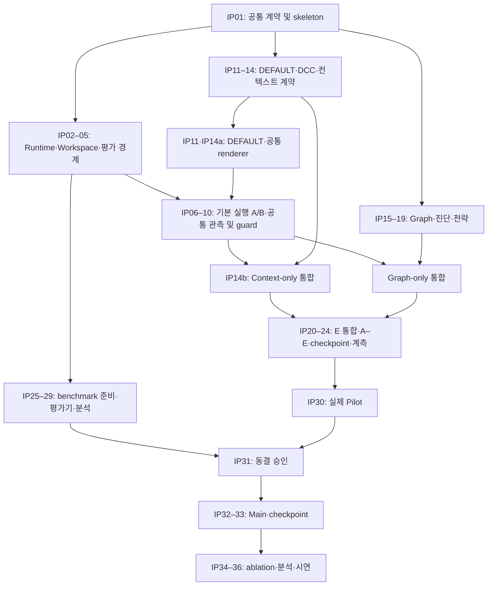
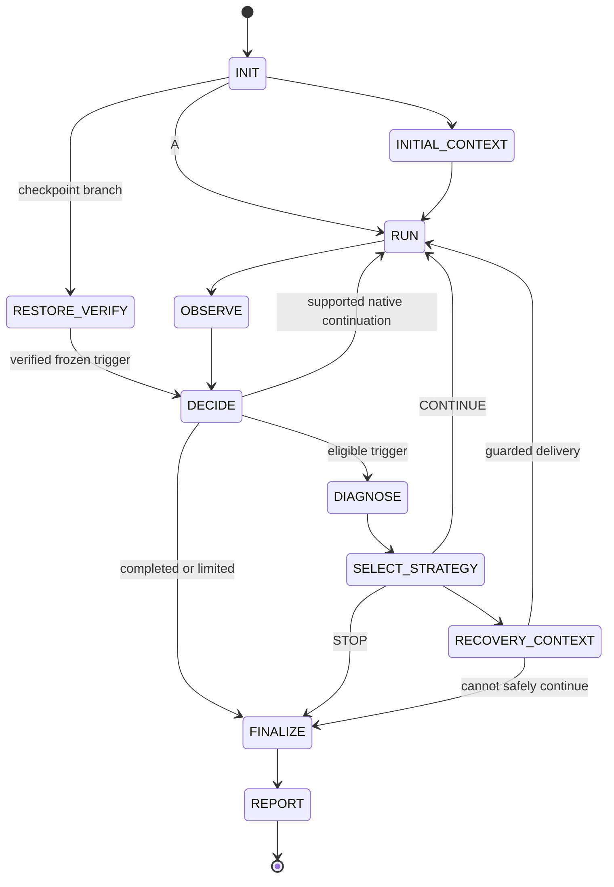

# Adaptive Agent Harness — 구현 계획서

## 그래프 기반 실패 복구 및 동적 컨텍스트 최적화를 통한 코딩 에이전트의 신뢰성과 실행 효율 향상

**English title:** Adaptive Agent Harness: Graph-Guided Failure Recovery and Dynamic Context Optimization for Coding Agents

| 항목 | 내용 |
| --- | --- |
| 문서 | IMPLEMENTATION_PLAN.md |
| 버전 | v0.1.0 |
| 작성일 | 2026-11-25 |
| 수행 맥락 | 잇츠 스터디 5기 — Codex 기반 AI 코딩 에이전트 구축 |
| 대상 | 3인 팀, 구현 담당자, Codex 개발 에이전트 |
| 상태 | 구현 착수용 계획 초안; 실제 진척·담당자·비용 미확정 |
| 상위 문서 | RESEARCH_PROPOSAL.md, PROJECT_OVERVIEW.md, LITERATURE_REVIEW.md, METHODOLOGY.md, SYSTEM_ARCHITECTURE.md, TECHNICAL_SPEC.md, EXPERIMENT_DESIGN.md, BENCHMARK_SPEC.md, EVALUATION_PROTOCOL.md |

> **핵심 목표:** 실제 Codex 실행에서 관측된 실패를 근거로 코드와 실행 이력을 연결해 진단하고, 후속 전략과 보조 컨텍스트를 구성하는 외부 하네스를 구현한다. 동일한 평가 환경에서 제안법의 효과와 비용을 검증한다. 특정 엔지니어링 용어나 라이브러리 도입은 구현 목표가 아니다.

---

## 1. 구현 목적 및 계획의 적용 원칙

본 문서는 기존 아홉 개 문서의 연구 목표·알고리즘·소프트웨어 계약·평가 정책을 실행 가능한 작업 단위로 연결한다. 연구의 핵심은 그래프 기반 증거·전략 선택과 상태 적응형 컨텍스트 최적화이며, 피드백 루프는 이를 반복 적용하는 실행 구조다. Codex의 모델이나 비공개 내부 상태를 변경하지 않는다.

### 1.1. 우선순위와 문서 권한

| 결정 대상 | 기준 문서 |
| --- | --- |
| 연구 질문·범위·가설 | RESEARCH_PROPOSAL.md |
| 제품 기능·수용 조건 F01–F14, AC01–AC09 | PROJECT_OVERVIEW.md |
| 차별화 범위 및 추가 비교 | LITERATURE_REVIEW.md |
| 그래프·전략·DCC 계산 및 M01–M11 | METHODOLOGY.md |
| 모듈 경계·상태 머신·격리 | SYSTEM_ARCHITECTURE.md |
| 타입·함수·CLI·구현 테스트 | TECHNICAL_SPEC.md |
| 비교 조건·규모·동결 | EXPERIMENT_DESIGN.md |
| 과제·테스트·snapshot 품질 | BENCHMARK_SPEC.md |
| 평가 판정·계측·분석 | EVALUATION_PROTOCOL.md |
| 작업·의존성·담당·일정 | 본 문서 |

상위 문서 간 불일치가 발견되면 구현 에이전트가 편의상 선택하지 않는다. 충돌을 이슈로 등록하고 담당자와 연구 책임자가 영향을 검토한 뒤 문서·테스트·설정을 함께 변경한다. 본 문서는 기존 정책을 덮어쓰지 않는다. 작업 ID, 담당 역할, 실행 순서, 마일스톤 승인 절차는 신규 제안이다.

### 1.2. 실행 원칙

- 실제 Codex 연동과 독립 평가를 가장 먼저 확인하는 vertical slice를 우선한다.
- 공통 계약을 고정한 뒤 그래프와 DCC를 병렬 구현한다.
- 모의 런타임은 계약 검증용이며 실제 연동 성공의 증거가 아니다.
- 공개 검사만 복구 루프에 사용한다. hidden test, 정답 패치 및 private 판정은 외부 평가 경계를 넘지 않는다.
- 안전한 격리 및 프로세스 종료를 확보하지 못하면 실제 실행과 연구를 중단한다.
- 연구 성능 목표는 구현 완료 기준과 분리한다. 개선이 없더라도 모든 결과와 한계를 보고한다.

## 2. 범위 및 MVP 정의

| 우선순위 | 구현 범위 | 검증 근거 |
| --- | --- | --- |
| P0 | 단일 Codex, Python 저장소, 승인된 공개 검사와 작업 공간 관리 | F01–F02, AC01, RT01–RT07 |
| P0 | 초기·복구 DCC와 공통 DEFAULT 정책 | F03/F09, AC02, M01/M07 |
| P0 | Repository Graph, Execution Graph, Cross-Graph Mapping | F04–F06, AC03, M02–M04 |
| P0 | 공통 실패 감지, 유형별/일반 복구 전략, 피드백 루프 | F07–F10, AC04–AC06 |
| P0 | 실행 보고서, A–E 자동 비교, 공통 실패 체크포인트 및 독립 평가 | F11–F12, AC07–AC08 |
| P1 | 실제 로그 기반 사례 뷰어, AB1–AB4 우선 추가 실험 | F13–F14, AC09 |
| P2/제외 | 멀티에이전트, RL, 동적 워크플로 재배선, 그래프 DB, 다중 언어, 장기 메모리, IDE 플러그인 | 본실험 완료 후 별도 승인 |

정적 결과 페이지 또는 보고서로 AC09를 충족할 수 있으므로 실시간 UI는 필수가 아니다. P0 구현이 완료되기 전에 별도 서버·복잡한 프론트엔드·추가 모델 호출을 도입하지 않는다. 공개 과제는 편입 검증이 된 경우만 사용한다. 자체 과제 규모도 품질 게이트를 만족하는 범위에서 정한다.

## 3. 팀 역할 및 코드 소유권

실제 이름은 합의 후 TEAM_ROLES.md에 기입한다. 담당 역할은 RH/GR/CE로 표기하여 실험 조건 A–E와 구분한다.

| 역할 | 주 담당 | 산출물 | 학습 목표 |
| --- | --- | --- | --- |
| RH — Runtime & Harness | runtime, workspace, workflow, evidence, 공통 감지, experiment runner, CLI | capability report, 실제 실행 로그, 상태 머신, schedule, checkpoint 복원 | Codex 실행 인터페이스, 격리, 상태 및 예산 관리 |
| GR — Graph & Recovery | repository/execution/mapping, graph·flat diagnosis, strategy, adherence | 그래프 schema 구현, 실패 앵커 탐색, 전략 근거 기록 | AST, 관계 탐색, 실패 진단, 전략 검증 |
| CE — Context & Evaluation | 후보/DEFAULT/DCC, 메시지 guard, evaluator, usage 집계, 분석 | 컨텍스트 패키지, 독립 평가기, 지표·통계 코드 | 검색·예산 최적화, 평가 및 비용 회계 |
| 공동 | domain 계약, benchmark 제작·교차 리뷰, 통합, 동결, 발표 | 과제 검증 보고서, PR, 결정 로그, 실험 결과 | 재현 가능한 AI 시스템 연구 |

CE의 업무가 집중되므로 RH가 계측 원천 및 평가 실행 연결을 맡고, GR이 AB1/AB2/AB4와 실패 사례 분석을 주도한다. benchmark 및 private suite 작성은 분담하고 반드시 다른 사람이 리뷰한다. 정책을 개발하는 Codex 세션은 Main private 자료에 접근하지 않는다. 완전한 사람 수준 블라인딩이 어렵다는 한계를 기록한다.

| 승인 대상 | 작성/운영 | 리뷰 및 승인 |
| --- | --- | --- |
| 공통 타입·정책 매핑 | RH + GR + CE | 세 역할 합의 |
| 런타임·격리 | RH | CE 검증, GR 교차 리뷰 |
| 그래프 및 전략 | GR | RH 계약, CE 정책 격리 리뷰 |
| DCC 및 renderer | CE | GR 근거·RH 전달 계약 리뷰 |
| 평가·비용·통계 | CE | RH 계측, GR 계산·해석 리뷰 |
| benchmark task | 지정 작성자 | 다른 팀원, BQ14 승인 |
| 실험 동결 및 변경 | 공동 | 세 역할 승인; 미해결 P0 차단 |

## 4. 저장소 구성과 개발 환경

TECHNICAL_SPEC §2의 모듈 배치에 따른 작업 위치다. 실제 파일명과 시그니처는 기술 명세를 따른다.

```text
adaptive-agent-harness/
  README.md
  AGENTS.md
  pyproject.toml
  configs/
  docs/
  src/aah/
    cli/          domain/       workflow/
    runtime/      workspace/    evidence/
    graphs/       diagnosis/    recovery/
    context/      reporting/
  experiments/
  evaluation/
  benchmarks/
  analysis/
  tests/
    unit/         contract/     integration/
    isolation/    live/
  results/
```

- Python 3.11+, Python AST, NetworkX MultiDiGraph, BM25, pytest를 기술 명세의 시작점으로 사용한다. 버전·토큰화·OS·격리 방식은 S0/Pilot에서 기록하고 고정한다.
- Codex CLI 우선 검증, SDK 대안. 설치된 버전의 실제 기능에 맞춰 adapter 구현을 결정한다. 본 문서는 새 Codex 명령이나 API 지원을 보장하지 않는다.
- `results/` 및 private benchmark 저장 위치는 일반 작업 공간 및 공유 저장소와 별도 접근 경계를 적용한다. 위 트리는 논리적 위치이며 private 자료를 에이전트가 접근 가능한 repo 내부에 넣으라는 뜻이 아니다.
- `.gitignore`는 편의 수단일 뿐 보안 경계가 아니다. 비밀키·개인정보·정답·hidden suite를 개발 프롬프트, 원시 공개 로그 및 Git 기록에 노출하지 않는다.
- 의존성 잠금 파일, 지원 환경 및 설치 방법을 실제 검증한 뒤 README에 기록한다. 환경별 설치 스크립트는 필요할 경우 추가한다.

## 5. 전체 작업 의존성



위 다이어그램은 작업 단계의 의존성이지 새로운 실행 알고리즘이 아니다. 핵심 임계 경로는 공통 계약 → 안전한 실제 실행 → A/B 공통 실행 → C/D 및 E 통합 → 실제 비교·checkpoint 검증 → Pilot → 동결 → Main이다. GR과 CE는 초기부터 합성 fixture 기반 개발을 병행하고 실제 ledger/adapter가 준비되면 교체해 통합한다. 과제 작성·평가기 개발도 S0 이후 병렬 수행한다. IP06–10과 IP25–29 사이에서 evaluator·계측 계약을 공유하되 실제 private 평가 결과는 workflow에 역류하지 않는다.

## 6. 단계별 구현 작업 백로그

모든 작업은 다음 표의 ID를 GitHub Issue 제목 또는 참조에 사용한다. `선행`은 통합 완료 기준이며, mock을 이용한 준비 작업까지 금지하는 것은 아니다. 초기 상태는 모두 `PLANNED`이며 실제 구현 여부를 추정하지 않는다.

### S0 — 실행 가능성·공통 계약·안전 경계

| ID | 작업 | 담당 | 선행 | 산출물 / 완료 조건 |
| --- | --- | --- | --- | --- |
| IP01 | repo skeleton, domain 계약, 설정·schema 버전 합의 | RH/공동 | 없음 | RunRequest, RunState, TurnRequest/Result, EvidenceRecord, SnapshotRef, PolicySet 등 기술 명세 기반 타입; import 및 CT02 검증 |
| IP02 | WorkspaceManager와 snapshot/diff/freeze/cleanup | RH | IP01 | 원본 불변, 신규 파일 포함 snapshot/patch 재현, UT01–02 |
| IP03 | RuntimeAdapter 및 capability probe | RH | IP01, IP02 | 버전·모델·이벤트·후속 실행·취소·usage 확인. RT06은 IP04 경계와 IP05 공동 증거로 닫음 |
| IP04 | 승인 공개 검사 및 독립 평가 최소 경계 | CE/RH | IP02 | DEV-01/02 baseline FAIL, reference PASS, 공개·private 검사 분리; EP01/EP28 실제 검증 |
| IP05 | 실제 smoke vertical slice, 격리 및 정리 승인 | RH/CE | IP02–04 | 승인된 Dev profile에서 최소 한 과제 실행·독립 판정. RT04–06과 LT01/LT03 해당 증거, 안전성 차단 기록 |

**S0 산출물:** capability report, smoke run ID, patch hash, 공개·독립 검사 결과, 보안 검사 기록, 지원/미지원 기능 표. RT04–RT06 안전 실패 시 실환경 실행 금지. RT03 실패 시 복구 미완료; 팀이 공통 새 세션 등 지원 가능한 외부 경계를 검증하기 전 후속 제어를 가정하지 않는다.

### S1 — 공통 실행·증거·일반 재시도

| ID | 작업 | 담당 | 선행 | 산출물 / 완료 조건 |
| --- | --- | --- | --- | --- |
| IP06 | Observer + EvidenceLedger + report store | RH | IP01, IP03 | raw 이벤트 정규화, provenance·unknown·중복 제거, snapshot/diff/check 연결, UT04/05, CT01 |
| IP07 | 공통 상태 머신 및 Budget Manager | RH | IP02, IP06 | 정상/한도/취소/오류 경로, 예약 ID·정리 reserve·monotonic 시간, UT15/IT01/IT04 |
| IP08 | resolver A–E와 guard 공통 계약 | RH/CE | IP01 | 고정 정책 매핑, A 외부 개입 없음, CT03–07 설계 fixture |
| IP09 | 공통 trigger/gate + Flat Diagnoser + GENERIC_RETRY | RH/GR | IP06, IP07 | T1–T4 우선순위, T5 미관측 구분, 동일 ledger parity, UT08–10/CT04 |
| IP10 | A/B vertical slice 및 공개 report CLI | RH/CE | IP07–09, IP11, IP14a | 실제 또는 모의 A/B 정상·실패 경로, 실제 A 확인; 공통 강한 평면 대조군, CT07/IT01/IT02/IT07 |

S1의 기본 패키징은 S2 IP11/14와 동시에 전달한다. 단계 번호가 모든 작업의 순차 완료를 의미하지 않는다. B는 무의미한 retry 메시지가 아니라 공통 후보에서 실패와 관련된 증거를 제공해야 한다.

### S2 — Dynamic Context Compiler

| ID | 작업 | 담당 | 선행 | 산출물 / 완료 조건 |
| --- | --- | --- | --- | --- |
| IP11 | 후보 수집 및 DEFAULT 패키징 | CE | IP01 | 필수/보조 구분, 공통 원천·형식·상한, B/D에 DCC 전용 최적화 없음 |
| IP12 | DCC 유효성·관련성 점수 및 출처 | CE | IP11 | INVALID/HISTORICAL/UNCERTAIN 구분, BM25·scope·실패 관련성, UT11 |
| IP13 | 중복 제거·Greedy Packing 및 선택 기록 | CE | IP12 | 결정적 동률 처리, 최소 근거 및 최종 직렬화 크기, UT12/13 |
| IP14 | 공통 renderer/guard + C 통합 | CE/RH | IP08, IP11 (IP14a); IP13, IP10 (IP14b) | 필수 지침·권한, 초기/복구 fixture 및 누출 차단. CT03의 최종 A–E 초기 parity는 IP21에서 확인 |

IP14a는 renderer/guard 공통 계약을 먼저 제공하고 IP14b는 IP10 및 IP13 완료 후 C 실제 통합을 수행한다(IP10과의 순환 의존성 방지). DCC는 전략 ID를 변경하지 않고, 그래프가 제공한 근거 후보가 없는 상황에서도 평면 증거만으로 실행 가능해야 한다. 초기 컨텍스트는 그래프 파생 정보에 의존하지 않는다.

### S3 — 이중 그래프 및 복구 전략

| ID | 작업 | 담당 | 선행 | 산출물 / 완료 조건 |
| --- | --- | --- | --- | --- |
| IP15 | Repository Graph builder | GR | IP01, IP02 | 파일·함수·테스트, 허용 관계, AST 실패·동적 호출 unknown, UT02/03 |
| IP16 | Execution Graph builder | GR | IP01, IP06 | 실행·결과·실패 반복, 관측 순서 및 이벤트 참조, UT04 |
| IP17 | Cross-Graph Mapping | GR | IP15, IP16 | 관측/추정·snapshot 근거, 명확하지 않은 READS/FAILS_AT 강제 생성 금지, UT05 |
| IP18 | GraphService 및 제한된 진단 | GR | IP17, IP09 | 실패 앵커, 관계 탐색, 깊이·방문·분기·top-k 제한, 경로·점수, UT06/07 |
| IP19 | TYPED 전략 및 D 통합 | GR/RH | IP18, IP10, IP11 | REVIEW_REGRESSION/RELOCALIZE/REFRESH_EVIDENCE 및 GENERIC_RETRY fallback; CONTINUE/STOP; 전략 수행 관측, UT10/IT02/IT03 |

그래프 모듈은 관계를 단순히 표시하는 데 그치지 않고 실제 Diagnosis의 후보와 근거를 생성한다. `SUSPECTS` 등 추정 정보는 관측된 원인과 구분한다. Graph-only D는 DEFAULT 패키징만 사용한다. 실제 후속 행동은 Codex가 수행하며 전달한 지침이 그대로 수행되었다고 가정하지 않는다.

### S4 — 통합·실험 자동화·평가

| ID | 작업 | 담당 | 선행 | 산출물 / 완료 조건 |
| --- | --- | --- | --- | --- |
| IP20 | E 통합 및 상태 전이 오류 경로 | RH/GR/CE | IP13, IP14b, IP19, G0 | 그래프→전략→DCC→후속 실행의 관측·전달, IT02/03. 실제 공개 실패 이후 전달 LT02는 RH가 실행하고 GR/CE가 검토 |
| IP21 | A–E policy parity/spy 검증 | 공동 | IP20, IP10 | CT03–07, 동일 후보·공통 trigger·상한·권한; A/B/C graph 미호출, A/B/D DCC 미호출 |
| IP22 | CheckpointRecord capture/restore 및 분기 | RH | IP02, IP07, IP21 | patch·신규 파일·ledger·잔여 예산·세션 정책·hash 일치, IT05 |
| IP23 | ExperimentManifest, schedule, runner 및 리포트 연결 | RH/CE | IP20–22, IP27; 완료 검증에 IP24 | slot/attempt·독립 판정과 비용/coverage 연결. 같은 Dev 과제 A–E LT04는 IP24와 공동 검증 |
| IP24 | 사용량·예산·오버헤드·비용 원천 | RH/CE | IP03, IP06, IP07 | UsageRecord, 누적/증분 모드, 계측 범위 및 결측, UT14/EP13–18/21 |

### 병렬 트랙 — benchmark·독립 평가·분석 (S0–S4)

| ID | 작업 | 담당 | 선행 | 산출물 / 완료 조건 |
| --- | --- | --- | --- | --- |
| IP25 | Smoke/Dev fixture 및 replay 제작 | 공동 | IP04 | DEV-01–08 후보 중 5–8개 개발 과제; 자연 실패와 인위적 replay 구분 |
| IP26 | 자체 Main 16개 후보 및 공개 후보 8개 슬롯 검증 | 공동 | IP04, IP25 계약 | R-AUTH/R-ORDER/R-INGEST/R-SCHED; 후보 registry, 라이선스·환경·BQ01–14 및 교차 리뷰 |
| IP27 | 독립 evaluator 완성 및 상태 mapping | CE/RH | IP04, IP02 | FrozenPatch+private spec, 기능/회귀/제약, EP01–12, hidden 결과 역류 금지 |
| IP28 | 집계·분석 파이프라인 | CE | IP01, IP27 계약, IP24 계약 | 분석 단위·결측·CPS·paired contrast·2×2·bootstrap, EP13–25/30 |
| IP29 | 격리·과제·분석 품질 게이트 검증 | 공동 | IP21/22, IP26–28 | SEC/ISO/BQ/EP 및 artifact 무결성 결과, 편입 승인/제외 근거 |

IP26의 16+8은 목표이며 전부 승인된 상태가 아니다. 공개 후보 미검증 시 사전에 정한 자체 과제 대체 또는 축소 경로를 사용한다. Main 후보에 대한 정책 실행 결과를 보고 난이도나 문서 상태를 변경하지 않는다. IP28의 분석 fixture는 실제 Main 결과가 나오기 전 구현한다.

### S5 — Pilot, 동결, 평가 및 제출

| ID | 작업 | 담당 | 선행 | 산출물 / 완료 조건 |
| --- | --- | --- | --- | --- |
| IP30 | 실제 Pilot, 정책·비용·후속 실행 검증 | 공동 | G1, IP25, IP27; Dev 품질·안전 게이트 | 5–8개 Dev × A–E 1회 목표, 실제 후속 전달·parity·복원·usage·조정 기록 |
| IP31 | 규모/설정/과제/분석 사전 동결 | 공동 | IP29, IP30 | locked manifest, 고정 slot·source 순서 및 동적 branch/AB slot 생성 규칙, 정책 hash·모델·환경·분석 버전·공동 승인 |
| IP32 | Main end-to-end | RH 운영/공동 | IP31 | A–E 고정 schedule, 원시 실행·평가·비용 기록 |
| IP33 | 자연 실패 source 확보 및 B–E 분기 | RH/GR | IP31, IP22 | source 전체 기록, 적격 상태·실패율·분기·복원·비용 기록 |
| IP34 | 우선 ablation | GR/CE | IP31의 동결 subset 규칙 및 IP32/33 관련 파생 기록 | AB1/AB2 우선, AB3/AB4 가용 시. AB2는 별도 짝 계약 승인(OD-18), 미수행 사유 기록 |
| IP35 | 정량 분석, 실패·오개입·한계 검토 | CE/공동 | IP32/33 및 수행 AB | EP30 재집계, paired 결과 및 불확실성, 사례 선택 근거 |
| IP36 | README, 보고서, 실제 로그 시연, 발표 | 공동 | IP35 (문서 준비는 선행 가능) | 재현 절차, 제한 사항, 원시 증거 연결, AC09 |

## 7. 핵심 모듈 통합 순서와 개발 계약

### 7.1. 첫 실제 실행 (S0)

G0 전에는 RH/CE가 Dev 과제·승인 검사/평가 runner·경계를 지정하고 공동으로 한시 Smoke 프로파일과 실제 실행을 승인한다. 최소 권한·허용 도구와 환경·시간/턴/비용·정리 reserve·parser/timeout·사용자 승인 근거 및 만료를 기록한다. IP02/IP04가 합성 자료로 경계를 입증한 뒤 실제 인증을 적용한다. RT06은 그 근거와 IP05 통합 확인을 함께 요구한다. 이 프로파일은 G2 동결 설정과 별도다.

1. 개발용 fixture와 승인된 실행 환경을 준비한다. 원본 저장소와 실행 공간, 평가 전용 공간을 분리한다.
2. baseline과 reference 평가를 실행해 evaluator가 실제 버그 상태와 정상 상태를 구별하는지 확인한다.
3. RuntimeAdapter로 단일 Codex 실행을 시도하고 공개 이벤트·usage·권한을 관측한다.
4. 프로세스 정지와 snapshot/patch 고정 이후에만 독립 평가기로 패치를 전달한다.
5. 원시 이벤트, 공개 검사, capability, 종료 사유, 독립 평가 결과를 서로 다른 artifact로 기록한다.

안전 테스트는 실제 모델 호출 전에 가능한 범위를 우선 수행하고, 실제 런타임 경계에서도 재확인한다. 안전 위반이 발생하면 중단 및 정리하고 원인을 수정한 뒤 재검증한다.

### 7.2. 정책 구성 및 정보 경계

| 조건 | initial_context | diagnosis | strategy | recovery_context | 외부 개입 |
| --- | --- | --- | --- | --- | --- |
| A | NONE | NONE | NATIVE | NONE | false |
| B | DEFAULT | FLAT | GENERIC | DEFAULT | true |
| C | DCC | FLAT | GENERIC | DCC | true |
| D | DEFAULT | GRAPH | TYPED | DEFAULT | true |
| E | DCC | GRAPH | TYPED | DCC | true |

TECHNICAL_SPEC §4.3의 매핑을 그대로 구현한다. 연구 모드에서는 개별 policy override를 금지한다. B–E의 감지·개입 상한·정보 접근 범위·필수 지침은 공통으로 유지한다. 그래프 off인 A/B/C는 그래프 호출 0, DCC off인 A/B/D는 DCC 호출 0을 테스트한다. 동일 초기 입력에서 B/D, C/E의 외부 패키지 byte parity를 검증한다. 로그용 ID는 외부 메시지에서 제외한다. A의 native 동작과 공통 계측은 외부 복구를 금지한 상태에서 유지한다.

### 7.3. 공통 상태와 예외 처리



그림은 주요 경로만 표시한다. INIT/INITIAL_CONTEXT/OBSERVE/DIAGNOSE의 안전 종료를 포함한 전체 허용 전이는 TECHNICAL_SPEC §11.1을 따른다. EVALUATE는 실험 실행기만 접근하며 workflow의 일반 사용자 제어부가 호출하지 않는다. 안전 위반·취소 → 전역 한도 → 유효 trigger/gate → 정상 종료/지원된 지속 순서를 유지한다. 외부 개입 상한 도달은 정상 지속까지 강제 종료한다는 의미가 아니다.

후속 실행 예약과 실제 전달을 구분하고, 불명확한 전달에는 중복 실행을 금지한다. 실패한 모듈은 사전 정의된 공통 fallback 또는 안전 종료로 처리하며 배정 조건을 변경하지 않는다. 실패한 실행의 토큰·시간·오류를 보존한다.

### 7.4. 모듈 계약 체크리스트

| 소비자 | 제공자 | 공유 입력/출력 | 차단할 의존성 |
| --- | --- | --- | --- |
| Orchestrator | RuntimeAdapter | TurnRequest → TurnResult, RawEvent | 비공개 추론·임의 내부 상태 제어 |
| Observer | Workspace/Runtime | TurnResult, workspace, before snapshot → ObservationBatch | private 판정 접근 |
| Ledger | Observer | ObservationBatch의 정규화 레코드 append → EvidenceView | 판정·파생 정보로 원본 수정 |
| Detector | Ledger | 공통 EvidenceView → Trigger | graph/DCC 파생 점수 |
| Diagnoser | GraphService 또는 flat | Trigger → Diagnosis | hidden test/정답 참조 |
| Recovery | Diagnoser | Diagnosis → Strategy | DCC 내부 점수에 따른 전략 변경 |
| ContextCompiler | candidates/diagnosis | CompileRequest → CompileResult | 필수 지침 삭제·권한 변경 |
| Evaluator | 실험 실행기 | REPORT 후 EvaluationRequest → EvaluationResult | agent에게 피드백 제공 |
| Analysis | run/evaluation/usage 저장소 | 분석 집합 및 결과표 | 모델 호출·자동 재실행 |

실제 시그니처는 TECHNICAL_SPEC §5와 EVALUATION_PROTOCOL §13을 따른다. 추가 타입이 필요하면 contract test를 먼저 작성하고 소비자와 합의한다.

## 8. 테스트 계획 및 게이트

### 8.1. 테스트 계층 및 책임

| 테스트 범주 | ID / 기준 | 주 책임 | 수행 시점 |
| --- | --- | --- | --- |
| 단위 | UT01–UT15 | 모듈 담당자 | 모든 관련 PR |
| 계약 | CT01–CT07 | RH + 소비 모듈 담당자 | 계약 변경·통합 PR |
| 통합 | IT01–IT07 | RH/공동 | S1–S4, merge 전 |
| 보안·격리 | ST01, SEC01–SEC07, ISO-01–08 | RH/CE | 실제 실행 전 및 환경 변경 시 |
| 실제 런타임 | RT01–RT07, LT01–LT04 | RH/공동 | S0, S4/Pilot |
| 과제 품질 | BQ01–BQ14 | 작성자+타인 리뷰 | 각 과제 승인 전 |
| 평가·분석 | EP01–EP30 | CE/공동 | evaluator/분석 변경 및 동결 전 |
| 방법·제품 | M01–M11, AC01–AC09 | 공동 | 단계별 승인 및 제출 전 |

테스트 ID들은 중복 검증 목적을 가질 수 있으므로 이를 합산해 독립적인 테스트 함수 수로 주장하지 않는다. 통과, 실패, 차단, 미실행을 구분하고 `NOT_APPLICABLE`은 근거 및 승인 없이는 사용하지 않는다. live 및 실제 격리 테스트는 mock으로 대체할 수 없다.

### 8.2. 단계별 명령과 CI

아래는 기술 명세에 따른 구현 목표이며 현재 동작을 확인한 명령이 아니다.

```bash
pytest tests/unit tests/contract
pytest tests/integration tests/isolation
# 실제 호출은 인증·권한·격리·비용 승인 후 명시적으로 수행
pytest tests/live -m live
```

CI 기본 작업은 unit/contract 및 외부 모델을 사용하지 않는 integration/isolation fixture 검증으로 구성한다. 실제 보안 경계 검증은 별도 환경에서 실행한다. 유료 live test는 기본 CI 및 자동 merge 트리거에서 제외한다. 실제 호출 전 비용 단위·한도·인증 여부를 확인한다. 새 패키지 설치나 권한 상승이 필요하면 승인 없이 진행하지 않는다.

### 8.3. 제품 완료 기준 연결

| 완료 기준 | 기능 | 구현 작업 | 확인 근거 |
| --- | --- | --- | --- |
| AC01 | F01/F02 | IP03–05 | 실제 Codex run ID 및 patch |
| AC02 | F03 | IP11–14 | 필수 지침 보존 및 패키지 선택 로그 |
| AC03 | F04–F06 | IP15–18 | snapshot 근거 및 그래프 경로 |
| AC04 | F07–F10 | IP09, IP19/20 | IT02와 승인된 Dev LT02의 실제 공개 실패→지침 전달→관측. IP30은 더 넓은 Pilot |
| AC05 | F10 | IP07/20 | 정상·한도 종료 테스트 |
| AC06 | F02/F07–F10 | IP06/07/09/14/20 | unknown·fallback·오류 경로 및 기록 |
| AC07 | F11 | IP10/23/24 | CLI patch 및 리포트 조회 |
| AC08 | F12 | IP21–24, IP27 | IT05/06 및 Dev LT04의 A–E·독립 평가·비용 연결. IP29의 Main 품질/승인은 G2 |
| AC09 | F13 | IP35/36 | 실제 artifact 기반 사례 및 비교 시각화 |

AC01–AC08이 MVP 승인에 필요하다. AC09는 제출·발표 시 검증한다. 실제 실패 후 지침 전달을 검증하는 AC04와 복구 성능 향상을 주장하는 것은 별개다. 한 건의 성공 사례나 fake 통과만으로 전체 구현 완료를 선언하지 않는다.

## 9. Pilot, 예산 및 정책 고정

### 9.1. Pilot 시작값

아래 값은 EXPERIMENT_DESIGN §13.1의 임시 시작값을 유지한다.

| 정책 | 시작값 |
| --- | --- |
| T1 반복 / T2 관측 창 및 비율 | 2회 / 6개 행동, 0.67 |
| trigger priority | T3 → T1 → T2 → T4 |
| 그래프 깊이 / 방문 / 분기 / top-k | 4 / 200 / 20 / 8 |
| 엣지 기본 비용 / 추정 penalty | 1 / 1 |
| 그래프 점수 가중치 | 0.4 / 0.3 / 0.15 / 0.15 |
| DCC 초기 / 복구 가중치 | 0.5 / 0.3 / 0.2 / 0 ; 0.25 / 0.2 / 0.2 / 0.35 |
| 중복 penalty / BM25 k1,b | 0.2 / 1.5, 0.75 |
| 초기 및 복구 보조 컨텍스트 상한 | 각 2,048 추정 토큰 |
| 외부 복구 개입 / 상태 전이 상한 | 2회 / 100 |
| 정리 reserve | 15초 |
| 실제 모델·세션·시간·턴·토큰 강제 | probe 후 결정 |

0.67과 4/6은 동일하지 않다. 현재 시작값에서 4/6은 기준 미만이므로 UT08에 경계 테스트를 포함하고 의도한 조건은 Dev/Pilot에서 명시적으로 확정한다. 토큰 강제 미지원 시 `observe_only`로 고정하고 공통 시간·턴 상한을 사용한다. 2,048은 외부 보조 패키지 추정 상한이지 전체 모델 사용량 상한이 아니다.

### 9.2. Pilot 수행 순서

- Smoke 1–2개 및 Dev 5–8개를 준비한다. Main과 동일 underlying bug/family를 공유하지 않는다.
- A–E로 개발 과제를 실행하여 비용 및 시간, 자연 실패 빈도, 관측 범위를 측정한다(25–40회 기본 계획, 기술 검증·추가 조정 별도).
- 실제 후속 전달, 패치 복원, graph/flat parity, DCC 격리, 평가 결과 비유입을 확인한다.
- 조정 전후 설정·근거·영향받는 테스트를 기록한다. Main 결과를 확인하지 않는다.
- 단계별 실행당 평균·중앙 비용과 긴 실행 위험, 안전 reserve, 프로젝트 잔여 자원으로 규모를 선정한다.

Pilot 성공은 본실험 성능이 좋다는 뜻이 아니다. 자연 실패가 없으면 관측 결과를 기록하고 Dev 과제의 복잡도 및 검사 범위를 검토한다. 강제 replay는 기능 테스트로만 사용한다. 실제 관측 실패 및 후속 전달을 확보하지 못하면 AC04·복구 실험은 차단 상태로 남긴다.

### 9.3. 실험 규모 선택

| 계획 | Main A–E | 체크포인트 | 추가 실험 |
| --- | ---: | --- | --- |
| Full | 24 × 5 × 2 = 240 | 목표 12, source 최대 24, 분기 목표 48 | AB1–AB4 80회 |
| Core | 20 × 5 × 2 = 200 | 목표 8–12, B–E | AB1/AB2 우선 |
| Reduced | 12 × 5 × 2 = 120 | 목표 최대 6–8, B–E | 가능 시 AB2 |
| Emergency | 8 × 5 × 1 = 40 | 가능한 공통 상태, B–E | 생략 가능; 탐색적 평가 |

Full의 P0 계획 실행은 최대 source 24 및 목표 분기 48을 합해 312회, P1까지 392회다. Smoke, Pilot 및 개발·probe 호출은 별도이며 실행 수는 모델 호출 수 또는 크레딧과 같지 않다. 실제 적격 checkpoint가 적으면 확보된 수만 평가하고 발생 빈도 및 이유를 보고한다. Emergency는 확인적 연구를 대체하지 않는다.

예산 단위별로 `계획 실행 수 × 실측 단위 비용 + 개발/검증 + 예비 자원`을 계산한다. 기존 실험설계의 20% reserve 권고를 검토하되 실제 잔여 자원과 구분한다. 정확한 토큰·과금·크레딧을 확인할 수 없는 경우 단위를 혼합하거나 0으로 채우지 않는다. 활동 종료 후 크레딧 사용 가능성이 확인되지 않았다면 그 이후의 모델 호출을 가용 예산으로 산정하지 않는다.

## 10. 마일스톤과 일정

아래 날짜는 연구제안서 및 실험설계의 잠정 일정(11/30 활동 종료, 12/16 발표 예정)을 이어받았다. 오늘(2026-11-25)부터의 작업 제안이며 실제 진행률이나 공식 마감 확인 결과가 아니다. 먼저 운영진 공지·제출 마감·크레딧 만료·팀 가용 시간을 확인한다. 촉박한 일정으로 모든 작업을 완료할 수 있다고 보장하지 않는다.

| 날짜 (2026) | 단계 | RH | GR | CE | 종료 증거 |
| --- | --- | --- | --- | --- | --- |
| 11/25–26 | S0 | workspace/probe/계약 | graph·strategy fixture | 독립 평가 최소 경계, DCC 계약 | G0: 실제 기본 실행 및 안전 경계 |
| 11/27 | S1 병행 | ledger/상태/예산/A–B | repository/execution/mapping | DEFAULT/후보/renderer | 공통 계약 및 정상/실패 fake 경로 |
| 11/28 | S2/S3 | 통합 인터페이스 | 제한 탐색/flat/전략 | DCC·guard/C | B/C 및 D 통합 테스트 |
| 11/29–30 | S4 | E/runner/checkpoint/계측 | graph 복구 실제 근거 | evaluator/비용/parity | G1: 실제 통합 MVP·초기 Pilot 목표 |
| 12/01–04 | Pilot/동결 | schedule/restore 검증 | Dev 분석/과제 검증 | 분석 fixture/benchmark 검증 | G2: 승인된 lock manifest |
| 12/05–09 | Main/checkpoint | 실행 운영·안전/비용 | 진단 로그 및 source | 독립 판정·집계 | G3: 원시 기록 및 disposition |
| 12/10–12 | 추가 평가/분석 | 재현 및 로그 검증 | AB1/2/4, 실패 사례 | AB3 및 paired 분석 | G4: 결과·한계·증빙 |
| 12/13–15 | 제출 준비 | CLI/README/실제 replay | 그래프 설명·사례 | 결과표·보고서 | G5: 최종 제출 패키지 |
| 12/16 예정 | 발표 | 공동 | 공동 | 공동 | 실제 결과 및 작동 데모 |

11/25–30의 benchmark 작성·검토는 잠정 병행 계획이다. 초기 자료 관측은 G1 전 사용해도 되지만, 정식 IP30 Pilot과 G2 동결·Main의 전제는 아래 게이트를 따른다. OD-13/14에서 크레딧 만료·공식 마감·비작성 리뷰 여력을 확인한다. Full P0 계획 312회의 실행·독립 평가·정리·획득 실패를 포함한 처리량과 OD-08의 규모는 Pilot 근거로 승인한다.

### 10.1. 승인 게이트

| 게이트 | 승인 조건 | 실패 시 행동 |
| --- | --- | --- |
| G0 — 실제 실행 가능 | RT01–07 결과, RT04–06 안전, 한 Dev 과제 실제 실행 및 독립 판정 | 안전 실패 시 실행 금지; RT03 실패 시 복구 미완료 및 대안 검증 |
| G1 — 통합 MVP | AC01–08 및 관련 M/테스트, 승인된 Dev LT02/LT04, A–E parity·공개 보고·IT05/06 | 확장 기능 제거, blocker 해결. 모의 실행만으로 통과 금지 |
| G2 — 본실험 준비 | Pilot 완료 기준, Main BQ 승인 및 동결, EP 적용 결과, 비용·schedule·분석 고정, 공동 승인 | 결과 열람 전 규모 축소/일정 조정. 미검증 과제 제외 근거 기록 |
| G3 — 핵심 평가 | 예정 슬롯 및 모든 실제 실행/미실행 기록, 독립 판정·usage 연결, 적격 checkpoint 기록 | 동결된 중단·결측 규칙 적용, 결과에 따른 선별 금지 |
| G4 — 분석 | 고정 분석 집합, paired 효과·불확실성, 비용 범위, 실패 사례·미수행 AB 기록 | 재집계/오류 검토; 변경 버전과 기존 결과 보존 |
| G5 — 제출 | README, 실제 결과·시연, AC09, 비밀·라이선스 검토, 재현 안내 | 실시간 시연 대신 실제 기록 replay; 미완성 기능 명시 |

게이트는 날짜가 아니라 증거로 승인한다. 날짜가 지났다는 이유로 안전·독립 평가·공정성 기준을 완화하지 않는다.

### 10.2. 일정 및 자원 부족 시 의사결정

1. 실시간 UI, 추가 언어, 추가 런타임, 확장 AB5–AB9 등 비핵심 작업을 제외한다.
2. 실제 replay 기반 발표 자료로 F13을 최소화한다. AB1/AB2를 우선하되 수행하지 못한 효과는 주장하지 않는다.
3. Pilot 근거를 바탕으로 동결 전에 Core → Reduced → Emergency를 검토한다. 24개라는 목표보다 BQ 승인 및 비교의 공정성이 우선이다.
4. 안전, 실제 후속 전달, A–E 격리 중 하나가 미충족이면 Main을 시작하지 않는다. 구현 현황과 확인된 실험 범위를 발표한다.
5. 동결 후 전체 하드 상한 도달 시 `NOT_RUN_BUDGET`으로 남기고 불완전 블록을 보고한다. 좋은 결과만 남기거나 선택적으로 재실행하지 않는다.

## 11. 실험 동결 및 운영 절차

### 11.1. 동결 산출물

- capability report: model ID/reasoning/runtime/인증/세션/usage mode와 미지원 범위.
- benchmark manifest: 실제 task ID, source revision, snapshot/environment/test hash, family, split, 문서 상태, BQ 승인, public/private 경계.
- experiment manifest: 조건, 반복, schedule seed, source 순서, checkpoint 상한, P1 subset, 전역 시간·턴·비용 상한.
- policy config: graph·trigger·strategy·DCC·DEFAULT·renderer·fallback 및 토큰 추정기.
- evaluator/analysis config: 평가 suite·판정·결측·대체 규칙, 대비·bootstrap·검정 및 비열등성 수행 여부.
- 승인 기록: Git commit, 해시, 잠금 시각, 세 역할 승인, 변경 이력.

미확정 `null` 항목을 임의 기본값으로 채워 확인적 실행을 시작하지 않는다. 허용 손실 폭 또는 검정 여부를 확정하지 않은 경우 해당 주장을 하지 않는다. 동결 이후 오류 수정은 영향 범위를 검토하고 실험 버전을 분리한다.

### 11.2. 실행 모드

다음은 TECHNICAL_SPEC §14의 CLI 계약을 따르는 구현 목표다.

```bash
adaptive-codex probe --config configs/pilot.yaml
adaptive-codex run --repo ./my-project --task "로그인 실패 횟수에 따른 계정 잠금 오류 수정" --config configs/default.yaml
adaptive-codex experiment --manifest configs/experiments/main.yaml
# <run-id>에는 실제 실행 ID를 입력
adaptive-codex report --run-id <run-id> --results-root results
```

일반 사용자 실행은 공개 patch와 report만 제공한다. 연구 모드에서만 실험 실행기가 독립 evaluator를 호출한다. report 및 분석 재실행은 모델을 다시 호출하지 않는다. 실제 사용 명령은 구현 및 live 검증 후 README에 반영한다.

### 11.3. 결과 무결성 및 통계 처리

- schedule의 모든 슬롯은 실행, 미실행, 결측 또는 유효 결과로 연결한다. 실행 종료 상태, 독립 판정, 분석 disposition을 분리한다.
- E2E는 A–E 전체를 비교하고 B–E 2×2의 조건부 효과, 주효과 및 상호작용을 분석한다.
- Checkpoint는 동일 외부 snapshot·ledger·잔여 예산 및 공통 세션 정책에서 B–E로 분기한다. 내부 세션 복제가 검증되지 않으면 공통 NEW_SESSION 정책을 적용하고 한계를 보고한다.
- 자연 발생 상태와 replay/주입 상태를 섞지 않는다. checkpoint source 비용은 실제 지출에서 한 번만 집계하고 조건별 branch 비용을 구분한다.
- 최종 PASS는 기능·회귀·필수 제약 검사를 충족한 독립 판정에 따른다. 타임아웃 자체가 자동 FAIL인 것은 아니다. 최종 유효 패치를 평가한다.
- 토큰·시간·실패 포함 성공당 비용을 기록한다. 사용량 미관측은 null/coverage, 성공 0건이면 유한 CPS 없음으로 처리한다.
- EVALUATION_PROTOCOL의 공통 유효 블록, task/task family cluster bootstrap 10,000회, 95% 구간을 적용한다. 실제 분석 설정을 동결한다. 작은 표본과 결측·저장소 군집의 영향을 함께 보고한다.

## 12. Codex 활용 개발 절차

개발 과정의 Codex와 실험 대상 Codex를 분리한다. 개발용 에이전트는 구현 문서와 Dev fixture를 참고할 수 있으나 Main 정답 및 private 평가 자료에는 접근하지 않는다. 실험 에이전트에 구현용 AGENTS.md나 이전 개발 대화가 주입되지 않도록 실행 환경과 지침을 분리한다.

### 12.1. 작업 단위와 Issue 양식

```markdown
## IPxx — 작업명
- 담당 역할 / 리뷰어:
- 우선순위 / 마일스톤:
- 선행 작업:
- 상위 문서 및 절:
- 구현 목표:
- 변경 허용 경로:
- 입력/출력 계약:
- 변경 금지 사항:
- 수용 테스트 ID 및 검증 명령:
- 실제 실행 승인 필요 여부:
- 완료 증거(커밋, 테스트 결과, artifact):
- 미해결 위험/한계:
```

모든 Issue는 독립적으로 검증 가능한 크기로 나눈다. 큰 모듈은 IPxx-a/b 형태의 하위 이슈를 허용한다. 현재 계획의 단위·계약 테스트 ID를 유지하고 새로운 테스트는 별도 ID로 기록한다.

### 12.2. Codex 작업 요청 예시

```text
작업: IP17 — Cross-Graph Mapping 구현
기준: METHODOLOGY §6, SYSTEM_ARCHITECTURE §9, TECHNICAL_SPEC §8,
      IMPLEMENTATION_PLAN §6 및 기존 AGENTS.md(있는 경우).
목표: repository/execution artifact와 evidence의 버전을 검증하고
      관측 근거가 있는 cross-graph edge만 생성한다.
제약: 공개 증거만 사용. 미관측 READS/FAILS_AT를 만들어내지 않는다.
      C 조건에 graph 정보가 유입되지 않게 유지한다.
      비교군, evaluator, private benchmark, 모델 설정을 변경하지 않는다.
검증: UT05 및 관련 graph schema/contract 테스트를 작성하고 실행한다.
      실제 모델 호출은 필요하지 않다.
산출: 변경 파일, 테스트 결과, 미지원 경우와 남은 작업을 보고한다.
계약 충돌 또는 접근 경계 문제가 있으면 임의 변경하지 말고 blocker로 기록한다.
```

이 요청은 예시이며 특정 기능이 이미 구현되어 있음을 뜻하지 않는다. 처음에는 IP01, IP02, IP04처럼 선행 계약 및 작은 vertical slice를 먼저 할당한다. Codex에게 모든 문서를 한 번에 주고 전체 구현을 무제한으로 수행하도록 하는 대신, 공통 지침과 해당 모듈의 필요한 명세를 제공하고 PR 단위로 검증한다.

### 12.3. PR 및 변경 관리

- 작업마다 변경 범위가 제한된 branch/PR을 만든다. 동료가 계약·안전·실험 공정성에 대한 리뷰를 수행한다.
- PR에는 IP/F/AC/M 및 테스트 ID, 실제 실행 명령·결과·미실행 사유, 변경된 정책·비용 영향, 문서 업데이트를 포함한다.
- live 모델 호출 및 원격 push/배포는 별도 사용자 승인과 권한을 전제로 한다. 제품 에이전트는 자동 원격 push를 수행하지 않는다.
- 모듈별 테스트가 통과해도 공통 정책 parity, 평가 격리, 통합 경로가 깨지면 merge하지 않는다.
- 사후 성능 개선을 위한 정책 조정은 locked Main과 분리된 새 버전에서 시행한다.

## 13. 프로젝트 운영 및 학습·협업 기록

다음 상태는 작업 관리용이며 평가 결과 enum과 별개다.

| 상태 | 의미 |
| --- | --- |
| PLANNED | 미착수, 계약 및 담당 확인 필요 |
| READY | 선행 조건 및 리뷰어 확정 |
| IN_PROGRESS | 구현 또는 검증 진행 중 |
| IN_REVIEW | PR 및 증거 리뷰 |
| BLOCKED | 기술·안전·비용·계약 장애로 진행 불가 |
| DONE | 완료 기준 충족 및 리뷰 승인 |
| DEFERRED | 범위·자원 결정에 따라 연기, 이유 기록 |

팀은 짧은 일일 통합 점검에서 신규 blocker, 계약 변경, 실제 통합 가능 범위와 비용을 공유한다. 별도의 복잡한 관리 도구는 필수가 아니며 GitHub issue/PR과 Markdown 기록으로 관리한다. 개발자가 자신이 작성한 private 과제를 정책 튜닝에 사용하지 않도록 업무 경계를 확인한다.

활동일지에는 회차별 학습 자료, 논의 내용, 역할, 구현/테스트 결과, 발견한 실패, 다음 작업을 기록한다. `EXPERIMENT_LOG.md`에는 실제 run/manifest/설정 버전과 비용, 변경·중단 사유를 기록한다. `DECISION_LOG.md`에는 대안, 채택 근거, 영향받는 문서·테스트, 승인자를 기록한다. `TEAM_ROLES.md`에는 이름과 실제 수행 업무 및 PR 링크를 넣는다. 이 문서들은 계획과 실제 활동을 구별한다.

## 14. 리스크 등록부

| ID | 위험 / 감지 조건 | 대응 및 차단 기준 | 책임 |
| --- | --- | --- | --- |
| R01 | 후속 실행 인터페이스 미지원 (RT03) | 검증된 턴 경계/새 세션 검토, 공통 조건 고정; AC04 미충족 표시 | RH |
| R02 | 격리/취소/권한 불충분 (RT04–06) | 즉시 실제 실행 중단, 환경 수정 및 실제 재검증 | RH/CE |
| R03 | 이벤트 미관측 및 누적 usage 불명 | unknown/null, 추정·실측 구분, 근거 부족 시 전략 fallback | RH |
| R04 | 잘못된 graph edge/버전 오염 | snapshot 식별, 추정 관계 분리, 경로 근거 검증, 오개입 기록 | GR |
| R05 | DCC 필수 지침 누락 또는 core over cap | guard, 공통 fallback 또는 종료, UT11–13 | CE |
| R06 | Graph/DCC 효과 혼합, 정책 누출 | CT03–07 및 동일 원천 parity; 해결 전 동결 금지 | 공동 |
| R07 | 자연 실패 확보 부족 | 적격 source 수 보고, Dev에서 관측 검토, 인위적 replay 분리 | GR/RH |
| R08 | 과제 준비·공개 환경 검증 부족 | BQ 우선, 사전 자체 대체/축소, 권리 및 환경 검증 | 공동 |
| R09 | 비용·활동 기간 부족 | probe/Pilot 비용 확인, P1 축소, 사전 규모 결정, 하드 상한 | RH/공동 |
| R10 | 유사 선행연구와 중복 | MemTrace 등 문헌 검토의 제한된 기여 범위 유지, AB1/2 검증 | GR/공동 |
| R11 | 팀 병목 및 통합 실패 | 공통 계약 먼저, 작은 PR, CE 업무 분담, 실제 통합 우선 | 공동 |
| R12 | 평가 데이터 유출·편향 | private 접근 차단, 교차 리뷰, lock, 누출 시 해당 실행/연구 무결성 리뷰 | CE/공동 |
| R13 | 발표 당일 모델/환경 장애 | 실제 artifact replay 및 정적 리포트 준비 | RH/공동 |
| R14 | 성능 개선 미관측 | 가설 지지 여부와 구현 성공 분리, 부정적 결과 및 불확실성 보고 | 공동 |

## 15. 제출 산출물 및 심사 기준 연결

| 심사 기준 | 배점 | 구현·연구 증거 |
| --- | ---: | --- |
| 문제정의·필요성 | 15 | 실제 Dev 실패/정체 로그, 연구 질문·적용 조건 |
| AI 기술 활용도 | 25 | Codex 실제 실행·후속 전달, graph 진단과 DCC의 선택 근거 |
| 구현 완성도 | 25 | AC01–08, 실제 CLI, 테스트 및 장애 처리, A–E 비교 |
| 실용성 | 15 | 개발자의 repo/task 실행 예시, patch 및 report, 성공당 비용·시간 |
| 학습과정·협업 | 10 | 팀별 PR·리뷰·활동일지, 선행연구에서 구현/실험으로 이어진 증거 |
| 차별성·확장성 | 10 | 통제 실험·AB1/2·유사 연구와의 한계 구분, 교체 가능한 정책 구조 |
| 합계 | 100 | 실제 구현 및 검증 증거에 근거 |

최종 제출에는 구현 저장소, 재현 가이드, 고정 설정·공개 가능한 실행 기록, 실제 비교 결과표, 연구보고서, 발표 자료 및 사례 replay를 포함한다. private 테스트·정답·비밀정보·라이선스 제한 자료는 공개하지 않는다. 시연 예시의 가상 숫자를 실제 성과로 사용하지 않는다. 구현하지 않았거나 실험하지 않은 기능은 범위를 표시한다.

## 16. 최종 Definition of Done

### 16.1. 구현 완료 체크리스트

- [ ] F01–F12 및 AC01–AC08, 관련 M01–M11의 검증 근거가 있다.
- [ ] RT01–RT07을 실제 확인하고 지원/미지원 및 안전 경계를 기록했다.
- [ ] 최소 한 실제 공개 실패 후 전략과 복구 패키지를 후속 실행에 전달하고 재관측했다.
- [ ] A–E 정책 매핑, 공통 trigger 및 초기 패키지 parity, 독립 평가 격리를 확인했다.
- [ ] 정상·실패·취소·한도·fallback·결측을 처리하며 무한 루프 없이 종료한다.
- [ ] CLI에서 저장된 patch와 공개 보고서를 조회할 수 있다.
- [ ] 공통 checkpoint 복원 및 독립 평가 연결이 검증되었다.

### 16.2. 연구 완료 체크리스트

- [ ] Pilot 완료 및 실제 가용 자원에 따른 규모가 사전 승인되었다.
- [ ] 편입 과제의 BQ 게이트와 manifest, 분석 및 정책 동결 기록이 있다.
- [ ] Main과 checkpoint의 예정·실행·미실행·결측·유효 결과를 설명할 수 있다.
- [ ] 실제 원시 기록을 고정 분석 설정으로 재집계할 수 있다.
- [ ] 성공률·복구율·비용·불확실성·부작용 및 한계를 보고했다.
- [ ] 수행한 ablation과 수행하지 못한 검증을 구분했다.
- [ ] AC09 실제 로그 기반 설명, README, 보고서, 발표 및 협업 증빙을 검토했다.

모든 체크박스는 작성 시점에 미완료로 두며, 실제 작업 후 증거 링크를 추가한다. 구현 완료가 가설 지지 또는 학술적 신규성을 의미하지 않는다.

## 17. 미확정 결정과 착수 순서

| 결정 | 상태 | 확정 시점/담당 |
| --- | --- | --- |
| 팀원 실명, 가용 시간 | 미확정 | 착수 시 공동 합의 |
| 운영 마감·크레딧 만료 | 미확인 | 첫 작업 전 운영 안내 확인 |
| Codex 모델/CLI·SDK/인증/세션 | 미검증 | S0 RT01–RT07 |
| 실제 격리 방식/OS/권한 | 미검증 | S0 실제 안전 게이트 |
| 전체 토큰·턴·시간·비용 상한 | 미확정 | Pilot 이후 freeze |
| Pilot 정책 값 및 T2 경계 | 후보 | Dev 검증 후 freeze |
| 공개 과제 instance ID·라이선스·환경 | 후보 | IP26, BQ 승인 |
| Main 24/20/12/8 및 실제 P1 | 후보 | G2 승인 |
| 비열등성·검정·분석 결측 세부값 | 미확정 | EVALUATION_PROTOCOL 검토 후 G2 |
| UI 형태 | 정적 보고 우선 제안 | G1 이후 잔여 자원 |

**착수 우선 작업:** IP01(공통 계약), IP02(workspace), IP04(평가 fixture)를 병렬 준비하고 IP03(실제 probe) 및 IP05(smoke)로 연결한다. G0 확인 직후 S1–S3 트랙을 병행한다. 기존 9개 문서는 변경하지 않는다. 본 계획은 새로운 기술 선택을 강제하지 않으며 구현 환경과 팀 상황에 맞춘 변경은 승인 기록을 거친다.

## 18. 설계 추적성 및 후속 문서

| 참조 문서 | 본 계획에 반영된 범위 |
| --- | --- |
| [RESEARCH_PROPOSAL.md](../research/RESEARCH_PROPOSAL.md) | §3, §8–12: 범위·일정·역할·실험·심사 |
| [PROJECT_OVERVIEW.md](PROJECT_OVERVIEW.md) | §4, §11–16: F/AC, CLI, 제품·시연 |
| [LITERATURE_REVIEW.md](../research/LITERATURE_REVIEW.md) | §4–8: 유사 연구 및 차별화, 강한 대조군, 전략 분리 |
| [METHODOLOGY.md](../research/METHODOLOGY.md) | §4–11, §13–16: 그래프·DCC·복구 정책·M ID |
| [SYSTEM_ARCHITECTURE.md](../design/SYSTEM_ARCHITECTURE.md) | §4–17: 모듈·보안·런타임·S0–S5 |
| [TECHNICAL_SPEC.md](../design/TECHNICAL_SPEC.md) | §2–18: 구현 계약·CLI·테스트·RT/SEC |
| [EXPERIMENT_DESIGN.md](../evaluation/EXPERIMENT_DESIGN.md) | §4–14, §17: 비교군·실험 규모·Pilot·동결 |
| [BENCHMARK_SPEC.md](../evaluation/BENCHMARK_SPEC.md) | §4–14: 과제 준비·BQ/ISO·checkpoint |
| [EVALUATION_PROTOCOL.md](../evaluation/EVALUATION_PROTOCOL.md) | §4–16: evaluator·usage·분석·EP·완료 기준 |

링크는 저장소의 실제 영역별 폴더 경로를 가리킨다. 사람이 검토한 실제 결정·실험·결과·시연의 근거를 각 운영 문서에 기록한다.

**문서의 한계:** 본 문서는 기존 9개 설계 파일을 바탕으로 작성한 계획이며 실제 코드 구현, Codex 계정 기능 확인, 모델 호출, benchmark 구축 및 보안·성능 테스트를 수행하지 않았다. 36개 작업 ID, 단계별 담당 역할·일자 배분 및 G0–G5 게이트는 구현 관리용 제안이다. 프로젝트 진척과 공식 일정은 별도 확인해야 한다.
