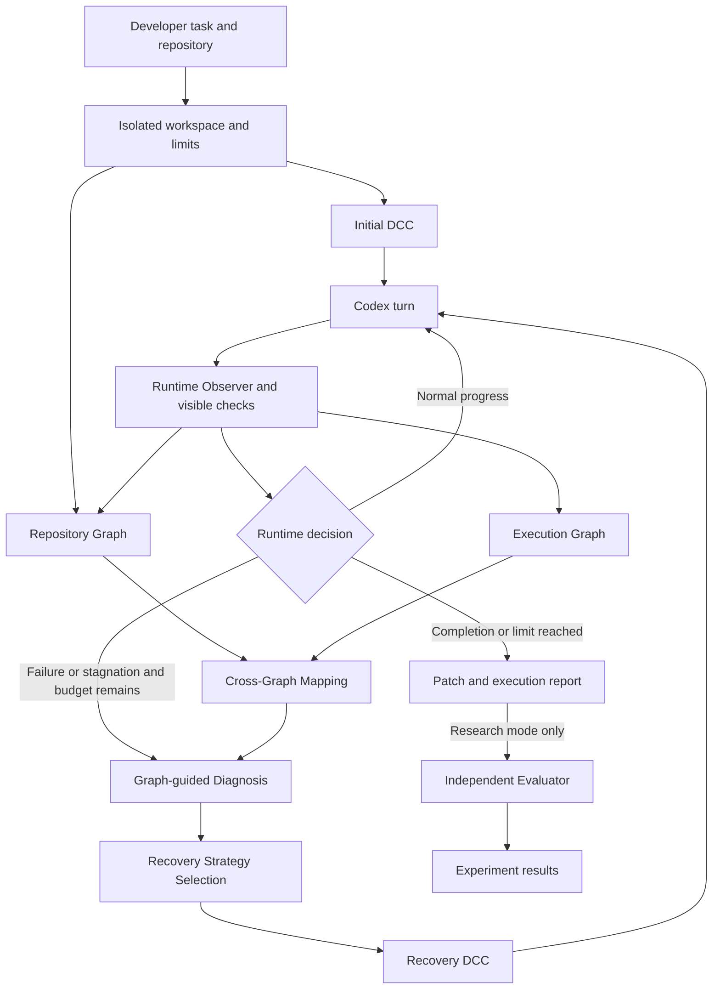
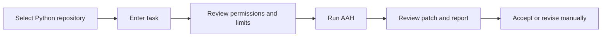

# Adaptive Agent Harness — 프로젝트 설명서

> **실행 상태를 이해하고, 실패에 대응하며, 필요한 정보를 다시 구성하는 Codex 실행 하네스**

| 항목 | 내용 |
| --- | --- |
| 프로젝트명 | Adaptive Agent Harness (AAH, 가칭) |
| 영문 연구명 | Graph-Guided Failure Recovery and Dynamic Context Optimization for Coding Agents |
| 수행 맥락 | 잇츠 스터디 5기 · Codex 기반 AI 코딩 에이전트 구축 |
| 결과물 유형 | CLI 기반 개발 도구 + 재현 가능한 에이전트 평가 시스템 |
| 핵심 AI 기술 | OpenAI Codex |
| 대상 환경 | Python 저장소의 테스트 가능한 버그 수정 작업 |
| 작성일 | 2026-11-24 |
| 문서 버전 | v0.1.0 |
| 상태 | 제품 및 기능 설계안 — 구현 및 실험 전 |
| 상위 문서 | `RESEARCH_PROPOSAL.md` v0.1.0 |

---

## 1. 프로젝트 소개

Adaptive Agent Harness(AAH)는 Codex의 저장소 수준 개발 작업을 관찰하고, 필요한 경우 실행 방향과 보조 컨텍스트를 재구성하여 후속 작업을 지원하는 외부 실행 프레임워크다.

기본 코딩 에이전트는 자체적으로 파일을 탐색하고 코드를 수정하며 테스트를 실행한다. AAH는 이러한 능력을 대체하지 않는다. 대신 공개 실행 이벤트, 코드 변경 및 검증 결과를 수집하고, 실패가 반복되거나 진행이 정체될 때 코드 의존성과 실행 이력을 연결한 그래프를 탐색한다. 그 결과를 바탕으로 복구 전략과 관련 정보를 구성해 Codex의 후속 턴에 제공한다.

최초 실행 전에도 작업별 보조 문서를 선별하여 불필요한 정보의 전달을 줄인다. 정상 진행 중에는 외부 개입을 최소화하고, 모든 실행에는 공통 종료 조건과 비용 기록을 적용한다.

**핵심 가치 제안:** 더 많은 토큰이나 무조건적인 재시도에 의존하기보다, 관측된 실패 증거를 바탕으로 다음 행동과 필요한 정보를 선택하도록 지원한다.

AAH는 모델 자체를 학습하는 프로젝트가 아니다. AI 에이전트가 작동하는 환경을 설계하고 그 효과를 비교 실험으로 검증하는 프로젝트다. 성공률 향상이나 비용 절감은 검증할 목표이지 현재 확보한 성과가 아니다.

## 2. 해결 대상 문제와 사용자 필요성

### 2.1. 문제 정의

| 문제 | 사용자에게 발생하는 부담 | AAH의 대응 |
| --- | --- | --- |
| 과도하거나 오래된 보조 안내 | 무관한 정보 처리, 잘못된 파일 참조, 추가 탐색 | 유효성 및 관련성에 따른 컨텍스트 선별 |
| 관련 정보 누락 | 필요한 테스트·코드 관계를 다시 찾는 비용 | 작업 및 실패 상태에 맞춘 정보 구성 |
| 반복 실패 | 유사한 수정과 테스트가 반복되어 실행 한도 소진 | 실패 지문과 이전 변경을 활용한 선택적 복구 |
| 탐색 정체 | 이미 조사한 파일을 반복 확인 | 실행 이력과 인접 의존성을 활용한 후속 탐색 제안 |
| 회귀 오류 | 수정 영향 범위를 사람이 다시 확인 | 변경 요소와 실패 테스트 사이의 관계 탐색 |
| 분산된 실패 증거 | 로그·diff·코드를 수동으로 종합해야 함 | 실행 및 코드 그래프의 명시적 연결과 근거 기록 |

이 문제들은 `RESEARCH_PROPOSAL.md`에서 설정한 후보들이다. 모든 Codex 실행에서 발생한다고 가정하지 않으며, 실제 빈도와 사용자 부담은 pilot에서 확인한다. 반복 행동만으로 실패를 단정하지 않는다.

### 2.2. 대상 사용자

| 구분 | 사용자 | 요구 사항 |
| --- | --- | --- |
| 핵심 사용자 | Codex를 활용해 Python 저장소의 버그를 수정하는 개발자 | 기존 저장소에 적용, 제한된 비용 내 실행, 실패 대응, 검토 가능한 패치 |
| 보조 사용자 | 코딩 에이전트의 성능을 비교하는 연구자·개발자 | 같은 조건에서 자동 실행, 로그와 비용 수집, 결과 재현 |
| 프로젝트 내부 사용자 | 스터디 팀원 | 모듈별 개발, 실험 자동화, 실패 사례 분석, 협업 기록 |

사용자 조사나 상용 제품 수준의 수요 검증은 아직 수행하지 않았다. 위 대상은 연구제안서에 근거한 초기 제품 가설이다.

### 2.3. 사용자 관점의 목표

- 작업 요청과 저장소를 지정하면 하나의 실행 명령으로 작업을 시작할 수 있다.
- 실패 발생 시 하네스가 개입 여부와 근거를 판단하고 가능한 후속 실행을 지원한다.
- 왜 특정 코드나 정보가 복구에 사용되었는지 확인할 수 있다.
- 결과 패치, 공개 검증 상태, 종료 이유 및 측정 가능한 비용을 확인하고 직접 검토할 수 있다.
- 기존 기본 Codex 및 일반 재시도와 같은 과제에서 비교할 수 있다.

## 3. 제품 정의 및 범위

### 3.1. 제품 구성

| 구성 | 역할 | 주요 산출물 |
| --- | --- | --- |
| Adaptive Agent Harness | Codex 실행, 관측, 정책 선택, 후속 턴 실행 | 실행 CLI 및 패치 |
| Dynamic Context Compiler (DCC) | 최초 및 복구 시점 보조 컨텍스트 최적화 | 컨텍스트 패키지 및 선별 근거 |
| Graph-guided Recovery Controller | 코드·실행 그래프 연결, 실패 관련 탐색, 복구 전략 선택 | 진단 근거 및 복구 지침 |
| Evaluation Harness | 실험 환경 초기화, 비교 실행, 독립 판정 및 집계 | 실험 로그, 지표, 평가 결과 |
| Result Viewer | 실행 및 복구 과정의 이해 지원 | CLI 리포트, 정적 뷰어 또는 간단한 대시보드 |

개발자용 실행 도구와 연구용 평가 도구는 공통 런타임을 공유하되, 평가용 hidden test와 정답은 개발자 실행 및 에이전트 작업 공간에서 분리한다.

### 3.2. MVP 범위

| 포함 (MVP) | 제외 또는 후속 확장 |
| --- | --- |
| 단일 Codex 에이전트 | 멀티에이전트 및 다른 에이전트 지원 |
| Python 저장소의 테스트 가능한 버그 수정 | 범용 기능 개발 및 다중 언어 지원 |
| 지원되는 공개 이벤트와 턴 경계 제어 | 비공개 추론 제어, 임의 시점 내부 상태 복원 |
| 코드·실행 그래프 및 명시적 연결 | 그래프 신경망, 완전한 동적 프로그램 분석 |
| 규칙 기반 실패 감지 및 복구 전략 선택 | 학습 기반 정책, 워크플로 자동 합성 |
| 초기 및 복구 DCC | 내부 컨텍스트 삭제·압축, 장기 경험 메모리 |
| CLI, 실행 결과, 대표 사례 시각화 | 대규모 웹 서비스, IDE 확장, 자동 배포 |
| 자동 평가 및 핵심 비교군 | 모든 확장 ablation의 수행 보장 |

### 3.3. 설계 원칙

1. **최소한의 개입:** 정상 실행은 Codex에 맡기고, 사전에 정의한 개입 조건에서만 복구한다.
2. **근거 기반 복구:** 실제로 관측된 증거와 추정 관계를 구분하고 원인 후보를 확정 원인으로 제시하지 않는다.
3. **정보의 충분성:** 필수 지침은 보존하고 선택 가능한 보조 정보만 예산에 맞추어 구성한다.
4. **비용 투명성:** 그래프 구축과 컨텍스트 구성, 재시도 등 하네스 자체의 비용을 누락하지 않는다.
5. **재현성과 안전:** 격리 환경과 독립 평가, 동일한 실험 조건, 검토 가능한 로그를 유지한다.
6. **검증 가능한 단순성:** 특정 엔지니어링 용어나 라이브러리를 사용하기 위해 기능을 추가하지 않는다.

## 4. 핵심 기능 및 요구사항

기능 ID는 구현 계획과 테스트에서 참조할 수 있도록 부여한 초안이다. P0는 MVP 필수, P1은 핵심 구현 완료 후 권장 기능이다.

| ID | 기능 | 주요 동작 및 수용 기준 | 우선순위 |
| --- | --- | --- | --- |
| F01 | 작업 실행 | 저장소·요청·실행 제한을 입력받아 격리 작업 공간에서 실제 Codex 실행 | P0 |
| F02 | 실행 관측 | 지원되는 공개 이벤트, Git diff, 검증 결과 및 관측 가능한 사용량 기록; 미관측은 명시 | P0 |
| F03 | 초기 DCC | 필수 지침을 유지하고 작업별 보조 후보를 선별, 선택 근거 및 크기 기록 | P0 |
| F04 | Repository Graph | Python 코드의 파일·함수·테스트 등 구조 및 추출 가능한 관계 표현 | P0 |
| F05 | Execution Graph | 공개 행동 및 결과를 시간·실패 반복 등의 관계로 구성 | P0 |
| F06 | Cross-Graph Mapping | 실행 사건과 코드 스냅샷을 연결하고 관측·추정 근거를 구분 | P0 |
| F07 | 실패·정체 감지 | 개발용 과제에서 설정한 규칙을 평가하고 개입 이유 기록 | P0 |
| F08 | 복구 전략 선택 | 실패 관련 관계 탐색 결과로 후속 조사·재검토 방향 선택; 근거 부족 시 일반 재시도 또는 무개입 | P0 |
| F09 | 복구 DCC | 실패 상태와 전략에 맞는 보조 증거를 유효성·중복·관련성·예산에 따라 구성 | P0 |
| F10 | 피드백 루프 | 선택된 지침을 지원되는 후속 턴에 전달하고 새 결과를 관측; 한도 도달 시 종료 | P0 |
| F11 | 실행 보고서 | 패치, 공개 검증 결과, 종료 이유, 개입 및 사용량 정보를 출력 | P0 |
| F12 | 자동 비교 평가 | A–E 핵심 비교군 실행, 격리된 최종 테스트 판정 및 결과 집계 | P0 |
| F13 | 결과 시각화 | 실제 실행 로그에서 실패 관련 그래프, 선택 증거, 비교 지표를 표시 | P1 |
| F14 | 확장 ablation | 그래프 연결 및 DCC 정책의 세부 기여를 추가 검증 | P1 |

F12는 평가 기능이다. 일반 사용자의 실행에 hidden test를 제공하거나 독립 판정 결과를 복구 지침으로 전달하지 않는다. F13은 정적 HTML이나 간단한 결과 뷰어로도 충족할 수 있으며 실시간 웹 UI는 필수가 아니다.

## 5. 시스템 개요



그림은 제안한 통합 방식을 나타낸다. 실제 실행 단위, 정상 진행 시 세션 유지 방식과 취소 지원은 기술 검증에 따라 정해진다. B–E 비교군은 같은 외부 제어 구조에서 그래프 복구와 DCC를 각각 활성화하거나 비활성화한다. A는 Codex 기본 실행을 참조한다.

### 5.1. 그래프의 역할

| 그래프 | 질문 | 데이터 또는 제어 역할 |
| --- | --- | --- |
| Workflow Graph | 어떤 단계로 이동할 것인가? | 상태 전이와 조건 분기 |
| Repository Graph | 어떤 코드 요소가 관련되는가? | 파일·함수·클래스·테스트·의존성 |
| Execution Graph | 어떤 행동과 결과가 관측되었는가? | 탐색·수정·명령·실패·재시도 |
| Cross-Graph Mapping | 실행 증거가 어떤 코드 요소와 연결되는가? | 두 데이터 그래프의 타입 있는 연결 |

Workflow Graph는 실행 제어 구조이고 Repository Graph와 Execution Graph는 의사결정에 사용하는 정보 구조다. 그래프 라이브러리를 사용하는 것 자체는 연구 기여가 아니다. 실제 관계 탐색이 복구 전략과 증거 선택을 바꾸어야 한다.

### 5.2. 컨텍스트 최적화의 역할

| 항목 | Initial DCC | Recovery DCC |
| --- | --- | --- |
| 시점 | 최초 실행 전 | 개입 조건 충족 후, 후속 턴 전 |
| 입력 | 요청·현재 저장소·보조 안내 | 요청·현재 작업 트리·실패 증거·전략 |
| 선별 기준 | 작업 관련성·적용 범위·유효성 | 초기 기준 + 실패·전략 관련성 |
| 출력 | 작업별 보조 패키지 | 복구 지침을 뒷받침하는 보조 패키지 |

두 단계는 공통 DCC 정책을 공유한다. 그래프 활성화 조건에서는 탐색한 관계를 보조 후보와 관련성 평가에 사용한다. Context-only에서는 평면 증거만 사용한다. 필수 지침과 원본 저장소 접근은 항상 유지한다.

### 5.3. 실행 및 복구 상태

| 상태 | 다음 동작 |
| --- | --- |
| 실행 준비 | 입력 및 권한·한도 확인, 초기 정보 구성 |
| 정상 진행 | 지원되는 실행 단위로 진행, 불필요한 외부 지침 추가 금지 |
| 개입 신호 발생 | 실패 증거 수집, 남은 예산 및 개입 가능 여부 확인 |
| 진단 가능 | 관계 탐색, 전략 선택 및 컨텍스트 패키징 |
| 근거 부족 | 강한 원인 단정 없이 일반 재시도 또는 무개입 |
| 후속 실행 | 복구 지침 전달 및 결과 재관측 |
| 완료 또는 한도 도달 | 추가 실행 종료, 패치 및 종료 이유 기록 |
| 런타임 장애 | 지원되는 취소·정리 절차 수행, 장애로 분류 |

공개 테스트 통과나 Codex의 완료 선언이 독립 평가 성공을 보장하지 않는다. 연구 모드에서는 최종 패치를 별도의 평가기에서 판정한다.

## 6. 사용자 경험과 CLI

### 6.1. 일반 사용자 흐름



1. 사용자는 대상 저장소를 준비하고 승인 가능한 테스트 명령을 정한다.
2. 자연어 개발 요청과 실행 설정을 전달한다.
3. 하네스는 격리된 작업 트리에서 Codex를 실행한다.
4. 실패 신호가 관측되면 정책에 따라 필요한 후속 작업을 수행한다.
5. 실행이 종료되면 사용자는 패치, 공개 검증 상태, 개입 근거와 사용량을 확인한다.
6. 최종 변경의 적용·커밋·푸시는 사용자가 검토 후 수행한다.

### 6.2. CLI 사용 예시

연구제안서에 있는 인터페이스 초안을 유지한다. 아래 명령은 현재 설치하거나 실행할 수 있는 완성 제품이 아니다.

```bash
adaptive-codex run \
  --repo ./my-project \
  --task "로그인 실패 횟수에 따른 계정 잠금 오류 수정" \
  --config configs/default.yaml
```

설정 파일은 다음 범주의 정보를 포함하는 방향으로 제안한다. 정확한 필드 이름, 단위, 기본값은 `TECHNICAL_SPEC.md`에서 확정한다.

| 설정 범주 | 내용 |
| --- | --- |
| Runtime | 모델 식별자, 추론 설정, 런타임 버전 |
| Workspace | 작업 디렉터리, 접근 범위, 격리 방식 |
| Validation | 사용자 승인 공개 검증 명령 |
| Limits | 시간, 턴, 복구 횟수, 지원되는 경우 토큰 상한 |
| Context | DCC 활성화, 보조 후보 및 컨텍스트 상한 |
| Recovery | 그래프 복구 활성화, 사전 설정한 감지·탐색 정책 |
| Logging | 결과 경로, 민감정보 처리, 사용량 기록 |

토큰 한도의 엄격한 강제가 지원되지 않는 경우 이를 사용자에게 명시하고 공통 시간·턴 상한 및 관측된 토큰량을 사용한다. 자격 증명은 CLI 예시나 결과 파일에 포함하지 않는다.

### 6.3. 결과 보고서 초안

| 항목 | 사용자에게 전달하는 정보 |
| --- | --- |
| Run metadata | 실행 ID, 설정 버전, 초기 저장소 상태 |
| Completion | 완료·한도 소진·장애 등 종료 사유 |
| Patch | 변경 파일, diff 또는 검토 가능한 격리 작업 트리 위치 |
| Visible validation | 공개 테스트 및 실행 명령의 결과, 미실행 여부 |
| Interventions | 개입 시점, 감지 근거, 선택한 복구 전략 |
| Context selection | 제공한 보조 정보, 출처, 선택·제외 이유 |
| Cost | 관측 토큰, 시간, 호출 수, 가능한 경우 비용 |
| Warnings | 근거 부족, 부분 계측, 불완전한 그래프 등 제한 |

개발자용 보고서는 공개 검증 결과를 보여 준다. 평가용 hidden test의 상세 데이터는 독립된 연구 모드에서만 접근하며 에이전트에게 노출하지 않는다.

## 7. 대표 사용 시나리오

### 7.1. 실패 복구: 계정 잠금 정책 버그

다음은 연구제안서의 예시를 제품 흐름으로 구체화한 가상 시나리오다. 실제 실행 로그나 실험 성과가 아니다.

| 단계 | 관측 또는 요청 | 시스템 대응 |
| --- | --- | --- |
| 1. 요청 | 로그인 실패 횟수에 따른 계정 잠금 오류 수정 | 작업 및 필수 지침 확인 |
| 2. 초기 정보 구성 | 인증·세션·테스트 문서가 존재 | 관련 최신 안내 및 테스트 위치 선별 |
| 3. 최초 실행 | Codex가 `auth.py` 수정 및 테스트 | 공개 이벤트와 diff 기록 |
| 4. 실패 감지 | 동일 오류 지문 반복, 사전 조건 충족 | 개입 여부 판단 |
| 5. 그래프 진단 | 테스트와 이전 변경·호출 관계가 연결됨 | 미탐색 `session.py`를 원인 후보로 선택 |
| 6. 전략 변경 | 인증 함수 반복 수정 대신 세션 갱신 검토 | 후속 지침 구성 |
| 7. 복구 정보 구성 | 관련 코드·로그·이전 수정·최신 안내 | DCC가 제한된 보조 예산에 패키징 |
| 8. 후속 실행 | 새 지침을 받은 Codex가 작업 | 테스트 및 결과 재관측 |
| 9. 종료 | 완료 또는 예산 소진 | 패치 및 보고서 반환, 연구 모드에서는 독립 판정 |

예시의 `session.py`는 확정된 오류 원인이 아니라 관계 탐색으로 찾은 후보다. 실제 복구 여부는 최종 평가로 확인한다.

### 7.2. 정상 실행: 외부 복구가 필요 없는 단순 버그

간단한 버그가 기본 에이전트 실행만으로 해결되는 경우 초기 보조 컨텍스트 구성 후 추가 복구 없이 종료할 수 있어야 한다. 불필요한 진단 및 재시도를 억제하는 것이 정상 경로의 목표다. 그래프 구축 및 초기 DCC의 오버헤드는 여전히 전체 실행 비용에 포함한다.

### 7.3. 실패 복구 불가 또는 실행 한도 도달

복구 근거가 부족하거나 제한 내에서 작업을 마치지 못한 경우 성공으로 표시하지 않는다. 남은 작업 트리, 관측된 실패, 종료 이유 및 비용을 보고하고 사용자가 결과를 검토하도록 한다. 무제한 재시도나 자동 배포는 수행하지 않는다.

### 7.4. 연구 사용자: 동일 과제의 비교 실행

연구 사용자는 사전에 고정한 과제·모델·실행 제한을 사용해 A–E 비교군을 반복 실행한다. 결과 평가기는 에이전트로부터 격리된 테스트로 최종 패치를 판정하고 원시 로그 및 비용을 보존한다. 비교 결과를 기반으로 효과와 한계를 분석한다.

## 8. AI 기술 활용 및 차별점

### 8.1. Codex의 역할

Codex는 프로젝트 개발 보조 도구이기도 하지만, 결과물에서는 실제 저장소 탐색·코드 수정·테스트를 수행하는 핵심 실행 엔진이다. AAH는 Codex의 공개 인터페이스를 통해 관측 가능한 이벤트와 후속 실행을 관리한다. 모델 내부 추론을 수정하거나 확인할 수 있다고 가정하지 않는다.

| 구성 | 기술 활용 목적 |
| --- | --- |
| Harness Engineering | 실행, 관측, 제어, 환경 및 평가의 통합 |
| Graph Engineering | 코드와 실행 증거 사이의 관계 활용 |
| Context Engineering | 작업 및 복구 상태에 적합한 보조 정보 구성 |
| Loop Engineering | 결과를 다음 실행에 반영하고 종료 조건 관리 |
| Prompt Engineering | 선택된 전략과 증거를 구체적 실행 지침으로 전달 |

이 용어들은 프로젝트 내 역할을 설명하기 위해 사용한다. 학계의 보편적 포함 관계나 다섯 가지 독립적인 연구 기여를 주장하지 않는다. 별도의 LLM 호출, LangGraph 또는 그래프 데이터베이스가 반드시 필요한 것은 아니다.

### 8.2. 기존 사용 방식과의 비교

| 관점 | 기본 실행 / 일반 재시도 | AAH 제안 방식 |
| --- | --- | --- |
| 보조 정보 | 기본 지침 또는 단순 정보 제공 | 작업·실패 상태별 선별 및 유효성 검사 |
| 실패 관련 증거 | 실행 로그와 수정 결과를 개별적으로 확인 | 코드·실행 관계를 명시적으로 연결하여 탐색 |
| 후속 실행 | Codex 자체 복구 또는 일반 재시도 | 실패 증거에 근거한 선택적 전략 및 컨텍스트 구성 |
| 결과 확인 | 패치 및 기본 실행 출력 | 패치·개입 근거·비용을 통합 기록 |
| 성능 검증 | 개별 실행 확인 | 통제된 비교군 및 독립 평가 |

이는 비교 대상의 설정과 제안법의 설계상 차이이며, 기본 Codex가 자체 복구 능력이 없다는 의미가 아니다. 관련 학술 연구와의 차별성은 `LITERATURE_REVIEW.md`에서 원문을 검토한 뒤 확정한다.

## 9. 평가 및 개선 효과 검증

프로젝트의 실용성은 실제 사용 가능성과 연구 평가로 나누어 확인한다. 구현 성공과 성능 개선은 별개의 기준이다.

### 9.1. 비교군

| ID | 실행 방식 | DCC | 그래프 복구 |
| --- | --- | --- | --- |
| A | Vanilla Codex | 미적용 | 미적용 |
| B | Flat Retry | 미적용 | 미적용 |
| C | Context-only | 적용 | 미적용 |
| D | Graph-only | 미적용 | 적용 |
| E | Adaptive Agent Harness | 적용 | 적용 |

B–E는 공통 감지 규칙, 재시도 기회, 기본 메시지 형식 및 실행 제한을 사용하는 2×2 요인 설계다. C는 평면 증거 및 일반 복구 정책을 사용하고, D는 그래프 기반 전략·증거 선택을 하되 기본 패키징을 사용한다. A는 실용적인 기본 실행 참조점이다.

### 9.2. 평가 방식

- **End-to-end:** 동일 초기 저장소와 요청에서 전체 성공률·비용·개입 결과 비교.
- **Common Failure Checkpoint:** 공통 실패 외부 상태 및 잔여 예산에서 B–E 복구 정책 비교. 내부 세션 복제가 불가능하면 같은 외부 이력과 작업 트리를 사용하는 새 세션 방식의 한계를 명시한다.
- **Ablation:** 자원이 허용하면 그래프 연결 제거, 평면 증거 비교 및 초기·복구 DCC 적용 시점 분리부터 수행한다.

### 9.3. 핵심 지표

| 지표 | 판단할 제품·연구 가치 |
| --- | --- |
| Task Success Rate | 작업 완료 신뢰성 |
| Failure Recovery Rate | 동일한 실패 상태에서의 복구 성능 |
| Cost per Success | 실패 비용까지 포함한 실질 실행 효율 |
| End-to-End Token Usage / Time | 하네스 자체 오버헤드를 포함한 자원 소비 |
| Instruction Compliance | 필수 제약 유지 |
| Tool Calls / Exploration Redundancy | 반복 탐색 및 행동 효율 |
| Harmful Intervention | 외부 개입으로 인해 발생할 수 있는 악화 |

최종 평가 집합과 설정은 결과 확인 전에 고정한다. 제안서의 20–24개 평가 과제, 5개 조건, 2회 반복(200–240회)은 잠정적인 본실험 규모다. pilot·checkpoint·ablation 비용은 별도다. 실제 규모와 통계 분석 계획은 `EXPERIMENT_DESIGN.md`에서 확정한다. 개선 수치가 없더라도 공정한 측정과 부정적 결과 보고를 유지한다.

## 10. 기술 구성 및 운영 요구사항

| 영역 | 기술 후보 |
| --- | --- |
| Agent Runtime | Codex SDK 또는 CLI |
| Workflow | Python 상태 머신, 필요 시 LangGraph |
| Graph | Python AST, NetworkX |
| Context | BM25, 메타데이터 기반 규칙, greedy packing |
| Workspace | Git, Docker 또는 격리 작업 디렉터리 |
| Evaluation | pytest 및 독립 검증 스크립트 |
| Data | JSONL, CSV, 필요 시 SQLite |
| Analysis | pandas, NumPy, SciPy, Matplotlib |
| Result Viewer | CLI 리포트, 정적 뷰어 또는 Streamlit |

위 기술 스택은 연구제안서의 후보이며 최종 의존성이나 버전은 확정하지 않았다. 실제 SDK 이벤트, 후속 턴, 취소 및 사용량 계측 지원 여부는 기술 검증 대상이다.

### 10.1. 비기능 요구사항

| 항목 | 요구사항 |
| --- | --- |
| 격리성 | 원본 저장소를 보존하고 실행별 작업 공간을 분리 |
| 보안 | 최소 권한, 승인된 명령, 네트워크·비밀정보 접근 제한 |
| 관측 가능성 | 선택 및 제외 근거, 그래프 관계 출처, 실행 한도와 종료 이유 기록 |
| 오류 처리 | 관측 실패, 명령 실패, 런타임 장애를 구분; 근거 없는 진단 금지 |
| 재현성 | 실행 설정·모델·런타임·초기 커밋·평가 테스트 버전 기록 |
| 비용 관리 | 상한과 중단 조건을 명시하고 전체 관측 비용 수집 |
| 확장성 | 런타임·복구 정책·컨텍스트 정책의 인터페이스 분리 |

자동 배포 및 원격 푸시는 범위 밖이다. 평가용 정답, hidden test 및 판정기 변경 권한은 에이전트에 제공하지 않는다. 공개 전 로그의 자격 증명과 개인정보를 검토한다.

## 11. 완료 기준 및 통합 검증

아래 기준은 연구제안서의 MVP와 제품 기능을 연결하기 위한 수용 조건 초안이다. 기능별 상세 테스트는 기술 명세서에서 구체화한다.

| ID | 완료 기준 | 확인 근거 |
| --- | --- | --- |
| AC01 | 최소 하나의 검증된 Python 과제를 실제 Codex로 자동 실행 | 실행 ID, 원시 이벤트, 결과 패치 |
| AC02 | 최초 보조 컨텍스트를 구성하고 필수 지침을 보존 | 선택·제외 근거, 토큰 또는 크기 기록 |
| AC03 | 공개 실패 신호를 코드 스냅샷 및 실행 증거와 연결 | 그래프 및 관계 출처 |
| AC04 | 개입 규칙에 따라 전략과 복구 패키지를 생성하여 실제 후속 턴에 전달 | 개입 전후 이벤트, 전달 지침 |
| AC05 | 정상 경로 및 한도 소진 경로가 무한 반복 없이 종료 | 통합 테스트 및 종료 이유 |
| AC06 | 증거 부족이나 지원되지 않는 관측을 안전하게 처리 | 장애·fallback 테스트 |
| AC07 | 사용자가 CLI로 결과 패치 및 공개 검증·비용 리포트를 확인 | 재현 가능한 사용 예시 |
| AC08 | 독립 평가기가 버그 상태·정상 패치를 구분하고 A–E 실행을 집계 | 테스트 검증 및 비교 실행 결과 |
| AC09 | 대표 사례의 실제 로그를 재현하고 근거를 설명 | 정적 결과 뷰어 또는 시연 자료 |

AC01–08은 MVP 및 핵심 평가 완료를 위한 기준이다. AC09는 발표용 산출물의 기준이며 반드시 실시간 UI일 필요는 없다. AC04에서 실제 복구 성공은 별도 평가 지표로 측정한다. 후속 턴 전달만으로 성능 개선이 검증된 것은 아니다.

## 12. 팀 협업 및 추진 계획

### 12.1. 3인 팀 기준 역할 분담안

| 담당 영역 | 주요 책임 | 학습 및 기록 |
| --- | --- | --- |
| Runtime & Harness | Codex 연동, 상태 관리, 관측 및 통합 실행 | 이벤트 제어, 피드백 루프, 통합 테스트 |
| Graph & Recovery | 그래프 구축 및 연결, 실패 진단·전략 선택 | 정적 분석, 그래프 탐색, 진단 사례 |
| Context & Evaluation | DCC, 비용 계측, 비교 실행 및 집계 | 정보 선별, 실험 평가, 분석 코드 |
| 공동 | 평가 과제 및 테스트 리뷰, 문서, 실험·발표 | PR, 교차 리뷰, 실험 로그, 활동일지 |

역할은 실제 합의 전 제안이다. 팀원 이름과 담당 업무는 확정 후 기록한다. 공통 인터페이스를 우선 합의하고 평가 정답과 정책 개발의 접근 경계를 관리한다.

### 12.2. 단계별 산출물

| 기간 (2026년, 잠정) | 목표 | 산출물 |
| --- | --- | --- |
| 11/24–11/26 | 연구·런타임 검증 | 한 과제의 자동 실행 및 평가, 관측 범위 확인 |
| 11/27–11/30 | 통합 MVP | 초기 DCC, 그래프 및 복구, 실제 후속 실행, pilot |
| 12/01–12/04 | 정책과 평가 확정 | 비교군, 평가 과제, 공통 설정 고정 |
| 12/05–12/09 | 본실험 | 원시 실행 로그, 체크포인트 평가 |
| 12/10–12/12 | 분석 및 추가 실험 | 핵심 결과 및 가능한 ablation, 한계 분석 |
| 12/13–12/15 | 제출·발표 준비 | 보고서, 사용 가이드, 실제 비교 시연 |
| 12/16 | 발표 예정 | 프로젝트 및 연구 결과 발표 |

11월 30일 활동 종료와 12월 16일 발표는 상위 제안서에서 승계한 잠정 일정이다. 제출 마감 및 활동 종료 후 크레딧 사용 가능 여부는 별도 확인이 필요하다. 자원이 부족하면 UI와 확장 실험을 먼저 축소하고 실제 통합 실행과 공정한 핵심 평가를 우선한다.

## 13. 주요 위험 및 대응

| 위험 | 대응 |
| --- | --- |
| Codex 기본 성능이 높아 개입 이득이 작음 | pilot으로 필요성 확인, 정상 사례도 평가, 성공당 비용 분석 |
| 공개 인터페이스의 제어·관측 제한 | 지원되는 턴 단위 기능만 활용, 미관측 상태 및 한계 명시 |
| 그래프 연결 오류 | 스냅샷과 관계 근거 기록, 추정과 관측 구분 |
| 잘못된 복구 전략 | 개입 제한, 근거 부족 시 무개입 또는 일반 재시도 |
| 보조 정보 누락 | 필수 지침 보존, 원본 파일 접근 유지 |
| 시간·비용 초과 | pilot으로 예산 추산, 사전 축소 규칙과 종료 조건 적용 |
| 선행연구 중복 | 원문 및 직접 비교 검토, 차별화 주장을 실험 가능한 질문으로 제한 |
| 시연의 비결정성 | 실제 실행 로그와 녹화본 준비, 단일 성공 사례와 전체 통계 구분 |

## 14. 최종 산출물 및 제출 형태

| 산출물 | 제출 또는 활용 내용 |
| --- | --- |
| AAH CLI | 설치·실행 가능한 핵심 도구, 사용 예시 |
| DCC 및 복구 모듈 | 소스 코드, 설정, 테스트 |
| 평가 하네스 및 벤치마크 | 검증된 과제, 비교 실행 및 독립 판정 절차 |
| 실험 데이터 | 설정, 비식별 로그, 비용과 성능 집계, 재현 스크립트 |
| 결과 뷰어 | 실패 증거 및 복구 경로, 실제 비교 결과 |
| 연구 문서 | 제안서, 방법론, 설계, 결과 분석 및 한계 |
| 협업 자료 | 역할, 활동일지, PR·리뷰, 의사결정 및 실험 기록 |
| 공개 저장소 | README, 코드·테스트·문서, 라이선스 및 민감정보 검토 후 공개 |
| 발표 자료 | 핵심 문제, 작동하는 결과물, 실제 정량 평가, 시연 |

## 15. 심사 기준 대응

사용자가 제공한 잇츠 스터디 심사 기준을 제품 요구사항과 연결한다. 예상 점수나 수상을 보장하는 표는 아니다.

| 심사 항목 | 배점 | 핵심 대응 | 제시할 실제 근거 |
| --- | ---: | --- | --- |
| 문제정의·필요성 | 15 | 반복 실패 및 정보 비효율을 측정 가능한 문제로 정의 | pilot에서 확인한 로그, 문제 사례, 연구 목표 |
| AI 기술 활용도 | 25 | Codex를 실제 실행 엔진으로 활용하고 입력·복구를 설계 | 실제 실행 이벤트, 컨텍스트 선택 및 후속 턴 |
| 구현 완성도 | 25 | 관측·진단·복구·재실행·보고서를 통합 | AC01–08 확인 결과, 통합 실행, 테스트 |
| 실용성 | 15 | 개발자 저장소에서 CLI 적용 및 결과 검토 | 사용 안내, 적용 사례, 성공률과 성공당 비용 |
| 학습과정·협업 | 10 | 학습에서 설계·구현·실험으로 이어지는 역할 분담 | 활동일지, PR, 리뷰 및 담당별 산출물 |
| 차별성·확장성 | 10 | 그래프 간 연결 및 상태별 컨텍스트의 효과 검증 | 선행연구 비교, 핵심 ablation, 모듈 경계 |
| 합계 | 100 | | |

AI 기술 활용과 구현 완성도가 50점, 실용성까지 합하면 65점이다. 발표용 시각화보다 실제 Codex 후속 실행까지 연결되는 기능을 우선한다. 검증되지 않은 성능 수치나 가상의 시연 결과를 실험 성과로 사용하지 않는다.

## 16. 발표 및 시연 방향

### 16.1. 핵심 메시지

> 코딩 에이전트의 실패에 무조건 재시도로 대응하는 대신, 실제 실행 증거와 코드 관계를 연결해 다음 행동과 필요한 정보를 선택하도록 지원하는 환경을 설계한다.

### 16.2. 시연 구성안

| 단계 | 보여 줄 내용 |
| --- | --- |
| 문제 제시 | 실제 pilot에서 관측된 반복 실패 또는 비효율 사례 |
| 시스템 실행 | 저장소와 작업을 지정하여 실제 CLI 실행 |
| 개입 근거 | 실패 지문, 이전 패치, 코드·실행 그래프 연결 |
| 복구 과정 | 선택된 전략, 선별된 정보, 후속 실행 로그 |
| 결과 확인 | 최종 패치, 독립 평가 및 종료 이유 |
| 전체 비교 | A–E의 성공률·복구율·성공당 비용 및 불확실성 |
| 학습 및 한계 | 팀원별 구현·실험 과정, 실패한 사례, 적용 범위 |

대표 사례는 실제 실행 결과 확보 후 선정한다. 라이브 실행이 불안정하면 실제 로그를 기반으로 한 재현 뷰어 또는 녹화 시연으로 대체한다. 전체 평가 집합의 결과는 대표 성공 사례와 구분하여 제시한다.

## 17. 확장 방향

| 확장 | 전제 조건 |
| --- | --- |
| 다른 코딩 에이전트 어댑터 | 공통 런타임 인터페이스 확정 및 지원 이벤트 검증 |
| 다중 언어 저장소 | 언어별 코드 그래프 추출의 정확도 검토 |
| 장기 경험 메모리 | 과제 간 정보 누출 방지 및 별도 평가 설계 |
| 복구 정책 자동 최적화 | 규칙 기반 baseline과 충분한 데이터 확보 |
| IDE 연동 및 실시간 UI | CLI의 안정성과 사용자 요구 검증 |
| 동적 워크플로 구조 변경 | 고정 상태 머신으로 해결되지 않는 문제가 실제 확인될 때 |

확장 항목은 현재 MVP의 완료 조건이 아니며 구현 및 효과를 약속하지 않는다.

## 18. 문서 간 관계 및 미확정 사항

| 문서 | 역할 |
| --- | --- |
| `RESEARCH_PROPOSAL.md` | 연구 목적, 범위, 가설, 비교 원칙의 상위 기준 |
| `PROJECT_OVERVIEW.md` | 제품 가치, 사용자, 기능 및 수용 조건 (본 문서) |
| `LITERATURE_REVIEW.md` | 선행연구 원문 검증 및 차별성 분석 |
| `METHODOLOGY.md` | 감지·그래프 탐색·복구·DCC 알고리즘 |
| `SYSTEM_ARCHITECTURE.md` | 모듈 경계, 데이터 흐름, 상태 전이 및 예외 처리 |
| `TECHNICAL_SPEC.md` | 인터페이스·스키마·CLI·설정·테스트 상세 |
| `EXPERIMENT_DESIGN.md` | 비교군, 과제 수, 반복, 예산 및 통계 계획 |
| `BENCHMARK_SPEC.md` | 과제, 데이터 및 환경 구성 |
| `EVALUATION_PROTOCOL.md` | 독립 판정, 비용 측정, 실패 분류 및 재현 절차 |
| `IMPLEMENTATION_PLAN.md` | 구현 순서, 의존성, 담당 및 완료 조건 |

미확정 사항: 런타임과 모델 버전, 관측·제어 가능 범위, 테스트 및 작업 공간 격리 방식, 감지 임계값, 그래프 탐색 범위, DCC 정책 값, 정확한 CLI 및 결과 파일 형식, 실험 비용·규모, 역할 배정, 운영 일정 및 공개 라이선스.

본 문서는 상위 연구제안서에 근거해 제품 관점으로 구체화한 설계안이다. 기능 ID, 우선순위, 보고서 항목 및 수용 기준은 후속 구현을 위한 신규 제안이며 실제 구현 현황을 의미하지 않는다. 상위 연구 범위와 비교군을 변경하지 않는다. 변경이 필요할 경우 결정 근거를 기록하고 관련 문서를 함께 갱신한다.

---

**프로젝트의 최종 정체성:** 개발자가 Codex로 수행하는 버그 수정 작업에 적용할 수 있고, 실패 대응과 정보 활용의 효과를 같은 조건에서 검증할 수 있는 적응형 실행 하네스.

**현재 상태:** 설계 단계. 기능 구현, 실제 사용자 검증, 성능 개선 및 학술적 신규성은 미확정이다.
