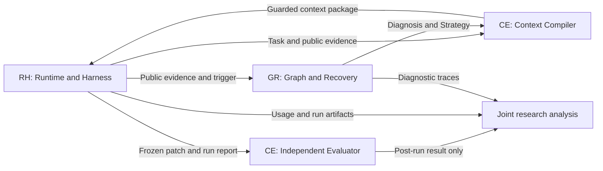

# Adaptive Agent Harness — 팀원 역할 분담 및 협업 계획서

## 그래프 기반 실패 복구 및 동적 컨텍스트 최적화를 통한 코딩 에이전트의 신뢰성과 실행 효율 향상

| 항목 | 내용 |
| --- | --- |
| 문서 | TEAM_ROLES.md |
| 버전 | v0.1.0 |
| 작성일 | 2026-11-25 |
| 수행 맥락 | 잇츠 스터디 5기 — Codex 기반 AI 코딩 에이전트 구축 |
| 팀 구성 | 3인 (RH / GR / CE) |
| 상태 | 역할 분담 및 협업 계획 초안; 실명·가용 시간·실제 수행 이력 미확정 |
| 주 기준 | IMPLEMENTATION_PLAN.md §3, §6, §8, §10–15; AGENTS.md §3, §6–9 |

> **협업 목표:** 세 팀원이 각각 실행 환경, 그래프 기반 복구, 컨텍스트 및 평가를 학습하고 구현하며, 공통 계약과 교차 검증을 통해 실제 Codex 실행 시스템으로 통합한다. 개인별 학습이 연구 질문과 구현 및 실험 증거로 이어지도록 기록한다.

## 1. 역할 분담 원칙

- 모듈별 주 책임자를 지정하되 공동 계약, 연구 설계, 평가 과제, 실험 동결 및 최종 결과에는 세 역할이 함께 책임을 진다.
- 기존 IP01–IP36 담당 및 선행 관계는 유지한다. 본 문서의 세부 주관자, 리뷰어, 회의 운영 및 증빙 양식은 팀 합의를 위한 추가 제안이다.
- 담당자는 구현·문서·테스트 결과를 설명할 수 있어야 한다. Codex의 도움을 받은 부분과 사람이 검토·수정·검증한 부분을 구분한다.
- 역할 분담의 기준은 연구 문제를 해결하는 데 필요한 업무다. 특정 엔지니어링 개념을 개인별로 하나씩 할당하거나 불필요한 기능을 추가하지 않는다.
- 코드 소유권은 리뷰 책임을 의미한다. 다른 모듈의 계약이나 실험 조건을 임의로 변경할 권한을 뜻하지 않는다.
- 안전한 실제 실행, 평가 격리, 강한 대조군 및 재현성이 일정이나 기능 수보다 우선한다.

## 2. 팀 구성 및 담당자 확정

| 역할 ID | 역할명 | 담당자 | GitHub 계정 | 주간 가용 시간 | 합의 상태 |
| --- | --- | --- | --- | --- | --- | --- |
| RH | Runtime & Harness | 미정 | 미정 | 미정 | 미확정 |
| GR | Graph & Recovery | 미정 | 미정 | 미정 | 미확정 |
| CE | Context & Evaluation | 미정 | 미정 | 미정 | 미확정 |

스터디 리더/연구 진행 조정 담당: **미정** (세 역할 중 한 사람이 겸임 가능). 실제 리더가 어떤 개발 역할을 맡을지는 합의 후 기입한다. 추가 인력을 가정하지 않는다.

### 2.1. 책임 요약

| 책임 영역 | RH | GR | CE |
| --- | --- | --- | --- |
| Codex runtime, workspace, orchestration | 주관 | 협업 | 검증 |
| 공통 Evidence Ledger 및 trigger | 주관 | 공동 설계·진단 연계 | 정책 격리 검토 |
| Repository/Execution Graph 및 mapping | 계약·통합 | 주관 | 근거·격리 검토 |
| Flat/Graph diagnosis, 복구 전략 | 실행 연계 | 주관 | 컨텍스트 계약 검토 |
| DEFAULT/DCC, renderer, guard | 전달·통합 | 근거 검토 | 주관 |
| 실험 runner, checkpoint, usage 원천 | 주관 | source/복구 검증 | 비용·평가 연결 |
| 독립 평가기, 지표·통계 분석 | 실행·계측 지원 | 실패 분석·교차 검증 | 주관 |
| 연구 질문·benchmark·동결·발표 | 공동 | 공동 | 공동 |

## 3. 역할별 상세 책임과 학습 목표

### 3.1. RH — Runtime & Harness

**목표:** 공개 인터페이스에서 실제 Codex를 실행하고, 안전하게 관측·제어하며, 모든 정책의 비교와 평가를 재현할 수 있는 실행 기반을 구축한다.

| 구분 | 담당 내용 |
| --- | --- |
| 핵심 경로 | `src/aah/runtime/`, `workspace/`, `workflow/`, `evidence/`, `cli/`, `reporting/`의 실행 영역 및 `experiments/` |
| 주요 구현 | RuntimeAdapter, WorkspaceManager, 상태 머신, EvidenceLedger, Budget Manager, 공통 trigger, A–E resolver 연결, checkpoint 및 experiment runner |
| 연계 계약 | TurnRequest/Result, RawEvent, SnapshotRef, EvidenceRecord/View, RunState, UsageRecord, FrozenPatch, CheckpointRecord |
| 학습 주제 | Codex CLI/SDK 공개 계약, 이벤트 정규화, 안전한 프로세스 종료, 작업 공간 격리, 상태 전이·재시도 제어, 예산 및 사용량 계측 |
| 검증 과제 | RT01–RT07, LT01–LT04, 관련 UT/CT/IT 및 ST/SEC/ISO 항목; 실제 후속 전달과 독립 평가 경계 |
| 연구 기여 | A와 B의 재현 가능한 실행, B–E 공통 조건의 보장, 전체 실행·시간·비용 및 checkpoint 비교 기반 |
| 개인별 산출물 | capability report, runtime/workspace PR, 실제 smoke run 증거, 상태 전이 및 오류 테스트, 실행·계측·복원 기록 |

**학습 → 구현 연결:** 공개 이벤트 및 세션 인터페이스를 확인해 adapter를 구현하고, 상태 머신 학습을 종료 및 안전한 재실행 테스트로 연결한다. 실제 runtime에서 확인하지 못한 기능은 미지원 또는 미검증으로 기록한다. 비공개 추론 상태를 복원하거나 내부 행동을 강제할 수 있다고 가정하지 않는다.

### 3.2. GR — Graph & Recovery

**목표:** 관측된 실패와 코드 의존성을 연결하여 검증 가능한 진단 근거를 찾고, 후속 실행 전략을 결정하는 정책을 구현한다.

| 구분 | 담당 내용 |
| --- | --- |
| 핵심 경로 | `src/aah/graphs/`, `diagnosis/`의 진단 영역, `recovery/`; 관련 합성 fixture 및 실패 사례 분석 |
| 주요 구현 | Repository Graph, Execution Graph, Cross-Graph Mapping, GraphService, Flat/Graph Diagnoser, 유형별 복구 전략, fallback, 전략 수행 관측 |
| 연계 계약 | SnapshotRef, EvidenceView, Trigger, GraphNode/Edge, Diagnosis, Strategy |
| 학습 주제 | Python AST 및 정적 분석, NetworkX MultiDiGraph, 타입별 관계·버전 관리, 제한된 그래프 탐색, 실패 앵커·전략 선택 및 관측 근거 해석 |
| 검증 과제 | UT02–UT10 중 담당 범위, CT04/05, IT02/03 및 관련 M 항목; snapshot 일치, graph off 호출 금지, 추정과 관측 구분 |
| 연구 기여 | B vs D, C vs E의 graph 기반 복구 정책 효과, AB1/AB2 우선 및 AB4 가용 시, 자연 실패·오개입 사례 분석 |
| 개인별 산출물 | graph builder/mapping PR, schema 및 근거 경로 fixture, 진단 결과·전략 로그, ablation과 실패 사례 분석 |

**학습 → 구현 연결:** 저장소 그래프 및 실행 추적 연구를 검토하고, 실패 이벤트를 출발점으로 관련 코드 후보를 찾는 탐색 정책으로 연결한다. 후보 관계를 단순 시각화하는 것이 아니라 후속 Diagnosis 및 Strategy에 실제 활용되도록 구현한다. 시간적 선후와 인과관계, 의심 후보와 확인된 원인을 혼동하지 않는다.

### 3.3. CE — Context & Evaluation

**목표:** 필수 지침을 보존하면서 실행 상태에 필요한 보조 정보를 구성하고, 독립적인 평가와 비용·통계 분석으로 정책의 효과 및 한계를 검증한다.

| 구분 | 담당 내용 |
| --- | --- |
| 핵심 경로 | `src/aah/context/`, `evaluation/`, `analysis/`, `reporting/`의 집계 영역 |
| 주요 구현 | 공통 후보 수집, DEFAULT/DCC, 유효성·관련성·중복 평가, 예산 packing, renderer/guard, 독립 평가기, usage 집계 및 통계 분석 |
| 연계 계약 | CompileRequest/Result, ContextPackage, Diagnosis, Strategy, FrozenPatch, EvaluationResult, RunReport 및 분석 disposition |
| 학습 주제 | BM25, 메타데이터 기반 선별, greedy packing, 컨텍스트 유효성 및 출처, hidden test 격리, 비용 회계, paired 비교·2×2 요인설계·cluster bootstrap |
| 검증 과제 | UT11–14 중 담당 범위, CT03/05/06, EP01–EP30, 관련 SEC/ISO·IT 검증; 필수 지침 및 정책 parity 유지 |
| 연구 기여 | B vs C, D vs E의 context 정책 효과, AB3 및 DCC 세부 ablation, 전체 비용과 성공률·복구율·불확실성 분석 |
| 개인별 산출물 | DCC/DEFAULT 및 evaluator PR, 선별/제외 근거 로그, 독립 평가 기록, metric fixture, 재집계 스크립트, 결과표 및 통계 보고 |

**학습 → 구현 연결:** 저장소 컨텍스트와 정보 검색에 관한 선행연구를 관련성·유효성·예산 정책으로 연결한다. 평가와 통계 학습은 성공 판정, 실패 비용 포함 CPS 및 과제 단위 비교로 검증한다. hidden 결과는 복구 제어부에 제공하지 않는다.

### 3.4. 공동 연구 책임

- 연구 질문과 주장 범위 검토: 신규성·성능 우위를 미리 단정하지 않고 부정적 결과도 보고한다.
- 공통 타입·정책 매핑·모듈 경계 합의, 교차 코드 리뷰 및 통합 테스트.
- Smoke/Dev 및 Main 과제 작성·품질 검증·평가 자료 격리. 담당자는 자신이 작성한 private 과제를 정책 조정에 사용하지 않는다.
- Pilot 비용 측정, 실험 규모·조건·분석 동결, 전체 실행 및 미실행 기록 검토.
- 실제 증거에 기초한 연구보고서·README·발표·시연과 개인별 학습 기록 검토.

## 4. IP01–IP36 작업 배정표

`기존 담당`은 IMPLEMENTATION_PLAN §6의 담당을 그대로 옮긴 것이다. `주관·리뷰 제안`은 공동 업무의 연락 책임과 독립 검토자를 추가한 운영안이며 기존 공동 책임을 해제하지 않는다. 리뷰어는 해당 PR/산출물의 실제 작성자와 달라야 한다. 공통 계약·동결은 세 역할 모두 승인한다. 모든 작업의 실제 진행 상태는 미확인이다. 구현 계획상 초기 상태는 PLANNED다.

| 단계 | ID | 작업 | 기존 담당 | 주관·리뷰 제안 | 선행 작업 |
| --- | --- | --- | --- | --- | --- | --- |
| S0 | IP01 | repo skeleton, domain 계약, 설정·schema 버전 합의 | RH/공동 | RH / GR·CE | 없음 |
| S0 | IP02 | WorkspaceManager와 snapshot/diff/freeze/cleanup | RH | RH / CE | IP01 |
| S0 | IP03 | RuntimeAdapter 및 capability probe | RH | RH / GR·CE | IP01, IP02. RT06은 IP04 경계·IP05 통합 증거 |
| S0 | IP04 | 승인 공개 검사 및 독립 평가 최소 경계 | CE/RH | CE / RH·GR | IP02 |
| S0 | IP05 | 실제 smoke vertical slice, 격리 및 정리 승인 | RH/CE | RH / CE·GR | IP02–04 |
| S1 | IP06 | Observer + EvidenceLedger + report store | RH | RH / GR | IP01, IP03 |
| S1 | IP07 | 공통 상태 머신 및 Budget Manager | RH | RH / CE | IP02, IP06 |
| S1 | IP08 | resolver A–E와 guard 공통 계약 | RH/CE | RH / CE·GR | IP01 |
| S1 | IP09 | 공통 trigger/gate + Flat Diagnoser + GENERIC_RETRY | RH/GR | RH / GR·CE | IP06, IP07 |
| S1 | IP10 | A/B vertical slice 및 공개 report CLI | RH/CE | RH / CE·GR | IP07–09, IP11, IP14a |
| S2 | IP11 | 후보 수집 및 DEFAULT 패키징 | CE | CE / RH | IP01 |
| S2 | IP12 | DCC 유효성·관련성 점수 및 출처 | CE | CE / GR | IP11 |
| S2 | IP13 | 중복 제거·Greedy Packing 및 선택 기록 | CE | CE / RH | IP12 |
| S2 | IP14 | 공통 renderer/guard + C 통합 | CE/RH | CE / RH·GR | IP08, IP11 (IP14a); IP13, IP10 (IP14b) |
| S3 | IP15 | Repository Graph builder | GR | GR / RH | IP01, IP02 |
| S3 | IP16 | Execution Graph builder | GR | GR / RH | IP01, IP06 |
| S3 | IP17 | Cross-Graph Mapping | GR | GR / CE·RH | IP15, IP16 |
| S3 | IP18 | GraphService 및 제한된 진단 | GR | GR / CE | IP17, IP09 |
| S3 | IP19 | TYPED 전략 및 D 통합 | GR/RH | GR / RH·CE | IP18, IP10, IP11 |
| S4 | IP20 | E 통합 및 상태 전이 오류 경로 | RH/GR/CE | RH / GR·CE | IP13, IP14b, IP19, G0. LT02는 RH 실행/GR·CE 검토 |
| S4 | IP21 | A–E policy parity/spy 검증 | 공동 | RH / GR·CE | IP20, IP10 |
| S4 | IP22 | CheckpointRecord capture/restore 및 분기 | RH | RH / GR·CE | IP02, IP07, IP21 |
| S4 | IP23 | ExperimentManifest, schedule, runner 및 리포트 연결 | RH/CE | RH / CE | IP20–22, IP27; LT04 완료는 IP24 공동 |
| S4 | IP24 | 사용량·예산·오버헤드·비용 원천 | RH/CE | RH / CE·GR | IP03, IP06, IP07 |
| 병렬 | IP25 | Smoke/Dev fixture 및 replay 제작 | 공동 | RH / GR·CE | IP04 |
| 병렬 | IP26 | 자체 Main 16개 후보 및 공개 후보 8개 슬롯 검증 | 공동 | GR / RH·CE | IP04, IP25 계약 |
| 병렬 | IP27 | 독립 evaluator 완성 및 상태 mapping | CE/RH | CE / RH·GR | IP04, IP02 |
| 병렬 | IP28 | 집계·분석 파이프라인 | CE | CE / GR·RH | IP01, IP27 계약, IP24 계약 |
| 병렬 | IP29 | 격리·과제·분석 품질 게이트 검증 | 공동 | CE / RH·GR | IP21/22, IP26–28 |
| S5 | IP30 | 실제 Pilot, 정책·비용·후속 실행 검증 | 공동 | RH / GR·CE | G1, IP25, IP27; Dev 품질·안전 게이트 |
| S5 | IP31 | 규모/설정/과제/분석 사전 동결 | 공동 | 공동 / 전원 승인 | IP29, IP30 |
| S5 | IP32 | Main end-to-end | RH 운영/공동 | RH / CE·GR | IP31 |
| S5 | IP33 | 자연 실패 source 확보 및 B–E 분기 | RH/GR | RH / GR·CE | IP31, IP22 |
| S5 | IP34 | 우선 ablation | GR/CE | GR·CE / RH 및 비작성자 | IP31의 동결 subset 규칙, IP32/33 파생 기록, AB2 OD-18 승인 |
| S5 | IP35 | 정량 분석, 실패·오개입·한계 검토 | CE/공동 | CE / RH·GR | IP32/33 및 수행 AB |
| S5 | IP36 | README, 보고서, 실제 로그 시연, 발표 | 공동 | 공동 / 전원 검토 | IP35 (문서 준비는 선행 가능) |

IP14는 공통 renderer/guard인 IP14a를 먼저 전달하고, IP10과 IP13 이후 IP14b에서 C를 통합한다. IP10과 IP14 전체를 서로 대기시키지 않는다. 세부 산출물·테스트 ID·완료 조건은 IMPLEMENTATION_PLAN §6을 기준으로 한다. 공동 작업의 주관자는 일정 및 통합 조정 책임자이며 모든 구현을 혼자 맡는 사람이 아니다.

## 5. 업무 균형 및 교차 지원

| 병목 후보 | 조정안 |
| --- | --- |
| RH에 실제 runtime·격리·runner가 집중 | GR/CE가 합성 fixture로 독립 개발; G0/G1 실환경 검증을 함께 수행. RH에 UI 작업을 추가하지 않는다. |
| GR의 그래프·진단·전략 동시 개발 | 공통 evidence 계약을 RH가 먼저 제공; 그래프 탐색부터 검증하고 복잡한 시각화는 후순위로 둔다. |
| CE에 DCC·평가기·통계가 집중 | RH가 usage 원천·독립 평가 실행 연결, GR이 AB1/AB2/AB4·실패 사례 분석 담당; 과제 작성과 수용 검증은 공동 수행. |
| benchmark 준비 부족 | 세 역할이 과제 저작과 리뷰를 분담; 승인된 과제 수를 기준으로 실험 규모를 사전에 축소. |
| 통합 계약 변경 | 관련 제공자와 소비자가 변경에 합의하고 공통 타입·테스트·문서를 함께 수정. |

작업 개수는 난이도나 기여도의 대리 지표로 사용하지 않는다. 첫 회의에서 개인별 가용 시간과 선행 작업 위험을 확인하고, 매일 남은 작업과 blocker를 기준으로 재배정한다. 개인별 소요 시간은 실제 기록이 생긴 후 입력한다.

## 6. 모듈 간 인수인계 및 리뷰 계약

| 전달자 → 수신자 | 전달물 | 수신 검증 |
| --- | --- | --- |
| RH → GR/CE | snapshot·공개 EvidenceView·trigger 및 공통 후보 원천 | 동일 스냅샷, unknown/null, 출처, 원본 접근 범위 및 읽기 전용 계약 |
| GR → RH/CE | Diagnosis, 후보 경로/점수/근거, Strategy | 그래프 on/off 조건, 근거와 전략 ID의 일치, 추정 명시 |
| CE → RH | DEFAULT/DCC CompileResult, ContextPackage, renderer/guard 결과 | 필수 지침, 정책별 호출 격리, 공통 형식, 최종 보조 컨텍스트 상한 |
| RH → CE | frozen patch, run ID, usage, 종료 및 실행 산출물 | 해시, 사용량 모드·결측, 안전한 종료, 독립 평가 연결 |
| CE → 공동 연구 분석 | 독립 판정·집계·분석 결과 | 실험 실행 종료 후 연구 분석에서만 이용; 정책과 runtime에 역류 금지 |



개념적 업무 인수인계도이며 A–E의 실제 실행 분기를 대신하지 않는다. 특히 A/B/C의 graph 미호출, A/B/D의 DCC 미호출을 지켜야 한다. B/D 및 C/E의 동일 초기 입력에서 외부 패키지 byte parity, 공통 trigger 및 강한 flat baseline을 유지한다.

### 6.1. 교차 리뷰 및 승인

| 리뷰 대상 | 필요한 검토 |
| --- | --- |
| Runtime/Workspace | GR: 공개 증거 계약; CE: 평가 경계·usage·안전 |
| Graph/Recovery | RH: adapter/ledger·상태 전이; CE: 후보 근거·정책 격리 |
| Context | GR: 진단 근거 및 Strategy 불변; RH: 메시지 전달·예산·guard |
| Evaluation/Analysis | RH: patch/usage 정합성; GR: 계산·실패 분석·해석 |
| 공통 타입, A–E resolver, 변경된 실험 정책 | 세 역할 합의; 계약 및 회귀 테스트 동시 검토 |
| Main 과제 및 private suite | 작성자 외 별도 리뷰어, BQ14 승인, 정책 조정 접근 제한 |
| 실험 동결 및 동결 후 변경 | 세 역할 승인, 버전·해시·영향 범위 기록 |

일반 PR은 비작성자 리뷰 1인 이상을 기본 운영안으로 제안한다. 경계·정책 변경은 위의 관련 소비자 및 승인자가 추가 검토한다. 역할의 주관자가 실제 공동 작성에 참여한 경우 다른 비작성자가 리뷰한다. 안전성, 평가 격리, 비교군 분리의 결함이 남아 있으면 merge 또는 다음 게이트 진행을 승인하지 않는다.

## 7. 벤치마크와 독립 평가의 역할 분리

| 역할 | 벤치마크 책임 | 증빙 |
| --- | --- | --- |
| RH | Smoke 환경, snapshot 복원, 공개 검사 adapter, 실제 격리 | capability report, ISO 및 smoke 기록 |
| GR | 구조적으로 의미 있는 의존성 과제, 공개 실패 증거, replay fixture | 후보 과제 설계서, graph/trigger 검증 |
| CE | 필수/보조 문서 분류, NORMAL/NOISY/STALE 조건, 독립 평가 계약 | 후보 문서 검증, evaluator 및 EP 증거 |
| 공동 | 과제와 참조 구현·private 테스트 작성 및 교차 리뷰, 공개 후보 검증, 동결 | BQ01–BQ14, 승인 manifest |

자체 16개·공개 8개는 BENCHMARK_SPEC의 목표 구성이지 승인된 실제 과제 수가 아니다. DEV-01–08 후보 및 R-AUTH/R-ORDER/R-INGEST/R-SCHED의 실제 작성자와 리뷰어는 별도 등록한다. IP26을 세 사람이 공동 수행한다.

| 과제 ID | Split | 작성자 | 독립 리뷰어 | private 접근자 | 정책 튜닝 제한 확인 | BQ 승인/증거 |
| --- | --- | --- | --- | --- | --- | --- | --- |
| 미배정 | 미확정 | 미정 | 미정 | 미정 | 미검증 | 미확인 |

위 표는 등록 양식이며 실제 과제 배정표가 아니다. 과제마다 작성 및 검토 담당을 기록하고, Main private 자료에 접근한 사람은 해당 과제를 정책 조정에 이용하지 않는다. 가능한 경우 과제 작성과 정책 튜닝을 분리한다. 3인 팀 특성상 사람 수준의 완전한 블라인딩을 보장하지 못하므로 접근 기록, 사전 동결, 상호 리뷰와 한계 공개로 관리한다.

개발용 Codex에는 공개/합성 fixture와 명세만 제공하며 Main 정답·hidden suite·private 판정은 전달하지 않는다. 평가 대상 Codex에는 개발용 AGENTS.md, 설계 문서, 이전 개발 세션을 주입하지 않는다. `.gitignore`는 보안 경계가 아니다. 접근 권한과 실제 격리를 확인한 후 실행한다.

## 8. 실험 및 분석 업무 분담

| 프로토콜/영역 | RH | GR | CE |
| --- | --- | --- | --- |
| Pilot | runtime·비용·실행 한도 확인 | 관측 실패 및 그래프·전략 점검 | DCC·평가기·통계 fixture 점검 |
| End-to-end A–E | 고정 schedule 운영, run/usage 기록 | 진단·복구 기록 검증 | 독립 판정, TSR/CPS/시간·준수율 집계 |
| Common Failure Checkpoint B–E | source 및 snapshot 복원, 분기 운영 | 적격 실패와 진단·전략 기록 검증 | 독립 판정, FRR 및 비용 집계 |
| AB1/AB2 (우선), AB4 (가용 시) | 공통 runner 지원 | 그래프 연결·전략·검색 대비 주관 | 비교 조건·분석 검토 |
| AB3 및 DCC 세부 ablation (가용 시) | 공통 runner 지원 | graph/strategy 불변 검토 | 초기·복구 DCC 및 세부 정책 분석 주관 |
| 최종 분석 | 실행 슬롯·비용 원천·재현성 검증 | 실패·오개입·메커니즘 분석 | paired/2×2 효과 및 불확실성 집계 |

실험 규모는 기존 Full/Core/Reduced/Emergency 선택 규칙을 적용한다. 본실험은 Pilot과 G2 공동 승인 후에만 진행한다. source 확보 비용과 branch 비용은 구분하며, 승인되지 않은 재실행·조건 변경·불리한 결과 제외를 금지한다. 분석은 EVALUATION_PROTOCOL을 기준으로 수행한다. 수행하지 못한 ablation은 미수행으로 보고하고 해당 효과를 주장하지 않는다.

각 과제의 저자·비작성 리뷰어·큐레이터 접근 권한 및 변경·열람 이력을 별도 등록한다. 모두가 같은 과제를 저작한 경우 BQ14의 비작성 검토를 충족하지 않은 상태로 둔다. 역할의 실제 배정, 제한 저장소·공개 이력 범위는 OD-06/13/16에서 승인한다.

## 9. 일정과 게이트별 공동 책임

날짜는 기존 구현계획의 2026년 잠정 일정이다. 공식 제출일, 활동 종료 이후 크레딧 사용 가능 기간, 각 팀원의 실제 가용 시간은 아직 확인되지 않았다.

| 기간 | RH | GR | CE | 공동 확인 |
| --- | --- | --- | --- | --- |
| 11/25–26 | workspace, probe, 계약 | graph·strategy fixture | 독립 평가 최소 경계, DCC 계약 | G0 실제 안전 실행 |
| 11/27–28 | 공통 ledger·상태·A/B, 통합 계약 | 그래프·mapping·탐색·전략 | DEFAULT·DCC·guard·C | 모듈 통합 및 B/C/D 검증 |
| 11/29–30 | E·runner·checkpoint·계측 | 실제 진단·복구 증거 | evaluator·비용·parity | G1 통합 MVP 및 초기 Pilot 목표 |
| 12/01–04 | schedule·복원·예산 | Dev 분석·과제 검증 | benchmark·분석 fixture | G2 공동 동결 |
| 12/05–09 | Main·checkpoint 실행 | source·진단 기록 | 독립 판정·집계 | G3 실행 및 미실행 기록 |
| 12/10–12 | 재현·로그 검증 | 우선 AB·실패 사례 | DCC AB·paired 분석 | G4 결과·한계 검토 |
| 12/13–15 | CLI·README·replay | 그래프·사례 설명 | 결과표·연구보고서 | G5 제출 검토 |
| 12/16 예정 | 공동 발표 | 공동 발표 | 공동 발표 | 실제 결과·시연 |

G0–G5의 승인 조건은 IMPLEMENTATION_PLAN §10.1과 AGENTS §8을 따른다. 일정이 지나도 미통과 게이트를 통과 처리하지 않는다. 11/30 이전에도 benchmark를 병렬 제작한다. 자원이 부족하면 P1/P2와 실험 규모를 우선 조정하고, 안전·공정성·독립 평가를 생략하지 않는다.

## 10. 협업 운영 및 Codex 개발 규칙

### 10.1. 작업 흐름

1. 담당자는 GitHub Issue에 IP ID, 관련 명세, 선행 작업, 변경 경로, 테스트 및 리뷰어를 기록한다.
2. 작업에 필요한 명세와 AGENTS.md를 참조하여 개발한다. 공통 계약 변경 전 소비 모듈 담당자와 조율한다.
3. 작은 단위의 PR로 제출하고 실제 검증 명령·결과·미실행 이유를 첨부한다.
4. 비작성자 리뷰 및 필요한 테스트를 통과한 뒤 승인된 방식으로 통합한다.
5. 완료 증거와 남은 blocker를 Issue 및 활동일지에 연결하고, 다음 의존 작업 담당자에게 인계한다.

| 상태 | 의미 |
| --- | --- |
| PLANNED | 계획, 미착수 |
| READY | 선행 조건 및 리뷰어 확정 |
| IN_PROGRESS | 구현 또는 검증 진행 |
| IN_REVIEW | PR 및 증거 검토 |
| BLOCKED | 기술·안전·비용·계약 장애 |
| DONE | 완료 조건과 리뷰 승인 충족 |
| DEFERRED | 범위·자원에 따라 연기, 근거 기록 |

상태는 구현 계획서의 작업 관리 상태를 유지한다. AGENTS.md의 COMPLETE/PARTIAL/BLOCKED는 Codex의 작업 보고 상태이며 실험 평가 상태 코드와도 별개다. mock 테스트는 실제 호출을 대체하지 않는다.

### 10.2. 운영 제안

- 착수 회의: 역할·가용 시간·공통 타입·첫 IP 작업·실제 실행 비용 승인 방식 합의.
- 짧은 일일 점검: 완료 증거, 다음 작업, blocker, 계약 변화, 잔여 비용 공유. 시간 및 채널은 팀 합의 후 정한다.
- 각 게이트에서 통합 검토: 실제 로그·테스트·승인 근거 확인, 실패 시 범위 조정과 다음 작업 결정.
- 실험 동결 후: 임의 수정 없이 이슈와 영향 범위를 기록한다. 필요한 변경은 새 버전과 공동 승인으로 처리한다.
- Codex 사용: 승인된 범위에서만 개발 에이전트를 활용하고, 실제 모델 호출·원격 push·배포는 별도 권한 및 승인을 따른다.

### 10.3. PR 기록 양식

```markdown
## IPxx — 작업명
- 담당 역할 / 실제 작성자 / 리뷰어:
- 관련 연구 질문 및 F/AC/M/테스트 ID:
- 학습 자료와 설계 선택 근거:
- 변경 파일 및 입력·출력 계약:
- Codex 활용 범위 / 사람이 검토·수정한 부분:
- 실행한 테스트 / 결과 / 미실행 사유:
- 실험 조건·보안·격리 영향:
- 실제 artifact/commit/PR 링크:
- 남은 문제와 후속 작업:
```

단위·계약·통합·격리·실제 실행 테스트를 구분한다. 유료 live test는 일반 CI에서 자동 실행하지 않는다. 비용 또는 안전 경계가 확인되지 않으면 해당 작업을 차단 상태로 기록한다.

## 11. 개인별 학습과정 및 심사 증빙

### 11.1. 학습 목표와 실제 산출물의 연결

| 역할 | 학습 자료 후보 (기존 문헌 검토/명세 기준) | 학습 결과 확인 방법 |
| --- | --- | --- |
| RH | Codex 공식 연동 자료, SWE-agent 및 LITERATURE_REVIEW의 하네스·실행 인터페이스 내용 | 공개 인터페이스 지원 범위를 설명하고 실제 probe, adapter 및 상태 전이 테스트로 연결 |
| GR | RepoGraph, CodeTracer, PROBE, MemTrace 등 기존 문헌 검토의 그래프·복구 연구 | 코드·실행 그래프 관계와 기존 방법의 차이를 설명하고 근거 경로, 전략 테스트 및 ablation으로 검증 |
| CE | Evaluating AGENTS.md, Rivet, MemTrace 등 컨텍스트 관련 문헌과 EXPERIMENT_DESIGN/EVALUATION_PROTOCOL | 선별 정책·비용 측정 기준을 설명하고 DCC 패키지, 비교군 격리, 독립 평가 및 분석 코드로 연결 |
| 공동 | SWE-bench 및 benchmark/평가 명세, 유사 연구 비교 | 과제 검증, 공통 비교군·동결·결과 재현 과정과 한계를 설명 |

위 목록은 읽고 검토할 후보이며 실제 독서·학습 완료 기록이 아니다. 문헌의 주장과 본 프로젝트의 관측 결과를 구분한다. 문헌 상세 서지는 LITERATURE_REVIEW의 확인 자료를 참조하고 추가 검토가 필요한 주장은 별도로 확인한다.

### 11.2. 활동일지 작성 형식

스터디 회차별 실제 수행 내용으로 채운다. 기존 활동일지 형식(활동 정보, 회의 요약, 역할 분담, 세부 논의 내용, 다음 진행사항)에 맞춘다.

```markdown
## 01. 활동 정보
- 회차 / 일시 / 참석자 / 방식:
- 회의 사진 또는 협업 증거(공개 가능 범위):

## 02. 회의 요약
- 학습 주제와 참고 자료:
- 주요 문제 및 합의 사항:

## 03. 역할 분담
| 역할/실제 담당자 | IP ID | 이번 회차 실제 수행 | 결과/증빙 |
| --- | --- | --- | --- |
| RH | | | |
| GR | | | |
| CE | | | |

## 04. 세부 논의 내용
- 개념·문헌에서 얻은 내용과 구현 결정:
- 검토한 대안, 실패 또는 변경 근거:
- 교차 리뷰와 통합 테스트 결과:
- 참고자료/PR/issue/실행 기록:

## 05. 다음 진행사항
- 담당자 / 다음 작업 ID / 완료 기준:
- 남은 blocker 및 일정 조정:
```

활동일지 제출 기한은 실제 운영 안내를 확인한다. 회의 사진이나 개인 기록 공개 시 참여자 동의와 개인정보·비밀정보 보호를 우선한다.

### 11.3. 개인별 기여 기록 (누적 관리)

| 날짜/회차 | 역할/담당자 | IP ID | 학습 내용 | 구현·실험 및 본인 기여 | 리뷰/산출물 링크 | 확인 상태 |
| --- | --- | --- | --- | --- | --- | --- |
| 미기입 | RH | | | | | 미확인 |
| 미기입 | GR | | | | | 미확인 |
| 미기입 | CE | | | | | 미확인 |

예시 기록을 실제 수행 사실처럼 채우지 않는다. commit 수나 LOC만으로 기여도를 평가하지 않고 문제 해결, 계약 검증, 리뷰, 실패 분석, 문서화 및 통합 기여를 함께 기록한다.

### 11.4. 심사 기준 대응 및 제출 증거

| 평가 항목 | 배점 | 주관 및 증거 |
| --- | ---: | --- |
| 문제정의·필요성 | 15 | 공동: 실제 Dev 실패 사례, 연구 질문, 문헌과의 연결 |
| AI 기술 활용도 | 25 | RH/GR/CE: 실제 Codex 실행·후속 전달, graph 근거, DCC 선택 로그 |
| 구현 완성도 | 25 | 공동: AC01–AC08 및 실제 통합 테스트, 기능별 PR, 실행·오류 처리 증거 |
| 실용성 | 15 | RH/CE/GR: 실제 CLI 사용, patch/report, 성공당 비용 및 적용 조건 |
| 학습과정·협업 | 10 | 공동: 실명 역할 분담, 학습 자료, 활동일지, IP별 산출물, 비작성자 리뷰, 결정·실험 기록 |
| 차별성·확장성 | 10 | GR/CE/RH: 유사 연구 비교, 수행된 ablation, 정책 모듈 및 재현 가능한 검증 |
| 합계 | 100 | 실제 수행 및 검증에 근거; 문서만으로 점수를 보장하지 않음 |

발표에서 각 담당자는 자신의 구현 결정, 기술적 장애, 검증 결과 및 다른 모듈과의 인수인계를 설명할 수 있도록 준비한다. 가상 수치나 확인되지 않은 성능을 발표 증거로 사용하지 않는다. 비밀키·개인정보·Main private 평가 자료·라이선스 제한 내용은 공개 증빙에서 제외한다.

## 12. 의사결정, 변경 및 위험 관리

| 상황 | 처리 방식 |
| --- | --- |
| 담당자 부재·업무 과부하 | 영향받는 IP와 가용 시간 확인 → 지원/재배정 합의 → 기록·리뷰어 갱신 |
| 공통 타입 또는 문서 충돌 | 임의 해석 금지, 관련 문서·테스트 ID와 대안 기록, 담당자 및 연구 책임자 승인 |
| 실험 조건 변경 요청 | 세 역할 공동 검토; Main 동결 후 변경은 영향 분석 및 새 실험 버전 필요 |
| 보안·격리·데이터 누출 | 즉시 실제 실행 중단, RH/CE와 공동 검토, 영향받는 실행 및 무결성 기록 |
| 자연 실패 부족/비용 부족 | 실제 관측치 보고, Pilot 기반 사전 규모 축소, 인위적 replay를 자연 실패와 분리 |
| 연구 가설 지지되지 않음 | 원시 결과 보존, 비용·오개입·적용 조건 분석; 완료 여부와 가설 지지 분리 |

의사결정은 후속 DECISION_LOG.md에, 실제 실험 이력은 EXPERIMENT_LOG.md에, 개인 역할 변경은 본 문서에 연결한다. 문제를 발견한 사람은 담당 영역과 무관하게 blocker를 등록할 수 있다. 안전 또는 평가 격리 위반은 일정 이유로 승인할 수 없다.

### 역할 변경 기록 양식

| 날짜 | 변경 IP/역할 | 기존 담당 | 변경 담당 | 이유 및 영향 | 승인/증빙 |
| --- | --- | --- | --- | --- | --- |
| 미기입 | | | | | |

## 13. 착수 체크리스트 및 완료 기준

- [ ] RH/GR/CE 실명, GitHub 계정, 가용 시간 및 실제 조정 담당 확정.
- [ ] IP01–IP36 주관·리뷰 제안 검토, 첫 IP 작업과 담당·선행 조건 등록.
- [ ] 공통 계약 및 개발/실험/독립 평가 접근 경계 확인.
- [ ] 실제 모델 호출 승인, 비용 상한, 공식 활동·제출 일정 및 크레딧 만료 확인.
- [ ] 각 역할의 학습 계획과 개인 산출물, PR 및 활동일지 기록 시작.
- [ ] G0–G2 게이트 및 Main 과제의 BQ14 독립 리뷰 확인 후 본실험 착수.
- [ ] 실제 기여 이력·검증 결과·실패·미수행 범위와 최종 G3–G5 증거 검토.

### 역할 확정 승인

| 역할 | 실제 담당자 | 합의 여부 | 승인일 / 근거 |
| --- | --- | --- | --- |
| RH | 미정 | 미확정 | |
| GR | 미정 | 미확정 | |
| CE | 미정 | 미확정 | |

체크박스는 모두 계획 단계이며 실제 완료를 뜻하지 않는다.

## 14. 설계 추적성 및 문서 관계

| 기준 문서 | 본 문서에서 활용한 내용 |
| --- | --- |
| RESEARCH_PROPOSAL.md §10–11 | 3인 역할 분담, 학습·협업 및 심사 |
| PROJECT_OVERVIEW.md §11–16 | 수용 기준, 사용자·시연, 협업 증빙 |
| LITERATURE_REVIEW.md §4–8, §11 | 유사 방법, 학습 자료, 주장 범위 |
| METHODOLOGY.md §4–16 | 관측, 그래프·전략·DCC·복구 정책 |
| SYSTEM_ARCHITECTURE.md §4–17 | 모듈 경계, 계약, 보안, 통합 |
| TECHNICAL_SPEC.md §2–16 | 코드 경로·인터페이스·테스트 ID |
| EXPERIMENT_DESIGN.md §4–14, §17 | 비교군, 실험·ablation 및 역할 |
| BENCHMARK_SPEC.md §10–13 | 과제 품질, 독립 리뷰 및 격리 |
| EVALUATION_PROTOCOL.md §4–16 | 평가, 계측, 분석 및 결과 증거 |
| IMPLEMENTATION_PLAN.md §3, §6, §8, §10–16 | 역할, IP01–IP36, 게이트, 운영 및 산출물 |
| AGENTS.md §3, §6–9 | Codex 작업 지침, 보안, 보고 및 리뷰 |

문서 참조는 파일명 및 절을 기준으로 하며 실제 저장소의 디렉터리 배치에 맞춰 경로를 연결한다. 기술·실험 계약은 각 상위 문서가 기준이고 본 문서가 이를 덮어쓰지 않는다.

**미확정 및 한계:** 실제 팀원 이름·가용 시간·역할 합의, 개별 과제 작성자와 리뷰어, 현재 구현 진척, 공식 마감, 가용 비용은 확인되지 않았다. 본 문서가 추가하는 세부 주관·리뷰 배정과 운영·증빙 양식은 제안이다. 실제 작업·학습·리뷰·실험을 수행하거나 완료했다고 주장하지 않는다. 기존 문서는 변경하지 않았다.
