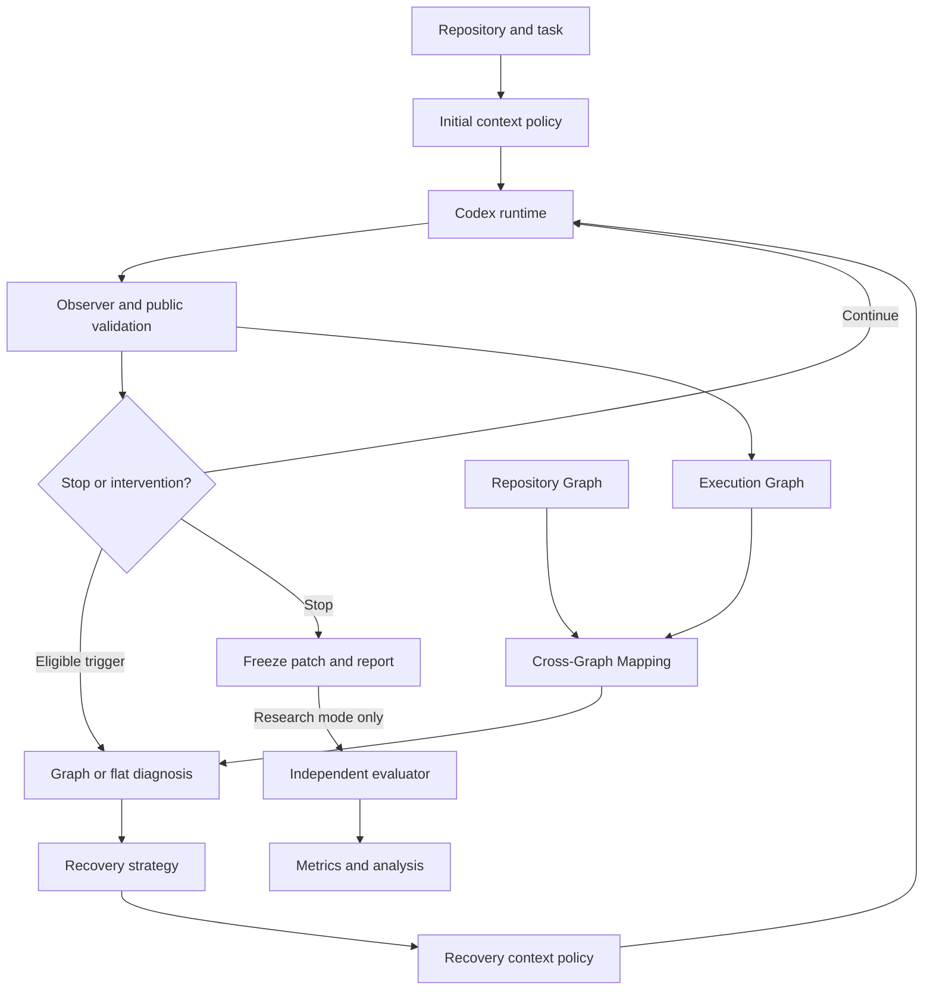

# Adaptive Agent Harness — 발표 및 시연 시나리오

## 그래프 기반 실패 복구 및 동적 컨텍스트 최적화를 통한 코딩 에이전트의 신뢰성과 실행 효율 향상

*Adaptive Agent Harness: Graph-Guided Failure Recovery and Dynamic Context Optimization for Coding Agents*

| 항목 | 내용 |
| --- | --- |
| 프로젝트 | Adaptive Agent Harness (AAH) |
| 수행 맥락 | 잇츠 스터디 5기 · Codex 기반 AI 코딩 에이전트 구축 |
| 문서 버전 | v0.1.0 — 발표 사전 설계 |
| 작성일 | 2026-11-25 |
| 관련 작업 | IP35–IP36, F13, AC09, G4–G5, DL-029 |
| 발표 예정일 | 2026-12-16 (기존 계획 승계, 운영진 확인 필요) |
| 발표 시간 | 미확정. 7분 기본안 및 5분·10분 대안 제안 |
| 상태 | 발표 구성 초안. 실제 실행·평가·성과·영상 및 팀 승인 증거 미등록 |

> 이 문서는 발표를 위한 운영 설계이며 실제 발표 자료나 실행 결과가 아니다. `—`, `[실측값]`, `[근거 ref]`는 채워야 할 자리표시자다. 과제 예시, 슬라이드 문구, 화면 구성은 설계 예시로 명시한다. 실제 자료는 G4 분석 검토 이후 확정하고 G5 제출 검증을 거친다. 수상이나 개선 수치를 보장하지 않는다.

## 1. 발표 목표 및 핵심 메시지

심사위원이 에이전트 엔지니어링 용어를 알지 못해도 다음 세 가지를 이해할 수 있도록 한다.

1. **왜 필요한가:** 강력한 코딩 에이전트도 일부 복잡한 과제에서 같은 실패를 반복하거나 필요한 증거를 놓칠 수 있다. 실제 발생 여부와 비용은 Pilot 관측으로 보여 준다.
2. **무엇을 만들었는가:** Codex의 외부에서 실행을 관찰하고, 필요한 경우 실패 증거와 코드 구조를 연결해 복구 전략 및 보조 컨텍스트를 바꾸는 하네스를 설계한다. 구현된 범위는 증거로 구분한다.
3. **효과가 있는가:** 동일 모델의 기본 실행·일반 재시도·단독 정책·결합 정책을 통제된 실험으로 비교하고, 성공과 비용 및 한계를 함께 설명한다.

**발표 중심 문장**

> 더 강력한 모델을 만드는 대신, 현재 모델이 더 잘 작동할 수 있는 실행 환경을 설계합니다. 실패가 관측되면 다음 행동과 필요한 정보를 다시 구성하고, 그 효과를 동일한 실행 제약 아래 검증합니다.

**사용자 가치:** 개발자는 자연어 작업 요청과 저장소를 입력하고, 검토 가능한 패치, 공개 검사 결과, 복구 개입의 근거와 비용을 확인한다. 자동 커밋·푸시·배포나 모델 내부 추론 제어는 제공한다고 주장하지 않는다.

### 1.1. 발표의 연구 정체성

| 개념 | 발표에서 설명할 실제 역할 |
| --- | --- |
| Harness Engineering | Codex 실행·관측·환경·예산·평가를 연결하는 시스템 |
| Graph Engineering | 코드 구조와 실행 증거를 연결하고 실패 관련 관계를 탐색 |
| Context Engineering | 필수 지침 보존, 보조 정보의 관련성·유효성·중복·예산 최적화 |
| Loop Engineering | 공개 실행 피드백을 다음 턴에 반영하고 종료 조건 관리 |
| Prompt Engineering | 선택된 전략과 근거를 후속 실행 지침으로 전달 |

용어를 다섯 가지 독립 연구 기여로 나열하지 않는다. 핵심 실험 조작은 DCC와 그래프 기반 복구 두 요인이며 하네스와 피드백 루프는 이를 연결하는 구조다. Workflow Graph는 실행 제어용이며 Repository/Execution Graph는 증거 표현용이다. 고정 상태 머신의 조건부 전이를 동적 그래프 재배선이라고 표현하지 않는다.

## 2. 심사 기준별 발표 전략

| 심사 항목 | 배점 | 발표에서 입증할 질문 | 실제 증거 | 슬라이드 |
| --- | ---: | --- | --- | --- |
| 문제정의·필요성 | 15 | 실제로 어떤 상황이 문제인가? | Pilot 로그, 실패 발생 범위, 연구 질문 | 1–2 |
| AI 기술 활용도 | 25 | Codex가 결과물의 핵심인가? | 실제 실행 이벤트, 복구 메시지 전달, 재관측, DCC 기록 | 3–5 |
| 구현 완성도 | 25 | 전체 기능이 연결되어 실제 작동하는가? | G0/G1, AC01–08, CLI와 patch/report, AC09 replay, 검증 상태 | 4–6 |
| 실용성 | 15 | 개발자에게 어떤 가치를 주는가? | repo/task 사용 예시, A–E 비교, 비용·성공률·시간 | 3, 6–7 |
| 학습과정·협업 | 10 | 학습이 구현과 검증으로 이어졌는가? | RH/GR/CE의 실제 IP·PR·리뷰·활동일지 | 8 |
| 차별성·확장성 | 10 | 기존 방법과 무엇이 다르며 어디까지 확장 가능한가? | 선행연구 비교, 실제 AB1/AB2, 조건 및 한계 | 3, 7–9 |
| 합계 | 100 | | | |

AI 활용과 구현이 50점이고 실용성까지 65점이다. 따라서 발표 전 우선순위는 **실제 통합 실행 → 검증 가능한 결과 → 설명 가능한 시각화** 순서다. 화려한 실시간 UI를 위해 P0 구현 또는 독립 평가를 희생하지 않는다. 심사 점수를 추정해서 결과로 표기하지 않는다.

## 3. 발표 시간과 스토리라인

공식 발표 및 Q&A 제한 시간은 미확정이다. 아래는 팀이 선택할 수 있는 제안이다. 시간에는 화면 전환을 포함하고 Q&A는 별도라고 가정한다. 운영 규정에 Q&A가 포함되면 본문과 영상 길이를 먼저 줄인다.

| 구성 | 5분 | 7분 기본 | 10분 |
| --- | ---: | ---: | ---: |
| 문제와 목표 | 40초 | 60초 | 80초 |
| 방법 및 아키텍처 | 45초 | 70초 | 100초 |
| 실제 비교 시연 | 100초 | 135초 | 180초 |
| 실험 설계 및 결과 | 60초 | 85초 | 140초 |
| 차별성·협업·한계 | 40초 | 50초 | 75초 |
| 결론 | 15초 | 20초 | 25초 |
| 합계 | 300초 | 420초 | 600초 |

### 3.1. 7분 슬라이드 구성 (기본안)

| 순서 | 슬라이드 제목 | 시간 | 화면 및 설명 | 필요 근거 |
| --- | --- | ---: | --- | --- |
| 1 | 같은 모델, 다른 실행 환경 | 20초 | 한 문장 문제 정의와 프로젝트 소개 | 프로젝트명·범위 |
| 2 | 왜 단순 재시도만으로 충분하지 않을 수 있는가? | 40초 | 실제 Pilot 반복 실패/정체 로그 또는 관측 한계 | EL ref, run ID, 공개 검사 |
| 3 | 우리가 바꾸는 것은 모델이 아니라 실행 정책 | 35초 | 기본 Codex 대비 제안 하네스, 사용자 가치, 선행 접근 | 아키텍처 및 문헌 근거 |
| 4 | 실패 증거 → 전략 → 컨텍스트 → 재실행 | 35초 | 전체 구조와 두 핵심 정책, 정상 경로 및 종료 | 그래프/루프 구조 |
| 5 | 동일 과제에서 복구 방식은 어떻게 달라지는가? | 90초 | 실제 로그 기반 A/E 또는 공통 체크포인트 B/E 비교 | manifest, checkpoint/run refs |
| 6 | 개발자가 실제로 사용하는 도구 | 45초 | CLI, 최종 patch/report, 공개 검사·비용·종료 상태 | 실행/검증 기록, AC01–08 |
| 7 | 같은 조건에서 비교한 결과 | 85초 | A–E, B–E FRR, 비용, 핵심 대비, 수행한 ablation | FIG02–06/08, 분석 ID |
| 8 | 학습이 구현으로 이어진 과정 | 25초 | RH/GR/CE 역할, PR·리뷰·학습 증거 | 실제 기록 |
| 9 | 어디까지 검증했으며 다음은 무엇인가? | 45초 | 선행연구 중복, 한계, 적용 조건, 결론 및 확장 | 실제 결과 및 한계 |
| 합계 | | 420초 | | |

슬라이드 9의 45초는 차별성·한계 25초와 결론 20초로 나눈다. 5분 발표는 3–4와 8–9를 통합하고 결과 그래프는 핵심 2개로 줄인다. 10분 발표는 동일 체크포인트 분기와 AB1/AB2 중 실제 수행한 실험 및 부정적 사례에 시간을 추가한다. 긴 논문 목록, 상세 수식, 전체 테스트 목록은 부록에 둔다.

### 3.2. 도입·전환·결론 대본 초안

다음 대본은 발표 전 수정할 문구다. 대괄호 부분은 실제 증거를 확인한 뒤 사용한다.

**도입 (슬라이드 1–2)**

“Codex는 코드 탐색부터 테스트까지 스스로 수행합니다. 그렇다면 복잡한 작업에서 같은 실패를 반복할 때, 우리는 어떤 정보를 주고 어떤 행동을 다시 시도하도록 해야 할까요? 저희는 모델을 바꾸지 않고 실행 환경을 개선하는 방법을 연구했습니다. [실제 Pilot에서 관측한 실패 상황 또는 자연 실패 확보의 한계]가 이 질문의 출발점입니다.”

**제안법 (슬라이드 3–4)**

“AAH는 코드의 의존 관계와 에이전트의 관측 가능한 실행 기록을 연결합니다. 실패 조건이 충족되면 관련 근거를 찾고 후속 전략을 선택합니다. DCC는 선택된 전략에 필요한 보조 정보만 예산 안에서 구성합니다. 실행 결과는 다시 관측하며 정상적으로 완료되거나 예산을 소진하면 종료합니다.”

**시연 전환 (슬라이드 5–6)**

“지금 보시는 것은 [실제 기록 재현 / 실제 라이브 실행]입니다. 두 조건의 [초기 저장소 및 공통 실행 제약 / 공통 실패 상태와 잔여 예산]을 확인하고, 어떤 증거가 어떤 후속 전략으로 연결되는지 보겠습니다.”

**정량 결과 전환 (슬라이드 7)**

“이 한 사례는 동작을 설명하기 위한 예시입니다. 일반적인 효과는 별도로 사전 정의한 평가 집합에서 비교했습니다. [실제 수행 범위]에 대해 성공률, 공통 실패 상태에서의 복구율, 성공당 모델 토큰을 함께 분석했습니다.”

**결론 (슬라이드 9)**

“저희의 목표는 에이전트가 단순히 더 오래 실행하게 만드는 것이 아니라, 실패 증거를 다음 실행에 활용하는 것입니다. [실제 지지된 결과 및 적용 범위]. [확인된 부작용 또는 미확정 결과]. 이를 바탕으로 [실제 구현 및 검증된 산출물]을 제공하고, 향후에는 [조건부 확장 계획]을 검토하겠습니다.”

실험 미완료 시 ‘비교했습니다’를 ‘비교하도록 설계했습니다. 현재 검증 범위는 …입니다’로 바꾼다. 완료하지 않은 시스템을 완성품으로 소개하지 않는다.

## 4. 아키텍처 설명용 화면



슬라이드에는 E 조건의 그래프 진단과 DCC 경로를 강조하고, B–D는 동일 외부 구조의 정책 교체라는 점을 결과 설명에서 보여 준다. 독립 평가기는 실행 종료 뒤에만 동작하며 복구 루프로 연결되는 화살표를 넣지 않는다. 관측된 이벤트와 추론된 관계를 다른 표시로 구별한다.

## 5. 실제 시연 사례 선정 및 증거 관리

### 5.1. 후보 과제와 선정 규칙

기존 PROJECT_OVERVIEW §7.1의 `auth.py`/`session.py` 계정 잠금 사례는 설명용 가상 시나리오다. BENCHMARK_SPEC §4의 실제 후보와 동일 과제라고 간주하지 않는다. 자체 과제의 경우 다음 후보를 검토할 수 있다.

| 후보 ID | 요구사항 요약 | 설명 가능성 | 현재 상태 |
| --- | --- | --- | --- |
| AAH-D01 | 비밀번호 변경 후 기존 세션 무효화 | 파일 간 의존성, STALE 보조 문서 | 설계 후보 |
| AAH-R01 | 성공 로그인 시 실패 카운터 초기화, 활성 잠금 보존 | 회귀 위험, NOISY 보조 문서 | 설계 후보 |
| AAH-S01 | 잠금 만료 경계에서 다시 로그인 가능 | 단순 정상 경로, 과잉 개입 확인 | 설계 후보 |
| AAH-C01 | 전체 세션 로그아웃 상태 갱신 및 반복 호출 처리 | 복합 수정 및 상태 일관성 | 설계 후보 |

실제 과제 제작 및 BQ 검증 전에는 위 과제를 실행 가능한 벤치마크로 소개하지 않는다. 발표에는 허용된 개발용 과제 또는 평가 완료 및 공개 검토를 거친 과제를 사용한다. Main을 앞두고 시험 실행으로 평가 과제를 조정하지 않는다.

**사례 선택 규칙 (발표용, 연구 표본 선정과 별개):** EXPERIMENT_DESIGN §15.2를 따라 A/B 실패–E 성공, A/B 성공–E 실패, 모든 조건 실패, 외부 개입 없이 성공한 유형의 최초 적격 사례 또는 사전 확정한 대표성 기준을 적용한다. 동일 유형 내에서 극적인 사례만 고르지 않는다. 공개 가능한지, 실제 이벤트-증거-지침-결과가 연결되는지, 비교 조건이 명확한지를 적격 요건으로 둔다. 해당 유형이 없으면 없다고 명시한다. 대표 사례는 전체 표본의 효과를 증명하지 않는다.

### 5.2. 시연 모드

| 모드 | 설명 | 필수 표시 | 운영 우선순위 |
| --- | --- | --- | --- |
| LOG REPLAY | 실제 종료된 Codex run의 비식별 artifact를 순서대로 재생 | 실제 실행 기록 재현, run/date/config refs, 재생 시간과 실측 시간 구별 | 기본 |
| LIVE | 허용된 시연용 저장소에서 Codex를 실제로 실행 | 별도 live run ID, 실행 환경, 실제 제한, 결과 미보장 | 선택 |
| RECORDED | 실제 실행 화면의 사전 녹화 영상 | 실제 실행 녹화, 편집/배속 여부, run ref | 대안 |
| SCHEMATIC | 방법을 설명하는 가상의 도식 또는 fixture | 설계 예시 / mock / 실험 결과 아님 | 실제 증거 부족 시 한정 |

Replay는 새 모델 호출이나 추가 복구가 아니다. 발표 현장에서 실행한 별도 run은 Main 표본으로 합치지 않는다. Replay는 원래 run 결과가 실패·부분 종료인 경우에도 그 상태를 그대로 표현한다.

### 5.3. 케이스 등록표 (실제 확인 후 작성)

| 항목 | 대표 복구 케이스 | 정상/부정적 케이스 |
| --- | --- | --- |
| task ID / family / source | — | — |
| 선정 규칙 및 선정 근거 | — | — |
| experiment / slot / run ID | — | — |
| checkpoint / source run ID (해당 시) | — | — |
| 조건 / 모델 ID / runtime / config hash | — | — |
| 초기 commit / snapshot hash / 환경 | — | — |
| session policy / 잔여 실행 제한 | — | — |
| trigger / evidence / intervention / package refs | — | — |
| 종료 이유 / public check / 평가 분석 상태 | — | — |
| 비용·시간·사용량 coverage | — | — |
| 실제 artifact ref / 공개 승인 | — | — |

## 6. 비교 시연 구성 (슬라이드 5–6, 135초)

### 6.1. 시연의 비교 논리

- **A vs E (End-to-end):** 개발자에게 기본 Codex 대비 전체 시스템의 사용 경험 및 결과 차이를 보여 준다. 최초 작업과 저장소 및 공통 실행 제약을 맞추되 실제 실행 이력은 서로 다를 수 있다. A는 외부 보조 패키지·복구 메시지가 없는 참조군이며 자체 복구 능력은 유지한다.
- **B vs E (공통 실패 체크포인트):** 동일한 외부 실패 상태에서 일반 재시도와 제안 복구 정책이 어떻게 다른 증거 및 전략을 구성하는지 설명한다. B에도 실제 원본 증거와 일반 재시도 기회가 있다. B/E 차이는 두 정책의 묶음 효과이지 그래프 단독 효과가 아니다. Graph-only와 Context-only의 별도 결과는 슬라이드 7에서 설명한다.
- 공통 체크포인트의 내부 세션 복제가 검증되지 않았으면 동일 `NEW_SESSION` 및 동일 공통 이력 요약을 사용했다는 점을 표시한다. E의 초기 DCC 효과를 체크포인트 분기 효과로 설명하지 않는다.

시간 내에 두 비교를 모두 보여 줄 수 없다면 실제 로그 근거가 더 완전한 비교 하나를 주 시연으로 선정하고 다른 비교는 결과표 또는 부록으로 제시한다.

### 6.2. 장면별 진행 큐 (실제 기록에 맞춰 편집)

| 누적 시간 | 화면 | 발표 멘트·조작 | 확인할 실제 근거 |
| ---: | --- | --- | --- |
| 0–15초 | 케이스 카드 | 작업, 저장소, 모델, 실행 제약 및 비교 유형 표시 | manifest, checkpoint ref |
| 15–30초 | B/A 및 E 타임라인 | 실제 공개 실패, 반복 또는 정상 진행 확인 | evidence/checks |
| 30–50초 | 실패 앵커 + 이중 그래프 | 어떤 관계로 후보를 찾았는지 실제 탐색 경로 강조 | GraphArtifact, DiagnosisTrace |
| 50–65초 | 전략 결정 | 실제 strategy ID와 선택 이유, fallback 여부 표시 | interventions |
| 65–80초 | DCC 정보 선택 | 현재 안내, 역사적 실패 로그, 제외 후보, 예산·토큰 표시 | context records |
| 80–90초 | 후속 턴과 공개 검사 | 전달 여부, 관측된 수행 및 다음 검사 상태 표시 | events/evidence/checks |
| 90–110초 | 개발자용 CLI/리포트 | 명령과 실제 종료 이유, 검토 가능한 patch | report, final.patch |
| 110–125초 | 연구용 별도 평가 | 독립 판정 상태와 계측 비용·시간 | 평가기 결과 및 run refs |
| 125–135초 | 정상 또는 부정 사례 카드 | 모든 사례에 개입이 유익하지 않으며 전체 평가는 별도임을 설명 | 실제 해당 사례 또는 미확보 표시 |

모든 장면의 실제 로그 및 평가 판정을 등록하기 전에는 성공/실패 결과를 대본에 확정하지 않는다. 실제로 특정 전략이 선택되지 않았다면 해당 전략을 보여 주는 장면을 다른 실측 근거로 교체한다.

### 6.3. CLI 시연 계약

아래는 TECHNICAL_SPEC §14의 계획 명령을 그대로 사용한 예다. 구현 및 설치 검증 전에는 실행 가능한 명령이라고 표시하지 않는다. 실제 시연에서는 승인된 fixture와 확인된 설정을 사용한다.

```bash
adaptive-codex run --repo ./my-project \
  --task "로그인 실패 횟수에 따른 계정 잠금 오류 수정" \
  --config configs/default.yaml
```

```bash
adaptive-codex report --run-id <run-id> --results-root results
adaptive-codex experiment --manifest configs/experiments/main.yaml
```

일반 `run`은 E 기본 정책이며 사용자용 공개 검증·패치 리포트를 반환한다. 연구용 A–E 실행은 동결 manifest의 `experiment`로 수행한다. 발표 중 Main 실행 전체를 새로 시작하지 않는다. `report`는 저장 결과 조회이며 모델 재호출이 아니다. 일반 실행의 종료 코드 0을 독립 평가 성공과 혼동하지 않는다. 시연용 명령은 실제 구현된 계약으로 리허설하며 인증 정보, 절대 경로의 개인정보, private test 상세는 화면에 노출하지 않는다.

## 7. 그래프 및 컨텍스트 시각화 명세

### 7.1. 실패 진단 화면

실패 앵커를 중심으로 관련 Repository Graph와 Execution Graph의 제한된 부분만 표시한다. 전체 저장소 그래프를 한 화면에 쏟아내지 않는다. 노드 클릭 기능은 선택이며 정적 이미지도 허용한다.

| 요소 | 화면 표기 |
| --- | --- |
| 실패 앵커 | 공개 검사 ID, 오류 지문, 트리거 ID, 관측 시점 |
| 실행 증거 | 읽기/변경/검사 이벤트, event ID, snapshot ref |
| 코드 요소 | 파일 또는 심볼 및 현재/역사 snapshot 구분 |
| 그래프 관계 | 실제 타입, 근거 ref, observed/inferred 및 불확실성 |
| 후보 순위 | 실제 계산 점수와 선택 근거, 원인 확정 아님 |
| 탐색 제한 | 깊이·방문 상한, truncated/unresolved 여부 |
| 복구 전략 | 실제 strategy ID, 대상, 지침 전달 상태, 다음 공개 검사 |

예를 들어 T1에서 관련 대안 코드 후보가 확인되면 `RELOCALIZE`가 선택될 수 있다. 이는 예시이며 실제 오류 지문, `session.py` 연결, 해당 전략 선택 및 후속 수행은 실측 로그로만 표시한다. T3의 `REVIEW_REGRESSION`, `REFRESH_EVIDENCE`, `GENERIC_RETRY`, `CONTINUE`, `STOP`도 실제 정책 기록을 따른다. 추정 관계를 원인 확정으로 표현하지 않는다.

### 7.2. DCC 선택 화면

| 항목 | 입력/표시 | 예시 해석 (실측 아님) |
| --- | --- | --- |
| 필수 지침 | 고정 영역, 사용자 요청, 권한 | 선별·삭제 대상이 아님 |
| 후보 정보 | source, revision, scope, snapshot, evidence refs | 현재 코드, 보조 문서, 실패 로그 |
| 유효성 | CURRENT / INVALID / HISTORICAL / UNCERTAIN | 폐기 안내와 당시 실패 기록을 다르게 처리 |
| 점수 | 관련성·범위·유효성·실패 관련도 | 점수는 확률이 아님 |
| 선택 결과 | 선택/제외 이유, 실제 보조 토큰, 예산 및 fallback | 필수 영역과 보조 토큰 구분 |
| 후속 실행 | package ID, hash, 전달 여부 | 실제 다음 턴 입력과 연결 확인 |

B/D 및 C/E의 최초 패키지 parity와 B/C의 그래프 파생 정보 금지를 유지한다. DCC가 전체 Codex 내부 컨텍스트를 직접 수정하는 것처럼 설명하지 않는다. 이전 실패의 역사 증거를 현재와 불일치한다고 무조건 삭제하는 것도 아니다. 선택된 보조 토큰과 전체 모델 소비 토큰은 별도로 표시한다.

### 7.3. 화면 레이아웃 (설계안)

```text
┌───────────────────────────────────────────────────────────┐
│ AAH | 실제 로그 REPLAY | task / run / condition / config   │
├────────────────────────────┬──────────────────────────────┤
│ 비교 실행 타임라인          │ 실패 앵커와 진단 그래프         │
│ A 또는 B / E               │ relation / provenance / rank │
├────────────────────────────┼──────────────────────────────┤
│ 전략·후속 턴 전달            │ 컨텍스트 선택·제외 및 예산       │
├────────────────────────────┴──────────────────────────────┤
│ 공개 검사 / 종료 / patch / usage coverage / 시간           │
│ 연구 모드: 별도 독립 평가 판정(실행 종료 후 연결)            │
└───────────────────────────────────────────────────────────┘
```

정상/실패/미측정/불명/추정은 텍스트와 도형으로 함께 표시하고 색상만으로 구분하지 않는다. 그래프 애니메이션과 슬라이드 전환보다 증거 ID 및 관계가 읽히는 것을 우선한다. 실제 영상과 화면의 개인정보·로그 비밀은 공개 전에 제거한다.

### 7.4. Replay 데이터 계약 및 수용 기준

새로운 런타임 wire schema를 추가하지 않고 기존 artifact를 읽는 뷰어로 구현한다. TECHNICAL_SPEC §12의 `manifest.json`, `evidence.jsonl`, `checks.jsonl`, `transitions.jsonl`, `graphs/`, `interventions.jsonl`, `context.jsonl`, `usage.jsonl`, `final.patch`, `report.json`을 필요한 범위에서 참조한다. `events.raw.jsonl` 및 `restricted/`는 기본 공개 대상으로 삼지 않는다. 독립 평가 데이터는 종료 후 별도 분석 결과로만 연결한다.

- 동일 run의 manifest, snapshot, ledger cursor, intervention/package 연결 및 hash를 검증한다.
- 실제 event 순서 및 실패·fallback·취소·종료 상태를 그대로 유지한다.
- 누락·부분 관측·계산 불가를 명시한다. 값 0 또는 성공 상태로 대체하지 않는다.
- 재생 속도와 원래 wall time을 구분한다. 정적 화면도 동일 근거로 생성한다.
- 사용자 보고서의 공개 정보와 연구 결과 화면의 독립 판정을 구분한다.
- 비식별 공개본으로 재생하며, 재생 중 Codex나 평가기를 재호출하지 않는다.

이 항목들은 AC09의 구체적 발표 검토 기준으로 제안하며 제품 명세의 AC01–08을 대체하지 않는다.

## 8. 정량 결과 발표 (슬라이드 7, 85초)

### 8.1. 비교군 설명

| 조건 | 초기 패키지 | 외부 감지 | 진단·전략 | 복구 패키지 |
| --- | --- | --- | --- | --- |
| A: Vanilla Codex | NONE | 없음 | NONE / NATIVE | NONE |
| B: Flat Retry | DEFAULT | 공통 | FLAT / GENERIC | DEFAULT |
| C: Context-only | DCC | 공통 | FLAT / GENERIC | DCC |
| D: Graph-only | DEFAULT | 공통 | GRAPH / TYPED | DEFAULT |
| E: Adaptive Agent Harness | DCC | 공통 | GRAPH / TYPED | DCC |

B–E를 2×2 요인으로 분석한다. A는 외부 개입이 없는 실용적 참조 조건으로 따로 둔다. 동일 모델·작업·원본 접근·공통 실행 제약을 사용하고 실제 사용량은 결과로 측정한다. 토큰의 엄격한 상한이 지원되지 않았다면 시간·턴 상한 및 관측 사용량을 명시하고 ‘정확히 동일 토큰 예산’이라고 주장하지 않는다.

### 8.2. 결과 화면과 시간 배분

| 시간 | 화면 | 설명 요점 |
| ---: | --- | --- |
| 15초 | 비교군 및 실제 실험 규모 | 예정/실행/유효/미실행 수, 과제 유형, 반복, 고정 조건 |
| 20초 | FIG02 성공률 + FIG06 비용 | A–E의 실제 성공률, 성공당 모델 토큰 및 비용 단위, P-R1/P-R3 |
| 20초 | FIG03 공통 체크포인트 FRR | B–E 복구율, 공통 상태와 확보율, P-R2 |
| 20초 | FIG04 및 FIG08 | 핵심 효과 크기와 불확실성, 실제 수행한 AB1/AB2 |
| 10초 | 해석 | 지지된 결과, 불확실성, 비용 증가·오개입 등 실제 한계 |
| 합계 85초 | | |

슬라이드에 그래프를 과밀하게 넣지 않는다. 필요한 경우 슬라이드 7을 7a–7c로 나누되 시간 합계를 유지한다. 실측 자료가 충분하지 않으면 미수행 그래프를 생략하고 수행 현황과 한계를 설명한다.

### 8.3. 결과표 (G4 이후 등록)

| 지표 | A | B | C | D | E |
| --- | ---: | ---: | ---: | ---: | ---: |
| E2E 유효 실행 수 | — | — | — | — | — |
| E2E 성공 수 / 분모 | — | — | — | — | — |
| E2E 성공률 | — | — | — | — | — |
| 공통 checkpoint FRR | N/A | — | — | — | — |
| 성공당 모델 토큰 | — | — | — | — | — |
| 전체 관측 모델 토큰 | — | — | — | — | — |
| 실행 시간 중앙값 | — | — | — | — | — |
| 필수 지침 준수율 | — | — | — | — | — |
| 개입 뒤 공개 검사 악화 | N/A | — | — | — | — |

공통 paired 분석 집합과 전체 유효 실행은 별도 표로 유지한다. FRR은 E2E에서 조건마다 자연적으로 발생한 실패를 분모로 계산하지 않고 공통 실패 체크포인트 분석 집합에서 평가한다. 적격 source 확보율과 비용은 분기 FRR 및 비용과 별도로 보고한다.

| 주 분석 대비 | 결과 | 95% 구간 | 공통 단위/coverage | 해석 |
| --- | --- | --- | --- | --- |
| P-R1: CPS_C − CPS_B (E2E 성공당 모델 토큰) | — | — | — | — |
| P-R2: FRR_D − FRR_B (공통 실패 상태) | — | — | — | — |
| P-R3: p_E − max(p_C,p_D) (E2E 성공률) | — | — | — | — |
| 보조: A→E 성공률·비용 | — | — | — | — |
| 보조: p_E − p_D − p_C + p_B (가법 상호작용) | — | — | — | — |

P-R3의 양의 결과가 곧 양의 상호작용을 의미하지 않는다. 세 주 대비의 결과와 단독 비교를 구분하고, 연구 질문의 성공 기준을 사후 변경하지 않는다. 성공률 차이는 %p, 상대 변화는 %로 구별한다. 비용은 모델 토큰, 실제 과금액, 추정 과금액, 구독 크레딧, 로컬 시간/오버헤드의 단위를 섞지 않는다. CPS는 실패 실행의 비용까지 포함하고 성공이 0건이면 유한한 수치로 표시하지 않는다.

### 8.4. Ablation 및 차별성의 설명

| ID | 무엇을 분리하는가 | 발표 가능한 주장 (실제 수행 시) |
| --- | --- | --- |
| AB1 | E vs Unlinked | 명시적 그래프 연결을 포함한 정책의 추가 가치 |
| AB2 | 동일 진단·증거 패키지에서 Typed vs Generic | 첫 복구 전략 지침의 효과. 증거 선택 효과와 분리 |
| AB3 | 초기/복구 DCC 적용 시점 | 초기 제공과 복구 제공의 개별 효과 |
| AB4 | 공통 전략·DCC에서 Graph vs Flat | 그래프 기반 증거 검색의 효과 |

미수행 항목은 후속 검증 계획으로만 제시한다. Graph ON은 증거 검색과 유형별 복구 전략의 묶음 조작이므로 AB1/AB2/AB4의 검증 없이 그래프의 특정 구조나 전략만 성능 향상의 원인이라고 단정하지 않는다. 신뢰구간은 과제/가족 수준의 paired cluster bootstrap 및 실제 분석 설정으로 산출한다. 작은 표본에서 불확실성이 큰 경우 그 사실을 말하고 통계적 유의성을 과장하지 않는다.

### 8.5. 관측 결과별 메시지 전환 규칙

| 실제 결과 상태 | 발표할 메시지 | 피할 표현 |
| --- | --- | --- |
| 성공률 개선 및 비용 감소 | 관측 범위, 차이, 분모, CI 및 부작용을 제시 | 모든 코딩 작업에 유효 |
| 성공률 개선, 비용 증가 | 성공과 비용의 trade-off 및 적용 조건 제시 | 무조건 더 효율적 |
| 비용 감소, 성공률 유지 근거 부족 | 비용 개선과 성공률 불확실성을 분리 | 비유의하므로 성능 유지 입증 |
| 단독 정책이 E보다 좋음 | 어떤 정책이 어느 조건에서 유용한지 설명 | 결합이 항상 우수 |
| 그래프/전략 효과 불명 | 공통 상태 표본, 탐색 제한, 부작용 및 추가 검증 설명 | 실패 원인을 정확히 진단 |
| 자연 실패 희소 | Pilot 또는 확보 시도 수, 적격 발생률 및 일반화 한계 보고 | 실패 상황을 임의 제작해 자연 사례로 소개 |
| 실험 미완료 또는 결측 과다 | 실제 구현·검증 범위 및 미수행 계획을 분리 | 계획 수를 실측 표본 수로 주장 |

예상 효과가 없더라도 유효한 결과를 생략하지 않는다. 통합 성공을 보여 주는 한 사례와 전체 연구의 실증 결론을 구분한다.

## 9. 학습·협업 및 차별성 발표 (슬라이드 8–9)

### 9.1. 협업 증빙

| 역할 | 설명할 학습·구현 연결 | 실제 증빙 |
| --- | --- | --- |
| RH | Codex 공개 이벤트와 실행 제어 학습 → Runtime/상태 머신/계측 검증 | PR, IP 작업, RT 검증 ref: — |
| GR | 코드 그래프와 실패 진단 문헌 → 그래프·복구 모듈·AB 분석 | PR, 진단 fixture, 실제 로그 ref: — |
| CE | 컨텍스트 선별 및 평가 학습 → DCC·독립 평가·통계 분석 | PR, 패키지 기록, 평가·분석 ref: — |
| 공동 | 인터페이스 합의 → 교차 리뷰 → 통합 테스트 → 동결 및 결과 검토 | 회의·ADR·EL ref: — |

역할 배정안이 실제 개인 기여를 의미하지 않는다. 팀원이 직접 작성/검증한 내용과 개발용 Codex가 보조한 내용을 실제 기록으로 구분한다. 기여량을 커밋 개수 하나로 평가하지 않는다. 최종 발표에서 개인별 학습 내용 하나와 구현/검증 증거 하나를 연결하면 된다.

### 9.2. 관련 연구 대비 설명

아래 요약은 LITERATURE_REVIEW의 기존 검토를 계승하며 이번 문서에서 원문이나 공개 구현을 추가 검증하지 않았다.

| 기존 접근 | 기존 연구 문서에서 확인한 접점 | 이번 연구의 질문 |
| --- | --- | --- |
| RepoGraph | 저장소 구조 기반 코드 탐색 | 실행 실패 증거와 연결한 복구에 유용한가? |
| Rivet | 관계 기반 근거 선택 및 예산 제어 | 상태·복구 전략에 따른 보조 정보 정책이 유용한가? |
| AgentTether | 그래프 진단 및 런타임 개입 | Codex 저장소 과제에서 정책별 추가 효과는 무엇인가? |
| MemTrace | 저장소 상태·실행 이력 연결과 컨텍스트 유효성/복원 | 실패 시 후속 행동 결정과 정보 정책의 독립·결합 효과는? |

연구 기여는 ‘최초의 그래프+컨텍스트 시스템’이 아니라 관측 가능한 실패 상태에 조건화된 정책 설계 및 실제 Codex 통제 평가다. 직접 재현하지 않은 선행 방법보다 우수하다고 주장하지 않는다. 확장성은 교체 가능한 Runtime Adapter, 언어별 그래프 추출, 선택적 복구 정책 및 장기 메모리 등 조건부 확장으로 설명한다. 현재 단일 Codex·Python 범위를 벗어난 효과는 검증하지 않았다.

## 10. 예상 질의응답 (답변 가이드)

| 질문 | 답변 방향 | 확인할 근거 |
| --- | --- | --- |
| Q1. Codex 자체가 이미 반복해서 오류를 해결하지 않나요? | 맞다. A는 Codex의 자체 탐색과 재시도를 그대로 유지한다. 외부 개입이 추가로 유용한 상황인지 A/E와 강한 B 대조군에서 검증한다. | Pilot, A–E 결과 |
| Q2. 실패를 어떻게 감지하나요? | 관측 가능한 공개 검사 및 실행 이벤트에서 반복 오류 지문, 정체, 회귀, 완료 선언 시 공개 실패를 감지한다. 미관측 또는 인프라 문제는 보류/분리한다. | T1–T5, detector 로그 |
| Q3. 그냥 실패 로그를 다시 주는 것과 다른가요? | B가 그에 가까운 강한 대조군이다. D/E는 실제 코드와 실행 관계를 탐색해 후속 전략을 구성한다. 차이는 공통 상태 비교로 측정한다. | B/D/E, AB1/AB4 |
| Q4. 그래프가 원인을 정확히 찾는다는 보장이 있나요? | 없다. traceback·diff 등 관측 근거와 정적 추정 관계를 분리한다. 후보와 검증 계획을 제공하며 근거 부족 시 fallback한다. | DiagnosisTrace, provenance |
| Q5. 왜 단순 상태 머신 외에 이중 그래프가 필요하죠? | 상태 머신은 제어 흐름, 이중 그래프는 실패 증거와 코드 구조의 관계 표현이다. AB1/AB4를 통해 관계 활용의 추가 가치를 검증할 계획이다. | 아키텍처, 실제 ablation |
| Q6. 실행 중 그래프 구조를 스스로 바꾸나요? | MVP는 갱신되는 증거 그래프와 고정 상태 머신의 조건부 전이를 사용한다. 워크플로 자체의 자동 재배선은 범위 밖이다. | workflow, snapshot |
| Q7. 컨텍스트를 줄이면 중요한 지침이 누락되지 않나요? | 필수 지침과 권한은 고정하고 보조 정보만 선택한다. 유효성·출처와 예산을 기록하며 필수 제약 검사를 별도 평가한다. | DCC, compliance |
| Q8. 실제로 Codex 내부 컨텍스트를 최적화하나요? | 공개 인터페이스에 제공하는 외부 보조 패키지를 구성한다. 내부 대화 이력이나 비공개 추론을 직접 제어하지 않는다. | RT probe, package |
| Q9. AI 기술을 많이 쓴 것보다 실제 성능에 무엇을 더했나요? | 같은 모델을 실행 엔진으로 사용하고 외부 증거와 전략, 정보를 조정한다. 효과는 P-R1–P-R3의 실측 결과만 주장한다. | 실제 실행 및 분석 |
| Q10. 더 많은 턴과 토큰을 주었기 때문에 좋은 것 아닌가요? | B–E의 외부 감지·개입 기회 및 전체 공통 실행 제약을 고정한다. 정확한 토큰 상한이 불가능하면 명시하며 실제 사용량·오버헤드를 보고한다. | manifest, usage coverage |
| Q11. 비용이 얼마나 줄었나요? | `[실측값]`을 성공당 모델 토큰 및 실제 사용량 coverage와 함께 말한다. 통화 과금과 구독 크레딧은 별도다. 미계측이면 그렇게 답한다. | FIG06, EP 집계 |
| Q12. 연구 설계가 너무 작거나 데이터가 인위적이지 않나요? | 실제 과제 수, 자체/공개, NORMAL/NOISY/STALE 및 군집 의존성을 명시한다. 인위적 조건과 자연 분포를 구분하고 작은 표본의 불확실성을 공개한다. | BENCHMARK_SPEC, CI |
| Q13. 공통 실패 체크포인트는 실제로 같은 상태인가요? | 작업 트리·관측 이력·잔여 예산을 검증한다. 내부 세션의 동일 복제가 불가능하면 공통 NEW_SESSION 정책을 사용하고 외부 상태 비교라는 한계를 명시한다. | checkpoint records |
| Q14. 그래프와 DCC가 둘 다 필요하다는 근거는? | B–E 2×2 비교와 실제 수행한 ablation으로 본다. E가 단독 방법보다 좋다는 사실과 양의 상호작용은 서로 다른 분석이다. 미검증 효과는 주장하지 않는다. | P-R3, FIG05, AB1–4 |
| Q15. MemTrace 또는 AgentTether와 무엇이 다른가요? | 유사 메커니즘이 이미 존재한다. 실패 시점의 전략 및 보조 정보 정책을 공통 상태에서 분리 평가하는 실증 연구로 범위를 좁혔다. 직접 재현 여부도 명시한다. | LITERATURE_REVIEW §4, §8 |
| Q16. 테스트 통과가 실제 성공과 같은가요? | 사전 정의한 기능·회귀·필수 제약을 모두 통과해야 한다. 모든 실제 요구를 완전하게 증명하는 것은 아니며 테스트의 품질과 범위를 공개한다. | 독립 평가기, BQ |
| Q17. 평가 정답이 에이전트에 유출되지 않나요? | 평가기와 작업 공간을 분리하고 private tests/정답 패치는 외부 복구 루프에 반환하지 않는다. 실제 격리 검증 증거를 제시한다. | SEC, AC, EP 테스트 |
| Q18. 실패가 없거나 잘못된 개입이 발생하면요? | 정상 진행은 외부 복구 없이 종료할 수 있고 근거 부족 시 일반 복구 또는 종료한다. 추가 오버헤드·악화 사례를 보고한다. | 정상/부정적 사례 |
| Q19. 실제 서비스로 바로 적용 가능한가요? | 구현 및 검증된 CLI 사용 범위에서 설명한다. 모델·언어·보안 제약 및 검증 상태를 표시하고 자동 배포는 하지 않는다. | README, 실행 및 테스트 |
| Q20. 팀원들이 각각 무엇을 학습했나요? | 역할별 실제 IP·PR·리뷰와 사람의 검증 사례를 연결한다. 수행하지 않은 활동이나 기여를 주장하지 않는다. | TEAM_ROLES, 활동일지 |

실측 질문에 대답할 때는 분석 ID와 분모를 포함한다. 발표 후 추가 실험을 약속하는 대신 현재 확인 가능한 결과와 검증 범위를 설명한다.

## 11. 시연 운영 및 장애 대응

### 11.1. 시연 전 확인

- [ ] 공식 시간·Q&A 포함 여부·화면 비율·제출 형식·인터넷 허용 여부 확인.
- [ ] G4 결과 및 G5 공개 검토 상태, 실제 모델·runtime·환경 버전 확인.
- [ ] 발표용 자료가 동일 분석 버전에서 생성되었는지 원본 표와 대조.
- [ ] 실제 replay, 로컬 영상, 정적 이미지/PDF 대안이 같은 공개 가능한 증거를 참조하는지 확인.
- [ ] LIVE를 선택한 경우 승인된 개발/시연 fixture, 접근권한, 인증, 한도, 안전한 종료 및 연결 상태 확인.
- [ ] 비밀·private test·정답·개인정보·라이선스 제한 자료의 화면/음성/영상 노출 제거.
- [ ] CLI 보고서와 평가 판정이 서로 다른 경계에 표시되는지 확인.
- [ ] 발표자가 직접 사용할 키·명령·전환 순서와 시간 제한을 리허설.
- [ ] 회복되지 않는 장애에서 즉시 대체 자료로 전환하는 기준과 담당자 합의.

### 11.2. 장애 대응표

| 상황 | 현장 대응 | 설명할 문장 |
| --- | --- | --- |
| 네트워크/API/인증 장애 | 새 호출 중단, 필요 시 안전 취소 후 실제 replay/녹화 사용 | “현재 외부 호출에 문제가 있어 동일 프로젝트의 사전 실행 기록을 보여드리겠습니다.” |
| Codex 실행 지연 | 라이브 대기 대신 시간 상한 확인 후 저장 사례로 전환 | “실행 지연도 비용에 포함됩니다. 실제 기록으로 복구 과정을 확인하겠습니다.” |
| LIVE에서 예상한 실패가 없음 | 정상 경로 그대로 설명, 실패 사례 replay는 별도 run 표시 | “이번 실행은 복구 개입 없이 진행했습니다. 실패 경로는 별도 실제 기록입니다.” |
| LIVE에서 복구 실패/오개입 | 결과를 유지하고 종료 이유와 근거 설명, 별도 사례는 명시 | “이 실행은 복구되지 않았습니다. 관측된 상태와 한계를 확인하겠습니다.” |
| replay 파싱/화면 오류 | 공개 검토한 로컬 정적 캡처나 녹화로 전환 | “동일 run의 저장된 검증 자료를 사용하겠습니다.” |
| 발표용 평가 수치와 원본 불일치 | 해당 수치 제시 중단, 확인된 표 또는 미확인 표시 | “이 수치는 현재 검증이 필요해 성과로 제시하지 않겠습니다.” |
| 안전 격리/비밀 노출 우려 | 화면 공유 및 실제 실행 중단, 공개본으로 전환 | “안전한 공개 범위의 기록만 보여드리겠습니다.” |
| 실제 사례 자체가 미확보 | SCHEMATIC으로 구조만 설명, 실험 미완료를 명시 | “이는 방법 설명용 도식이며 실제 복구 성공 사례가 아닙니다.” |
| 제한 시간 임박 | 라이브 및 선택적 상세 설명 생략, 실제 핵심 결과와 결론으로 이동 | “핵심 검증 결과와 현재 적용 범위를 요약하겠습니다.” |

전환 지연 허용치는 리허설 후 팀이 정한다. 예를 들어 7분안에서는 추가 대기 10초를 넘기기 전에 대체 자료로 이동하는 것을 운영 시작값으로 제안한다. 이 발표용 전환 기준은 실험의 시간·턴·복구 상한을 바꾸는 설정이 아니다. 실패한 실행의 결과를 삭제하거나 영상을 성공으로 편집하지 않는다.

## 12. 발표 역할 및 리허설 계획

팀원 이름과 발표 방식은 미확정이므로 역할 기준으로 배치한다. 7분 기본안에서는 한 명이 발표 흐름을 유지하고 다른 두 명이 시연·Q&A를 지원하는 구성을 우선 제안한다. 모두 발표할 필요가 있는지는 공식 규정을 확인한다.

| 역할 | 발표 준비 책임 | 현장 지원 |
| --- | --- | --- |
| RH | 실제 CLI·run/report·환경·비상 전환 및 G0/G1 증거 | 시연 조작, 런타임 질문 |
| GR | 실패 앵커·그래프 경로·전략·실패/부정 사례 및 AB 증거 | 진단·선행연구 질문 |
| CE | 컨텍스트 패키지·독립 평가·정량 분석·결과표 | 통계·비용·DCC 질문 |
| 공동 | 발표 스토리라인, 최종 자료 검증, 리허설, 공개 승인 | 학습·협업·한계 질문 |

| 단계 | 목표 | 완료 기준 |
| --- | --- | --- |
| R0 — 자료 등록 | 실제 증거가 있는지 점검 | run/analysis ID, 공개 검토, 누락 표시 |
| R1 — 내용 검증 | 설계와 실제 결과의 일치 확인 | 수치, 분모, 표본, 그래프·전략 ref, 근거 검토 |
| R2 — 시간 리허설 | 7분안 또는 공식 제한에 맞추기 | 화면 전환 포함 시간 측정, Q&A 모의 |
| R3 — 장애 리허설 | 네트워크 없이 대안 재생 | 로컬 영상·정적 자료로 전환 성공 |
| R4 — 최종 확인 | G5 제출 패키지 및 발표본 승인 | 자료 버전·공개 범위·팀 검토 기록 |

기존 일정의 12/13–15 발표 준비를 승계한 제안이다. 실제 제출 마감·크레딧 사용 가능 기간·팀 일정에 맞춰 조정한다. G4 결과가 지연되더라도 근거 검증을 건너뛰지 않는다.

## 13. 발표 산출물 및 증거 인덱스

아래는 발표 패키지 제안 파일명이다. 본 문서 작성 시 실제 생성하지 않았다. 기준 문서의 실험 artifact 경로를 변경하지 않는다.

```text
presentation/
├── slides/                 # 발표용 원본 및 PDF 대안
├── demo/                   # 공개 검토한 replay/실제 녹화/정적 캡처
├── figures/                # 실제 분석에서 export한 FIG01–FIG10 중 사용분
├── evidence_index.md        # 슬라이드·run·분석·협업 증거 연결
└── rehearsal_log.md         # 실제 시간·장애 전환·검토 기록
```

| 자료 | 필수 연결 정보 | 등록 상태 |
| --- | --- | --- |
| 발표본 및 PDF 대안 | 버전, 발표 시간, 결과 분석 ID | — |
| 실제 비교 시연 | case ID, run refs, 비교 유형, mode, 환경 | — |
| 그래프/DCC 시각화 | graph/evidence/strategy/package refs | — |
| 평가 결과표 및 그림 | freeze ref, analysis ID, 분모, 단위, CI | — |
| 구현 증거 | G0/G1, 관련 IP·AC·RT·테스트 결과 | — |
| 협업 증거 | 실제 PR·리뷰·활동일지·학습 산출물 | — |
| 재현 안내 | README, 지원 환경 및 고정 설정, 접근 범위 | — |
| 공개 검토 | 승인 기록, 비식별, 라이선스 확인 | — |

### 13.1. 슬라이드별 증거 등록 양식

```markdown
### Slide [번호] / Claim [ID]
- 주장 및 적용 범위:
- 구분: 실제 구현 / 실측 결과 / 설계 예시 / 후속 계획
- 근거: experiment_id, run_id, checkpoint_id, analysis_id 또는 EL/PR ref
- 실제 비교 조건 및 분모:
- 데이터/코드/정책 버전:
- 한계 및 미계측:
- 공개 검토:
- 담당자 / 검토자 / 검토일:
```

## 14. 최종 시연 완료 기준

| ID | 검토 조건 | 현재 상태 |
| --- | --- | --- |
| DEMO01 | 실제 CLI 사용 및 통합 실행 증거와 미구현 범위 구분 | 미등록 |
| DEMO02 | 모든 재현 장면이 실제 run 및 순서와 일치 (AC09) | 미등록 |
| DEMO03 | 실패 앵커·관계·전략·패키지·전달 상태 연결 확인 | 미등록 |
| DEMO04 | B/E 또는 A/E의 비교 조건 및 한계를 정확히 설명 | 미등록 |
| DEMO05 | G4 승인 결과와 슬라이드의 수치·단위·분모·CI 일치 | 미등록 |
| DEMO06 | 미수행 ablation·부작용·계측 결측 및 성과 한계 표시 | 미등록 |
| DEMO07 | RH/GR/CE의 실제 개인 기여 및 학습 증빙 등록 | 미등록 |
| DEMO08 | private 평가·정답·비밀·라이선스 공개 검토 | 미등록 |
| DEMO09 | 제한 시간 리허설 및 실제 기록 기반 비상 대안 검증 | 미등록 |
| DEMO10 | 발표 형식·자료 버전·팀 검토 및 G5 승인 | 미등록 |

DEMO01–10은 발표 준비를 위한 신규 체크 ID이며 기존 제품/연구 수용 기준을 변경하지 않는다. 수행하지 못한 검토는 미등록 또는 미충족으로 남긴다. 문서 작성 완료는 G5 완료가 아니다.

## 15. 기준 문서 및 설계 추적성

링크는 현재 문서들이 동일 디렉터리에 배치된 상태를 기준으로 한다. 저장소에서 docs/ 계층으로 재배치할 경우 링크를 함께 갱신한다.

| 기준 문서 | 이 문서에서 승계한 범위 |
| --- | --- |
| [RESEARCH_PROPOSAL.md](RESEARCH_PROPOSAL.md) | 연구 목표, 핵심 방법, 심사 대응 및 범위 |
| [PROJECT_OVERVIEW.md](PROJECT_OVERVIEW.md) | 사용자 시나리오, F13, AC09, CLI, 시연 메시지 |
| [LITERATURE_REVIEW.md](LITERATURE_REVIEW.md) | 선행연구 중복, 주장의 제한 |
| [METHODOLOGY.md](METHODOLOGY.md) | 그래프, T1–T5, 전략 카탈로그, DCC, 피드백 |
| [SYSTEM_ARCHITECTURE.md](SYSTEM_ARCHITECTURE.md) | 모듈 경계, 흐름, 독립 평가 |
| [TECHNICAL_SPEC.md](TECHNICAL_SPEC.md) | CLI, artifact, 보안 및 테스트 계약 |
| [EXPERIMENT_DESIGN.md](EXPERIMENT_DESIGN.md) | 비교군, P-R1–3, checkpoint, ablation, 사례 선정 |
| [BENCHMARK_SPEC.md](BENCHMARK_SPEC.md) | 자체 과제 후보 및 품질 검증 |
| [EVALUATION_PROTOCOL.md](EVALUATION_PROTOCOL.md) | 판정·지표·계측·결측·통계 처리 |
| [IMPLEMENTATION_PLAN.md](IMPLEMENTATION_PLAN.md) | IP35–36, G4–G5, 일정 및 완료 조건 |
| [AGENTS.md](AGENTS.md) | 실험 공정성·개발과 평가 분리·결과 조작 금지 |
| [TEAM_ROLES.md](TEAM_ROLES.md) | RH/GR/CE, 실제 학습 및 기여 증거 |
| [README.md](README.md) | 제품 소개 및 지원 범위, 재현 안내 |
| [DECISION_LOG.md](DECISION_LOG.md) | DL-029 실제 로그 중심 시연 |
| [EXPERIMENT_LOG.md](EXPERIMENT_LOG.md) | EL/FRZ 및 실제 run 기록 |
| [RESULTS_ANALYSIS.md](RESULTS_ANALYSIS.md) | FIG01–10, 분석 표와 가설 해석 |
| [FINAL_REPORT.md](FINAL_REPORT.md) | 연구 요약, 실측 결론 및 한계, 제출 근거 |

### 15.1. 문서 유지 및 미확정 사항

이번 문서에서 새롭게 제안한 것은 발표 시간별 구성, 슬라이드/대본, 장면별 진행 큐, 시각화 배치, 발표용 증거 인덱스, 예상 질의응답, 리허설 및 장애 대응 절차다. 공식 발표 시간·형식, 팀원별 발표 배정, 실제 시연 과제·run, 결과 수치 및 공개 승인 상태는 확인되지 않았다. 기존 17개 문서의 연구 정책·가설·실험 조건을 수정하지 않는다. 실제 실행 및 실험, 영상·슬라이드 제작, 리허설을 이번 문서 작성에서 수행하지 않았다. 구현과 평가 완료 이후 실제 증거를 등록하고 결과에 맞게 대본을 수정한다.
