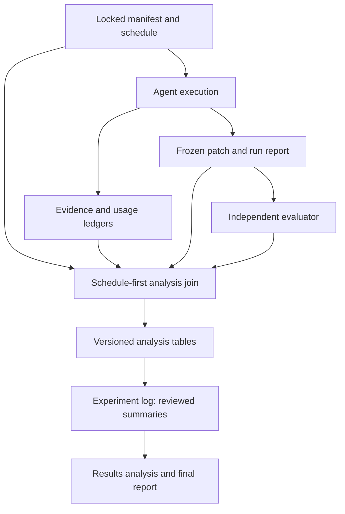

# Adaptive Agent Harness — 실험 기록서 (Experiment Log)

## 그래프 기반 실패 복구 및 동적 컨텍스트 최적화를 통한 코딩 에이전트의 신뢰성과 실행 효율 향상

**English title:** Adaptive Agent Harness: Graph-Guided Failure Recovery and Dynamic Context Optimization for Coding Agents

| 항목 | 내용 |
| --- | --- |
| 프로젝트 | Adaptive Agent Harness (AAH) |
| 수행 맥락 | 잇츠 스터디 5기 · Codex 기반 AI 코딩 에이전트 구축 |
| 작성일 | 2026-11-25 |
| 문서 버전 | v0.1.0 |
| 문서 상태 | S0 로컬 런타임 탐지 및 공개 fixture 검증 등록. 실제 모델 실험 미실행 |
| 실험 기준 | EXPERIMENT_DESIGN.md, BENCHMARK_SPEC.md, EVALUATION_PROTOCOL.md |
| 구현 기준 | TECHNICAL_SPEC.md, IMPLEMENTATION_PLAN.md, AGENTS.md |
| 변경·협업 기록 | DECISION_LOG.md, TEAM_ROLES.md |
| 후속 문서 | RESULTS_ANALYSIS.md, FINAL_REPORT.md, DEMO_SCENARIO.md |

> 이 문서는 실제로 발생한 실험, 실패, 비용, 설정 변경과 검증 근거를 기록하기 위한 운영 기록부다. 초기 양식에 포함된 계획 수량과 후보 설정은 측정값이 아니다. 실제 실행이나 승인 이력을 확인하지 않은 상태에서 성공률, 비용, 실행 로그, 담당자 승인 등을 작성하지 않는다.

---

## 1. 목적 및 기록 원칙

AAH의 실험은 동일 Codex 모델과 공통 실행 제약 아래 그래프 기반 복구와 DCC의 독립 효과 및 결합 효과를 검증한다. 기록부는 실험이 어떻게 수행되었는지, 어떤 설정으로 결과가 생성되었는지, 실패 및 제외가 어떻게 처리되었는지 추적할 수 있도록 한다.

- **계획과 관측의 구분:** 예정 과제 수, Pilot 후보값, 기대 성능, 실제 측정값을 별도로 관리한다.
- **모든 시도 보존:** 성공뿐 아니라 실패, 취소, 장애, 미실행 및 대체 실행도 남긴다. 실험 결과가 좋지 않다는 이유로 삭제하지 않는다.
- **원천 데이터 우선:** 이 Markdown은 사람이 검토할 운영 요약 및 증거 인덱스다. 수치의 원천은 버전이 고정된 manifest, 구조화 로그와 독립 평가 결과다. 직접 입력한 요약과 원천이 다르면 원천을 확인하고 정정 이력을 남긴다.
- **실험 분리:** 기술 검증, 개발용 Pilot, Main, 자연 발생 checkpoint, replay/주입, ablation 및 mock/fixture 결과는 별도 식별한다. 개발 과정의 모델 호출을 Main 결과에 합치지 않는다.
- **독립 평가:** 공개 검사는 복구에 사용할 수 있지만 hidden test, 정답 패치, 최종 독립 판정은 에이전트 및 복구 제어부에 전달하지 않는다.
- **변경 추적:** 동결 이후 연구 조건을 임의 변경하지 않는다. 필요한 변경은 DECISION_LOG의 승인과 새 실험 버전을 통해 관리한다.
- **공개 범위:** 비밀키, 인증 정보, 개인 정보, private 평가 데이터와 제한된 raw payload는 공개 기록부에 복사하지 않는다. 허용된 비식별 참조만 남긴다.

## 2. 현재 기록 상태

아래 표는 이 기록부에서 확인할 수 있는 증거를 표시한다. 외부 작업은 근거가 연결된 시점에 추가한다.

| 항목 | 관련 단계 | 현재 기록 상태 | 실제 증거 참조 |
| --- | --- | --- | --- |
| Runtime capability probe | S0, RT01–RT07 | DEV-01 범위 실환경·보완 검증 완료 | [S0 검증 기록](S0_VERIFICATION.md) |
| 실제 기본 실행 및 독립 평가 | G0 | GO | EL-20261126-012, [G0 판정](S0_VERIFICATION.md#g0-재판정) |
| 공통 실행 및 A/B 기준선 검증 | S1, IP06–IP10 | 완료. 합성 A/B 및 실제 A | EL-20261126-013/015, [S1 검증](S1_VERIFICATION.md) |
| 동적 컨텍스트 구성 | S2, IP11–IP14 | 구현 및 합성 B/C 검증 | EL-20261126-016, [S2 검증](S2_VERIFICATION.md) |
| 이중 그래프와 유형별 복구 | S3, IP15–IP19 | 구현 및 합성 D 검증 | EL-20261126-017, [S3 검증](S3_VERIFICATION.md) |
| A–E 통합 MVP 검증 | S4, IP20–24, G1 | 합성 비교·복원과 실제 LT02·LT04 통과. G1 승인 확인 | EL-20261126-018–021, [S4 검증](S4_VERIFICATION.md) |
| Pilot | IP25/IP30 | Dev 5과제에서 실환경 25/25 평가, 복구 전달 8회 | EL-20261126-022/023, EL-20261127-001, [S5 Pilot 실환경 결과](S5_PILOT_PREPARATION.md#pilot-실환경-결과) |
| Main 동결 및 공동 승인 | IP26–29/IP31, G2 | 공개 기준본 8개 검증, 큐레이터 Docker 평가 8개 통과 보고, AAH-S03 합성 Docker 및 MXC 권한 검사 A–E 통과, 실행기의 권한 해시 대조 A–E 일치, Main 일정·독립 평가 연결 합성 검증 5/5, 실행 경로·운영 평가기·동결 초안 준비(잠금 미충족 3건), 승인된 Main 과제 0개 | EL-20261127-002/003/005–023, [G2 사전 검증](G2_PREPARATION.md) |
| End-to-end Evaluation | IP32 | 미실행. G2 잠금 미충족(큐레이터 manifest, BQ14, 실행 승인·G2 공동 승인) | EL-20261127-023 |
| Common Failure Checkpoint | IP33 | 미등록 | — |
| Ablation Study | IP34 | 미등록 | — |
| 통계 분석 및 재집계 | IP35, G4 | 분석 파이프라인 구현, Dev Pilot 재집계 재현. Main 결과 없음 | EL-20261127-024, [결과 분석](RESULTS_ANALYSIS.md) |
| 최종 공개·시연 검증 | IP36, G5 | 미등록 | — |

실험 결과표, 실행 성공률 및 총 비용은 현재 산출하지 않는다. 기록이 없다는 사실을 비용 0, 성공 0건 또는 실패 0건이라는 측정으로 변환하지 않는다.

## 3. 기록 단위 및 추적 체계

### 3.1 식별자

기존 TECHNICAL_SPEC §3, §12–13과 EVALUATION_PROTOCOL §10의 계약을 유지한다. 아래 `EL`, `INC`, `FRZ` 접두사는 사람이 작성하는 기록부 항목을 위한 신규 운영 제안이며 런타임 enum이나 wire schema를 변경하지 않는다.

| 단위 | 식별자 | 역할 |
| --- | --- | --- |
| 운영 기록 | EL-YYYYMMDD-NNN | 실행 세션, 검증, Pilot 관측 등의 요약 |
| 실험 | experiment_id, protocol | 동결된 실험 및 프로토콜 식별 |
| 과제 | task_id, task_family_id, repo_id | 과제 및 군집 단위 연결 |
| 계획 슬롯 | slot_id | 실험·프로토콜·대상·조건·반복의 canonical key |
| 실제 시도 | run_id, attempt_index | 실행마다 별도 ID; 대체 시 replacement_of |
| 실패 상태 | checkpoint_id, source_run_id | source와 공통 복구 분기 연결 |
| 세부 증거 | snapshot_id, intervention_id, package_id, usage_id | 변경·개입·컨텍스트·비용 추적 |
| 장애/결측 리뷰 | INC-YYYYMMDD-NNN | 원인과 책임, disposition 결정 근거 |
| 동결 기록 | FRZ-YYYYMMDD-NNN | manifest, hash, 승인 및 변경 범위 |
| 설계 및 구현 | DL/OD, IP, RT, BQ, EP, AC | 기존 결정·작업·검증 ID 연결 |

`slot_id`와 `run_id`는 다르다. 미실행 슬롯에는 실제 run ID를 생성하지 않는다. 하나의 슬롯에 여러 시도가 있더라도 분석용 선택 판정은 최대 하나이며 실제 비용은 모든 시도를 별도로 보존한다. checkpoint source는 분기와 별도 run이다.

### 3.2 기록 구조 및 권한



독립 평가 결과에서 에이전트 실행 또는 복구 정책으로 돌아가는 경로는 없다. 기록부 및 분석 영역도 평가 에이전트의 접근 범위 밖에 둔다. 원시 payload 및 private 자료는 권한이 제한된 저장 위치를 사용한다.

### 3.3 실행 산출물 참조 (기존 계약)

```text
results/<experiment-id-or-local>/<run-id>/
├── manifest.json
├── events.raw.jsonl
├── restricted/
├── evidence.jsonl
├── checks.jsonl
├── transitions.jsonl
├── snapshots/
├── graphs/
├── interventions.jsonl
├── context.jsonl
├── usage.jsonl
├── final.patch
└── report.json
```

위 구조는 TECHNICAL_SPEC §12의 구현 예정 계약이다. 현재 파일이 생성되었다는 의미가 아니다. 독립 판정은 별도 평가 권한 영역에 저장한다. `schedule.csv`, `checkpoint_registry.jsonl`, 독립 `EvaluationResult` 및 TaskRegistry는 실험 수준의 조인 원천이다. 구체적인 평가 저장 위치는 안전한 구현 경계에 따라 정하며 사용자용 report에 private 판정을 넣지 않는다.

## 4. 실험 단계 및 계획 수량 인덱스

EXPERIMENT_DESIGN §9의 계획을 참조한다. 아래는 실행 전 후보이며 실제 예산 승인과 동결 결과를 §8에 등록한다.

| 단계 | 계획 | 수량 | 기록 참조 |
| --- | --- | ---: | --- |
| Probe / Smoke | RT01–RT07, 1–2개 과제 | 미정 | §6 |
| Pilot | Dev 5–8개 × A–E × 1회 | 25–40 | §7 |
| Main (Full) | 평가 24개 × A–E × 2회 | 240 | §9 |
| Checkpoint acquisition | 평가 과제 최대 24개 × 1회 | 최대 24 | §10 |
| Checkpoint branches | 목표 12개 × B–E × 1회 | 목표 48 | §10 |
| AB1 | 8개 checkpoint × 2조건 | 목표 16 | §11 |
| AB2 | 8개 checkpoint × 2조건 | 목표 16 | §11 |
| AB3 | 8개 과제 × 4조건 | 목표 32 | §11 |
| AB4 | 8개 checkpoint × 2조건 | 목표 16 | §11 |
| AB5–AB9 | 별도 승인 | 미정 | §11 |

Full P0는 312회, P1까지 모두 별도 실행할 경우 392회라는 계획값이다. 목표 checkpoint 확보를 가정하며 실제 실행 수, 호출 수, 크레딧, 과금액을 의미하지 않는다. 개발·probe·smoke·pilot 비용은 별도다. Core(200 Main), Reduced(120 Main), Emergency(40 Main) 등 축소안은 결과 열람 전에 승인한다. Emergency는 탐색적 평가다.

## 5. 공통 운영 기록 양식

실제 작업이 발생한 뒤 아래 양식을 복사하여 §17의 기록 인덱스에 추가한다. 원시 파일이 대량인 경우 run마다 Markdown을 수동 작성하지 않고 schedule 및 구조화 데이터에서 생성한 요약을 링크한다. 대표 사례와 장애는 별도로 상세 기록한다.

```markdown
### EL-YYYYMMDD-NNN — 기록 제목
- 기록 종류: PROBE / SMOKE / PILOT / MAIN / CHECKPOINT_SOURCE / CHECKPOINT_BRANCH / ABLATION / REPLAY / ANALYSIS
- 실행 근거: 실제 live / mock·fixture / 로그 replay / 분석 전용 (실제 성격 선택)
- 기록자 / 주관 역할 / 검토자:
- 실행 시작·종료 시각 / 시간대:
- 관련 IP / RT / BQ / EP / DL / OD:
- experiment_id / protocol / schema_version:
- code_version / config_hash / manifest_hash / schedule_hash:
- task_id 또는 예정 슬롯 범위 / condition / repetition:
- run_id 목록 또는 실제 시도 테이블 참조:
- 모델 ID / 추론 설정 / runtime 버전 / 인증 유형 (비밀값 금지):
- 환경 hash / 초기 snapshot / 필수 지침 hash / 세션 정책:
- 예산 및 계측 방식 / 실제 사용량 원천:
- 관측 결과 및 독립 판정 참조 (분리된 권한 영역):
- 발생 실패 / 결측 / 중단 / 대체 시도 및 INC 참조:
- 정책 변경 여부 / DL 및 FRZ 참조:
- 검증 한계 / 미확인 사항:
- 다음 작업 및 검토 상태:
```

실제 실행 시각은 offset이 포함된 시각으로 기록하고, 기간 계산은 monotonic elapsed time을 우선한다. 기록 작성일과 실행 발생일이 다르면 각각 표시한다. 원천 참조에는 가능한 commit/hash와 접근 가능한 파일 위치를 함께 기록한다.

## 6. 기술 검증 및 Smoke 기록 (S0–S4)

### 6.1 Runtime capability probe

| ID | 확인 대상 | 실제 관측 / 지원 범위 | 검증 상태 | 증거 참조 |
| --- | --- | --- | --- | --- |
| RT01 | 모델·버전·추론 설정 및 실제 실행 | CLI 0.166.0, `gpt-6-luna`/`low` 요청, 실행 ID 및 턴 완료 기록 | Dev 실행 기록 확인 | EL-20261125-001, EL-20261126-008 |
| RT02 | 이벤트 목록, 원시→정규화 및 누락 범위 | 실제 관측 유형 7개 대조. 합성 JSONL로 요약 정규화와 미지원·오류 건수 확인 | S0 Dev 검증 완료 | EL-20261126-008, EL-20261126-011 |
| RT03 | 실제 후속 요청 및 세션 정책 | 실제 두 턴의 스레드 UUID와 후속 응답의 확인 코드 일치 | Dev resume 점검 PASS | EL-20261126-009 |
| RT04 | timeout/cancel 및 잔존 프로세스 | MXC 전경 프로세스와 실제 Codex 턴에 각각 타임아웃·취소 적용. 네 사례 모두 종료 확인 및 잔존 0개 | PASS | EL-20261126-009, EL-20261126-010 |
| RT05 | 필수 지침·권한·cwd·원본 보호 | MXC 사전 점검, 실제 턴 이후 원본·합성 보호 파일 보존, DEV-01 고정 지침을 포함한 입력 해시 일치 | Dev 권한 경계 점검 PASS | EL-20261126-008, EL-20261126-009 |
| RT06 | 공개 검사와 private 평가 접근 경계 | 실제 Docker 평가 실행 경로에서 합성 평가 입력·ledger 접근 차단 및 호스트 파일 보존 | Dev Docker 경계 점검 PASS | EL-20261126-004, EL-20261126-008, EL-20261126-009 |
| RT07 | usage mode, 추정기, 강제 가능 여부 | 고정 CLI는 `CUMULATIVE`. 같은 스레드에서 후속 턴 차분을 재현했고 두 중단 턴은 결측. Dev 입력 추정기 `utf8-bytes-div4-v1`, 한도 `observe_only` | S0 Dev 관측 모드 검증 완료 | EL-20261126-009, EL-20261126-010, EL-20261126-011 |

실제 지원 여부는 명령/버전 정보, 승인된 실행 기록 및 테스트 증거로 확인한다. RT04–RT06 안전 검증 미충족 시 연구 실행 금지. RT03 미충족 시 복구 기능을 완료로 표시하지 않는다. mock은 파서와 제어 흐름 테스트를 위한 증거이지 live 기능의 증거가 아니다.

### 6.2 기술 검증 세션 양식

```markdown
### EL-... — Capability / Smoke
- 대상 RT / LT / 관련 IP / AC:
- 사전 인증·권한·격리·비용 승인 참조:
- runtime / model / 환경 / fixture 버전:
- 테스트 종류: mock / live / replay
- 테스트 명령 또는 테스트 ID:
- 기대 관측 / 실제 관측:
- 지원 / 미지원 / 관측 불가 범위:
- 취소·정리·파일 접근 경계 검증:
- event 및 usage coverage / raw 참조:
- 독립 평가 및 patch hash 연결 (해당 시):
- 통과·실패·미수행 / 실패 이유:
- G0/G1 승인 요청 또는 blocker / 담당자:
```

## 7. Pilot 기록 (IP30)

Pilot은 개발용 과제에서만 임계값, 모델·실행 환경, 정책 동작, 재현성 및 비용을 검증하는 단계다. Main 과제의 hidden 결과를 보고 정책을 조정하지 않는다. Pilot 결과는 Main 성능표에 합치지 않는다.

### 7.1 Pilot 세션 기록

| Pilot ID / EL | Dev task manifest | 설정 버전 | 실행 범위 A–E | 실제 live/fixture | 산출물·비용 참조 | 검토 |
| --- | --- | --- | --- | --- | --- | --- |
| `s5-dev-pilot-20261126` / EL-20261127-001 | DEV-01~05 | CLI 0.166.0 · `gpt-6-luna`/`low` | 각 조건 5회, 총 25/25 평가 | 실제 Codex 및 독립 Docker 판정 | 18 PASS, 7 FAIL, 총 33턴 및 2,298,144 모델 토큰 | [실측 및 증거](S5_PILOT_PREPARATION.md#pilot-실환경-결과) |

추가 기록: 정상/실패 경로, 실제 후속 요청 전달, B/D 및 C/E 최초 패키지 parity, B–E trigger parity, 그래프/DCC 격리, checkpoint 복원, 독립 평가, usage 관측 범위 및 비용 측정. 검증되지 않은 항목은 별도 blocker로 기록한다.

### 7.2 정책 조정 기록

| 설정 | 기존 Pilot 시작 후보 | 실제 적용값 | 관측 근거 | 변경안 / DL·OD |
| --- | --- | --- | --- | --- |
| T1 반복 횟수 | 2 | — | — | — |
| T2 관측 구간 / 중복 임계값 | 6 / 0.67 | — | — | OD-04 |
| trigger priority | T3 → T1 → T2 → T4 | — | — | — |
| 그래프 깊이 / 방문 / 분기 / top-k | 4 / 200 / 20 / 8 | — | — | — |
| edge 비용 / 추정 추가 비용 | 1 / 1 | — | — | — |
| 진단 점수 가중치 | (0.4, 0.3, 0.15, 0.15) | — | — | — |
| DCC 초기 가중치 | (0.5, 0.3, 0.2, 0) | — | — | — |
| DCC 복구 가중치 | (0.25, 0.2, 0.2, 0.35) | — | — | — |
| 중복 패널티 | 0.2 | — | — | — |
| 초기 / 복구 보조 정보 cap | 각각 2,048 추정 토큰 | — | — | — |
| 개입 / 전이 / cleanup reserve | 2회 / 100 / 15초 | — | — | — |

출처: DECISION_LOG §10.1, METHODOLOGY §15, TECHNICAL_SPEC §4.1. 4/6은 0.67 미만이므로 경계 사례를 검증하고, 필요하면 동결 전 정확한 기준을 승인한다. 이 표는 config를 대체하지 않는다.

### 7.3 Pilot 비용 및 자원 검토 양식

| 단계 / 조건 | 유효 사용량 관측 수 / 시도 수 | 평균 / 중앙값 | p90 (표본 충분 시) | 시간 | 비용 종류 / 단위 | 관측 누락 및 한계 |
| --- | --- | --- | --- | --- | --- | --- |
| Dev Pilot 전체 | 25/25 | 91,925.76 / 78,632 | — | 실행·평가 합계 976.602초 | CLI 관측 모델 토큰 | 화폐 결제액과 크레딧 미관측. 시간에 전체 사전 점검과 슬롯 간 대기 제외 |

추정 총비용은 단계·조건별 예정 실행 수 × Pilot 단위 비용 + probe/dev + reserve로 계산한다. 실제 예산 단위별로 산정하고 초기 reserve 20% 권고를 검토한다. 크레딧 만료와 실제 운영 마감은 확인 자료를 첨부한다. 표본 수, 계획안 및 중단 한도는 결과 열람 전에 승인한다.

## 8. 본실험 동결 및 승인 (IP31, G2)

G0/G1 및 Pilot 완료, Main 과제 BQ 검증, EP 평가 계약 확인 이후 다음 양식을 실제로 작성한다. 미확정 필드를 임의로 채우지 않는다.

```markdown
### FRZ-YYYYMMDD-NNN — Experiment freeze
- 실험 ID / protocol / version / 부모 실험 ID:
- Full / Core / Reduced / Emergency 및 선택 이유:
- G0 / G1 / Pilot / BQ / EP 검증 증거:
- code commit / schema versions / runtime capability ref:
- 실제 model ID / reasoning / CLI·SDK version / session policy:
- task manifest hash / source revisions / split / family / 문서 상태:
- 환경 및 test bundle hash / evaluator version:
- 정책 및 설정 hash / renderer / tokenizer estimator / fallback:
- schedule hash / execution_order_seed / block / 동시성:
- source 순서 / checkpoint 상한 / AB subset 및 재사용 규칙:
- 턴·시간·개입·전역 예산 / token_limit_mode / 비용 계측 범위:
- 통계 config hash / primary family / bootstrap / 허용 손실 폭:
- 결측·인프라 대체 규칙 / 사전 중단 조건:
- 결과 열람 여부 및 잠금 시각:
- RH / GR / CE 실제 승인자와 승인 근거:
- 변경 발생 시 관련 DL / 새 실험 버전:
```

동결 기록 인덱스:

| FRZ | experiment_id | manifest/hash | 승인 근거 | 상태 | 후속 버전 |
| --- | --- | --- | --- | --- | --- |

Main 동결 이후 정책, 과제, 평가 테스트, 모델, 분석 기준 변경이 불가피하면 기존 원시 자료를 보존하고 DECISION_LOG §11을 적용한다. 변경 전후 결과를 같은 실험으로 임의 합산하지 않는다.

G2에서는 실험 설계 §14.2의 계획 slot·source 순서·적격성·생성 및 subset 규칙을 잠근다. 자연 checkpoint 확보 뒤 결과와 독립적으로 생성한 분기/AB schedule에는 부모 동결 참조, 파생 hash, 미확보·미생성·예산 미실행의 구분을 등록한다. 계획 슬롯에 실제 run ID는 미리 부여하지 않는다.

## 9. End-to-end Evaluation 기록 (IP32)

### 9.1 비교군 및 기록 범위

| 조건 | 초기 보조 정보 | 복구 방식 | 복구 패키징 |
| --- | --- | --- | --- |
| A — Vanilla Codex | 외부 패키지 없음 | 외부 개입 없음 | 해당 없음 |
| B — Flat Retry | DEFAULT | Flat + GENERIC | DEFAULT |
| C — Context-only | DCC | Flat + GENERIC | DCC |
| D — Graph-only | DEFAULT | Graph + TYPED | DEFAULT |
| E — Adaptive Harness | DCC | Graph + TYPED | DCC |

A는 실용 참조군이며 B–E만 2×2 요인 분석에 포함한다. 모든 조건의 공통 원천 접근 범위, 필수 지침, 실행 환경 및 전역 제한을 유지한다. B–E의 감지·개입 기회는 동일해야 한다. A는 외부 개입 없이 native 반복을 허용한다. D에 DCC 전용 점수를, B/C에 그래프 파생 정보를 전달하지 않는다.

### 9.2 실행 블록 운영 기록

| EL / experiment_id | block / task / repetition | 예정 조건 순서 | 실제 순서 | 완료 슬롯 / 예정 슬롯 | 이상·중단 참조 |
| --- | --- | --- | --- | --- | --- | --- |

계획 순서와 실제 순서 차이, 공급자 장애, 동시성 및 자원 경합, 캐시 상태, 모델 변경 여부를 기록한다. 실행 순서 seed는 모델 샘플링 seed와 구분한다. 미실행 슬롯도 schedule에서 제거하지 않는다.

### 9.3 조건별 집계 현황 (실제 데이터 입력 전)

| 조건 | 예정 슬롯 | 실제 시도 | 유효 성공 | 유효 실패 | 결측 | 미실행 | 검토 대기 | 집계 참조 |
| --- | ---: | ---: | ---: | ---: | ---: | ---: | ---: | ---: | --- |
| A | — | — | — | — | — | — | — | — |
| B | — | — | — | — | — | — | — | — |
| C | — | — | — | — | — | — | — | — |
| D | — | — | — | — | — | — | — | — |
| E | — | — | — | — | — | — | — | — |

실제 시도 수에는 승인된 대체 실행을 포함한다. 유효 결과·결측·미실행은 슬롯 기준으로 집계하며 `INVALID_TASK`는 집계 참조에서 별도로 표시한다. Main 과제의 성공 여부는 독립 평가기만 판정한다. 자연 실패가 발생한 E2E 실행에 한정한 복구율은 기술 통계이며 순수 정책 효과로 주장하지 않는다.

## 10. Common Failure Checkpoint 기록 (IP33)

### 10.1 Source 확보 기록

사전 지정 순서의 평가 과제를 B와 같은 DEFAULT 초기 정책으로 실행하고 첫 eligible trigger까지 외부 복구 지침을 제공하지 않는다. Main에서 결과가 좋은/나쁜 run을 골라 재사용하지 않는다. T1–T4, 공통 gate, 잔여 예산, 지원 실행 경계 및 안전한 snapshot 복원이 확보되어야 한다. T5 또는 인프라 오류만 발생한 상태는 자연 checkpoint에 포함하지 않는다.

| source_run_id | task_id / 사전 순번 | trigger / gate | eligible | selected | checkpoint_id | 미확보·미선택 이유 | source 비용 참조 |
| --- | --- | --- | --- | --- | --- | --- | --- |

미발생 source, 적격이지만 목표 개수 상한으로 미선택된 source도 기록한다. 자연 발생, 인위적 주입 및 replay는 프로토콜을 분리한다.

### 10.2 Checkpoint 검증 양식

```markdown
### EL-... — 공통 실패 체크포인트
- checkpoint_id / source_run_id / task_id:
- 사전 지정 source 순서 및 첫 eligible 관측 근거:
- initial_policy_hash / trigger_ids / anchor_ids:
- snapshot_id / workspace_bundle_ref 및 hash:
- tracked, untracked, 삭제 파일 복원 검증:
- common_evidence_ref/hash / common_history_ref/hash:
- fixed_requirements_hash / environment_hash:
- remaining_limits / initial_usage_refs:
- session_clone_verified / 실제 공통 세션 정책:
- 분기 B–E 각각의 restore 검증 및 run ID:
- 정책별 독립 재계산 / 동일 원천 및 예산 확인:
- source, restore, branch 비용 참조:
- 적격성·대표성 제한 및 검토자:
```

내부 세션 복제가 검증되지 않으면 모든 분기에 동일한 NEW_SESSION 및 공통 이력 요약을 적용한다. 복구 분기에는 최초 DCC를 별도로 수행하지 않는다. 각 분기의 그래프와 컨텍스트는 독립적으로 계산한다.

### 10.3 분기 결과 기록

| checkpoint_id | B run_id / 판정 | C run_id / 판정 | D run_id / 판정 | E run_id / 판정 | 공통 상태 검증 | disposition 참조 |
| --- | --- | --- | --- | --- | --- | --- |

주 FRR은 공통 유효 checkpoint에서의 독립 PASS 비율이다. 1차 개입 후 공개 검사 개선과 최종 복구 성공을 구분한다. checkpoint 발생률 및 확보 비용은 별도 집계한다. 실제 총지출에는 source 비용을 한 번만 더하고, 사용자 관점의 재구성 비용은 source + 해당 branch로 따로 표시한다. restore 비용도 분리한다. 동일 checkpoint 분기는 실제 호출 및 독립 결과로 입증한다.

## 11. Ablation Study 기록 (IP34)

| ID | 조작 / 비교 | 반드시 유지할 요소 | 실제 수행 / 참조 |
| --- | --- | --- | --- |
| AB1 | Linked vs Unlinked | 두 그래프, 원천 증거 접근 및 공통 예산; cross-graph traversal만 제거 | 미등록 |
| AB2 | TYPED vs GENERIC_RETRY | 동일 checkpoint, 진단 및 evidence 패키지; 전략 메시지만 변경, 양측 cap 재검증 | 미등록 |
| AB3 | Neither / Initial-only / Recovery-only / Both | Graph ON, 단계별 DCC 조작 이외 동일 | 미등록 |
| AB4 | Graph vs Flat retrieval | 동일 원천 후보, GENERIC_RETRY, DCC 및 상한 | 미등록 |
| AB5 | Repo-only / Exec-only | 원천 접근 보존, 특정 그래프 탐색 제거 | 미등록 |
| AB6 | 유효성 검사 / 중복 제거 효과 | 필수 지침 및 공통 보안 guard 유지 | 미등록 |
| AB7 | Static / Retrieval / DCC | 사전 구성 과제 및 예산 기준, 길이 차이 별도 표시 | 미등록 |
| AB8 | 관계 의미의 효과 | 무작위 엣지를 실제 코드 관계로 전달하지 않음 | 미등록 |
| AB9 | 선행연구 직접 비교 | 실제 공개 구현·지원 범위 및 별도 승인 | 미등록 |

실제 실행 전 subset, 비교 정책, 공통 조건 및 재사용 여부를 동결한다. AB2는 1차 개입에서 전략 메시지만 교체하도록 하며 후속 복구 정책 차이를 전략 자체의 순수 효과로 섞지 않는다. AB3의 D/E 결과 재사용은 동일 구현 버전·설정·과제·반복·schedule block 조건 충족 시에만 허용한다. AB1/AB2를 수행하지 않으면 명시적 연결 또는 전략 변경의 독립 효과를 주장하지 않는다.

```markdown
### EL-... — ABx
- 가설 / 조작 변수 / 비교군 / 사전 subset 참조:
- 공통 checkpoint 또는 task block / 반복:
- 고정 요소 / 실제 변경된 config diff / parity 증거:
- 기존 run 재사용 여부, 요건 확인 또는 신규 run ID:
- 실제 사용량 및 독립 평가 참조:
- 결과와 해석 가능 범위:
- 미수행 조건 및 이유 / 변경 승인:
```

## 12. 실패 사례 및 개입 기록

대표 사례는 성공적인 복구뿐 아니라 실패 복구, 불필요한 개입, fallback 및 관측 불가 사례를 포함한다. 사례를 선택한 기준 및 전체 사례 수를 기록한다. 에이전트 내부의 비공개 추론을 관측했다고 주장하지 않는다.

### 12.1 실패 유형

| ID | 관측 조건 | 사례 기록 시 확인할 근거 |
| --- | --- | --- |
| T1 | 동일 실패 지문 반복 | 비교 가능한 공개 검사, 지문·개선 여부 |
| T2 | 탐색 정체 | 비교 가능한 탐색 행동, 중복 분모, 신규 증거 및 진전 여부 |
| T3 | 회귀 | 동일 검사 조건에서 PASS → FAIL |
| T4 | 완료 선언과 공개 필수 검사 FAIL | 실제 완료 선언 및 공개 검사 |
| T5 | 분류 불가 또는 환경 장애 | 누락 범위 및 안전한 실행 가능성; 강제 복구 금지 |

동시에 발생한 신호를 보존하고 primary 우선순위는 동결된 정책을 따른다. 실패 지문 일치나 그래프 근접성은 실제 원인의 증명이 아니다.

### 12.2 사례 기록 양식

```markdown
### EL-... — 실패/복구 사례
- 실험 ID / slot_id / run_id / condition / task_id:
- 공개 증거 시점 / snapshot / 공개 check ID 및 비교 가능성:
- trigger IDs / primary / fingerprint / gate reason:
- 그래프 version / anchor / 관련 경로 / 관측·추정 관계:
- 진단 후보 및 근거 / unresolved 또는 fallback:
- strategy ID (GENERIC_RETRY / REVIEW_REGRESSION / RELOCALIZE / REFRESH_EVIDENCE / CONTINUE / STOP):
- 대상 및 검증 계획 / 실제 수행 관측 범위:
- context policy / package ID / 유효성·선별·제외 사유 / 추정 토큰:
- intervention_id / 예약·전달·실패 상태:
- 다음 공개 검사 및 최종 공개 검사 변화:
- 독립 최종 판정 참조 (분석 영역 전용):
- 전후 사용량·시간 / 대조 checkpoint 및 비교 조건:
- 관측 사실 / 가능한 해석 / 불확실성:
```

개입 ledger의 DECIDED, PACKAGE_READY, RESERVED, DELIVERED, DELIVERY_FAILED, OUTCOME_OBSERVED와 UNKNOWN_DELIVERY를 구분한다. 전달 불명확 시 성공 전달로 기록하거나 자동 중복 재실행하지 않는다. 전략 수행은 performed/not_observed/contradicted/unknown으로 구분하고, 모델 주장만으로 performed를 부여하지 않는다. 공개 검사 변화는 IMPROVED/WORSENED/MIXED/UNCHANGED/UNKNOWN을 사용한다. 악화 관측을 개입의 인과적 효과로 자동 해석하지 않는다.

## 13. 종료, 결측, 장애 및 대체 실행

### 13.1 상태 계층

| 계층 | 원천 | 예시 |
| --- | --- | --- |
| 실행 종료 | RunReport.stop_reason | COMPLETED, GLOBAL_LIMIT, CANCELED, RUNTIME_ERROR, ARTIFACT_ERROR |
| 독립 평가 | EvaluationResult.status | PASS, FAIL, INFRA_ERROR, NOT_EVALUABLE, NOT_RUN |
| 분석 상태 | AnalysisDisposition | 아래 표 참조 |

| disposition | y/z | 설명 |
| --- | --- | --- |
| VALID_SUCCESS | 1 | 타당한 독립 PASS |
| VALID_FAILURE | 0 | 독립 FAIL 또는 방법 책임의 유효 산출물 미생성 |
| MISSING_INFRA | null | 확인된 외부 환경 장애로 유효 판정 불가 |
| MISSING_EXTERNAL_CANCEL | null | 성능과 무관한 외부 취소, 사전 규칙 충족 |
| NOT_RUN_BUDGET | null | 프로젝트 예산 상한으로 미시작 |
| NOT_RUN_OTHER | null | 기타 미시작 |
| INVALID_TASK | null | 독립 검토를 통해 과제 무효, 모든 조건 공통 적용 |
| PENDING_REVIEW | null | 책임·원인 미확정 |

GLOBAL_LIMIT으로 끝나도 유효한 최종 patch가 독립 평가를 통과하면 성공이다. 사용량만 누락되면 성공 판정은 유지하며 비용만 결측 처리한다. runtime 오류 코드만으로 제외하지 않고 원인 및 책임 경계를 확인한다.

### 13.2 장애 및 판정 리뷰 양식

```markdown
### INC-YYYYMMDD-NNN — 장애 / 결측 / 안전 중단
- 발견일 / 보고자 / 관련 EL·DL / experiment_id:
- slot_id / run_id / attempt_index:
- 원래 stop_reason / evaluation_status / 오류 코드:
- 관측 증거 및 책임 경계 (방법 / 외부 / 불명확):
- 영향 범위 (다른 조건·과제·비용·보안):
- 즉시 조치 및 안전한 정리 증거:
- 분석 disposition / reason_code / 판정 근거:
- 원본 보존 위치 / 사용량 coverage:
- 대체 실행 허용 여부 및 사전 규칙 참조:
- replacement_of 및 신규 run_id (실제 승인·실행한 경우만):
- 리뷰어 / 조건·결과 열람 여부 / 승인 시각:
```

기본 자동 대체 실행은 금지다. 확인된 외부 인프라 장애에 대한 최대 1회 대체 실행은 Pilot 후 사전 승인할 운영안이며 OD-11에 연결한다. 성능 실패·시간 초과·높은 비용·낮은 성공률은 대체 사유가 아니다. 원 시도와 대체 시도를 모두 보존한다. 과제 무효 판정은 같은 과제 전체 조건에 공통 적용한다. 안전·격리 위반 시 실행을 중단하고 L3 변경 절차를 따른다.

## 14. 사용량·비용·시간 회계 기록

### 14.1 집계 원칙

- UsageRecord의 고유 `usage_id`, `run_id`, stage, source, usage_mode, coverage와 raw_ref를 확인한다.
- DELTA는 고유 이벤트를 1회 합산하고 CUMULATIVE는 검증된 scope의 차분만 사용한다. UNKNOWN과 누락분은 0으로 대체하지 않는다.
- cached/reasoning이 input/output의 부분집합이면 다시 더하지 않는다. 포함 관계는 RT07에서 검증한다.
- 초기·후속 실행 및 추가 모델 호출을 포함한다. DCC의 보조 패키지 추정 토큰은 실제 모델 입력과 별도다.
- 실제 과금, 추정 과금, 토큰, 구독 크레딧을 서로 다른 단위로 관리한다. 가격 근거와 유효 일자를 기록한다.
- 그래프 구축·탐색, DCC, snapshot, 공개 검사, 복원, 독립 평가 시간 등은 별도 계측한다. 중첩되는 시간은 무조건 합산하지 않는다.
- 주 CPS는 선택된 유효 슬롯의 전체 성공·실패 비용을 포함한다. 실제 운영 지출은 제외된 인프라 및 대체 시도까지 포함하여 별도 보고한다.

### 14.2 자원 사용 현황 표

| 단계 / experiment_id | 실제 시도 수 | 완전 usage 수 | model tokens | known subtotal (부분) | 실제 과금 / 통화 | 추정 과금 / 통화 | 크레딧 / 단위 | 시간 참조 |
| --- | ---: | ---: | ---: | ---: | --- | --- | --- | --- | --- |

사용량 및 금액의 원천과 귀속 범위를 첨부하고, 추정치는 versioned price sheet로 재현할 수 있게 한다. 분모가 0인 지표는 N/A로 표시하고 원시 숫자 필드는 null 또는 CSV 빈 값으로 보존한다. 성공 수가 0이면 CPS는 유한값으로 계산하지 않고 NO_SUCCESS를 기록한다.

### 14.3 예산 중단 기록

| EL / FRZ | 예산 단위 / 상한 | 실제 확인된 사용 | 잔여량 / 관측 한계 | 중단 시각 | 미실행 슬롯 참조 | 사유 |
| --- | --- | --- | --- | --- | --- | --- | --- |

전역 상한으로 미시작된 슬롯은 NOT_RUN_BUDGET으로 남긴다. 비용을 이유로 이미 종료한 run을 삭제하지 않는다. 계획 수량이 실제 호출 수와 다를 수 있음을 유지한다.

## 15. 결과 집계, 통계 분석 및 재현성

EVALUATION_PROTOCOL §10–11의 표준 projection을 사용한다. 사람이 작성하는 요약표는 원시 자료와 독립 평가 판정의 대체물이 아니다.

| 산출물 | 행 단위 / 연결 |
| --- | --- |
| run_status.csv | 계획 slot, 선택 run, disposition, y, 종료 및 평가 상태 |
| run_attempts.csv | 실제 run, attempt_index, replacement_of, 선택 여부 |
| run_metrics.csv | 선택 slot, 토큰·비용·시간·준수 및 행동 지표 |
| checkpoint_summary.csv | source run, 적격·선택·checkpoint·비용 |
| intervention_metrics.csv | 개입 ID, 전략, 전달 및 공개 검사 변화 |
| metric_summary.csv | 조건 × 지표 × 분석 집합, 분자·분모·coverage |
| paired_contrasts.csv | 대비, effect, CI, task/cluster 수, 해석 상태 |
| analysis_sets.json | 분석 집합의 포함·제외 ID 및 config hash |

schedule을 기준으로 left join하여 미실행 슬롯을 보존한다. 중복 판정, run/slot 불일치, patch hash 불일치, 사용량 중복, 누락된 source/branch 참조는 검토 대상으로 지정한다. 원천과 집계의 버전을 저장하고 분석을 재실행해 결과를 검증한다. 분석 코드의 재실행은 모델 호출과 구별한다.

### 15.1 분석 등록 양식

```markdown
### EL-... — Analysis / Reaggregation
- experiment_id / FRZ / code commit / analysis config hash:
- 원시 자료 manifest 및 독립 평가 참조:
- 분석 집합 ID / 공통 유효 task·slot·checkpoint·cluster 수:
- 제외·결측 사유 및 민감도 분석 범위:
- 비용 관측 완전성 및 단위:
- P-R1 / P-R2 / P-R3 및 보조 대비 결과 참조:
- task/task-family paired cluster bootstrap 설정 / seed / 10,000회 및 95% 구간:
- 검정 수행 여부 / Holm 적용 범위 / 비열등성 기준과 해석 제한:
- undefined replicate 수 / 표본 정밀도 및 군집 한계:
- EP30 등 재집계 검증 / 결과 파일 hash:
- 분석자 / 교차 검토자 / 변경·정정 이력:
```

주 대비는 EXPERIMENT_DESIGN §2.1의 P-R1(B→C 성공당 모델 토큰), P-R2(checkpoint B→D 복구율), P-R3(E와 max(C,D)의 E2E 성공률 차이)를 유지한다. 통계적 유의성 검정은 가정과 사전 승인 요건을 충족할 때 수행한다. 실패 사례만 선별한 비교 또는 단순 반복 run을 독립 과제처럼 취급하는 분석을 금지한다. 결과 및 구간은 실제 분석 이후 RESULTS_ANALYSIS에 등록한다.

## 16. 운영 책임, 게이트 및 제출 증빙

| 단계 | 기존 담당 | 기록할 최소 증거 |
| --- | --- | --- |
| G0 | RH 중심, 공동 검토 | RT01–07, 안전 경계, 실제 기본 실행·평가 |
| G1 | 공동 | 통합 live 흐름, AC01–08, parity·checkpoint 검증 |
| IP30 / G2 준비 | 공동 | Pilot, BQ/EP, 비용·설정 조정 |
| IP31 / G2 | RH·GR·CE 공동 승인 | 잠긴 manifest, schedule, 정책·과제·분석 hash |
| IP32 / Main | RH 운영/공동 | A–E 전체 슬롯·실제 시도·독립 판정 |
| IP33 / checkpoint | RH/GR | source 전체 및 분기·복원·비용 |
| IP34 / ablation | GR/CE | 조작 검증, 수행/미수행 및 근거 |
| IP35 / G4 | CE/공동 | 분석 집합, 대비 및 불확실성, 재집계 |
| IP36 / G5 | 공동 | 보고서, README, 실제 로그 시연, 공개 검토 |

실제 사람 배정 및 검토자는 TEAM_ROLES에서 합의한다. 위 표는 기존 역할을 새로 배정하지 않는다. 운영 기록의 작성과 승인은 구분한다. 날짜 경과나 문서 작성만으로 게이트를 통과시킬 수 없다.

공개 자료에는 승인된 비식별 로그, 실제 수치와 신뢰구간, 비용 단위, 재현 명령, 버전, 실패 사례를 포함한다. 미구현 기능이나 모의 실행은 명시한다. 학습·협업 증빙은 작업 ID, PR, 검증 결과, 참여자 실제 기여를 연결하되 private 평가 자료를 노출하지 않는다.

## 17. 실제 운영 기록 인덱스 (Append-only)

날짜별 기록을 아래에 추가한다. 정정은 기존 ID를 참조하는 새 기록으로 남긴다.

| EL ID | 발생일 | 종류 | 관련 experiment / run | 관측 요약 | 증거 ref | 기록·검토자 |
| --- | --- | --- | --- | --- | --- | --- | --- |
| EL-20261125-001 | 2026-11-25 | PROBE / 공개 fixture 검증 | S0, 연구 실행 ID 없음 | 설치된 CLI 메타데이터, DEV-01/02의 기준본·수정본 판정, Windows 프로세스 정리 | [시험 명령·판정·fixture ID](S0_VERIFICATION.md) | 개발 세션 기록, 팀 검토 대기 |
| EL-20261126-001 | 2026-11-26 | PROBE / Dev 입력 준비 | S0, 모델 실행 0건 | DEV-01 입력 ZIP 재현, Docker Desktop 기동 후 이 세션의 로컬 엔진 접근 거부 | [입력 해시·컨텍스트·미결 승인](S0_VERIFICATION.md#dev-01-첫-실행-준비) | 개발 세션 기록, 팀 검토 대기 |
| EL-20261126-002 | 2026-11-26 | PROBE / Docker Desktop | S0, 모델 실행 0건 | 사용자 셸에서 Linux 엔진 29.9.3과 고정 이미지의 Python·UID·읽기 전용 루트·인터페이스 확인. 개발 세션의 합성 검사는 엔진 접근 거부로 INCOMPLETE | [사용자 제공 출력·이미지 digest·합성 검사 명령](S0_VERIFICATION.md#dev-01-첫-실행-준비) | 사용자 출력과 개발 세션 기록, 팀 검토 대기 |
| EL-20261126-003 | 2026-11-26 | PROBE / Docker 합성 검사 | S0, 모델 실행 0건 | 사용자 셸의 probe 9/9 PASS. 사본만 마운트·수정, 합성 보호 자료 3개 보존, 부모·자식 강제 종료 후 컨테이너 제거 | [probe ID·원본 해시·관측 범위](S0_VERIFICATION.md#docker-합성-검사-결과) | 원본 보고서와 호스트 파일 대조, 팀 검토 대기 |
| EL-20261126-004 | 2026-11-26 | EVALUATION / 공개 Dev fixture | S0, 모델 실행 0건 | DEV-01/02 기준본 FAIL·수정본 PASS, 공개 검사 8건과 패치 재적용 4건 대조. EP01 공개 Dev 범위 충족 | [실행 ID·패치·요약 해시·판정 범위](S0_VERIFICATION.md#docker-독립-평가-결과) | 사용자 셸에서 실행, 저장 산출물 대조, 팀 검토 대기 |
| EL-20261126-005 | 2026-11-26 | PROBE / 실제 실행 사전 점검 | S0, 모델 실행 0건 | DEV-01 실행 요청 후 Docker 엔진 및 Codex Windows 샌드박스 사전 점검에서 접근 거부. 모델 전달 전 중단 | [접근 거부 및 G0 상태](S0_VERIFICATION.md#dev-01-실제-실행-사전-점검) | 개발 세션 기록 |
| EL-20261126-006 | 2026-11-26 | PROBE / DEV-01 운영자 실행기 | S0, 모델 실행 0건 | 사용자 셸에서 기본 MXC 점검 종료 코드 0. 전용 실행기를 연결했고 개발 세션에서는 MXC 보호 경계 사전 점검에서 접근 거부 | [실행 명령과 확인 범위](S0_VERIFICATION.md#dev-01-운영자-실행) | 개발 세션 기록, 실제 운영자 실행 대기 |
| EL-20261126-007 | 2026-11-26 | DEV-01 실제 실행 | `f04c50ee-92d4-41b0-a7d1-3f6ed3d291c6` | MXC·Docker·ChatGPT 로그인 사전 점검 통과. 첫 Codex 턴은 실패했고 사용량·패치·판정 미관측 | [첫 턴 기록 및 모델 교체](S0_VERIFICATION.md#첫-codex-턴-시작과-모델-교체) | 사용자 셸에서 실행, 보고서 대조 |
| EL-20261126-008 | 2026-11-26 | DEV-01 실제 실행·독립 평가 | `d5a2fcc7-3fd8-4bf2-bc2c-7a6b5270af7d` | Codex 턴 완료 및 정리 확인. 빈 패치의 `tab-edges` 기능 검사 FAIL·회귀 PASS. 독립 판정 FAIL | [첫 실제 완료 턴 및 판정 근거](S0_VERIFICATION.md#첫-실제-턴-완료-및-독립-판정) | 사용자 셸에서 실행, 요청·판정·패치 해시와 재생 확인 |
| EL-20261126-009 | 2026-11-26 | DEV-01 런타임 점검 | `a0c90602-5e15-46d6-b5e1-a746dcbe6972` | RT03·RT05·RT06 PASS. RT04 대상 턴 두 건이 정상 종료됐고 타임아웃·취소 미발동 | [런타임 관측 및 보고서 해시](S0_VERIFICATION.md#운영자-런타임-점검-결과와-rt04-재검증) | 사용자 셸에서 실행, RT04 재검증 대기 |
| EL-20261126-010 | 2026-11-26 | DEV-01 RT04 재검증 | `7c784b57-bb0c-401d-a0e6-d5fb57719ecc` | RT04 PASS. 네 사례에서 타임아웃·취소와 잔존 프로세스 0개 확인. 중단 두 턴의 usage는 `null` | [RT04 사례 및 보고서 해시](S0_VERIFICATION.md#운영자-rt04-통과) | 사용자 셸에서 실행, [G0 재판정](S0_VERIFICATION.md#g0-재판정) |
| EL-20261126-011 | 2026-11-26 | RT02·RT07 오프라인 검증 | EL-20261126-007/008/009/010 보고서 재검토 | 실제 이벤트 유형과 요약 범위 대조, 합성 정규화 fixture 검증. 동일 스레드의 토큰 차분과 중단 시 결측 확인 | [RT02 정규화](S0_VERIFICATION.md#rt02-이벤트-정규화와-관측-범위), [RT07 사용량](S0_VERIFICATION.md#rt07-토큰-사용량과-집행-가능-범위) | 모델 추가 호출 0건, 한시 프로파일 공동 승인 대기 |
| EL-20261126-012 | 2026-11-26 | DEV-01 한시 승인 확인 및 G0 판정 | 기존 DEV-01 실제 실행·독립 판정과 RT01–RT07 기록 | 사용자 보고로 RH·CE 공동 승인 확인. CLI 1회, 추가 지출 0원, 11월 27일 23:59 KST 만료. G0 GO | [승인 범위와 출처](DEV_SMOKE_PROFILE.md#승인-기록), [G0 판정](S0_VERIFICATION.md#g0-재판정) | 모델 추가 호출 0건 |
| EL-20261126-013 | 2026-11-26 | S1 합성 A/B 실행 | A `ee141d00-4b9a-47df-96e0-4fb60f296382`, B `1a2a31ce-07d0-461e-b4de-a5cfb9b753b7` | A 외부 개입 0회, 공개 FAIL. B 공개 실패 뒤 재시도 1회, 공개 PASS. 보고서 조회 확인 | [S1 실행 및 보고서 해시](S1_VERIFICATION.md) | 합성 런타임, 모델 호출 0건 |
| EL-20261126-014 | 2026-11-26 | S1 조건 A 운영자 실행기 연결 | `e0ca03cb-d41e-40bc-b774-1d7186b22278` | 한 번만 전달·공개 보고 저장·독립 평가 순서를 모의 검증. 개발 세션은 MXC 사전 점검에서 차단 | [운영자 명령과 증거](S1_VERIFICATION.md#조건-a-실제-codex-실행) | 모델 호출 0건, 승인 예약 미생성 |
| EL-20261126-015 | 2026-11-26 | S1 조건 A 실제 실행 | `08559adb-e4ad-483d-b7d5-e6e9e0796eaa` | 실제 턴 1회와 외부 개입 0회. 공개 FAIL, 독립 평가 FAIL, 동결 패치 재생 일치. S1 완료 | [실환경 검증 및 보고서 해시](S1_VERIFICATION.md#운영자-실환경-검증-결과) | 사용자 셸에서 실행, 1회 승인 사용 |
| EL-20261126-016 | 2026-11-26 | S2 B/C 합성 실행 | B `b66e90fb-2511-4394-b5c6-0387c83ab490`, C `54ea5139-7992-41b3-8d15-a2b89566bc83` | 두 조건의 공개 검사 FAIL → PASS. 후보 선택과 출처를 저장하고 별도 fixture로 유효성·중복·예산을 검증 | [S2 실행 및 보고서 해시](S2_VERIFICATION.md) | 합성 런타임, 모델 호출 0건 |
| EL-20261126-017 | 2026-11-26 | S3 조건 D 합성 실행 3건 | DEV-01, S3-label 반복 및 회귀 | 두 유형별 전략과 일반 재시도를 각각 전달했고 세 실행에서 마지막 공개 검사 PASS | [실행 ID, 판정 및 보고서 해시](S3_VERIFICATION.md) | 합성 런타임, 모델 호출 0건 |
| EL-20261126-018 | 2026-11-26 | DEV-01 A–E 합성 비교 및 독립 판정, 체크포인트 복원 | 비교 `1f81975d-05c5-48a9-a067-d02b73bc4f1e`, 분기 `8ab8df62-951f-4727-8df4-74ecd1cf25a7` | 비교 A FAIL, B–E PASS. 공통 최초 턴 1회에서 분기한 B–E는 각 1회 복구 후 PASS | [합성 결과 및 해시](S4_VERIFICATION.md) | 실제 모델 호출 0건 |
| EL-20261126-019 | 2026-11-26 | S4 DEV-01 실환경 승인과 사전 점검 | 사용자 확인으로 RH·CE 승인 기록. A–E 각 1회, 합계 최대 9턴, 기존 구독 및 추가 결제 한도 0원 | 개발 세션의 MXC 사전 점검에서 접근 거부. 모델 호출 0건, 슬롯 예약 0건 | [운영자 실행 범위](S4_VERIFICATION.md#실환경-검증) | 이후 운영자 PowerShell에서 사전 점검 통과 |
| EL-20261126-020 | 2026-11-26 | S4 실제 DEV-01 A–E 및 독립 Docker 평가 | `s4-dev01-live-20261126` | LT02·LT04 통과. A FAIL, B–E PASS. B·E는 동일 세션에서 복구 턴 각 1회 | [실행별 결과 및 해시](S4_VERIFICATION.md#운영자-실행-결과) | 실제 7턴, 관측 모델 토큰 462,647개, 결제액 미관측 |
| EL-20261126-021 | 2026-11-26 | G1 승인 확인 | 사용자 메시지 “G1 승인됐어. S5 Pilot 준비 진행해” | G1 통과 및 Pilot 준비 착수 | [G1 승인 기록](S4_VERIFICATION.md#증거-경로-및-g1-상태) | Pilot의 실제 실행 범위 승인 대기 |
| EL-20261126-022 | 2026-11-26 | S5 Dev 과제 및 Pilot 계획 준비 | `s5-dev-pilot-20261126-draft` | DEV-01~05 기준·참조 패치 검증, A–E 25슬롯 순서, 최대 65턴 제안 | [S5 준비 증거 및 예산](S5_PILOT_PREPARATION.md) | Pilot 모델 호출 0회, 실환경 후보 평가 연결 대기 |
| EL-20261126-023 | 2026-11-26 | S5 Pilot 실제 실행 승인 및 실행기 검증 | `s5-dev-pilot-20261126`, DEV-01~05 × A–E, 최대 65턴 및 추가 결제 0원 | 사용자가 제안 범위 승인 확인. 이 Work 세션의 실행은 MXC 사전 점검에서 접근 거부 | [Pilot 실행 승인과 명령](S5_PILOT_PREPARATION.md#pilot-실행-승인) | 실제 모델 호출 0회, 운영자 실환경 실행 대기 |
| EL-20261127-001 | 2026-11-27 | Dev Pilot 실제 A–E 비교 | `s5-dev-pilot-20261126` | 독립 평가 25/25, 18 PASS, 7 FAIL. 8회 복구 전달 후 5건 PASS | [조건별 결과·해시](S5_PILOT_PREPARATION.md#pilot-실환경-결과) | 최초 25턴과 복구 8턴, 모델 토큰 2,298,144개, 결제액 미관측 |
| EL-20261127-002 | 2026-11-27 | G2 준비용 증거 재검증 | Dev Pilot 슬롯 25개, S4 합성 체크포인트 B–E, Main 예약 후보 24개 | Main 승인 과제 0개. Pilot 실측으로 4개 규모의 E2E 자원 재산정. 별도 Dev 체크포인트 검증안 마련 | [G2 검토 자료와 재현](G2_PREPARATION.md) | 모델 호출 0회, Main 과제·평가 검증 및 공동 동결 대기 |
| EL-20261127-003 | 2026-11-27 | Main 공개 기준본 및 독립 평가 핸드오프 검증 | 내부 후보 8개, 유형별 2개 | 두 번씩 기능 FAIL·회귀 PASS 관측. 해시가 고정된 빈 패치와 평가기 연결 자료 생성 | [공개 기준본 및 핸드오프](G2_PREPARATION.md#main-후보-8개의-공개-기준본-검증) | 실제 독립 평가·비작성자 리뷰 대기, 모델 호출 0회 |
| EL-20261127-004 | 2026-11-27 | AAH-S02 작성자 사전 검증 및 큐레이터 실행 준비 | 사용자 보고 `CURATOR_PRECHECK_PASS` | 기준본 기능 FAIL·회귀 PASS, 참조본 공개·큐레이터 검사 PASS 보고 | [큐레이터 Docker 실행](G2_PREPARATION.md#aah-s02-큐레이터-환경-검증) | 실제 Docker 판정과 비작성자 리뷰 대기 |
| EL-20261127-005 | 2026-11-27 | AAH-S02 실제 큐레이터 Docker 평가 | `be8d1512-b929-4ebb-a7f1-f5bacb14e4c2` | 기준본 기능 FAIL(예상), 회귀 PASS. 참조본 기능·회귀·지시 PASS | [운영자 결과](G2_PREPARATION.md#aah-s02-큐레이터-환경-검증) | 사용자 출력으로 기록, 비작성자 리뷰 대기, 모델 호출 0회 |
| EL-20261127-006 | 2026-11-27 | AAH-S03 실제 큐레이터 Docker 평가 | `616f4fea-b562-4c43-b0c4-5da9acf441d6` | 기준본 기능 FAIL(예상), 회귀 PASS. 참조본 기능·회귀·지시 PASS | [운영자 결과](G2_PREPARATION.md#aah-s03-큐레이터-환경-검증) | 사용자 출력으로 기록, 비작성자 리뷰 대기, 모델 호출 0회 |
| EL-20261127-007 | 2026-11-27 | AAH-D02 실제 큐레이터 Docker 평가 | `d96a468e-2b50-4dd3-bf4f-fa3eb3a7a05f` | 기준본 기능 FAIL(예상), 회귀 PASS. 참조본 기능·회귀·지시 PASS | [운영자 결과](G2_PREPARATION.md#aah-d02-큐레이터-환경-검증) | 사용자 출력으로 기록, 비작성자 리뷰 대기, 모델 호출 0회 |
| EL-20261127-008 | 2026-11-27 | AAH-D04 실제 큐레이터 Docker 평가 | `7efe5a14-1bc9-45eb-ad2c-e633cdae53b1` | 기준본 기능 FAIL(예상), 회귀 PASS. 참조본 기능·회귀·지시 PASS | [운영자 결과](G2_PREPARATION.md#aah-d04-큐레이터-환경-검증) | 사용자 출력으로 기록, 비작성자 리뷰 대기, 모델 호출 0회 |
| EL-20261127-009 | 2026-11-27 | AAH-R03 실제 큐레이터 Docker 평가 | `3833bf45-693b-4794-8818-b75443f0aaf2` | 기준본 기능 FAIL(예상), 회귀 PASS. 참조본 기능·회귀·지시 PASS | [운영자 결과](G2_PREPARATION.md#aah-r03-큐레이터-환경-검증) | 사용자 출력으로 기록, 비작성자 리뷰 대기, 모델 호출 0회 |
| EL-20261127-010 | 2026-11-27 | AAH-R04 실제 큐레이터 Docker 평가 | `5e1b1463-3b92-4060-a701-d3b12c6edec7` | 기준본 기능 FAIL(예상), 회귀 PASS. 참조본 기능·회귀·지시 PASS | [운영자 결과](G2_PREPARATION.md#aah-r04-큐레이터-환경-검증) | 사용자 출력으로 기록, 비작성자 리뷰 대기, 모델 호출 0회 |
| EL-20261127-011 | 2026-11-27 | AAH-C02 실제 큐레이터 Docker 평가 | `2b2a7e92-2ae3-4602-8c99-3423c1709de2` | 기준본 기능 FAIL(예상), 회귀 PASS. 참조본 기능·회귀·지시 PASS | [운영자 결과](G2_PREPARATION.md#aah-c02-큐레이터-환경-검증) | 사용자 출력으로 기록, 비작성자 리뷰 대기, 모델 호출 0회 |
| EL-20261127-012 | 2026-11-27 | AAH-C03 실제 큐레이터 Docker 평가 | `656ae573-e768-4c1c-874f-4e301812b317` | 기준본 기능 FAIL(예상), 회귀 PASS. 참조본 기능·회귀·지시 PASS | [운영자 결과](G2_PREPARATION.md#aah-c03-큐레이터-환경-검증) | 사용자 출력으로 기록, 비작성자 리뷰 대기, 모델 호출 0회 |
| EL-20261127-013 | 2026-11-27 | AAH-S03 품질 사전 검토 | `f172aa1a-df99-4423-94aa-181eb57b4ac8` | BQ04·BQ06 FAIL, BQ09·BQ10 추가 증거 필요, BQ14 보류 | [검토 상태](G2_PREPARATION.md#aah-s03-큐레이터-환경-검증) | 작성자 세션의 AI 검토 보고, 과제 승인 보류 |
| EL-20261127-014 | 2026-11-27 | AAH-S03 큐레이터 Docker 재평가 | `c022ca54-5ded-45b4-aeb5-984069a13483`, `505b9c5d-cb97-4982-9077-7bf6e45901cc` | 두 번 모두 기준본 기능 FAIL(예상)·회귀 PASS, 참조본 기능·회귀·지시 PASS | [운영자 결과](G2_PREPARATION.md#aah-s03-큐레이터-환경-검증) | 사용자 출력으로 기록, 해시 대조 및 품질 재검토 대기 |
| EL-20261127-015 | 2026-11-27 | AAH-S03 검사 변경 후 로컬 변형 검증 | 운영자 출력 | 기존에 탈락했던 대안 구현 4/4 통과, 불완전 수정 5/5 검출 | [검토 상태](G2_PREPARATION.md#aah-s03-큐레이터-환경-검증) | BQ04–06 재검토 근거, 과제 승인 대기 |
| EL-20261127-016 | 2026-11-27 | AAH-S03 재평가 환경 및 검사 묶음 대조 | `c022ca54-5ded-45b4-aeb5-984069a13483`, `505b9c5d-cb97-4982-9077-7bf6e45901cc` | 검사 묶음 해시 일치, 평가 환경 해시 일치 | [검토 상태](G2_PREPARATION.md#aah-s03-큐레이터-환경-검증) | 운영자 출력으로 BQ08 근거 기록, 과제 승인 대기 |
| EL-20261127-017 | 2026-11-27 | AAH-S03 품질 재검토 | `f172aa1a-df99-4423-94aa-181eb57b4ac8` | BQ01–08·BQ11–13 PASS, BQ09·BQ10·BQ14 조건부 | [검토 상태](G2_PREPARATION.md#aah-s03-큐레이터-환경-검증) | 작성자 세션의 AI 재검토, 최종 판정 보류 |
| EL-20261127-018 | 2026-11-27 | AAH-S03 Main 합성 사전 검증 | `main-s03-synthetic-03` | A–E 작업 사본 및 동결 패치 5건, 별도 평가 프로세스 판정 5/5, 최초 메시지 B/D·C/E 일치 | [재현 절차](G2_PREPARATION.md#aah-s03-main-합성-사전-검증) | 모델 호출 0회, Docker 엔진 접근 및 Main 실제 권한 검증 대기 |
| EL-20261127-019 | 2026-11-27 | AAH-S03 Main 합성 Docker 사전 검증 | `main-s03-docker-20261127-025315` | A–E 5/5 PASS, 평가 요청·패치·판정 연결 대조, 모델 호출 0회 | [운영자 실행 기록](G2_PREPARATION.md#aah-s03-main-합성-사전-검증) | Main 에이전트 실제 권한 및 BQ09·BQ10 판정 대기 |
| EL-20261127-020 | 2026-11-27 | AAH-S03 Windows/MXC 권한 및 조건 동등성 검사 | `main-s03-access-20261127-030416` | A–E 접근 검사 5/5 PASS, 동등성 비교 9/9 일치, 작업 사본 정리 확인 | [결과 경로 및 검증 범위](G2_PREPARATION.md#aah-s03-main-mxc-권한-검사-bq09bq10) | Pilot 권한 프로필로 합성 자료 검사, 에이전트 턴·모델 호출 0회 |
| EL-20261127-021 | 2026-11-27 | AAH-S03 Main 실행기 권한 프로필 대조 | `main-s03-runner-gate-20261127-031402` | A–E 5/5 권한 설정 해시 및 시작 스냅샷이 MXC 검사 기록과 일치, 작업 사본 정리 확인 | [결과 및 검증 범위](G2_PREPARATION.md#aah-s03-main-실행기-권한-프로필-연결) | 검증 모드에서 에이전트 턴·모델 호출 0회 |
| EL-20261127-022 | 2026-11-27 | AAH-S03 Main 일정(A–E 각 1회) 및 독립 평가 연결 합성 검증 | `main-s03-schedule-docker-20261127-032456` | 5/5 슬롯의 시작 스냅샷·권한 설정 해시가 기록과 일치, Docker 합성 평가 5/5 PASS, 실행 ID·과제 ID·패치 해시·평가 manifest 연결 대조 5/5 | [결과 및 미연결 항목](G2_PREPARATION.md#aah-s03-main-실행-일정과-독립-평가-연결) | 합성 제출, 에이전트 턴·모델 호출 0회. live runtime, 공개 검사, 복구 턴, 큐레이터 평가기, 사용량, 승인·동결은 미연결 |
| EL-20261127-023 | 2026-11-27 | AAH-S03 Main 실행 경로·운영 평가기·동결 manifest 준비 | `configs/main/aah-s03-main-freeze.json` (`001a8002…`) | 초안 재현 일치, 실제 Docker 공개 검사 기준본 FAIL/PASS·합성 수정본 PASS/PASS, 실행 명령은 잠금 미충족으로 Codex 프로세스 없이 중단, Main 슬롯 5개 미실행 | [실행 경로와 동결 상태](G2_PREPARATION.md#aah-s03-main-실행-경로운영-평가기동결-manifest) | 큐레이터 manifest·BQ14·실행 승인/G2 공동 승인 없음. 운영자가 준비 상태로 마무리 결정, 에이전트 턴·모델 호출 0회 |
| EL-20261127-024 | 2026-11-27 | 분석 파이프라인 구현 및 Dev Pilot 원시 로그 재집계 | `results/analysis/pilot-reaggregation-20261127` (`73c2e8dc…`) | 18 PASS·7 FAIL, 모델 토큰 2,298,144, 실행·평가 976,602ms가 기존 기록과 일치, 재계산 바이트 일치(EP30) | [분석 상태](RESULTS_ANALYSIS.md#23-2026-11-27-현재-분석-상태) | Dev 재현성 확인용, Main 실측 아님 |
| EL-20261127-025 | 2026-11-27 | AMD-01 과제별 MXC 접근 검사 (8과제 × A–E) | `results/g2-preparation/amd01/access-*-20261127-041925` | 8/8 BQ09·BQ10 PASS, 작업 사본 정리 확인 | [AMD-01 이행](G2_PREPARATION.md#amd-01-이행-1단계-다과제-준비와-개발-측-객관적-검사) | 합성 확인용 파일만 사용, 에이전트 턴·모델 호출 0회 |
| EL-20261127-026 | 2026-11-27 | AMD-01 개발 측 객관적 검사와 Pilot 재집계 v2 | `objective-dev.json` (`2a4ff8d4…`), `pilot-reaggregation-v2-20261127` (`595b4d8d…`) | BQ07·12·13 8/8 PASS, 대안 구현 16/16 공개 검사 통과, 불완전 수정본 21/24 공개 검사 통과. Pilot 재집계 수치는 v1과 동일하고 분석 코드 해시만 다름 | [AMD-01 이행](G2_PREPARATION.md#amd-01-이행-1단계-다과제-준비와-개발-측-객관적-검사) | 큐레이터 판정·AI 리뷰 대기, 모델 호출 0회 |
| EL-20261127-027 | 2026-11-27 | AMD-01 1차 큐레이터 판정·AI 리뷰·편입 판정 (운영자 실행) | `curator-report.json` (`14cf55fa…`), `review-summary.json` (`1f8a5e8d…`), `inclusion-round1.json` (`86f1aed6…`) | 7과제 판정(S02 키트 누락). 큐레이터 객관 검사 7/7 PASS, 대안 구현 실패 D02 2개·R04 1개(명세 정당화 없음), AI 리뷰 APPROVE 3·HOLD 4. 편입 3/8 `BELOW_MINIMUM` | [AMD-01 이행 2단계](G2_PREPARATION.md#amd-01-이행-2단계-1차-편입-결과와-1회-검사-수정-경로) | Main 미실행. 모델 호출(실험 계정) 0회. 리뷰 근거는 키트 안에만 있음 |
| EL-20261127-028 | 2026-11-27 | AMD-01 §5 1회 검사 수정 경로 구현 (수정 지침, 해시 스냅샷, 2차 편입 규칙) | `docs/project/AMD01_TEST_FIX_INSTRUCTIONS.md` (`47fa5c43…`), 테스트 259개 통과 | 1차 판정을 새 코드로 재생성해도 3/8로 같음. 2차 규칙은 합성 보고서로 검증(비공개 검사만 변경·재리뷰·1회 제한) | [AMD-01 이행 2단계](G2_PREPARATION.md#amd-01-이행-2단계-1차-편입-결과와-1회-검사-수정-경로) | 운영자 측 수정·재리뷰 대기, 모델 호출 0회 |
| EL-20261127-029 | 2026-11-27 | AMD-01 2차 큐레이터 판정·리뷰·편입 (운영자 실행), 수정 규칙 과제 단위로 일반화 | `curator-report-r2.json` (`53a2c984…`), `review-summary-r2.json` (`5d1a53f1…`), `inclusion-round2.json` (`733646a4…`) | 8과제 판정(S02 첫 판정). 비공개 검사 변경 0건·수정 기록 0건. 재리뷰 C03·D02·D04·R04 HOLD 유지, S02 HOLD(BQ04). 편입 3/8 `BELOW_MINIMUM`. 테스트 259개 통과 | [AMD-01 이행 3단계](G2_PREPARATION.md#amd-01-이행-3단계-2차-재평가-결과와-수정-규칙-일반화) | Main 미실행. 과제별 수정 1회는 아직 미사용 |
| EL-20261127-030 | 2026-11-27 | AMD-01 3차: 과제별 비공개 검사 1회 수정·재리뷰·편입 (운영자 실행) | `curator-report-r3.json` (`4fb0c7f5…`), `review-summary-r3.json` (`0fec83c5…`), `inclusion-round3.json` (`94a518a6…`) | 5과제(C03·D02·D04·R04·S02) 비공개 검사만 수정, 재리뷰 APPROVE. 편입 8/8 `READY`. 수정자·리뷰어 모두 claude-opus-5-5 | [AMD-01 이행 4단계](G2_PREPARATION.md#amd-01-이행-4단계-3차-편입88-동결과-실행-승인) | 모델 호출(실험 계정) 0회 |
| EL-20261127-031 | 2026-11-27 | Main 동결 manifest 작성·재현, 실행 승인, 잠금 확인 | `aah-main-emergency-v1-freeze.json` (`4596afb3…`), `aah-main-emergency-v1-approval.json` (`f39483fa…`) | `MAIN_FREEZE_REPRODUCED`, `MAIN_FREEZE_LOCKED`. 40슬롯, 최대 104턴, 추가 결제 0원 | [AMD-01 이행 4단계](G2_PREPARATION.md#amd-01-이행-4단계-3차-편입88-동결과-실행-승인) | 운영자 승인, Main 실행 전 |
| EL-20261127-032 | 2026-11-27 | **Main 실행** `aah-main-emergency-v1` (8과제 × A–E × 1회, 운영자 실행) | `results/main-live/aah-main-emergency-v1/summary.json` | 40/40 실행·독립 판정. 성공 20·실패 20·결측 0, 대체 실행 0. 턴 59/104, 복구 19, 모델 토큰 4,168,809, 추가 결제 0원 | [결과 §2.4](RESULTS_ANALYSIS.md#24-main-실측-결과--aah-main-emergency-v1-amd-01-emergency-탐색적) | 동결 `4596afb3…`, 승인 `f39483fa…`. P-R2·ablation NOT_RUN |
| EL-20261127-033 | 2026-11-27 | Main 분석 (AMD-01 설정, 탐색적) | `results/analysis/aah-main-emergency-v1-amd01/analysis.json` (`4de4eb3c…`) | 과제 평균 성공률 A 0%·B 37.5%·C 75%·D 50%·E 87.5%. P-R1 −188,901.5 토큰(구간 보류), P-R3 +12.5%p(구간 없음). `--verify` 바이트 일치 | [결과 §2.4](RESULTS_ANALYSIS.md#24-main-실측-결과--aah-main-emergency-v1-amd-01-emergency-탐색적) | 가설 판단은 결론 불충분(탐색적 규모). `analysis_sets.json` 설정 해시 표기 결함 기록 |

### 17.1 장애 및 결측 인덱스

| INC ID | EL / run / slot | 유형 | 판정 상태 | 증거 및 승인 |
| --- | --- | --- | --- | --- |

### 17.2 설정 변경 및 실험 버전 이력

| 변경일 | DL / OD / FRZ | 이전 버전/hash | 새 버전/hash | 영향 범위 | 승인 및 검증 |
| --- | --- | --- | --- | --- | --- |

### 17.3 기록부 검토 체크리스트

- [ ] 실제 실행 유형과 모델·runtime·환경·설정 버전을 식별했다.
- [ ] 모든 계획 슬롯과 실제 시도, source 및 branch를 연결했다.
- [ ] 종료 사유, 독립 판정, 분석 상태를 각각 기록했다.
- [ ] 원시 로그, patch 및 평가 hash와 증거 참조를 확인했다.
- [ ] 비용 단위, 부분 관측, 대체 실행 및 미실행을 구분했다.
- [ ] 실패, 악화, fallback 및 미수행 ablation을 보존했다.
- [ ] 변경 승인 및 동결 버전 이력을 연결했다.
- [ ] 분석·공개 자료에서 private 정보와 비밀을 제거했다.
- [ ] 실제 검토자가 기록의 근거와 재현 가능성을 확인했다.

## 18. 기준 문서 및 변경 범위

| 기준 문서 | 관련 내용 |
| --- | --- |
| [RESEARCH_PROPOSAL.md](../research/RESEARCH_PROPOSAL.md) | RQ/H 및 기대 기여, 연구 범위 |
| [PROJECT_OVERVIEW.md](../project/PROJECT_OVERVIEW.md) | F01–F14, AC01–AC09, 사용자 가치 |
| [LITERATURE_REVIEW.md](../research/LITERATURE_REVIEW.md) | 차별화 주장 범위 및 세부 검증 필요성 |
| [METHODOLOGY.md](../research/METHODOLOGY.md) | T1–T5, 그래프, 전략, DCC, Pilot 후보 |
| [SYSTEM_ARCHITECTURE.md](../design/SYSTEM_ARCHITECTURE.md) | 실행·증거·평가 경계 및 저장 구조 |
| [TECHNICAL_SPEC.md](../design/TECHNICAL_SPEC.md) §11–13 | UsageRecord, RunReport, CheckpointRecord, 로그 계약 |
| [EXPERIMENT_DESIGN.md](../evaluation/EXPERIMENT_DESIGN.md) §2, §4–14 | 비교군, 프로토콜, 사전 분석·예산·동결 |
| [BENCHMARK_SPEC.md](../evaluation/BENCHMARK_SPEC.md) | 과제 분리, checkpoint, BQ 검증 |
| [EVALUATION_PROTOCOL.md](../evaluation/EVALUATION_PROTOCOL.md) §5–11, §14–16 | 상태 판정, 회계, 집계, 통계 및 평가 테스트 |
| [IMPLEMENTATION_PLAN.md](../project/IMPLEMENTATION_PLAN.md) §6, §10–13 | IP30–36, G0–G5, 기록·운영 |
| [AGENTS.md](../../AGENTS.md) | 개발용/실험용 에이전트 분리 및 변경 규칙 |
| [TEAM_ROLES.md](../project/TEAM_ROLES.md) | 담당, 교차 검토, 학습·협업 증빙 |
| [README.md](../../README.md) | 프로젝트 설명 및 공개 결과 갱신 |
| [DECISION_LOG.md](../project/DECISION_LOG.md) §10–13 | 미결 결정, ADR, 승인·변경 절차 |

본 문서가 추가 제안하는 것은 EL/INC/FRZ 식별 체계, 사람이 사용하는 기록 양식, 증거 인덱스 및 검토 체크리스트다. 기존 정책 enum, 원시 schema, 분석 규칙 및 실험 규모를 변경하지 않는다.

실제 구현 상태, 런타임 지원 범위, 가용 비용, 동결 승인 및 실험 성능은 확인 전이다. 이 기록부를 초기화한 사실만으로 실험이 수행되었거나 평가가 완료되었다고 주장하지 않는다.
