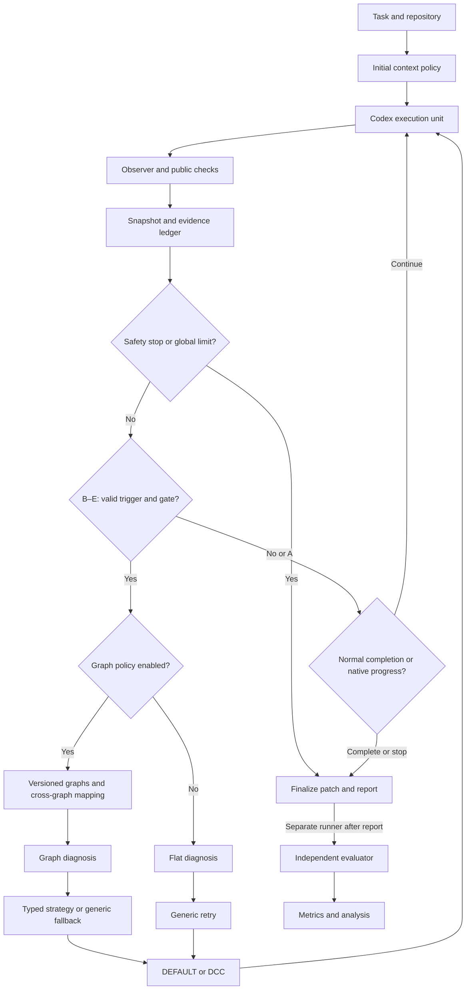
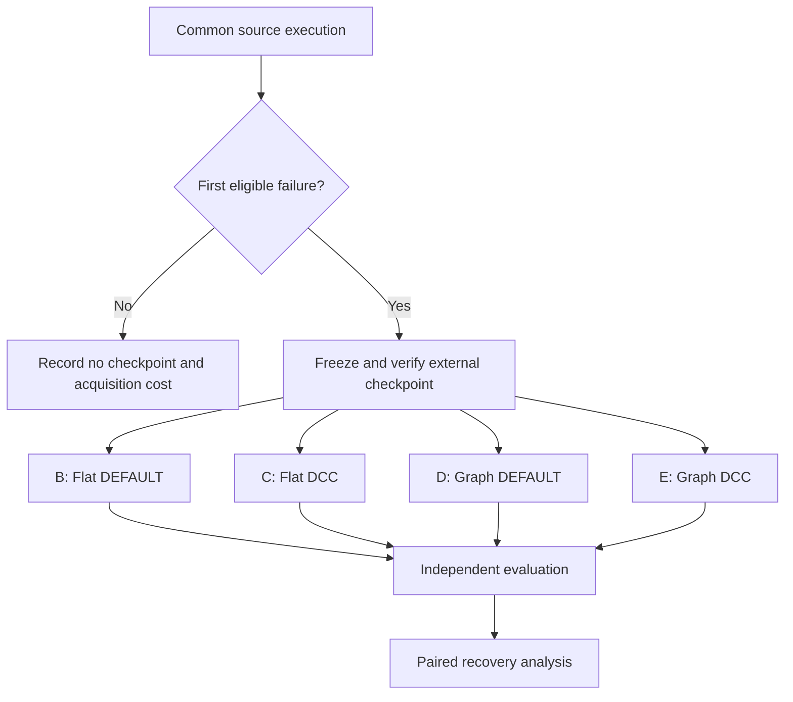

# Adaptive Agent Harness — 연구보고서 (Final Report)

## 그래프 기반 실패 복구 및 동적 컨텍스트 최적화를 통한 코딩 에이전트의 신뢰성과 실행 효율 향상

**Adaptive Agent Harness: Graph-Guided Failure Recovery and Dynamic Context Optimization for Coding Agents**

| 항목 | 내용 |
| --- | --- |
| 프로젝트 | Adaptive Agent Harness (AAH) |
| 수행 맥락 | 잇츠 스터디 5기 · Codex 기반 AI 코딩 에이전트 구축 |
| 연구 유형 | 실험적 시스템 연구 및 통제된 비교 실험 |
| 연구 대상 | 단일 OpenAI Codex 에이전트, Python 저장소의 테스트 가능한 버그 수정 |
| 작성일 | 2026-11-25 (실측 반영 2026-11-27) |
| 문서 버전 | v0.2.0 — Main(Emergency) 실측 반영본 |
| 저자 및 소속 | 팀 확인 후 기입 |
| 상태 | 구현·Dev 검증·Main Emergency 실험(v2) 완료. 결과는 탐색적이며 가설 판단은 결론 불충분 |
| 최종 승인 | 운영자 1인(RH·GR·CE 겸임). G4 교차 검토자 없음 |

> **읽기 안내:** 이 버전은 2026-11-27 Main Emergency 실험 `aah-main-emergency-v2`의 실측 결과를 반영한다. 1–4장과 6–7장은 사전 설계이고, 실측과 해석은 5·8–10장에 있다. 실험 원자료와 세부 표는 [RESULTS_ANALYSIS.md](RESULTS_ANALYSIS.md#25-main-주-결과--aah-main-emergency-v2-amd-01-emergency-탐색적)를 기준으로 한다. 표의 `—`는 미등록을 뜻하며 0, 실패 또는 통계적 비유의를 뜻하지 않는다.
>
> Main 평가 과제는 사람 동료 리뷰(BQ14)를 받지 않았다. 사전 등록한 수정 프로토콜 AMD-01(DL-031)에 따라 독립 AI 리뷰와 객관적 검사(대안 구현·불완전 수정 검출·반복·격리)를 통과한 과제만 편입했다. 승인은 1인이 RH·GR·CE를 겸임해 수행했다. 규모는 Emergency(최대 8과제 × A–E × 1회)이며 모든 결과는 탐색적이다.

---

## 초록 (Abstract)

코딩 에이전트는 자연어 요구사항에 따라 코드 저장소를 탐색하고 수정하며 테스트를 수행하지만, 복합적인 의존성을 갖는 과제에서는 반복 실패, 탐색 정체, 수정으로 인한 회귀 및 분산된 실패 증거로 인해 실행 효율이 저하될 수 있다. 보조 컨텍스트의 과잉 또는 불일치 역시 불필요한 탐색과 재작업을 유발할 가능성이 있다. 본 연구는 모델 자체를 변경하지 않고 이러한 문제에 대응하기 위한 외부 실행 프레임워크 Adaptive Agent Harness(AAH)를 제안한다.

AAH는 저장소의 구조적 관계를 나타내는 Repository Graph와 에이전트의 관측 가능한 행동·결과를 나타내는 Execution Graph를 연결한다. 공통 실패 감지 정책에 의해 개입 조건이 충족되면 실패 앵커에서 관련 관계를 탐색하고 후속 복구 전략을 결정한다. Dynamic Context Compiler(DCC)는 최초 실행 및 복구 시점에 작업 관련성, 현재 유효성, 중복 및 토큰 예산을 고려하여 보조 컨텍스트를 구성한다. 실행 결과는 다시 관측되어 다음 제어 판단에 반영되며, 정상 진행에 대한 불필요한 복구 개입은 최소화한다.

AAH를 구현하고, 기본 Codex(A), 일반 재시도(B), 컨텍스트 최적화(C), 그래프 기반 복구(D), 통합 정책(E)의 다섯 조건을 같은 모델(`gpt-6-luna`, 추론 강도 low)로 비교했다. 사람 리뷰어를 구할 수 없어 사전 등록한 수정 프로토콜 AMD-01에 따라 AI 리뷰와 객관적 검사를 통과한 8개 과제만 편입했고, 8과제 × 5조건 × 1회 = 40회를 실행해 독립 테스트로 판정했다. 과제 평균 성공률은 A 75%, B·C·D 87.5%, E 75%였다. 통합 정책의 추가 이득(P-R3)은 −12.5%p, C와 B의 성공당 토큰 차(P-R1)는 +5,790토큰(95% 구간 −6,515~+20,406)이었다. 실패 7건 중 5건은 다섯 조건 모두에서 실패한 한 과제였다. 그 밖의 조건 간 차이는 슬롯 2개에서만 생겼고, 대부분의 과제가 외부 보조 없이도 풀려 천장 효과가 있었다. 따라서 모든 가설 판단은 결론 불충분(탐색적 규모)이다. 첫 실행(v1)에서는 에이전트 셸 명령이 샌드박스 환경 변수 결함으로 모두 실행되지 않았다. 이를 실행 후 원시 로그 검토로 발견해 무효 처리하고, 수정한 뒤 다시 실행했다. 그래프와 컨텍스트의 결합 자체를 학술적 최초성으로 주장하지 않는다.

**Keywords:** Coding Agent, Codex, Agent Harness, Graph Engineering, Dynamic Context Engineering, Failure Recovery, Agent Evaluation

## Abstract (English)

Coding agents can navigate repositories, modify code, and run tests, yet complex dependency structures and dispersed execution evidence may contribute to repeated failures, exploration stagnation, regressions, and unnecessary computational cost. We propose Adaptive Agent Harness (AAH), an external execution framework that preserves the underlying Codex model and its native tools. AAH couples a repository graph with an execution-evidence graph to support failure-anchored diagnosis and recovery strategy selection. A Dynamic Context Compiler constructs bounded auxiliary context at initial execution and recovery boundaries using relevance, validity, redundancy, and budget constraints. An observable feedback loop governs selective intervention and termination. We design a five-condition end-to-end comparison, a common-failure-checkpoint evaluation, and targeted ablations to quantify the separate and combined effects of these policies. Independent functional, regression, and compliance checks determine task success. The primary outcomes are task success, failure recovery, and model-token cost per success. We implemented AAH and ran an emergency-scale main experiment (8 tasks × 5 conditions × 1 repetition, `gpt-6-luna`, low reasoning effort). Because no human peer reviewer was available, the main tasks were admitted under a pre-registered amendment (AMD-01) that replaced the human review with an independent AI review and objective checks. Mean task success was 75% (A), 87.5% (B, C, D) and 75% (E). P-R3 was −12.5 pp. P-R1 (C minus B tokens per success) was +5,790 tokens, with a 95% interval of −6,515 to +20,406. Five of the seven failures came from one task that failed under every condition. The remaining condition differences rest on two slots, and most tasks were solved without external assistance, so a ceiling effect limits the comparison. All hypothesis judgements are therefore inconclusive (exploratory scale). In the first run (v1), every agent shell command was refused by the sandbox because of a missing environment variable. A post-run log review found the defect; v1 was invalidated, the defect was fixed and the experiment was rerun (v2). No claim of methodological priority is made.

---

## 1. 서론 (Introduction)

### 1.1. 연구 배경

코딩 에이전트의 성능은 언어 모델의 코드 생성 능력뿐 아니라 저장소를 탐색하는 인터페이스, 제공받는 지침, 관측되는 실행 결과 및 반복 검증 구조의 영향을 받을 수 있다. SWE-agent [1]는 에이전트와 컴퓨터의 인터페이스 설계에 주목한 사례이며, SWE-bench [2]는 실제 소프트웨어 이슈에 대한 테스트 기반 평가를 제시한다. 이 연구들은 코딩 에이전트를 모델 단독의 문제로만 다루지 않는 연구 방향의 배경이 된다.

잇츠 스터디의 기존 질문인 'Codex와 같은 코딩 에이전트를 어떻게 효과적으로 활용할 수 있는가?'를 본 연구에서는 외부 실행 환경과 정책의 개선 및 검증 문제로 구체화한다. 모델 파인튜닝이나 새로운 코딩 모델 개발이 아니라 기존 Codex의 작업 수행을 지원하는 정보 구성과 실패 복구 방법을 연구한다.

### 1.2. 해결할 문제

| 문제 후보 | 관측 가능한 증거 | 제안 대응 |
| --- | --- | --- |
| 컨텍스트 과잉 | 중복 문서, 작업과 무관한 안내, 긴 추가 입력 | 작업·상태별 보조 정보 선별 |
| 컨텍스트 불일치 또는 부족 | 폐기된 지침, 현재 코드와 맞지 않는 경로, 관련 정보 누락 | 출처·범위·유효성 검사 |
| 반복 실패 | 동일한 공개 검사 실패 지문과 개선 부재 | 실패 증거에 따른 재진단 |
| 탐색 정체 | 반복 검색·파일 접근, 새 증거와 실질 진전 부족 | 미조사 의존성 후보 탐색 |
| 회귀 오류 | 비교 가능한 공개 검사가 통과에서 실패로 전이 | 변경 코드 영향 범위 검토 |
| 분산된 증거 | 로그, 코드 변경, 테스트 결과가 분리되어 존재 | 코드-실행 그래프 연결 |

이 문제들은 관측 및 검증 대상이지 모든 최신 Codex 실행에서 빈번하게 발생한다고 확정한 사실은 아니다. 일반적인 작업에서 Codex가 충분히 성공한다면 외부 개입의 비용이 이득보다 클 수 있다. Pilot에서는 자연 발생 실패의 빈도와 관측 가능성을 먼저 확인한다.

### 1.3. 연구 목적 및 범위

본 연구의 목적은 동일 모델과 공통 실행 제약 아래에서 코드-실행 관계 기반 복구와 상태 적응형 보조 컨텍스트 최적화가 각각, 그리고 함께 제공하는 가치를 측정하는 것이다. 대상은 Python 저장소의 테스트 가능한 버그 수정 및 단일 Codex 에이전트로 제한한다. 모델 내부 추론 변경, 비공개 상태 접근, 멀티에이전트, 워크플로 자체의 실시간 재배선 및 학습 기반 복구 정책은 핵심 범위에 포함하지 않는다.

### 1.4. 연구 질문과 가설

| ID | 질문 및 검증할 가설 | 주된 비교 |
| --- | --- | --- |
| RQ1/H1 | DCC는 성공당 비용을 줄이고 작업 성공과 필수 제약 준수의 실질적 저하를 최소화하는가? | E2E B→C, D→E |
| RQ2/H2 | 그래프 기반 복구는 일반 재시도보다 효과적인가? | Checkpoint B→D, C→E |
| RQ3/H3 | 통합 정책은 단독 정책보다 추가 이득을 제공하는가? | E2E C/D→E |
| RQ4/H4 | 명시적 그래프 연결과 세부 컨텍스트 정책은 추가 가치를 제공하는가? | AB1–AB9 중 실제 수행 항목 |
| RQ5 | 어떤 조건에서 유용하며 오개입 및 오버헤드는 무엇인가? | 사전 층화 및 개입 사례 분석 |

A→E 비교는 실제 기본 Codex 대비 전체 시스템의 실용적 가치를 평가하는 별도 참조다. 위 가설은 실측에 의해 지지되거나 기각될 수 있으며, 작은 표본에서 결론 불충분인 경우도 허용한다.

### 1.5. 예상 기여

1. 코드 구조와 공개 실행 증거를 연결하여 실패 관련 후보와 후속 전략을 구성하는 외부 복구 정책.
2. 초기 및 복구 시점에 동작하는 상태 적응형 Dynamic Context Compiler.
3. 일반 재시도, 그래프 복구, DCC 및 통합 정책을 같은 실행 제약에서 비교하는 실험 설계와 재현 가능한 평가 절차.
4. 개발자가 저장소에 적용하고 실패·복구 근거와 비용을 확인할 수 있는 CLI 프로토타입.

이는 기여 후보이며, 구현 및 실증이 확인된 항목만 최종본에서 달성된 기여로 전환한다.

## 2. 관련 연구 (Related Work)

본 절은 `LITERATURE_REVIEW.md`의 2026-11-24 기준 검토를 요약한다. 인용 번호는 이 보고서 내부에서 새로 부여하였다. 이전 문서의 참고문헌 번호와 혼동하지 않는다. 이번 종합 작업에서는 논문 원문을 새로 검색·검증하지 않았으며, 기존 검토의 근거 수준을 그대로 유지한다.

### 2.1. 에이전트 실행 환경 및 평가

SWE-agent [1]의 에이전트-컴퓨터 인터페이스, AFlow [3]의 워크플로 최적화는 모델 외부 실행 구조가 연구 대상이 될 수 있음을 보여 주는 관련 접근이다. SWE-bench [2]는 저장소 수준 이슈 해결을 테스트 기반으로 평가한다. AAH는 워크플로를 자동 생성하는 것이 아니라 고정 제어 구조에서 관측된 실패에 따라 실행 경로와 보조 정보를 변경한다.

### 2.2. 컨텍스트 및 저장소 관계 활용

Evaluating AGENTS.md [4]는 저장소 지침의 제공이 항상 성공률 향상으로 이어지지는 않으며 추론 비용을 증가시킬 수 있다는 연구 동기를 제공한다. SWE Context Bench [5]는 관련 개발 경험 재사용을 평가한다. RepoGraph [6]는 저장소 수준 코드 관계를 활용한 탐색, Rivet [7]은 구조 기반 근거 선택과 예산 제약 컨텍스트 구성을 다룬다. 따라서 단순한 검색, 그래프 코드 탐색 또는 토큰 제한 자체는 새로운 기여로 주장하지 않는다.

### 2.3. 실패 진단 및 적응형 복구

기존 검토에서 AgentRx [8], CodeTracer [9], PROBE [10]는 구조화된 실행 증거 및 실패 진단과 관련된 접근으로 정리되었다. 특히 AgentTether [11]는 그래프 기반 진단과 런타임 개입, GRADE [12]는 실행·의존성 관계 표현, MemTrace [13]는 실행 이력과 저장소 그래프의 연결 및 상태 일관성 있는 정보 재사용을 다룬다. DARC에 해당하는 연구 [14] 역시 실패에 따른 선택적 복구라는 관점에서 관련된다.

| 선행연구 | 직접 관련 내용 | AAH 설계에 주는 의미 |
| --- | --- | --- |
| RepoGraph [6] | 저장소 관계 기반 탐색 | 코드 그래프의 사용 자체는 신규성이 아님 |
| Rivet [7] | 구조적 근거 및 예산 기반 컨텍스트 | DCC의 단순 검색·패킹만으로 차별화하기 어려움 |
| CodeTracer / PROBE [9, 10] | 실행 추적, 실패 앵커, 복구 | 관측 증거 중심 진단과 강한 대조군 필요 |
| AgentTether [11] | 그래프 기반 진단 및 실행 개입 | 동적 개입 자체는 신규성이 아님 |
| MemTrace [13] | 코드·실행 그래프 연결, 상태 일관성 및 컨텍스트 | 이중 그래프와 컨텍스트 결합도 이미 겹치는 부분이 있음 |
| DARC 관련 연구 [14] | 선택적 복구 | 실패 감지 및 전략 선택의 효과 분리 필요 |

### 2.4. 연구 공백과 차별성의 범위

핵심 질문은 다음과 같다. **동일한 원본 증거, 외부 실패 상태, 복구 기회 및 실행 제약에서, 그래프 기반 증거 선택과 유형별 전략 결정 그리고 상태 적응형 정보 구성이 각각 어느 정도의 추가 효과를 갖는가?**

이를 검증하기 위해 강한 평면 대조군과 공통 실패 상태를 도입하며, 그래프 연결과 전략 선택, 초기·복구 DCC를 분리하는 ablation을 계획한다. 그러나 선행 방법의 공개 구현을 동일 조건에서 재현하지 않은 상태에서 경쟁 방법보다 우수하다거나 최초라는 결론을 내리지 않는다. 특히 2026년 preprint는 정식 심사 결과와 구분하고, 논문마다 모델·과제·예산이 다른 성능 수치를 직접 순위화하지 않는다.

## 3. 문제 형식화 (Problem Formulation)

과제는 다음의 튜플로 정의한다.

$$
\mathcal P=(q,R_0,M,C,\mathcal T,B)
$$

$q$는 자연어 요청, $R_0$는 초기 저장소, $M$은 필수 지침 및 권한, $C$는 허용된 보조 정보 원천, $\mathcal T$는 허용 도구와 공개 검사, $B$는 전체 실행 한도 벡터다. 관측된 실행 상태는 다음과 같다.

$$
S_t=(q,R_t,H_t,G_r^{(t)},G_e^{(t)},E_c^{(t)},b_t)
$$

$H_t$는 공개 실행 이력·diff·검사 결과, $G_r^{(t)}$와 $G_e^{(t)}$는 저장소 및 실행 그래프, $E_c^{(t)}$는 두 그래프 사이의 연결, $b_t$는 잔여 실행 한도다. 그래프 비활성 조건은 그래프 파생 상태를 정책에 사용하지 않는다.

공통 실패 감지와 진단·전략·정보 구성 정책을 분리한다.

$$
z_t=d(H_t,R_t),\quad D_t=\rho_g(S_t,z_t),\quad a_t=\pi_g(S_t,z_t,D_t),\quad K_t=\kappa_c(S_t,a_t,D_t,C)
$$

여기서 $g\in\{0,1\}$은 평면 또는 그래프 기반 복구 정책, $c\in\{0,1\}$은 기본 패키징 또는 DCC 정책을 의미한다. $D_t$는 관련 증거와 조사 후보이며 원인에 대한 정답이 아니다. $a_t$는 전략, $K_t$는 후속 실행의 보조 정보 패키지다. 최초 실행에는 실패 앵커와 복구 전략이 없고 초기 정보 구성에는 그래프 파생 복구 정보가 들어가지 않는다.

독립 평가에 의한 성공을 $Y(p)\in\{0,1\}$로 정의할 때 설계 목적은 다음과 같다.

$$
\max_{\pi,\kappa}\mathbb E[Y(p)]\quad\text{subject to}\quad \mathbf c(\pi,\kappa)\preceq B
$$

이는 설계 목표를 형식화한 것으로 학습 기반 정책 최적화나 전역 최적해를 보장하는 알고리즘이 아니다. 정확한 토큰 제한이 불가능하면 공통 시간·실행 단위 상한과 관측 토큰을 별도로 관리하며 동일 토큰 예산 실험이라고 표현하지 않는다.

## 4. 제안 방법 (Proposed Method)

### 4.1. 전체 프레임워크



AAH는 하네스 안에서 공통 실행, 관측 및 안전한 종료를 관리한다. 그래프는 의사결정에 필요한 관계를 표현하고 컨텍스트 컴파일러는 선택된 전략의 정보 입력을 구성한다. 루프는 이 두 정책을 실행 결과에 따라 반복 적용하는 제어 구조다. 프롬프트는 실행 전략과 증거를 Codex에 전달하는 구현 수단이다. 이 역할 구분은 이번 연구의 설계상 관계이며 보편적인 학술 분류 또는 다섯 개의 독립 연구 기여를 뜻하지 않는다.

### 4.2. 코드 및 실행 증거의 구조화

Repository Graph $G_r^{(t)}=(V_r^{(t)},E_r^{(t)})$는 현재 및 조회 가능한 역사 스냅샷의 파일·함수·클래스·테스트와 그 관계를 표현한다. Python AST 및 확인 가능한 정적 관계를 우선하고, 해결할 수 없는 동적 호출은 미확인 또는 추정으로 표기한다.

Execution Graph $G_e^{(t)}=(V_e^{(t)},E_e^{(t)})$는 관측된 검색, 읽기, 명령, 수정, 공개 검사 및 실패·복구 이벤트를 표현한다. 두 그래프를 다음과 같이 연결한다.

$$
G_d^{(t)}=(V_r^{(t)}\cup V_e^{(t)}, E_r^{(t)}\cup E_e^{(t)}\cup E_c^{(t)})
$$

| 그래프 | 관계 예시 | 근거 |
| --- | --- | --- |
| Repository | CONTAINS, IMPORTS, CALLS, INHERITS, TESTS | AST, 공개 테스트 참조 등 |
| Execution | NEXT, RETURNS, RETRIES, OBSERVED_AFTER, SAME_FAILURE_AS | 런타임 이벤트, 공개 검사 |
| Cross-Graph | READS, CHANGES, TESTS_TARGET, FAILS_AT | 파일 경로, diff, traceback, 공개 테스트 ID |

`SUSPECTS`는 진단에서 생성된 가설적 후보이며 기본 탐색의 직접 근거로 재사용하지 않는다. 코드 위치와 실행 이벤트의 연결은 당시 스냅샷을 보존한다. `OBSERVED_AFTER`는 시간적 관측 관계이지 원인 증명이 아니다. 관측되지 않은 읽기와 변경은 추측으로 채우지 않는다.

### 4.3. 공통 실패 감지

B–E에는 같은 그래프 비의존 감지 규칙을 적용한다. 공개 오류 지문은 검사·테스트 ID, 오류 유형, 정규화된 메시지 및 안정적 코드 위치로 구성하며 의미 있는 assertion 값을 보존한다.

| ID | 트리거 | 해석 |
| --- | --- | --- |
| T1 | REPEATED_FAILURE | 같은 공개 실패 지문 반복 및 검증 개선 부재 |
| T2 | STAGNATION | 반복 탐색 및 새 증거·검증 개선·실질 코드 진전 부재 |
| T3 | REGRESSION | 비교 가능한 공개 검사 PASS→FAIL |
| T4 | INCOMPLETE_AT_DONE | 완료 선언 시 공개 필수 검사 실패 |
| T5 | UNKNOWN / INFRA | 관측 불충분 또는 환경 오류, 복구 성능과 구분 |

반복 행동만으로 실패라고 단정하지 않는다. T5를 자연 실패 체크포인트로 사용하지 않으며, 개입은 새 관측 증거, 후속 턴 제어 가능성, 남은 시간·실행 단위, 최대 복구 횟수 및 안전한 정리를 위한 여유가 있을 때 수행한다. 초기 우선순위 후보는 T3→T1→T2→T4다.

### 4.4. 실패 앵커 기반 그래프 진단

실패를 뒷받침하는 관측 이벤트 집합 $A_t$를 탐색 시작점으로 사용한다. 허용된 관계와 방향만 따라 이동하고 깊이, 방문 상태 수, 분기 수를 제한한다. 경로 비용은 다음의 휴리스틱을 사용한다.

$$
L(P)=\sum_{e\in P}(w_{type(e)}+\eta[\mathrm{inferred}(e)]),\qquad
 d_t(v)=\min_{a\in A_t,P:a\leadsto v,|P|\le h} L(P)
$$

한도 때문에 탐색이 중단되면 탐색 범위의 근사 결과임을 명시한다. 현재 코드 요소의 조사 우선순위는 다음과 같다.

$$
Q_t(v)=\frac{w_d}{1+d_t(v)}+w_o o_t(v)+w_m m_t(v)+w_u u_t(v)
$$

관계 근접성, 관측 수준, 최근 수정 증거, 미조사 인접 의존성 여부를 고려한다. 이 점수는 원인 확률이 아니다. 상위 후보와 원래 근거·경로 ID를 반환하여 후속 전략 결정에 사용한다. 평면 대조군도 동일 원천에 접근하고 오류 지문, 경로 일치, BM25 및 diff를 활용하되 그래프 거리·경로·파생 후보는 사용하지 않는다.

### 4.5. 복구 전략 선택

| 전략 ID | 적용 후보 및 목적 |
| --- | --- |
| REVIEW_REGRESSION | T3 및 관련 변경 증거에 기초해 기존 기능과 영향 범위 재검토 |
| RELOCALIZE | 반복 실패·정체에서 근거 있는 대안 코드 후보 탐색 |
| REFRESH_EVIDENCE | 현재 코드 참조의 버전 불일치로 제한된 증거 갱신 |
| GENERIC_RETRY | B/C 기본 복구 또는 특정 전략의 근거가 부족할 때 대체 |
| CONTINUE | 정상 진행 또는 개입 근거 부족 |
| STOP | 안전한 실행 불가, 한도 소진 또는 정상 종료 |

D/E에서는 그래프 진단에 기반한 유형별 전략 또는 일반 fallback을 사용한다. 전략이 지시되었다는 사실과 실제 수행되었다는 사실을 구분한다. 관측 가능한 수행 여부 및 후속 공개 검사 변화를 기록하되 성공은 독립 평가로 판정한다. 전략은 Codex에 후속 행동을 제안하는 외부 지침이며 모델의 내부 행동을 강제로 변경한다는 의미는 아니다.

### 4.6. Dynamic Context Compiler

DCC는 선별 가능한 보조 정보만 처리한다. 최초 실행에서는 작업 요청, 현재 저장소, 보조 문서를 사용하고 복구에서는 공개 실패, diff, 이전 시도, 진단과 전략을 추가로 활용한다. 필수 지침 $M$과 사용자 요구사항은 삭제하거나 약화하지 않는다.

후보의 유효성은 CURRENT, INVALID, HISTORICAL, UNCERTAIN으로 구분한다. 현재 사실과 맞지 않는 명시적 무효 보조 안내는 제외할 수 있으나 과거 실행에 대한 역사 증거를 삭제하지 않으며 불확실한 정보는 표시한다. 공통 보안 검사와 필수 지침 보호는 모든 조건에 적용한다.

후보 $i$의 관련성 점수는 다음의 초기 설계를 사용한다.

$$
s_i=\alpha r_i(q)+\beta a_i(R_t)+\gamma v_i(R_t)+\delta f_i(S_t,a_t)
$$

각 항은 작업 관련도, 적용 범위 일치도, 유효성, 실패·전략 관련도를 나타낸다. 최초 실행은 $\delta=0$으로 두고, 복구 실행에는 네 항을 사용한다. 후보 선별은 다음의 목적을 근사한다.

$$
\max_{x_i\in\{0,1\}}\left(\sum_i s_ix_i-\lambda\sum_{i<j}d_{ij}x_ix_j\right),\qquad \sum_i t_ix_i\le B_{ctx,t}
$$

$d_{ij}$는 중복 정도, $t_i$는 보조 패키지의 길이, $B_{ctx,t}$는 해당 단계의 보조 정보 상한이다. MVP에서는 해시·Jaccard 중복과 한계 효용 밀도를 고려한 greedy packing을 사용한다. 최소 실패 근거 및 전략을 전달할 공간을 우선하며 실제 직렬화 길이와 출처를 기록한다. B/D의 기본 정책도 같은 상한에서 근거를 전달하되 추가 DCC 최적화는 적용하지 않는다.

DCC는 모델 내부 대화 이력 또는 내부 컨텍스트를 직접 삭제·교체하지 않는다. 주입된 보조 토큰 감소가 전체 사용량 및 성공당 비용 감소로 이어지는지는 실험 대상이다.

### 4.7. 반복 실행 및 종료

```text
initialize isolated workspace, budget and common evidence ledger
compile initial package (NONE / DEFAULT / DCC by condition)
while safe execution remains:
    execute a supported Codex unit
    observe public evidence and capture a safe snapshot
    if hard limit or unrecoverable error: finalize safely
    if condition A: follow native completion/continuation; no external recovery
    otherwise evaluate the common trigger and intervention gate, including T4 at completion
    if no eligible trigger: finalize if complete, continue if supported, or stop safely
    else:
        obtain flat or graph diagnosis from allowed evidence
        select generic or typed recovery strategy
        compile bounded DEFAULT or DCC package
        deliver at a supported subsequent execution boundary
        record intervention, budget and next observation
freeze final safe patch and run report
return the final patch and report
# Separate experimental runner requests independent evaluation afterward.
```

의사코드는 방법의 개요다. 구체적인 완료 선언 후 T4 복구, 정리 reserve, fallback 및 runtime 장애 분기는 `METHODOLOGY.md`, `SYSTEM_ARCHITECTURE.md`, `TECHNICAL_SPEC.md`의 상태 머신 계약을 따른다. 공개 검사 완료와 한도 도달을 구분하고, 외부 독립 평가 결과는 복구 루프로 다시 전달하지 않는다.

### 4.8. Pilot 초기 설정

| 설정 | 초기 후보 |
| --- | --- |
| 반복 실패 횟수 / 탐색 관측 구간 / 중복 비율 | 2회 / 6개 / 0.67 |
| 그래프 최대 깊이 / 방문 상태 / 노드별 분기 | 4 / 200 / 20 |
| 진단 후보 top-k | 8 |
| 엣지 기본 비용 / 추정 추가 비용 | 1 / 1 |
| 후보 가중치 (거리, 관측, 수정, 미조사) | (0.4, 0.3, 0.15, 0.15) |
| DCC 초기 가중치 | (0.5, 0.3, 0.2, 0) |
| DCC 복구 가중치 | (0.25, 0.2, 0.2, 0.35) |
| 중복 패널티 | 0.2 |
| 보조 컨텍스트 상한 | 초기·복구 각각 추정 2,048 토큰 |
| 최대 복구 개입 | 2회 |

이 값들은 `METHODOLOGY.md` §15의 개발용 후보이며 실제 최적값이나 동결된 설정이 아니다. 전체 실행 한도 및 관측 지원 수준도 Pilot에서 결정한다.

## 5. 시스템 구현 설계 (System Design and Implementation)

### 5.1. 구현 구조 및 상태

| 모듈 | 설계 책임 | 실제 검증 증거 |
| --- | --- | --- |
| Runtime Adapter | Codex 실행·이벤트·후속 턴·사용량 수집 | `src/aah/runtime`, Codex CLI 0.166.0 MXC 경로. [S0](S0_VERIFICATION.md), 라이브 스모크 |
| Workspace Manager | 격리 환경, 스냅샷 및 패치 관리 | `src/aah/workspace`, isolation 테스트, Main 접근 검사 BQ09·10 8/8 |
| Workflow Orchestrator | 공통 상태 머신, 한도 및 종료 정책 | `src/aah/workflow`, [S1](S1_VERIFICATION.md) |
| Evidence Ledger | 공개 증거 및 출처의 버전 관리 | `src/aah/evidence` |
| Graph Service | 이중 그래프, 연결 및 제한 탐색 | `src/aah/graphs`, [S3](S3_VERIFICATION.md) |
| Diagnosis / Recovery | 공통 감지 및 복구 전략 결정 | `src/aah/diagnosis`, `src/aah/recovery`, [S3](S3_VERIFICATION.md) |
| Context Compiler | DEFAULT와 DCC 패키징 정책 | `src/aah/context`, [S2](S2_VERIFICATION.md) |
| Experiment Runner | 비교군, 실행 스케줄, 체크포인트 분기 | `src/aah/experiments`, `benchmarks/main_public`, [S4](S4_VERIFICATION.md). 라이브 체크포인트 분기는 Main에서 미사용 |
| Independent Evaluator | 최종 기능·회귀·제약 판정 | `evaluation/`, 고정 Docker worker, 큐레이터 키트 프로세스 분리 |
| Reporting / Analysis | 실행 보고, 비용·성공률 분석 및 시각화 | `analysis/main_analysis.py`, EP30 바이트 재현. 시각화(FIG) 미작성 |

자동 테스트는 263개가 모두 통과한다(`pytest tests`). 실제 모델 호출 테스트는 일반 CI에 넣지 않았다.

설계 기술은 Python 3.11+, Codex CLI 우선 검증(SDK 대안), Python 상태 머신, AST와 NetworkX MultiDiGraph, BM25, JSON/JSONL/CSV, Git, 검증된 격리 환경 및 pytest이다. 구체 버전과 라이선스는 동결 전 확정한다. 단일 프로세스와 로컬 저장을 우선하고 필요 없는 그래프 DB 또는 워크플로 프레임워크 도입을 지양한다.

### 5.2. 실행 가능성과 안전성

실제 Codex 공개 인터페이스가 지원하는 이벤트, 세션 재개, 취소, 사용량 및 권한 제어를 RT01–RT07로 검증한다. 외부 하네스가 내부 도구 단계나 세션 상태를 임의 복제할 수 있다고 가정하지 않는다. 연구용 Codex는 프레임워크 개발용 AGENTS.md와 실험 정답을 읽을 수 없는 환경에 배치한다. 디렉터리 분리 자체가 안전성 검증을 대신하지 않는다.

### 5.3. 사용자 적용 계획

대상 사용자는 테스트 가능한 Python 저장소에서 Codex를 사용하는 개발자다. CLI를 통해 저장소와 과제를 입력하고 패치, 실행 종료 사유, 실패·복구 증거 및 사용량을 확인하는 것이 목표다. 예시 명령은 `README.md` 및 `TECHNICAL_SPEC.md`의 구현 예정 계약이며 실행 가능 여부가 확인되기 전에는 설치·사용 성공을 주장하지 않는다.

### 5.4. 구현 및 협업 검증

| 단계 | 역할 및 증거 | 상태 |
| --- | --- | --- |
| G0 | 실제 Runtime 연동 및 안전한 평가 | Dev Smoke 실행·독립 판정 기록([S0](S0_VERIFICATION.md)) |
| G1 | 통합 MVP, A–E 정책 격리 및 실제 실행 | S1–S4 검증 기록. A–E parity(CT03–CT07) 회귀 테스트 유지 |
| G2 | Pilot, 정책 및 평가 집합 동결 | 수정 기준(AMD-01)으로 충족. Pilot은 셸 결함 환경에서 수행됐고 다시 하지 않음 |
| G3 | 본실험과 체크포인트 기록 | v2 40/40 기록. v1은 무효 기록으로 보존. 체크포인트 NOT_RUN |
| G4 | 결과 분석 및 교차 검토 | 분석·재현 완료. 교차 검토자 없음(부분) |
| G5 | 재현 안내, 보고서 및 제출 | 이 보고서, README, 시연 문서 갱신. 공개 범위 검토는 남음 |

팀 역할은 RH(Runtime & Harness), GR(Graph & Recovery), CE(Context & Evaluation)로 제안되어 있다. 구현 작업 IP01–IP36, 리뷰, 공통 모듈 인수인계 및 개인별 학습 증빙은 `IMPLEMENTATION_PLAN.md`, `TEAM_ROLES.md`, `AGENTS.md`에 따른다. 실제 팀원, 역할 승인과 수행 내역은 증거 확인 후 기입한다.

## 6. 실험 설계 (Experimental Setup)

### 6.1. 비교군 및 변수

| 조건 | 최초 정보 | 외부 감지 | 진단 | 전략 | 복구 패키지 |
| --- | --- | --- | --- | --- | --- |
| A: Vanilla Codex | NONE | 없음 | NONE | NATIVE | NONE |
| B: Flat Retry | DEFAULT | 공통 | FLAT | GENERIC | DEFAULT |
| C: Context-only | DCC | 공통 | FLAT | GENERIC | DCC |
| D: Graph-only | DEFAULT | 공통 | GRAPH | TYPED | DEFAULT |
| E: Adaptive Agent Harness | DCC | 공통 | GRAPH | TYPED | DCC |

A는 기본 사용 참조이며 B–E는 동일 하네스에서 C(DCC ON/OFF), G(그래프 복구 ON/OFF)의 2×2 요인을 구성한다. G는 그래프 증거 선택과 유형별 전략을 묶은 조작이다. 그래프 연결 자체나 전략 지침만의 효과는 별도 ablation이 필요하다. B/D 및 C/E의 최초 정보는 각각 동일하게 유지하며, B/C에는 그래프 파생 정보 또는 유형별 전략을 제공하지 않는다. B는 원본 증거를 사용하는 강한 일반 재시도이지 빈 프롬프트가 아니다.

모델 ID 및 추론 설정, 런타임 버전, 초기 코드, 문서, 사용자 요청, 도구·권한, 환경, 공개 검사, 평가기, 공통 시간·실행 단위 및 가능한 토큰 한도, B–E 개입 시점과 최대 기회를 통제한다. 실제 사용량과 후속 행동 차이는 결과 변수다. 조건별 실행 순서는 과제·반복 블록에서 균형화하며, 저장소와 과제 가족의 상관을 고려한다.

### 6.2. 벤치마크

AAH-Suite(가칭)는 자체 Python 저장소의 신규 버그 수정 과제를 구성하는 계획이다. 공개 과제는 환경·라이선스·테스트 품질이 확인된 인스턴스만 사용한다.

| 대표 과제 유형 | 자체 목표 | 공개 목표 | 합계 |
| --- | ---: | ---: | ---: |
| SINGLE: 단일 파일 버그 | 4 | 2 | 6 |
| DEPENDENCY: 파일 간 의존성 | 4 | 2 | 6 |
| REGRESSION: 회귀 위험 수정 | 4 | 2 | 6 |
| COMPOSITE: 복합 수정 | 4 | 2 | 6 |
| 합계 | 16 | 8 | 24 |

자체 저장소 후보는 인증(R-AUTH), 주문·재고(R-ORDER), 데이터 처리(R-INGEST), 스케줄링(R-SCHED)이며 각 4개 과제를 설계한다. 문서 상태는 NORMAL 12, NOISY 6, STALE 6을 Full 구성의 잠정 목표로 한다. 공개 과제의 실제 상태를 변경해 배분을 맞추지 않으며 UNKNOWN/MIXED도 허용한다. 과제 유형과 문서 상태가 혼재하므로 이 기본 구성만으로 문서 상태의 인과 효과를 주장하지 않는다.

공개 후보는 `BENCHMARK_SPEC.md`에서 검토한 SWE-Bench Pro V2, SWE-bench-Live 등이다. SWE-bench Verified의 데이터 오염 및 평가 품질 문제에 관한 OpenAI의 분석 [15]을 고려하여 이를 단독 핵심 벤치마크로 사용하지 않는다. 실제 instance ID, 실행 환경과 테스트 검증은 미등록이다.

Smoke/Dev/Pilot 집합과 Main 평가 집합을 분리한다. 평가 과제 및 테스트는 결과 열람 전에 고정한다. 기준 패치 적용 시 통과, 초기 버그 상태에서 목표 테스트 실패, 합리적 대안 구현 수용, 회귀 검증과 격리 등을 과제 품질 게이트로 확인한다.

### 6.3. Protocol 1 — End-to-end Evaluation

동일 초기 과제에서 A–E를 독립적으로 실행한다. 작업 완료 또는 예산 종료 시 최종 안전 패치를 고정하고 독립 평가한다. 모든 계획 슬롯과 실패·미실행을 보존한다. 본 프로토콜은 전체 시스템의 실용적 성공률 및 비용을 비교한다. 조건별 자연 실패 후 복구율은 초기 DCC가 실패 집단 자체를 변화시킬 수 있으므로 기술 통계로만 해석하며 복구 정책의 주 비교에는 다음 프로토콜을 사용한다.

### 6.4. Protocol 2 — Common Failure Checkpoint Evaluation

사전에 지정한 과제 순서에서 DEFAULT 초기 정책을 사용한 별도 source run을 수행하고 첫 eligible T1–T4 트리거에서 외부 실패 상태를 고정한다. 복구 지침은 source 상태 고정 전에 전달하지 않는다. 자연 실패 미발생, 예산 부족, 부적격 상태 및 확보 비용도 기록한다. T5, 사후 성공 여부에 의한 사례 선택 또는 인위적 실패 주입은 자연 실패 집단에 섞지 않는다.



B–E 분기에 동일 작업 스냅샷, 공통 공개 이력, 필수 지침, 환경과 잔여 한도를 제공한다. 내부 세션 복제가 검증되지 않으면 모든 분기를 동일한 NEW_SESSION 및 공통 이력 요약으로 시작한다. 이 경우 내부 모델 상태까지 동일하다고 주장하지 않는다. 체크포인트 DCC 조작은 복구 패키지에만 적용한다. 확보 비용은 프로젝트 실제 지출에 한 번만 계상하고, 개별 분기의 사용자 관점 총비용은 source 비용을 포함해 별도로 표시한다.

### 6.5. Protocol 3 — Ablation Study

| ID | 조작 | 우선순위 |
| --- | --- | --- |
| AB1 | 연결 그래프 vs Unlinked | P1 |
| AB2 | 동일 증거 패키지에서 Typed vs Generic 전략 | P1 |
| AB3 | Initial-only / Recovery-only / Both / Neither DCC | P1 |
| AB4 | 동일 원천 접근과 공통 전략에서 그래프 vs 평면 검색 | P1 |
| AB5 | Repository-only vs Execution-only | P2 |
| AB6 | DCC 유효성 검사·중복 제거 제거 | P2 |
| AB7 | 정적 컨텍스트 vs 검색 기반 vs DCC | P2 |
| AB8 | 의미 있는 연결 vs 무작위 연결 | P2 |
| AB9 | 선행 시스템 재현 및 직접 비교 | P2, 조건부 |

실제 수행한 조작에 대해서만 구성 요소 효과를 주장한다. 필수 지침과 보안 가드는 ablation 대상으로 제거하지 않는다. 세부 조건과 비교 기준은 `EXPERIMENT_DESIGN.md` §8을 따른다.

### 6.6. 실행 수 및 동결 계획

| 단계 | Full 목표 실행 수 |
| --- | ---: |
| Pilot (개발용 5–8개 × 5조건 × 1회) | 25–40 |
| Main (24개 × 5조건 × 2회) | 240 |
| Checkpoint source | 최대 24 |
| Checkpoint branches (목표 12개 × 4조건) | 목표 48 |
| P0 평가 소계 (목표 checkpoint 확보 가정) | 312 |
| P1 AB1–AB4 별도 실행 | 80 |
| P0+P1 평가 합계 | 392 |

Pilot, smoke, 개발 호출은 P0/P1 평가 합계와 별도다. 실행 1회가 모델 호출 1회를 뜻하지 않는다. Core 200회, Reduced 120회, Emergency 40회의 Main 축소안을 유지하며 결과 열람 전에 예산에 맞는 계획을 결정한다. 24개 평가 과제와 반복 2회는 충분한 검정력을 보장하지 않는다. 12개 적격 체크포인트는 목표이지 확보 보장이 아니다.

실제 모델 ID, 런타임, 환경, 과제 및 평가기 버전, 정책·비용 상한, 비교 순서, 주 분석 집합 및 통계 계획은 G2 승인과 FRZ 기록에서 고정한다. Pilot에서 정한 값을 결과가 불리하다는 이유로 사후 수정하지 않는다.

### 6.7. 실제 실험 조건 등록 (실험 이후 작성)

| 항목 | 실제 값 / 증거 |
| --- | --- |
| FRZ ID 및 manifest hash | `aah-main-emergency-v2`, `5ef565bd48c3a684cbbf03c3a70687f4bda7f34e3ce5ba5649cc847895142e4a` (v1 `4596afb3…`은 무효) |
| 모델 및 추론 설정 | `gpt-6-luna`, reasoning effort low, SAME_SESSION |
| Codex 런타임 버전 / 인증 유형 | Codex CLI 0.166.0, 기존 ChatGPT 구독 로그인, Windows MXC 프로필 `aah_dev01_mxc` |
| 과제·환경·평가기·정책 버전 | 8과제(AAH-C02·C03·D02·D04·R03·R04·S02·S03), 공개 검사 환경 `f98af066…`, 코드 버전 `2401bc7f…`, 권한 해시 `74e24628…` |
| 토큰 제어 지원 / 공통 시간·실행 단위 상한 | `observe_only`. 실행당 360초, 네이티브 턴 105초, 최초 1턴 + B–E 복구 최대 2턴, 보조 정보 2,048 추정 토큰 |
| Main 과제 수, 반복 수, 실제 계획 슬롯 | 8과제 × 5조건 × 1회 = 40슬롯, seed 20261127, 최대 104턴 |
| Checkpoint source 및 eligible 상태 수 | NOT_RUN (AMD-01 §7.2 조건 미충족) |
| 실제 수행 Ablation 항목 | 없음 (AB1–AB4 NOT_RUN) |
| 분석 코드·설정 hash / 분석 집합 ID | `analysis/main_analysis.py`, AMD-01 설정 `7acf6117…`, 완전 블록 8과제 |

## 7. 평가 및 통계 방법 (Evaluation and Analysis)

### 7.1. 독립 평가

에이전트 실행 과정에서는 허용된 공개 검사만 사용한다. 최종 패치는 동결한 뒤 독립 평가 환경에 전달한다. 기능 테스트(H-FUNC), 회귀 테스트(H-REG), 공개된 필수 제약의 독립 검사(H-COMPLIANCE)가 모두 통과해야 성공이다. 기준 패치 문자열 일치는 성공 조건이 아니다. 평가 환경에서 제출 코드가 평가기 판정, 정답 및 다른 과제 자료에 접근하지 못하도록 검증한다.

실행 종료 사유와 평가 판정 및 분석용 상태를 분리한다. 완료 선언 후 hidden test 실패는 유효 실패이며, 실행 한도로 종료되더라도 마지막 안전 패치가 모두 통과하면 유효 성공이다. 방법 책임의 산출물 미생성은 유효 실패로 취급하고, 공통 외부 인프라 장애 등은 사전 기준에 따라 결측으로 처리한다. 모든 실제 시도와 예정 슬롯을 보존하고 실패 결과를 개선하기 위한 임의 재실행을 금지한다.

### 7.2. 주 평가 지표

조건 $c$의 유효 분석 집합에서 작업 성공률과 공통 체크포인트 복구율을 다음과 같이 정의한다.

$$
TSR_c=\frac{1}{N}\sum_{i=1}^{N}\frac{1}{R_{ic}}\sum_r Y_{icr},\qquad FRR_c=\frac{1}{J}\sum_{j=1}^{J} Z_{jc}
$$

N은 해당 공통 유효 과제 수, R_ic는 과제 내 유효 반복 수다. 슬롯 비율은 별도 기술 통계로 표시한다. J는 대비에서 유효한 공통 branch가 있는 checkpoint 수다. source 미발생·미확보, 적격·선택·결측과 확보 비용은 별도 집계한다. A에는 외부 checkpoint를 배정하지 않는다.

$$
CPS_c=\frac{\sum_{i,r} C_{icr}}{\sum_{i,r} Y_{icr}}
$$

성공당 비용의 분자에는 유효 실패 실행의 비용도 포함한다. 모델 토큰 CPS, 실제 금액 CPS, 추정 금액 CPS는 별도로 계산한다. 성공 0건이면 유한 CPS를 제시하지 않고 NO_SUCCESS를 기록한다. 비용 결측을 0으로 대체하지 않고 비용이 완전한 공통 블록을 사용하며, 성공률 분석의 유효 슬롯까지 제거하지 않는다. 제외된 인프라 및 대체 시도의 실제 지출은 별도 운영 관점 회계에 남긴다.

보조 지표는 전체 모델 토큰 및 시간, 로컬 처리 오버헤드, 필수 지침 준수율, 관측 도구 호출 및 탐색 중복, 개입·fallback·전략 수행 여부, 관측된 공개 검사 악화, 선택 컨텍스트 토큰과 진단 근거 범위다. 사용량 필드의 중복 및 누적 여부는 런타임에서 검증한다. 단순히 개입 이후 악화가 관측되었다고 개입의 인과적 위해를 확정하지 않는다.

### 7.3. 사전 지정 주 분석 대비

| ID | 대비 | 주 지표 및 개선 방향 |
| --- | --- | --- |
| P-R1 | $CPS_C-CPS_B$ | E2E 성공당 모델 토큰 감소 (음수) |
| P-R2 | $FRR_D-FRR_B$ | 공통 실패 상태에서 복구율 증가 (양수) |
| P-R3 | $p_E-\max(p_C,p_D)$ | 통합 정책의 성공률 추가 이득 (양수) |

H1은 성공당 비용의 감소와 성공률·준수율의 유지 여부를 함께 고려한다. H2의 P-R2는 Graph+Typed 정책의 효과이며 그래프 연결 단독의 효과는 아니다. P-R3은 E가 두 단독 조건 모두를 넘는지 평가하며 비용상의 이득을 사후 주 지표로 교체하지 않는다.

### 7.4. 2×2 요인설계

공통 B–E 분석 블록에서 성공률 $p_B,p_C,p_D,p_E$에 대한 가법적 주효과와 상호작용을 계산한다.

$$
\Delta_C=\frac{(p_C-p_B)+(p_E-p_D)}{2},\qquad
\Delta_G=\frac{(p_D-p_B)+(p_E-p_C)}{2}
$$

$$
\Delta_{int}=p_E-p_C-p_D+p_B
$$

효과 크기는 %p 단위로 제시한다. E가 C,D보다 우수한 사실이 양의 상호작용을 뜻하지 않는다. A는 요인 설계에 포함되지 않는다. FRR 요인 분석의 DCC는 복구 단계 조작으로 한정하며, CPS는 재표집마다 합계 분자와 분모를 다시 계산한다.

P-R3은 점추정과 두 성분 대비를 보고한다. 동률 또는 근접한 단독 성공률에서의 추론과 최소 유효 자료 요건은 평가 프로토콜 §11 및 OD-10을 따른다.

### 7.5. 통계 분석과 결측

과제 및 Task Family 단위의 paired cluster bootstrap을 기본 계획으로 하고 동일 가족의 모든 조건과 반복을 함께 재표집한다. 10,000회, 양측 95% percentile 구간은 기존 사전 제안값이다. 다중 검정을 수행할 경우 주 분석 가족에 Holm 보정을 적용하고 P-R3은 두 단독 비교를 모두 지지해야 하는 교집합 검정으로 취급한다. 작은 표본에서 검정 가정이 충족되지 않으면 기술 통계와 불확실성 중심으로 해석한다.

계획 슬롯으로부터 left join을 수행하고 유효한 공통 블록과 지표별 관측 범위를 기록한다. 인프라 결측·미실행·과제 무효 사유와 민감도 분석을 제시한다. 비용 bootstrap에서 성공 0건으로 무정의 CPS가 발생하면 이를 조용히 제거하지 않고 비율을 보고하며, OD-10에서 승인한 무정의 구간 처리만 적용한다. 비열등성은 사전 승인된 허용 손실 폭과 구간을 사용하고, 5%p는 검토 후보일 뿐 확정된 값이 아니다. 비유의 결과를 비열등성 증거로 해석하지 않는다.

## 8. 실험 결과 (Results)

> Main 평가 과제는 사람 동료 리뷰(BQ14)를 받지 않았다. 사전 등록한 수정 프로토콜 AMD-01(DL-031)에 따라 독립 AI 리뷰와 객관적 검사(대안 구현·불완전 수정 검출·반복·격리)를 통과한 과제만 편입했다. 승인은 1인이 RH·GR·CE를 겸임해 수행했다. 규모는 Emergency(최대 8과제 × A–E × 1회)이며 모든 결과는 탐색적이다.

세부 표, 과제별 판정과 재현 명령은 [RESULTS_ANALYSIS §2.5](RESULTS_ANALYSIS.md#25-main-주-결과--aah-main-emergency-v2-amd-01-emergency-탐색적)를 기준으로 한다. Pilot 결과는 Main에 합산하지 않았다.

### 8.1. 실제 실험 수행 범위

| 프로토콜 | 예정 슬롯 | 실제 시도 | 유효 성공 | 유효 실패 | 결측·미실행 | 비고 |
| --- | ---: | ---: | ---: | ---: | ---: | --- |
| Main E2E (v2) | 40 | 40 | 33 | 7 | 0 | 대체 실행 0, 턴 45/104, 복구 5회 |
| Main E2E (v1, 무효) | 40 | 40 | 20 | 20 | 0 | 에이전트 셸 전면 차단. 연구 질문에 대해 무효 |
| Checkpoint source | — | 0 | — | — | NOT_RUN | AMD-01 §7.2 조건 1·2 미충족 |
| Checkpoint branches | — | 0 | — | — | NOT_RUN | — |
| Ablation | — | 0 | — | — | NOT_RUN | Emergency 생략 |

### 8.2. End-to-end 성능 및 효율 (v2)

| 지표 | A | B | C | D | E |
| --- | ---: | ---: | ---: | ---: | ---: |
| 유효 실행 수 | 8 | 8 | 8 | 8 | 8 |
| 성공 수 | 6 | 7 | 7 | 7 | 6 |
| TSR (%) | 75.0 | 87.5 | 87.5 | 87.5 | 75.0 |
| 필수 지침 준수율 (%) | 100 | 100 | 100 | 100 | 100 |
| 전체 관측 모델 토큰 | 479,792 | 441,516 | 482,045 | 407,235 | 430,493 |
| CPS (tokens/success) | 79,965 | 63,074 | 68,864 | 58,176 | 71,749 |
| 실제 금액 CPS (지원 시) | 미관측 | 미관측 | 미관측 | 미관측 | 미관측 |
| Runtime wall time (평균) | 32.43초 | 30.44초 | 33.34초 | 28.33초 | 30.81초 |
| Local overhead | 미집계 | 미집계 | 미집계 | 미집계 | 미집계 |
| Usage coverage | 8/8 | 8/8 | 8/8 | 8/8 | 8/8 |

- **판정 분포:** 독립 판정의 회귀 검사와 필수 지침 검사는 40/40 통과했다. 실패 7건은 모두 기능 검사 실패다.
- **비용:** 구독 크레딧과 토큰을 금액으로 환산하지 않았다. 추가 결제는 0원이다.

### 8.3. 공통 실패 체크포인트 결과

수행하지 않았다(`NOT_RUN`). 라이브 체크포인트 경로를 동결 전에 합성 검증하지 못했고, 별도 실험 ID와 승인도 없었다. 참고로 v2에서 B 첫 턴의 공개 검사 실패는 8건 중 2건(D02·D04)이다. 측정하지 않았으므로 FRR과 P-R2는 미평가다. 이는 "효과 없음"이 아니다.

### 8.4. 주 분석 및 요인 효과 (task family cluster bootstrap 10,000회, 95% percentile)

| 비교 | 효과 크기 | 95% 구간 | 공통 표본 수 | 해석 |
| --- | --- | --- | --- | --- |
| P-R1: CPS_C − CPS_B | +5,790 토큰 | [−6,515, +20,406] | 8과제 / 8군집 | 결론 불충분 |
| P-R2: FRR_D − FRR_B | — | — | — | 미평가 (NOT_RUN) |
| P-R3: p_E − max(p_C,p_D) | −12.5%p | 없음 (승인된 방법 없음) | 8 | 결론 불충분. 성분 E−C −12.5%p, E−D −12.5%p |
| E2E A→E 실용 참조 | 0%p | [−37.5, +37.5] | 8 | 결론 불충분 |
| E2E Context 주효과 | −6.25%p | [−18.75, 0] | 8 | 결론 불충분 |
| E2E Graph 주효과 | −6.25%p | [−18.75, 0] | 8 | 결론 불충분 |
| E2E 가법 상호작용 | −12.5%p | [−37.5, 0] | 8 | 결론 불충분 |

AMD-01에 따라 유의성 검정과 비열등성 판정은 하지 않았다. 보조 대비는 E−B −12.5%p [−37.5, 0], C−B 0, D−B 0이다. 성공률 대비의 음수 점추정은 모두 E의 D04 실패 슬롯 1개에서 나온다.

### 8.5. Ablation 결과

AB1–AB9 모두 수행하지 않았다(`NOT_RUN`, Emergency 생략). 구성 요소별 효과를 주장하지 않는다.

### 8.6. 사례 및 메커니즘 분석

| 기록 항목 | 사례 1: AAH-S02 전 조건 실패 | 사례 2: D04-E 복구 실패 | 사례 3: v1 셸 전면 차단 |
| --- | --- | --- | --- |
| 범위 | A–E 5슬롯 | E 1슬롯(복구 1회) | v1 40슬롯 |
| 관측 | 5건 모두 공개 검사 PASS, 독립 기능 검사 FAIL | 셸 인용 오류로 파일 쓰기 명령이 실행되지 않음. 복구에서도 같은 방식 반복 | 에이전트 셸 명령 167개 모두 MXC launcher 오류. 실패 20건 중 17건이 빈 패치 |
| 판단 | 비공개 검사가 공개 명세·검사에 드러나지 않은 요구를 할 가능성. 과제 측 사후 검토 대상(결과를 보고 제외하지 않음) | snapshot이 바뀌지 않아 중복 개입 금지로 종료. 그래프 진단과 DCC 패키지는 도구 사용 오류를 바로잡지 못함 | 셸 환경 정책이 SYSTEMROOT를 제거. 사전 격리 검사는 다른 실행 경로라 결함을 못 잡음 |
| 후속 조치 | 큐레이터 측 검사 재검토 권고 | 해당 없음(관측 기록) | 정책 수정, 검사 경로 일치, 실행 중 자동 중단 추가 후 v2 실행 |

C03-A는 에이전트가 원인을 정확히 설명한 뒤 편집 없이 턴을 끝낸 사례다. A에는 복구가 없어 빈 패치로 실패했다. 시각화(FIG01–FIG10)는 작성하지 않았다.

## 9. 논의 (Discussion) — 해석 계획 및 한계

### 9.1. 가설 해석 기준

| 질문 | 해석에 필요한 근거 | 현재 판단 |
| --- | --- | --- |
| RQ1/H1 | 성공당 모델 토큰 차이와 성공률·준수율, 비용 관측 범위 | 결론 불충분 (P-R1 +5,790토큰, 구간이 0 포함) |
| RQ2/H2 | 공통 실패 상태의 B→D, C→E 복구율 차이 | 미평가 (체크포인트 NOT_RUN) |
| RQ3/H3 | E가 두 단독 정책을 넘는지, 비용 및 별도 상호작용 | 결론 불충분 (P-R3 −12.5%p, 슬롯 1개 차이) |
| RQ4/H4 | 실제 수행한 AB1–AB9 및 정책 격리 검증 | 미평가 (ablation NOT_RUN). 정책 격리는 테스트로 유지 |
| RQ5 | 사전 층화, 개입 기록, 악화 및 비용 분석 | 결론 불충분 (복구 5회, 표본 부족) |
| 실용성 | A→E 성능과 시간·비용, 실제 CLI 사용 증거 | 결론 불충분 (A와 E 모두 75%) |

효과 추정치와 불확실성 및 타당성에 근거하여 `지지`, `부분 지지`, `반대 방향 근거`, `결론 불충분`, `미평가`를 구분한다. 통계적 비유의 또는 작은 점추정 차이를 효과 없음의 증명으로 해석하지 않는다.

### 9.2. 가능한 결과와 해석 (가정적 논의)

- DCC가 초기 입력만 줄이고 전체 토큰이 증가한다면 추가 탐색·정보 부족 등의 비용을 살펴본다. 초기 입력 감소만으로 H1을 지지하지 않는다.
- 그래프 복구가 FRR을 높이더라도 추가 처리 시간과 진단 오류 및 전략 수행 여부를 함께 본다. AB1/AB2/AB4 없이 연결 자체의 인과 효과를 주장하지 않는다.
- E가 가장 높은 성능을 보이더라도 두 요인의 가법 상호작용은 음수 또는 0일 수 있다. 결합 이득과 상호작용을 구별한다.
- 정상 진행에서 불필요한 외부 개입이 증가하거나 자연 실패 발생이 적다면 시스템의 적용 범위를 제한하는 결과일 수 있다.
- 가설을 지지하지 않는 결과도 적용 조건 및 실패 원인을 확인했다는 측면에서 가치가 있으나, 성능 개선의 증거로 바꾸어 해석하지 않는다.

이 내용은 실제 관측 결과가 아니라 기존 해석 규칙을 설명하기 위한 가정이다.

### 9.3. 연구 타당성 위협

| 유형 | 위험 | 계획된 대응 및 남는 한계 |
| --- | --- | --- |
| 구성 타당성 | 오류 지문, 탐색 중복, 공개 검사 변화가 실제 원인·진전을 완전히 설명하지 못함 | 관측 가능한 기준과 UNKNOWN 처리, 별도 독립 판정; 원인 확정 불가 |
| 내부 타당성 | 정책 간 증거·권한·기회 차이, 초기 실패 집단의 차이 | B–E 공통 감지 및 원천 접근, 정책 격리, 공통 실패 체크포인트 |
| 내부 타당성 | 런타임 버전 변화, 비결정성, 실행 순서 및 캐시 | 버전 고정, 균형화, 반복, 실제 환경 로그; 완전한 결정성 보장 없음 |
| 내부 타당성 | 세션 상태 복제 불가 | 동일 NEW_SESSION 및 명시적 공통 이력, 외부 상태 비교로 해석 제한 |
| 측정 타당성 | 토큰 필드 누락, 중복 집계, 로컬 오버헤드 제외 | capability 검증, 사용량 coverage, 비용·시간 분리 |
| 결론 타당성 | 작은 표본과 저장소 내 상관, 성공 0건 및 결측 | paired cluster bootstrap, 분모·원자료 공개, 민감도 분석 |
| 외적 타당성 | 단일 모델, Python 버그 수정, 자체 과제의 제한 및 데이터 오염 | 자체·공개 결과 분리, 실제 과제 품질 검증, 일반화 제한 명시 |
| 방법론 한계 | AST의 동적 의존성 누락, 그래프 탐색 제한, 정보 유효성 오판 | 추정 관계 표기, 유효성 불확실 상태, fallback 및 실패 사례 보고 |
| 신규성 한계 | 유사한 기존 시스템과의 중복 및 직접 비교 미수행 | 문헌 비교와 실제 수행한 ablation에 근거해 주장 범위 제한 |

**실제 발생한 타당성 문제 (2026-11-27)**

1. **실행 환경 결함 (v1·Pilot):** 에이전트 셸 명령이 모두 실행되지 않았다. 원인은 셸 환경 정책 `inherit="none"`이 SYSTEMROOT를 제거한 것이다. 사전 격리 검사는 이 정책이 없는 다른 경로로 실행돼 통과했다. 실행 후 원시 로그 검토에서 발견했다. v1은 무효로 처리했고, Pilot 수치도 같은 환경의 기록이다. 정책을 고치고, 검사 경로를 실제 에이전트 경로와 맞추고, 실행 중 자동 중단을 추가한 뒤 v2를 실행했다. [세부](RESULTS_ANALYSIS.md#24-main-실측-결과--aah-main-emergency-v1-amd-01-emergency-탐색적)
2. **Pilot 미재실행과 v1 열람:** v2 전에 Pilot을 다시 하지 않았다. 운영자와 개발 측은 v1 결과를 본 상태에서 v2를 실행했다. 다만 바뀐 것은 셸 환경과 접근 기록뿐이다.
3. **과제 검토:** 사람 동료 리뷰 없이 AMD-01 AI 리뷰로 대체했다. 검사 수정자와 리뷰어가 모두 `claude-opus-5-5`였고, 이는 변형본을 작성한 개발 세션과 같은 모델이다. 8과제 중 5과제는 비공개 검사를 1회 고친 뒤 편입됐다. AAH-S02는 v2에서 다섯 조건 모두 공개 PASS·비공개 FAIL이었다.
4. **규모와 천장 효과:** 8과제 × 1회이고, 8과제 중 6과제가 A로도 첫 턴에 풀렸다. 조건 간 효과를 구분할 검정력이 사실상 없다.
5. **승인 구조:** 1인이 RH·GR·CE를 겸임했고, G4 교차 검토자가 없다.

격리 위반이나 평가 유출은 확인되지 않았다. 접근 검사 8/8 PASS, 독립 판정의 manifest 해시 일치, 큐레이터 자료가 개발 측으로 전달되지 않았음이 근거다.

### 9.4. 실용적 적용과 확장

개발자가 결과와 복구 근거를 검토하고 필요한 경우 패치를 채택하는 CLI 결과물이 실용적 목표다. 다만 지원 언어와 과제 범위, 안전한 작업 환경, 비용 및 복구 조건에 대한 검증 없이는 범용 자동 복구 도구로 주장하지 않는다. 후속 연구는 다른 에이전트·언어, 경험 메모리, 더 정교한 동적 분석, 학습 기반 정책 또는 워크플로 재구성으로 확장할 수 있으나 현재 MVP와 실험의 기여와 구분한다.

## 10. 결론 (Conclusion)

본 연구는 코딩 에이전트의 작업 수행 과정에서 필요한 정보와 후속 행동을 외부에서 적응적으로 구성하는 AAH 설계를 제안한다. 코드 구조와 실행 이력의 관계를 활용하는 복구 정책, 관련성·유효성·중복·예산을 고려하는 DCC, 선택적 개입을 위한 피드백 실행 구조 및 독립 평가 설계를 하나의 시스템으로 구성하였다. 현재 확인 가능한 산출물은 연구 및 구현 계획 문서이며, 실제 동작과 성능은 검증 대상이다.

**실증 결론 (탐색적).** 아래 결론은 G4 교차 검토 없이 운영자 1인 승인으로 작성했다.

| 최종 결론 항목 | 실제 확인 결과 |
| --- | --- |
| 구현 완료 범위 및 실제 사용 가능성 | A–E 조건, 그래프 진단, DCC, 복구 루프, 독립 평가, 동결·승인 게이트, 분석 파이프라인을 구현했다. 연구용 실행 경로로 Main 40슬롯을 실행했다. 일반 사용자용 CLI는 검증하지 않았다 |
| 주 분석 대비 P-R1–P-R3와 불확실성 | P-R1 +5,790토큰 [−6,515, +20,406], P-R2 미평가, P-R3 −12.5%p(구간 없음) |
| 지지된 가설 및 결론 불충분 가설 | 지지된 가설은 없다. H1·H3·RQ5는 결론 불충분, H2·H4는 미평가다 |
| 확인된 비용·성능 trade-off 및 적용 조건 | 이번 과제와 모델 조합에서는 기본 Codex(A)가 이미 75%를 풀었다. B–E의 외부 개입이 성공률이나 성공당 토큰을 의미 있게 바꾼다는 근거는 없었다. 개입이 필요한 실패 상태 자체가 드물었다(B 첫 턴 공개 실패 2/8) |
| 부정적 결과와 주요 한계 | v1의 셸 결함(사전 검사가 실제 에이전트 경로를 검증하지 못함), Pilot 미재실행, AI 리뷰 대체, 소규모·천장 효과, 1인 승인 |
| 실증된 연구 기여 및 후속 연구 | 연구 기여는 효과 입증이 아니다. 조건 격리·사전 동결·독립 평가를 갖춘 비교 실험 인프라와, 그 인프라로 실행 환경 결함을 검출해 무효 처리한 기록이다. 후속으로는 더 어려운 과제(기본 성공률이 낮은 과제), 반복 수 확대, 체크포인트 프로토콜, 사람 과제 리뷰가 필요하다 |

본 연구의 목표는 엔지니어링 용어를 모두 사용하거나 모델의 성능 향상을 보장하는 것이 아니라, 같은 모델이 어떤 실행 조건에서 더 신뢰성 있고 효율적으로 동작하는지 확인하는 것이다.

## 11. 연구 재현성 및 공개 (Reproducibility and Availability)

| 재현 및 제출 자료 | 실제 위치·버전 |
| --- | --- |
| 구현 저장소와 코드 commit / release | 커밋 `08b1698`(v2 동결 시점 코드). release 없음 |
| 의존성 lockfile / runtime capability report | `pyproject.toml`(lockfile 없음), Codex CLI 0.166.0 probe 기록([S0](S0_VERIFICATION.md)) |
| 동결 과제·환경·정책·스케줄 manifest | `configs/main/aah-main-emergency-v2-freeze.json`, 승인·접근 교체 파일 |
| 공개 가능한 평가 과제 및 평가 절차 | `benchmarks/main_public/AAH-*`(공개 기준본·공개 검사). 비공개 검사는 저장소 밖 큐레이터 키트에 있다 |
| 비식별 실행 로그 및 집계 데이터 | `results/`(Git 제외, 로컬 보관). 원시 로그에는 로컬 경로가 들어 있어 공개 전 비식별화가 필요 |
| 분석 코드 및 FIG01–FIG10 실제 산출물 | `analysis/main_analysis.py --amd01 --verify`로 바이트 재현. FIG는 미작성 |
| 라이선스, 공개 범위 및 재현 안내 | 라이선스 미정. 공개 범위 검토(OD-16) 미완료 |

원시 private tests, 참조 패치, 비밀키, 개인 식별 정보와 민감한 내부 로그는 승인 및 적절한 평가 격리 없이 공개하지 않는다. 공개 데이터의 라이선스에 따라 배포 가능한 자료만 포함하며, 재현이 제한되는 부분은 보고한다.

Main 제한 자료·이전 문서·Git 이력과 배포 파일, 공개 로그·시연은 OD-16의 큐레이터와 공개 범위 검토를 거친다. 공개 출처에서 변환한 AAH 판정은 공식 점수와 구분한다.

## 12. 학습·협업 및 심사 증빙 (제출용 부록)

본 절은 학술 본문과 구분되는 스터디 제출용 보조 자료다. 실제 수행하지 않은 기여나 팀 승인 기록은 작성하지 않는다.

| 심사 항목 | 배점 | 계획된 증빙 | 실제 근거 |
| --- | ---: | --- | --- |
| 문제정의·필요성 | 15 | 선행연구와 실제 Pilot 실패 사례, 측정 가능한 RQ | RQ·가설·사전 등록 대비, Main 실패 사례 3건 |
| AI 기술 활용도 | 25 | 실제 Codex 실행, 정책별 개입 및 컨텍스트 선택 로그 | Main 80슬롯(v1·v2) 실제 Codex 실행 기록, 복구 개입·컨텍스트 로그 |
| 구현 완성도 | 25 | G0/G1 통합 검증, 테스트 및 CLI 실행 증거 | 테스트 263개 통과, S0–S4 검증 문서, 동결·재현 확인 |
| 실용성 | 15 | A→E 비교, 사용자 적용 사례 및 비용 | A→E 0%p(결론 불충분). 사용자용 CLI는 미검증 |
| 학습과정·협업 | 10 | 역할별 IP 작업·학습 기록, PR 및 리뷰, ADR | DECISION_LOG(DL-031 등), EXPERIMENT_LOG. 1인 운영이라 교차 리뷰 없음 |
| 차별성·확장성 | 10 | 관련 연구 비교, 실제 ablation 및 적용 한계 | 문헌 비교만 있음. ablation 미수행 |
| 합계 | 100 | 실제 심사 점수는 부여하지 않음 | — |

팀원별 수행 범위, 개인별 산출물, 문헌 학습 및 사람의 직접 검증은 `TEAM_ROLES.md`와 실제 기록에서 확인한다. Codex는 프로젝트 개발 보조 도구이면서 별도 실험 대상이므로 두 역할과 권한을 구분한다.

## 참고문헌 (References)

아래 문헌은 `LITERATURE_REVIEW.md`의 기존 참고문헌을 인용 순으로 재배치한 것이다. 이번 보고서에서는 외부 문헌을 새로 조회하거나 공개 구현을 재현하지 않았다. 출판 및 URL의 최신 상태는 최종 제출 전 원문으로 재확인한다. 철회된 문헌은 주요 근거에 포함하지 않는다.

1. Yang et al. (2024). *SWE-agent: Agent-Computer Interfaces Enable Automated Software Engineering*. NeurIPS 2024. https://arxiv.org/abs/2405.15793 (기존 R01)
2. Jimenez et al. (2024). *SWE-bench: Can Language Models Resolve Real-World GitHub Issues?* ICLR 2024. https://arxiv.org/abs/2310.06770 (R02)
3. Zhang et al. (2024/2025). *AFlow: Automating Agentic Workflow Generation*. ICLR 2025. https://arxiv.org/abs/2410.10762 (R03)
4. Gloaguen et al. (2026). *Evaluating AGENTS.md: Are Repository-Level Context Files Helpful for Coding Agents?* https://arxiv.org/abs/2602.11988v2 (R05; preprint/워크숍)
5. Zhu et al. (2026). *SWE Context Bench: A Benchmark for Context Learning in Coding*. https://arxiv.org/abs/2602.08316v3 (R06; preprint)
6. Ouyang et al. (2024/2025). *RepoGraph: Enhancing AI Software Engineering with Repository-level Code Graph*. ICLR 2025. https://arxiv.org/abs/2410.14684 (R04)
7. Pan et al. (2026). *Rivet: Utility-Preserving Context Control for Repository-Level Coding Agents*. https://arxiv.org/abs/2610.34967v1 (R07; preprint)
8. Microsoft Research (2026). *Systematic debugging for AI agents: Introducing the AgentRx framework*. https://www.microsoft.com/en-us/research/blog/systematic-debugging-for-ai-agents-introducing-the-agentrx-framework/ (R08; 공식 설명)
9. Li et al. (2026). *CodeTracer: Towards Traceable Agent States*. https://arxiv.org/abs/2604.11641v3 (R09; preprint)
10. Zhao et al. (2026). *Debugging the Debuggers: Failure-Anchored Structured Recovery for Software Engineering Agents*. https://arxiv.org/abs/2605.08717v2 (R10; preprint)
11. Zhao et al. (2026). *AgentTether: Graph-Guided Diagnosis and Runtime Intervention for Reliable LLM Agent Operation*. https://arxiv.org/abs/2607.06273v1 (R11; preprint)
12. Zhao, Y. (2026). *GRADE: Graph Representation of LLM Agent Dependency and Execution*. https://arxiv.org/abs/2606.22741v3 (R13; preprint)
13. Xu et al. (2026). *MemTrace: State-Consistent Memory for Long-Horizon Coding Agents*. https://arxiv.org/abs/2610.04838v3 (R14; preprint)
14. Wang et al. (2026). *Diagnosis Before Recovery: Turning Agent Failures into Selective Self-Correction*. https://arxiv.org/abs/2608.11772v1 (R15; preprint)
15. OpenAI (2026-02-23). *Why SWE-bench Verified no longer measures frontier coding capabilities*. https://openai.com/index/why-we-no-longer-evaluate-swe-bench-verified/ (R17; 공식 분석)

관련 기술 자료(Codex 인터페이스의 실제 사용 버전은 별도 검증): OpenAI의 [Codex SDK Python API Reference](https://github.com/openai/codex/blob/main/sdk/python/docs/api-reference.md) 및 [Testing Agent Skills Systematically with Evals](https://developers.openai.com/blog/eval-skills). 기존 R18, R19에 해당하며 문헌 검토의 기술 자료를 승계한다.

## 부록 A. 문서 추적성

본 보고서는 저장소의 기준 계약과 실제 증거를 인용한다. 아래 링크는 기준 문서의 현재 물리 위치를 가리킨다.

| 기준 문서 | 반영 범위 |
| --- | --- |
| [RESEARCH_PROPOSAL.md](../research/RESEARCH_PROPOSAL.md) | 연구 배경, 핵심 RQ/H, 제안 방향 및 기여 |
| [PROJECT_OVERVIEW.md](../project/PROJECT_OVERVIEW.md) | 제품 정의, 사용자 적용 및 심사 기준 |
| [LITERATURE_REVIEW.md](../research/LITERATURE_REVIEW.md) | 관련 연구 및 신규성 제한, 참고문헌 |
| [METHODOLOGY.md](../research/METHODOLOGY.md) | 정책·수식·그래프·DCC 및 Pilot 설정 |
| [SYSTEM_ARCHITECTURE.md](../design/SYSTEM_ARCHITECTURE.md) | 모듈 경계, 상태 전이, 격리 구조 |
| [TECHNICAL_SPEC.md](../design/TECHNICAL_SPEC.md) | Runtime, 데이터 계약, 구현 및 테스트 |
| [EXPERIMENT_DESIGN.md](../evaluation/EXPERIMENT_DESIGN.md) | A–E, 세 프로토콜, 주 대비, 규모 및 통계 계획 |
| [BENCHMARK_SPEC.md](../evaluation/BENCHMARK_SPEC.md) | 과제 유형, 자체·공개 후보, 품질 및 테스트 |
| [EVALUATION_PROTOCOL.md](../evaluation/EVALUATION_PROTOCOL.md) | 판정, 계측, 분석 집합 및 통계 절차 |
| [IMPLEMENTATION_PLAN.md](../project/IMPLEMENTATION_PLAN.md) | IP01–IP36, 게이트 G0–G5 |
| [AGENTS.md](../../AGENTS.md) | 개발 규칙과 연구 제약 |
| [TEAM_ROLES.md](../project/TEAM_ROLES.md) | RH·GR·CE 역할 및 협업 증빙 |
| [README.md](../../README.md) | 제품 안내, CLI 계획 및 문서 구조 |
| [DECISION_LOG.md](../project/DECISION_LOG.md) | 결정, 미결 사항 및 변경 관리 |
| [EXPERIMENT_LOG.md](EXPERIMENT_LOG.md) | 실제 실행, 동결 및 장애 기록 |
| [RESULTS_ANALYSIS.md](RESULTS_ANALYSIS.md) | 결과표, 해석, G4 검토 및 시각화 |

정책 변경이 필요한 경우 DECISION_LOG의 검토·승인 절차를 따르며 상위 기준 문서를 수정하지 않은 채 최종 보고서에서 임의 변경하지 않는다. 결과는 동결된 실험 버전별로 보고한다.

## 부록 B. 최종본 완성 체크리스트

- [ ] 저자·소속·기여와 실제 팀 승인 확인
- [x] RT 기술 검증, 실제 구현 범위, 격리 및 테스트 증거 등록
- [x] G2 동결 manifest 및 실제 실험 환경·과제·비용 한도 등록
- [x] 모든 계획 슬롯·실제 시도·평가 결과 및 결측 처리 검증
- [ ] G4 결과 분석 승인 및 주 분석 대비, 분모, 구간 입력 (수치 입력 완료, 교차 검토 승인 없음)
- [x] 수행한 ablation과 수행하지 않은 항목 구분
- [x] 실제 성공·실패·오개입 사례와 타당성 한계 등록
- [x] 초록(국·영문), 기여 및 결론을 실측에 맞춰 갱신
- [ ] 참고문헌 원문, 출판 상태, 라이선스 및 공개 범위 확인
- [ ] README, 시연 및 발표 자료의 수치·주장 일치 확인
- [ ] G5 최종 제출 승인 및 보고서 버전 갱신

**변경 이력:** v0.1.0 — 2026-11-25, 기존 16개 문서 기반 연구보고서 초안 작성. 실측 자료 및 팀 승인 미등록. 기존 문서 수정 없음.
