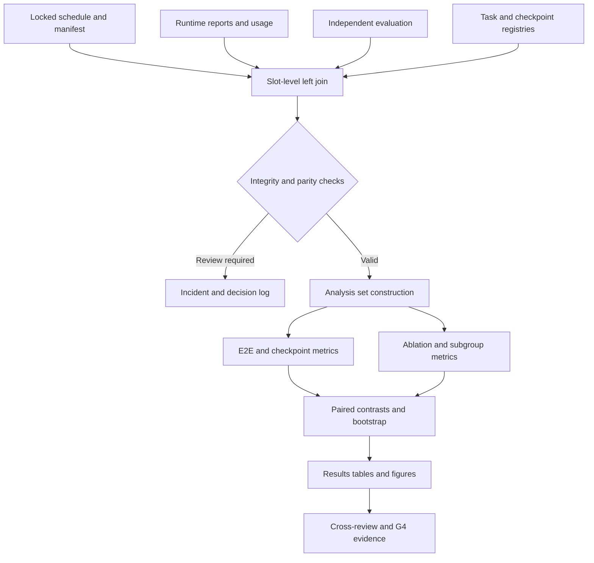

# Adaptive Agent Harness — 실험 결과 분석서 (Results Analysis)

## 그래프 기반 실패 복구 및 동적 컨텍스트 최적화를 통한 코딩 에이전트의 신뢰성과 실행 효율 향상

| 항목 | 내용 |
| --- | --- |
| 문서 | RESULTS_ANALYSIS.md |
| 버전 | v0.1.0 |
| 작성일 | 2026-11-25 |
| 수행 맥락 | 잇츠 스터디 5기 — Codex 기반 AI 코딩 에이전트 구축 |
| 상태 | 분석 절차 및 결과 보고 양식 초안 — 실측 자료 미등록 |
| 담당 | CE 주관, RH·GR 공동 검토 (TEAM_ROLES 및 IP35 기준) |
| 상위 기준 | EXPERIMENT_DESIGN.md §2, §6–15; EVALUATION_PROTOCOL.md §5–12, §15–16 |
| 입력 | EXPERIMENT_LOG.md, 동결 manifest, 독립 평가 결과 및 분석용 projection |
| 후속 산출물 | FINAL_REPORT.md, README.md 결과 영역, DEMO_SCENARIO.md 및 발표 자료 |

> **주의:** 본 문서에는 실제 실험 결과가 없다. `—`는 아직 값이 등록되지 않았음을 뜻하며 0, 실패, 통계적 비유의 또는 N/A를 의미하지 않는다. 실험 종료 후 동결된 조건과 증거를 확인하여 표를 채운다. 기대 효과, 가상의 설계 예시 및 모의 실행을 실제 연구 성과로 발표하지 않는다.

---

## 1. 분석 목적 및 범위

AAH의 그래프 기반 복구와 Dynamic Context Compiler(DCC)가 동일 Codex 모델과 공통 실행 조건에서 어떤 효과와 비용을 가지는지 분석한다. 연구 목표 달성 여부와 소프트웨어 구현 완료 여부는 별개로 판단한다.

핵심 질문은 세 가지다. 첫째, DCC가 성공당 전체 모델 토큰을 절감하면서 과제 성공과 필수 지침 준수를 보존하는가? 둘째, 관측 가능한 공통 실패 상태에서 그래프 기반 복구가 일반 재시도보다 효과적인가? 셋째, 두 정책을 함께 적용할 때 단독 정책 대비 추가적인 이득이 존재하는가? 구성 요소별 검증 및 개입 부작용은 별도로 분석한다.

| 분석 범위 | 목적 | 결과 해석 |
| --- | --- | --- |
| P0 E2E A–E | 전체 사용자 관점 성능과 비용 | 기본 및 개별 정책 대비 효과 |
| P0 Common Failure Checkpoint B–E | 동일 외부 실패 상태에서 정책 비교 | 조건부 최종 복구 효과 |
| P1 AB1–AB4 | 연결, 전략, DCC 적용 시점, 검색 방식 분리 | 실제 조작한 구성 요소의 효과 |
| P2 AB5–AB9 | 추가 구성 요소 및 선행 방법 비교 | 수행·승인 범위 내에서만 주장 |
| 탐색 분석 | 적용 조건, 관측 한계, 부작용 | 후속 가설 및 사례 설명 |

주 가설 및 실험 조건은 상위 문서의 동결된 버전을 따른다. 본 문서는 결과 보고 양식과 분석 실행 절차를 추가하며 사전 분석계획을 대체하지 않는다. 분석 전에 실제 FRZ 승인 기록을 확인하고 미확정 항목은 임의로 결정하지 않는다.

## 2. 현재 상태 및 분석 입력 등록

| 항목 | 확인 상태 | 실제 증거 / 버전 |
| --- | --- | --- |
| G2 실험 동결 승인 | 미등록 | — |
| 기술 검증 및 Pilot 결과 | 미등록 | — |
| Main E2E 결과 | 미등록 | — |
| 공통 실패 체크포인트 결과 | 미등록 | — |
| Ablation 결과 | 미등록 | — |
| 독립 평가 결과 | 미등록 | — |
| 집계 및 통계 분석 | 미등록 | — |
| G4 분석 검토 | 미등록 | — |

미등록은 이 문서에서 증거를 확인하지 않았다는 뜻이다. 외부에서 실험을 수행했는지는 별도 확인이 필요하다.

### 2.1 분석 실행 메타데이터 (작성 양식)

| 항목 | 입력 값 |
| --- | --- |
| experiment_id / protocol / FRZ ID | — |
| 모델 ID / 추론 설정 / runtime 버전 | — |
| 실행 환경 / base commit / 정책 hash | — |
| benchmark / evaluator / test bundle version | — |
| schedule / raw manifest hash | — |
| 분석 코드 commit / config hash | — |
| 분석 실행 시각 및 환경 | — |
| bootstrap 설정 / 검정 계획 / 허용 손실 폭 | — |
| EL / INC / DL 참조 | — |
| 분석자 / 교차 검토자 / 승인 | — |

### 2.2 자료의 권한과 공개 범위

원시 로그와 private 판정은 권한이 제한된 위치에서만 분석한다. 에이전트용 report 및 공개 dashboard에 hidden tests, 정답 패치, 비밀키, 내부 평가 메타데이터가 노출되지 않도록 한다. E2E·checkpoint·ablation을 별도 실험 ID로 관리하고 Pilot과 본실험은 합산하지 않는다. 정책 변경 전후 데이터를 같은 버전인 것처럼 합치지 않는다.

## 3. 데이터 집계 및 분석 전 검증



### 3.1 원천 및 산출물

| 자료 | 행 단위 / 키 | 분석 목적 |
| --- | --- | --- |
| schedule.csv | 계획 슬롯 / slot_id | 미실행까지 포함하는 계획 분모 |
| manifest.json, report.json | 실제 시도 / run_id | 설정, 종료, patch hash |
| checks.jsonl, evidence.jsonl | 공개 검사, 관측 이벤트 | 실패 및 반복 탐색 |
| interventions.jsonl, context.jsonl | 개입 및 패키지 | 전달, 전략, 컨텍스트 정책 |
| usage.jsonl | usage_id, run_id | 모델 토큰 및 비용 |
| checkpoint_registry.jsonl | source_run_id, checkpoint_id | 발생·선정·복원 및 source 회계 |
| EvaluationResult | run_id, task_id, patch_hash | 기능·회귀·제약 독립 판정 |
| TaskRegistry | task_id, task_family_id, repo_id | 사전 층화 및 군집 |

EVALUATION_PROTOCOL §10의 표준 projection을 그대로 사용한다.

| 분석 파일 | 목적 |
| --- | --- |
| run_status.csv | 슬롯별 판정 및 미실행 상태 |
| run_attempts.csv | 실제 시도와 대체 시도의 계보 |
| run_metrics.csv | 선택 슬롯의 토큰, 비용, 시간, 준수, 행동 |
| checkpoint_summary.csv | source의 적격성·선택 및 확보 비용 |
| intervention_metrics.csv | 개입 전달, 수행, 공개 검사 변화 |
| metric_summary.csv | 조건×지표×분석 집합, 분자·분모·coverage |
| paired_contrasts.csv | 대비별 효과와 신뢰구간 및 군집 수 |
| analysis_sets.json | 포함·제외 ID, 사유, config hash |

### 3.2 데이터 무결성과 실험 공정성 확인

- [ ] schedule에서 시작하는 left join으로 미실행 슬롯을 보존했다.
- [ ] slot당 선택 판정은 최대 하나이며 모든 실제 attempt는 별도로 남겼다.
- [ ] run ID, task ID, base/patch/environment/test hash가 일치한다.
- [ ] 비교군별 모델·권한·원천 접근·공통 한도와 B–E 복구 기회가 일치한다.
- [ ] 비활성 Graph/DCC 정책의 파생 정보 사용과 hidden 정보 역류가 없음을 검증했다.
- [ ] 공통 실패 분기의 snapshot, ledger, 세션 정책, 잔여 예산이 일치한다.
- [ ] 토큰 중복, 부분 관측, 누적치 초기화, 비용 단위를 검증했다.
- [ ] 사후 과제 결함 및 제외는 모든 조건에 일관되게 반영했다.
- [ ] 동결 이후 변경과 장애는 DL/EL/INC/FRZ 기록으로 추적 가능하다.
- [ ] EP01–EP30의 해당 검증 결과와 EP30 재집계 결과를 연결했다.

불일치가 있으면 자동으로 유리한 값을 선택하지 않는다. 원인을 검토하고 해당 대비를 보류하거나 승인된 규칙에 따라 처리한다. 중대한 정책 누출·격리 실패는 단순 결측이 아니라 실험 타당성 문제로 공개한다.

### 3.3 상태 분리와 분석 집합

`RunReport.stop_reason`, `EvaluationResult.status`, `AnalysisDisposition`은 서로 다른 개념이다. 실행 완료 선언이나 timeout 자체로 성공/실패를 단정하지 않고 마지막 안전한 패치에 대한 독립 평가를 우선한다. 방법 책임으로 평가 가능한 산출물을 만들지 못한 경우 유효 실패다.

| AnalysisDisposition | 주 분석 Y/Z | 보고 처리 |
| --- | --- | --- |
| VALID_SUCCESS | 1 | 유효 성공 |
| VALID_FAILURE | 0 | 유효 실패 |
| MISSING_INFRA | null | 외부 인프라 결측 |
| MISSING_EXTERNAL_CANCEL | null | 외부 취소 결측 |
| NOT_RUN_BUDGET | null | 예산 미실행 |
| NOT_RUN_OTHER | null | 기타 미실행 |
| INVALID_TASK | null | 모든 조건에서 동일한 과제 무효 처리 |
| PENDING_REVIEW | null | 검토 후 확정 또는 결측 공개 |

비용만 누락된 유효 판정은 성공률에서 유지한다. CPS는 비용까지 완전한 공통 블록을 별도 사용한다. 대체 실행은 동결된 정책이 허용하는 경우에만 선택하고 원래 시도를 삭제하지 않는다.

| 분석 집합(기록 양식) | 필요한 조건 | 지표 | set_id | 과제/CP 수 | family 수 | 제외 근거 |
| --- | --- | --- | --- | ---: | ---: | --- |
| P-R1 비용 완전 블록 | B,C | CPS | — | — | — | — |
| P-R2 완전 분기 | B,D | FRR | — | — | — | — |
| P-R3 완전 블록 | C,D,E | TSR | — | — | — | — |
| E2E 요인 분석 | B,C,D,E | TSR | — | — | — | — |
| CP 요인 분석 | B,C,D,E | FRR | — | — | — | — |
| 실용 참조 | A,E | TSR/CPS 등 | — | — | — | — |
| 전체 유효 관측 | 각 조건 | 기술 통계 | — | — | — | — |

`CP`는 common failure checkpoint의 약칭이다. 각 대비는 필요한 예정 반복이 모두 유효한 공통 블록을 사용한다. 지표마다 필요한 coverage가 다르면 추가 set_id를 부여한다. 위 명칭은 보고용이며 새로운 wire schema가 아니다.

## 4. 실험 조건과 실제 수행 범위

| 조건 | 초기 컨텍스트 | 진단 | 복구 전략 | 복구 컨텍스트 |
| --- | --- | --- | --- | --- |
| A Vanilla Codex | NONE | NONE | NATIVE | NONE |
| B Flat Retry | DEFAULT | FLAT | GENERIC | DEFAULT |
| C Context-only | DCC | FLAT | GENERIC | DCC |
| D Graph-only | DEFAULT | GRAPH | TYPED | DEFAULT |
| E Adaptive Agent Harness | DCC | GRAPH | TYPED | DCC |

A는 실용적 참조군이며 2×2 분석에서 제외한다. B–E는 공통 trigger, 복구 기회, 원천 증거 접근 및 공통 예산을 적용한다. Graph 요인은 그래프 증거 선택과 유형별 전략 선택의 묶음이다. DCC 요인은 E2E에서 최초 및 복구 패키징을 포함하지만 공통 checkpoint에서는 복구 패키징만을 뜻한다.

### 4.1 계획 대비 수행량

| 단계 | 기존 목표(잠정) | 동결된 계획 | 실제 시도 | 유효 분석 | 변경/미수행 근거 |
| --- | --- | ---: | ---: | ---: | --- |
| Smoke | 1–2개 과제 | — | — | — | — |
| Pilot | Dev 5–8개 × A–E, 25–40회 | — | — | — | — |
| Main E2E | 20–24개 × 5 × 2, 200–240회 | — | — | — | — |
| CP source | 최대 24개 과제 | — | — | — | — |
| CP branch | 목표 12개 × B–E, 48회 | — | — | — | — |
| AB1–AB4 | 별도 실행 시 80회 | — | — | — | — |
| AB5–AB9 | 조건부 | — | — | — | — |

Full 계획의 E2E+source+branch는 최대 계획상 312회, AB1–AB4를 추가하면 392회다(Pilot·Smoke·개발 호출 별도). 이는 실측치나 반드시 확보되는 표본 수가 아니다. Core/Reduced/Emergency를 사용한 경우 동결 근거와 제한된 분석 범위를 기록한다.

### 4.2 벤치마크 실제 구성

| 구분 | 계획 목표 | 편입 수 | 유효 과제 수 | 증거 및 비고 |
| --- | ---: | ---: | ---: | --- |
| 자체 AAH-Suite | 16 | — | — | — |
| 공개 Python 과제 | 8 | — | — | — |
| SINGLE | 6 | — | — | — |
| DEPENDENCY | 6 | — | — | — |
| REGRESSION | 6 | — | — | — |
| COMPOSITE | 6 | — | — | — |
| NORMAL | 12 | — | — | — |
| NOISY | 6 | — | — | — |
| STALE | 6 | — | — | — |

위 목표는 Full 24개 설계 기준이다. 출처·과제 유형·문서 상태는 서로 다른 분류 축이므로 모든 행을 합산하지 않는다. 난이도 LOW/MEDIUM/HIGH는 사전 분류를 사용하며 실제 모델 성공 여부로 재분류하여 과제를 교체하지 않는다.

## 5. End-to-end Evaluation 결과

### 5.1 계획 슬롯 및 실행 판정

| 조건 | 예정 슬롯 | 시작 슬롯 | 실제 attempt | 유효 | 성공 | 실패 | 결측 | 미실행 | 무효 과제 슬롯 | 대체 시도 |
| --- | ---: | ---: | ---: | ---: | ---: | ---: | ---: | ---: | ---: | ---: |
| A | — | — | — | — | — | — | — | — | — | — |
| B | — | — | — | — | — | — | — | — | — | — |
| C | — | — | — | — | — | — | — | — | — | — |
| D | — | — | — | — | — | — | — | — | — | — |
| E | — | — | — | — | — | — | — | — | — | — |

예정 슬롯의 분석 분류는 유효·결측(검토 중 포함)·미실행·무효로 구분한다. 실제 attempt와 시작 슬롯은 대체 실행 때문에 다를 수 있다. 전체 상태 세부표는 run_status.csv 및 run_attempts.csv를 참조한다.

### 5.2 핵심 결과표 — 전체 유효 관측(기술 통계)

| 지표 | A | B | C | D | E | 분모/단위 |
| --- | ---: | ---: | ---: | ---: | ---: | --- |
| Task Success Rate | — | — | — | — | — | 성공/유효 슬롯, % |
| 총 모델 토큰 | — | — | — | — | — | 완전 관측 범위, tokens |
| 실행당 모델 토큰 평균 | — | — | — | — | — | 비용 관측 슬롯 |
| 모델 토큰 중앙값 [IQR] | — | — | — | — | — | tokens |
| Cost per Success | — | — | — | — | — | tokens/success |
| Runtime Wall Time 평균 | — | — | — | — | — | 초 또는 ms 명시 |
| Runtime Wall Time 중앙값 [IQR] | — | — | — | — | — | 동일 단위 |
| Instruction Compliance | — | — | — | — | — | PASS/관측된 준수 판정 |
| Usage Coverage | — | — | — | — | — | 완전 관측/대상 슬롯 |
| Compliance Coverage | — | — | — | — | — | 유효 준수 판정/예정 슬롯 |

이 표는 조건별 관측 집합이 다를 수 있다. 주 효과나 비용 감소율은 같은 분석 집합에서 다시 계산하며 이 표의 수치를 무조건 빼서 만들지 않는다. 비용 결측으로 성공 슬롯만 골라낸 값은 전체 실행의 비용이 아니다.

### 5.3 주 paired 결과 — 대비별 공통 집합

과제 i, 조건 c, 반복 r에 대해 유효 결과를 $Y_{icr}\in\{0,1\}$로 두고 다음을 계산한다.

$$
\bar Y_{ic}=\frac{1}{R_{ic}}\sum_rY_{icr},\qquad p_c=\frac{1}{N}\sum_i\bar Y_{ic}.
$$

$$
\Delta_{a\to b}=\frac{1}{N}\sum_i(\bar Y_{ib}-\bar Y_{ia}).
$$

| 대비 | metric | set_id | 기준값 | 비교값 | 효과(비교−기준) | 95% CI | N / family |
| --- | --- | --- | ---: | ---: | ---: | --- | --- |
| A→E | TSR | — | — | — | — | — | — |
| B→C | TSR | — | — | — | — | — | — |
| B→D | TSR | — | — | — | — | — | — |
| D→E | TSR | — | — | — | — | — | — |
| C→E | TSR | — | — | — | — | — | — |
| B→C | token CPS | — | — | — | — | — | — |
| D→E | token CPS | — | — | — | — | — | — |
| C→E | token CPS | — | — | — | — | — | — |
| A→E | token CPS | — | — | — | — | — | — |

성공률 차이는 %p로, token CPS 차이는 tokens/success로 보고한다. E2E 내 실패 후 성공률은 조건별 선택된 실패 집단이 달라질 수 있으므로 기술 통계에 그치고 H2의 주 검증에 사용하지 않는다.

### 5.4 실제 사용자 관점 비교 (A→E)

- 동일 과제·동일 예산에서 최종 성공률 차이: —
- 성공당 토큰 및 실행 시간 변화: —
- 안전 종료 및 회귀/제약 위반: —
- 외부 처리 오버헤드와 사용자 측 장점: —
- 지원 환경 및 관측 제약: —
- 결과에 대응하는 실제 run ID 및 분석 집합: —

단일 성공 사례만으로 일반적인 개발 생산성 향상이나 모든 저장소에 대한 효용을 주장하지 않는다.

## 6. Common Failure Checkpoint Evaluation

### 6.1 공통 실패 상태 확보 및 대표성

| 항목 | 값 | 증거/분모 |
| --- | ---: | --- |
| 계획 source 슬롯 | — | — |
| 실제 source 시도 | — | — |
| 유효 관측 source | — | — |
| 적격 checkpoint 발생 source | — | — |
| 적격 checkpoint 발생률 | — | 유효 관측 source 기준 및 coverage |
| 선정 checkpoint | — | 사전 순서 및 목표 상한 |
| 미선정 적격 checkpoint | — | — |
| 복원 검증 실패/결측 | — | — |
| B–E 공통 유효 분기 checkpoint | — | — |
| B–D 공통 유효 분기 checkpoint | — | — |

source에서 실패 상태가 발생하지 않은 경우도 확보 비용 및 분모 흐름에 남긴다. T5 및 인위적 실패 주입은 자연 발생 표본과 분리한다. source는 관측 가능한 실패 신호에서 고정된 상태이며 hidden 실패를 이미 증명한 상태가 아니다.

| 사전 선정/복원 항목 | 확인 결과 | 근거 |
| --- | --- | --- |
| source 실행 조건 및 첫 적격 trigger | — | — |
| 동일 snapshot/patch/신규 파일 복원 | — | — |
| 공통 ledger, 이력 요약 및 세션 정책 | — | — |
| 동일 잔여 시간·턴·복구 기회 | — | — |
| 동일 공개 증거 접근 및 필수 지침 | — | — |
| 분기 독립성 및 평가 정보 격리 | — | — |

내부 세션 복제가 검증되지 않으면 공통 NEW_SESSION 및 동일 평면 이력 요약을 사용한다. 복원되지 않은 내부 상태를 동일하다고 주장하지 않는다. 분기 시작 시 최초 DCC를 다시 수행하지 않는다.

### 6.2 최종 실패 복구율

$$
FRR_c=\frac{1}{J}\sum_{j=1}^{J}Z_{jc},\qquad Z_{jc}\in\{0,1\}.
$$

J는 해당 대비에서 유효한 공통 checkpoint 수다. 첫 개입 후 공개 테스트 통과는 최종 FRR을 대신하지 않는다.

| 조건 | 선정/예정 분기 | 유효 분기 | 최종 성공 | 최종 실패 | 전체 유효 FRR (%) | 공통 B–E FRR (%) |
| --- | ---: | ---: | ---: | ---: | ---: | ---: |
| B | — | — | — | — | — | — |
| C | — | — | — | — | — | — |
| D | — | — | — | — | — | — |
| E | — | — | — | — | — | — |

| 대비 | set_id | J/family | 기준 FRR | 비교 FRR | 차이 (%p) | 95% CI |
| --- | --- | --- | ---: | ---: | ---: | --- |
| B→D (P-R2) | — | — | — | — | — | — |
| C→E | — | — | — | — | — | — |
| B→C | — | — | — | — | — | — |
| D→E | — | — | — | — | — | — |
| B→E | — | — | — | — | — | — |

복구율의 일반화 범위는 확보된 자연 발생 실패 유형과 해당 외부 상태다. E2E 전체 성공률과 구분한다. J=0이면 N/A와 이유를 표시하며 실패 0건으로 대체하지 않는다.

### 6.3 확보 및 분기 비용

| 항목 | 관측 수 | 모델 토큰 합 | 시간 합 | 관측 범위/단위 |
| --- | ---: | ---: | ---: | --- |
| 모든 source 실제 시도 (미발생 포함) | — | — | — | — |
| 복원 비용 | — | — | — | — |
| B branch | — | — | — | — |
| C branch | — | — | — | — |
| D branch | — | — | — | — |
| E branch | — | — | — | — |

분기 비용은 restore 완료 후 공통 정책 준비부터 종료까지로 통일한다. 사용자 관점의 가상 단독 비용은 공통 source + 해당 branch(+별도 restore 표시)로 재구성할 수 있으나 네 조건의 재구성 비용을 실제 총지출로 합산하지 않는다. 프로젝트 지출의 source는 한 번만 계산한다.

## 7. 2×2 요인 분석

B=(0,0), C=(1,0), D=(0,1), E=(1,1)에서 첫 요인은 DCC, 둘째는 Graph다. 성공률/FRR의 가법 척도에서 같은 B–E 공통 블록을 사용한다.

$$
\Delta_C=\frac{(p_C-p_B)+(p_E-p_D)}{2},\qquad
\Delta_G=\frac{(p_D-p_B)+(p_E-p_C)}{2}
$$

$$
\Delta_{int}=(p_E-p_D)-(p_C-p_B)=p_E-p_D-p_C+p_B.
$$

| 프로토콜 | set_id | p_B | p_C | p_D | p_E | N/J 및 family |
| --- | --- | ---: | ---: | ---: | ---: | --- |
| E2E TSR | — | — | — | — | — | — |
| CP FRR | — | — | — | — | — | — |

| 효과 | E2E 효과 (%p) | 95% CI | CP 효과 (%p) | 95% CI |
| --- | ---: | --- | ---: | --- |
| DCC 주효과 | — | — | — | — |
| Graph 주효과 | — | — | — | — |
| 가법 상호작용 | — | — | — | — |

해석 시 E가 C와 D보다 모두 높은지와 양의 상호작용이 있는지를 분리한다. 상호작용이 0 또는 음수이더라도 E가 두 단독 조건을 능가할 수 있다. 양의 상호작용만으로 E의 절대 성능이 최고라고 할 수도 없다. 효과 크기와 구간을 함께 보고한다. 비용은 별도 단위와 방향을 사용하고 비율 지표인 CPS에는 성공률의 요인식을 그대로 적용하지 않는다.

## 8. Ablation Study 결과

모든 variant는 별도 ID와 동결 manifest를 사용한다. 실제 수행하지 않은 실험은 결과를 작성하지 않고 미수행 사유를 등록한다.

| ID | 대비 | 분리 대상 | 주요 결과 | 실제 상태/참조 |
| --- | --- | --- | --- | --- |
| AB1 | E vs Unlinked | 명시적 그래프 연결을 포함한 복구 정책 | FRR, 후보 품질, 비용 | 미등록 |
| AB2 | Typed vs Generic, 동일 증거 | 첫 전략 지침 변경 | 첫 후속 공개 검사, 전략 수행 | 미등록 |
| AB3 | Neither / Initial-only / Recovery-only / Both | DCC 적용 시점 | E2E TSR, CPS | 미등록 |
| AB4 | Graph vs Flat, 공통 전략·DCC | 검색 구조 | 복구율, 증거 품질, 비용 | 미등록 |
| AB5 | Repo-only / Exec-only / Dual | 개별 그래프 | 조건부 복구율 | 미등록 |
| AB6 | DCC without validity / without dedup | 보조 컨텍스트 선별 요소 | 성공률, 비용, stale/noisy 영향 | 미등록 |
| AB7 | Static / Retrieval-only / DCC | JEC 계열 컨텍스트 정책 | 성공률, 비용 | 미등록 |
| AB8 | 의미 있는 연결 vs 무작위 연결 | 관계 의미 | 탐색적 비교 | 미등록 |
| AB9 | 유사 선행 방법 재현 | 직접 비교 | 별도 승인 계획 | 미등록 |

### 8.1 AB1–AB4 조작 검증 및 결과

| ID | 통제/조작 확인 | set_id | N/J 및 family | 지표/단위 | 효과 (방향 명시) | 95% CI | 제한 |
| --- | --- | --- | --- | --- | ---: | --- | --- |
| AB1 | 동일 원천 접근, 내부 그래프, 방문 상한, 정책 | — | — | — | — | — | 후보/전략 변화 포함 |
| AB2 | 동일 진단·증거 패키지, 전략 메시지만 변경 | — | — | — | — | — | 첫 후속 실행 우선 |
| AB3 | Graph ON, 최초/복구 DCC 교차 | — | — | — | — | — | E2E 집합 차이 고려 |
| AB4 | 동일 후보 풀·GENERIC_RETRY·DCC·상한 | — | — | — | — | — | 그래프 검색 효과 |

AB1은 관계 연결을 사용한 전체 정책의 조건부 효과이며 동일 최종 지침 아래 구조만 바꾼 효과가 아니다. AB2에서 DCC 패키지를 재생성해 증거를 바꾸거나 typed 조건의 fallback을 삭제하지 않는다. AB2의 첫 후속 실행을 기준으로 분석하며, one-step 독립 평가 또는 다단계 후속 비교는 실제 승인·수행한 설계에 한정한다. AB3에서 초기 DCC가 실패 집단에 미치는 영향을 고려하며 조건별 자연 실패 후 복구율을 순수 효과로 사용하지 않는다.

### 8.2 DCC 적용 시점 세부 결과(AB3)

| 조건 | 최초 DCC | 복구 DCC | TSR | token CPS | 초기/복구 패키지 토큰 | set_id |
| --- | --- | --- | ---: | ---: | --- | --- |
| Neither (D) | OFF | OFF | — | — | — | — |
| Initial-only | ON | OFF | — | — | — | — |
| Recovery-only | OFF | ON | — | — | — | — |
| Both (E) | ON | ON | — | — | — | — |

동결된 동일 버전과 schedule block 요건을 충족할 때만 기존 D/E 결과를 재사용한다. 모든 요인을 동시에 바꾸거나 서로 다른 분석 집합을 비교하지 않는다. AB1/AB2/AB4 미수행 시 연결·전략·검색 방식의 독립 효과를 주장하지 않는다.

## 9. 비용 대비 성능 및 로컬 오버헤드

### 9.1 모델 토큰과 과금

$$
CPS_c=\frac{\sum_{i,r}C_{icr}}{\sum_{i,r}Y_{icr}}.
$$

유효 성공 및 실패의 비용을 모두 포함한다. 비용과 성공 분모는 동일 슬롯 집합이어야 한다. 성공 0건이면 `NO_SUCCESS`로 기록하고 유한한 CPS를 표시하지 않는다. 부분 관측 합계는 완전한 토큰 합계가 아니다. DELTA는 고유 이벤트를 합산하고 CUMULATIVE는 검증된 scope에서 차분한다. cached input 또는 reasoning이 이미 총량에 포함되면 중복해서 더하지 않는다.

| 대비 | 비용 종류 | set_id | 기준 CPS | 비교 CPS | 감소율 (%) | 95% CI / 단위 |
| --- | --- | --- | ---: | ---: | ---: | --- |
| B→C | 모델 토큰 (P-R1) | — | — | — | — | — |
| D→E | 모델 토큰 | — | — | — | — | — |
| C→E | 모델 토큰 | — | — | — | — | — |
| A→E | 모델 토큰 | — | — | — | — | — |

감소율은 $100(CPS_a-CPS_b)/CPS_a$로 계산하며 기준값이 유한 양수이고 비교값도 정의된 경우에만 제공한다. 실제 과금, 추정 과금, 크레딧은 각각 독립적인 표로 같은 양식을 사용한다. 크레딧을 토큰·통화로 임의 환산하지 않는다. 가격표 버전 및 유효일을 확인하지 못하면 금액 지표를 보류한다.

### 9.2 로컬 시간 및 단계별 비용

| 단계/지표 | A | B | C | D | E | 단위/coverage |
| --- | ---: | ---: | ---: | ---: | ---: | --- |
| 초기 패키지 추정 토큰 | — | — | — | — | — | 외부 보조 정보 |
| 복구 패키지 추정 토큰 | N/A | — | — | — | — | 외부 보조 정보 |
| 전체 모델 토큰 | — | — | — | — | — | 모든 관측 모델 호출 |
| Graph build/update 시간 | N/A | N/A | N/A | — | — | 동일 clock 정의 |
| Graph query 시간 | N/A | N/A | N/A | — | — | 동일 clock 정의 |
| DCC 처리 시간 | N/A | N/A | — | N/A | — | 최초/복구 분리 |
| Runtime Wall Time | — | — | — | — | — | 전체 경과 시간 |
| 독립 평가 시간 | — | — | — | — | — | 별도 평가 비용 |

N/A 표시는 구조적으로 해당 정책이 없는 지표에 한정한다. 관측되지 않은 값은 별도 결측이다. 중첩된 wall-clock 구간을 단순 합산하여 전체 시간으로 사용하지 않는다. DCC의 2,048 보조 토큰 한도는 Pilot 후보이며 전체 모델 입력이나 실제 실행 토큰이 아니다.

### 9.3 실제 프로젝트 지출(운영 회계)

| 단계 | 모든 실제 시도 수 | 모델 토큰 | 실제 과금 | 추정 과금 | 크레딧 | 비고 |
| --- | ---: | ---: | ---: | ---: | ---: | --- |
| 개발 및 RT probe | — | — | — | — | — | — |
| Pilot / Smoke | — | — | — | — | — | — |
| E2E | — | — | — | — | — | — |
| CP source / restore / branch | — | — | — | — | — | — |
| Ablation | — | — | — | — | — | — |
| 기타 실제 지출 | — | — | — | — | — | — |

대체 시도는 해당 단계의 실제 회계에 포함하며 별도 합계를 다시 더하지 않는다. 제외된 인프라 시도 비용을 포함한 운영 관점 CPS는 주 CPS와 구별하여 보고한다. 실제 과금과 추정 과금은 합산하지 않는다.

## 10. 메커니즘 및 부작용 분석

### 10.1 실행 행동 및 개입

| 지표 | A | B | C | D | E | 분모 및 관측 범위 |
| --- | ---: | ---: | ---: | ---: | ---: | --- |
| Tool Calls | — | — | — | — | — | 고유 관측 호출 |
| Exploration Redundancy | — | — | — | — | — | 중복/비교 가능 탐색 |
| Trigger Rate | N/A | — | — | — | — | 유효 공통 감지 run |
| Intervention Rate | 0 (설계상) | — | — | — | — | 전달 확인 run/대상 run |
| Fallback Rate | N/A | — | — | — | — | 대체 개입/개입 결정 |
| Strategy Adherence | N/A | — | — | — | — | 전달 확인 개입 및 coverage |
| Harmful Intervention | N/A | — | — | — | — | 악화 관측/비교 가능한 개입 |
| Fault Localization Top-k | N/A | N/A | N/A | — | — | 검증 원인 위치 및 후보 관측 |
| Diagnostic Coverage | N/A | — | — | — | — | 진단 단계별 유효 관측 |

A의 외부 개입 0은 설계상 제약이며 실측 성과가 아니다. A의 트리거는 사후 오프라인 분석을 수행한 경우만 별도 표시한다. 진단 coverage는 평면 진단과 그래프 진단에서 공통으로 비교 가능한 부분을 구분하고 그래프 연결 등 전용 지표는 B/C에 N/A로 표시한다. 반복 탐색은 스냅샷 변경 및 새로운 증거를 고려한 정규화 정의로 계산한다. 단순 반복 읽기가 항상 비효율적이라는 가정을 하지 않는다.

### 10.2 실패 유형 및 복구 전략

| trigger | 관측 정의 | 발생 run 수 | 유효 CP 수 | 개입 수 | 최종 결과 참조 |
| --- | --- | ---: | ---: | ---: | --- |
| T1 REPEATED_FAILURE | 같은 실패 지문 반복 및 개선 없음 | — | — | — | — |
| T2 STAGNATION | 중복 탐색 및 새 증거/진전 부족 | — | — | — | — |
| T3 REGRESSION | 비교 가능 공개 검사 PASS→FAIL | — | — | — | — |
| T4 INCOMPLETE_AT_DONE | 완료 선언 시 공개 필수 검사 실패 | — | — | — | — |
| T5 UNKNOWN/INFRA | 불충분한 관측 또는 환경 장애 | — | N/A | — | — |

여러 trigger가 동시에 발생할 수 있으므로 행 합계가 전체 run 수와 일치하지 않을 수 있다. 사전 설계된 예상 trigger 태그와 실제 발생 신호는 별도로 보고한다. T5는 자연 실패 FRR에 포함하지 않는다.

| 전략 ID | 결정 | 전달 확인 | performed | not_observed | contradicted | unknown | fallback |
| --- | ---: | ---: | ---: | ---: | ---: | ---: | ---: |
| REVIEW_REGRESSION | — | — | — | — | — | — | — |
| RELOCALIZE | — | — | — | — | — | — | — |
| REFRESH_EVIDENCE | — | — | — | — | — | — | — |
| GENERIC_RETRY | — | — | — | — | — | — | — |

CONTINUE/STOP은 외부 전달이 없는 제어 결정으로 별도 집계한다. RESERVED와 DELIVERED, UNKNOWN_DELIVERY를 구분한다. 수행 여부와 성공은 다르며, 모델의 완료 주장만으로 performed를 부여하지 않는다. 전략별 빈도와 결과는 상태의 차이에 의해 교란될 수 있으므로 직접적인 인과 비교가 아니다.

### 10.3 공개 검사 변화 및 악화

| 상태 | B | C | D | E | 설명 |
| --- | ---: | ---: | ---: | ---: | --- |
| IMPROVED | — | — | — | — | 기존 FAIL→PASS |
| WORSENED | — | — | — | — | 기존 PASS→FAIL 또는 새 실패 |
| MIXED | — | — | — | — | 개선과 악화 동시 |
| UNCHANGED | — | — | — | — | 비교 가능한 검사 변화 없음 |
| UNKNOWN | — | — | — | — | 누락, 환경/검사 불일치 |

비교 가능한 동일 검사 버전/환경의 전후 관측만 사용한다. 악화율 분자에 MIXED를 포함하는 경우 그 건수를 명시하고 UNKNOWN을 정상으로 처리하지 않는다. 관측상 악화는 개입으로 인해 악화됐다는 인과 증명이 아니다. 공통 checkpoint 정책 비교 및 AB2의 조작 검증을 함께 참조한다.

### 10.4 그래프와 컨텍스트 내부 진단

| 모듈 | 분석할 항목 | 결과/참조 |
| --- | --- | --- |
| Graph | snapshot별 노드·엣지, observed/inferred/unknown | — |
| Graph | 실패 앵커, cross-graph 경로, 방문·후보 수, query 시간 | — |
| Graph | 관련 코드 후보 Top-k, 확인된 원인 위치 및 coverage | — |
| Graph | fallback, 누락 연결, 정적 분석 오류 | — |
| DCC | CURRENT/INVALID/HISTORICAL/UNCERTAIN 후보 및 선택·제외 | — |
| DCC | 관련성, 유효성, 중복 패널티, 토큰 예산 및 실제 전달 hash | — |
| DCC | 초기/복구 패키지 크기와 전체 실행 토큰의 관계 | — |
| DCC | 필수 지침 보존, 정보 과소 제공, 잘못된 제외 사례 | — |

추정 관계(SUSPECTS 등)나 traceback 위치는 확정된 근본 원인이 아니다. 실제 원인 위치의 private annotation은 분석에서만 사용하고 에이전트에 주입하지 않는다. 컨텍스트 절감이 전체 실행 비용 감소로 이어졌는지 별도 검증한다.

## 11. 통계 분석 및 불확실성

### 11.1 주 분석 가족

| 대비 ID | 추정 대상 | 개선 방향 | set_id | 효과 | 95% CI | 해석 상태 |
| --- | --- | --- | --- | ---: | --- | --- |
| P-R1 | E2E CPS_C − CPS_B (tokens/success) | 음수 | — | — | — | 미평가 |
| P-R2 | CP FRR_D − FRR_B (%p) | 양수 | — | — | — | 미평가 |
| P-R3 | E2E p_E − max(p_C,p_D) (%p) | 양수 | — | — | — | 미평가 |

P-R3은 같은 C/D/E 공통 집합에서 $\min(p_E-p_C,p_E-p_D)$로 계산하고 두 단독 대비를 함께 표시한다. 비용 면의 이득, A→E, C→E 복구율, 요인별 상호작용은 계획된 보조 분석이다. 보조 결과를 사후 주 가설로 승격하지 않는다.

### 11.2 Paired cluster bootstrap

동결된 계획에서 달리 승인하지 않은 경우 EVALUATION_PROTOCOL §11.4의 후보 설정(10,000회, 분석 seed 20261126, 양측 95% percentile 구간)을 따른다. 독립 재표집 단위는 task family다. 같은 family의 모든 조건·반복·checkpoint를 함께 뽑고 중복 추출의 multiplicity를 보존한다. 반복 run 수를 독립 과제 수로 사용하지 않는다.

```python
# 개념 의사코드. 실제 함수와 스키마는 TECHNICAL_SPEC 및 EP 테스트에 따른다.
blocks = select_complete_blocks(rows, contrast.required_conditions,
                                require_cost=contrast.requires_cost)
clusters = group_by_task_family(blocks)
if not clusters:
    return unavailable("NO_COMPLETE_BLOCKS")
point = statistic(blocks)
rng = make_rng(seed=frozen_analysis_seed)
values = []
for _ in range(frozen_bootstrap_reps):
    sampled = sample_with_replacement(clusters, len(clusters), rng)
    sample = concatenate_with_unique_draw_ids(sampled)
    values.append(statistic(sample))
return summarize_with_undefined_count(point, values, alpha=0.05)
```

각 bootstrap에서 TSR/FRR, 요인 대비 및 CPS의 분자·분모를 다시 계산한다. P-R3의 max 역시 매 표본에서 다시 계산한다. CPS 무정의 replicate는 삭제하지 않는다. EVALUATION_PROTOCOL의 보수적 후보 규칙(무정의 replicate가 하나라도 있으면 주 유한 percentile 구간 보류)은 Pilot 승인 여부를 확인하고 적용한다. 무정의 수와 비율을 반드시 기록한다.

| 대비 ID | 재표집 단위 | family 수 | 반복 수/seed | undefined 수/비율 | CI 방식 | 제한 |
| --- | --- | ---: | --- | --- | --- | --- |
| P-R1 | task family | — | — | — | — | — |
| P-R2 | task family | — | — | — | — | — |
| P-R3 | task family | — | — | — | — | — |

저장소 수가 충분하면 repository cluster bootstrap을 보조 검토하고, 작으면 leave-one-repository-out 분석을 수행하여 결과 의존성을 확인한다. 적은 family 수나 경계 비율에서 percentile CI가 과도하게 낙관적일 수 있으므로 원 분자·분모와 과제별 차이를 함께 제시한다.

### 11.3 검정과 비열등성

선택적 검정은 사전 승인 및 교환가능성 등 가정을 확인한 경우에만 수행한다. 주 가족에 Holm 보정을 적용하며 P-R3는 두 단독 대비를 모두 지지해야 한다는 교집합 검정으로 정의한다. 유효한 단측 검정이 확보된 경우 두 p값 중 최대값을 가족 보정 입력으로 사용하는 기존 후보를 검토한다. 통상적인 95% 구간은 동시 보정 구간이 아니다. 검정 생략은 비유의와 다르다.

| 항목 | 동결 기준 | 실제 적용 / 근거 |
| --- | --- | --- |
| 검정 수행 여부 및 가정 | — | — |
| 검정 방향, 가족, Holm 범위 | — | — |
| 성공률 비열등성 허용 손실 폭 | — | — |
| 준수율 판단 기준 | — | — |
| 비열등성에 사용할 신뢰 하한 및 분석 집합 | — | — |

5%p 허용 폭은 사전 검토 후보이지 확정된 값이 아니다. 결과를 본 뒤 허용 폭을 변경하지 않는다. 안전 및 필수 제약 위반을 허용하는 기준으로 사용하지 않는다. 비용 절감과 비유의한 성공률 차이는 성능 유지의 충분한 증거가 아니다.

## 12. 연구 질문별 가설 해석

분석 상태는 본 문서의 보고용 분류로 `지지`, `부분 지지`, `반대 방향 근거`, `결론 불충분`, `미평가`를 사용한다. 이는 EVALUATION_PROTOCOL의 AnalysisDisposition을 변경하지 않는다. 실제 판단은 승인된 분석 기준, 효과 크기, 구간, 표본 및 타당성에 근거하고 단순 점추정으로 확정하지 않는다.

| 질문 | 검증 증거 | 관측 요약 | 판단 | 한계 |
| --- | --- | --- | --- | --- |
| RQ1/H1: DCC 효율 | P-R1, B→C 및 D→E 성공률·준수율 | — | 미평가 | — |
| RQ2/H2: 그래프 복구 | P-R2, C→E CP FRR | — | 미평가 | — |
| RQ3/H3: 결합 이득 | P-R3, C→E/D→E CPS, 요인 효과 | — | 미평가 | — |
| RQ4/H4: 세부 구성 요소 | 실제 AB1–AB9 | — | 미평가 | — |
| RQ5: 적용 조건과 부작용 | 층화·공통 상태·개입 사례 | — | 미평가(탐색) | — |
| 실용 참조: AAH 가치 | A→E E2E | — | 미평가 | — |

해석 예시(가상의 판단 규칙이며 결과가 아님):

- H1: CPS가 감소하더라도 성공률 또는 준수에 실질적인 저하가 관측되면 효율 개선 전체를 지지한다고 하지 않는다. 불확실성이 크면 비용 이득과 성능 유지 결론을 분리한다.
- H2: B→D FRR 개선 근거가 있다면 공통 실패 상태의 Graph+Typed 정책 효과로 해석한다. AB1/AB2/AB4가 없으면 개별 그래프 연결이나 전략의 순수 효과라고 주장하지 않는다.
- H3: E가 두 단독 조건을 넘는 주 성공률 대비와 비용 이득을 따로 보고한다. 성공률 주 대비가 지지되지 않았다고 사후에 비용 이득으로 주 가설을 바꾸지 않는다. 양의 상호작용은 별도 추정 대상이다.
- H4: 해당 ablation을 수행했으며 조작 검증이 통과한 경우에만 세부 요소에 관한 주장을 한다.
- RQ5: 부정적 결과, fallback 및 오개입을 포함한다. 사후 발견은 탐색적 결과로 표시한다.

## 13. 하위집단 및 민감도 분석

| 하위집단 축 | 분류 | 대비/set_id | N/J 및 family | 효과 | 95% CI 또는 기술 통계 | 해석 제한 |
| --- | --- | --- | --- | ---: | --- | --- |
| 출처 | 자체 / 공개 | — | — | — | — | — |
| 대표 유형 | SINGLE / DEPENDENCY / REGRESSION / COMPOSITE | — | — | — | — | — |
| 문서 상태 | NORMAL / NOISY / STALE | — | — | — | — | — |
| 난이도 | LOW / MEDIUM / HIGH | — | — | — | — | — |
| 실제 실패 유형 | T1–T4 | — | — | — | — | — |

소표본에서 집단별 순위를 일반화하지 않는다. 태그 중복을 명시하며 자연 실패와 인위적 replay, 정상 실행과 복구를 섞지 않는다. E2E에서 조건별 trigger 발생 집단을 기준으로 한 효과 비교는 선택 편향을 포함할 수 있다.

### 13.1 결측 및 민감도 결과표

| 민감도 분석 | 기준 결과 | 대안 결과/범위 | 결론 변화 | 근거 |
| --- | --- | --- | --- | --- |
| 전체 유효 run vs 완전 블록 | — | — | — | — |
| 계획 분모 결측 전부 실패/성공 | — | — | — | — |
| 조건별 유리·불리 결측 가정 | — | — | — | — |
| 비용 완전 블록 coverage | — | — | — | — |
| 운영 CPS(대체 및 인프라 시도 포함) | — | — | — | — |
| leave-one-repository-out | — | — | — | — |
| repository cluster bootstrap(가능 시) | — | — | — | — |
| 자체/공개 별도 분석 | — | — | — | — |

계획 분모 민감도는 과제 무효 처리 및 사전 정의된 분석 대상 규칙을 먼저 적용하고, 포함 대상의 미실행 및 결측에 대해 상·하한을 계산한다. 이 범위는 통계적 신뢰구간이 아니다. 완전 블록이 없어지거나 결과가 결측 가정에 민감하면 결론을 제한한다.

## 14. 실패 및 복구 사례 분석

사례는 전체 결과의 설명을 보조한다. 성공 사례 외에 개선 없음, 역효과, fallback, 관측 부족도 포함한다. 가능하면 같은 과제 또는 동일 checkpoint의 상반된 조건을 비교한다. 사례 선택 기준과 실제 선택 이유는 기록하고 대표성 여부를 명시한다.

| 사례 ID | 선정 목적 | task/CP ID | 조건 / run ID | 독립 결과 | 증거 참조 |
| --- | --- | --- | --- | --- | --- |
| CASE-01 (예정) | 그래프 기반 복구 사례 | — | — | — | — |
| CASE-02 (예정) | 컨텍스트 최적화 사례 | — | — | — | — |
| CASE-03 (예정) | 결합 효과 또는 무개선 사례 | — | — | — | — |
| CASE-04 (예정) | 악화/fallback/실패 사례 | — | — | — | — |

CASE ID는 보고 편의를 위한 신규 제안이며 실제 사례가 존재한다는 뜻이 아니다. 해당 유형이 관측되지 않으면 미확보 사유를 기록한다.

### 14.1 사례별 작성 양식

```markdown
### CASE-... — 제목
- 선택 목적 및 표본 대표성:
- experiment/FRZ/analysis_set/task/checkpoint/run/EL ID:
- 과제 요청 및 환경(공개 가능 범위):
- 최초 관측 및 trigger, 이전 공개 검사와 snapshot:
- 그래프 앵커/경로/후보 및 observed/inferred 구분:
- 전략 ID, 선택 이유, fallback 및 실제 전달 여부:
- 컨텍스트 package_id, 선택·제외 근거, 토큰 수:
- 후속 관측 행동 및 adherence:
- 비교 가능한 공개 검사 변화와 독립 최종 판정:
- 같은 상태의 비교군 결과 및 비용:
- 관측 사실:
- 가능한 설명/대안 설명:
- 인과 주장에 필요한 추가 검증 및 한계:
- 공개 승인 및 검토자:
```

진단의 원인 후보와 실제 검증된 원인을 분리한다. 여러 번의 개입 후 성공을 첫 전략 단독의 효과로 해석하지 않는다. 사용자에게 실제 제공된 정보 및 관측된 행동만을 근거로 한다.

## 15. 결과 시각화 및 산출물 명세

아래 파일명은 분석·보고용 신규 제안이다. 실제 분석 코드나 그림이 생성되었다는 뜻이 아니다. 파일에는 분석 ID, 동결 버전, 단위, 분모 또는 분석 집합, 데이터 출처를 캡션 또는 별도 manifest로 연결한다.

| Figure ID / 제안 파일명 | 시각화 | 데이터 | 필수 표기 |
| --- | --- | --- | --- |
| FIG01 slot_flow.png | 상태별 실행 흐름/누적 막대 | run_status, run_attempts | 예정·실행·유효·미실행·결측 |
| FIG02 e2e_success.png | A–E 성공률과 불확실성 | metric_summary | 분자/분모, 공통 또는 전체 유효 구분 |
| FIG03 recovery_rates.png | B–E 공통 상태 FRR | checkpoint_summary, metric_summary | J, family, source 선정 흐름 |
| FIG04 paired_effects.png | paired 대비 forest plot | paired_contrasts | 0 기준선, 효과 단위, CI, N |
| FIG05 factorial.png | E2E/CP 요인 interaction plot | B–E 공통 집합 | 조건과 가법 상호작용 별도 |
| FIG06 cost_tradeoff.png | 성공률–성공당 토큰 비교 | 비용 완전 블록 | 단위, coverage, NO_SUCCESS 표기 |
| FIG07 runtime_overhead.png | 시간 및 오버헤드 분포 | run_metrics, stage spans | 중첩 구간 주의, 단위 |
| FIG08 ablations.png | 실제 수행한 조작의 효과 | paired_contrasts | AB ID, 대응 지표, 미수행 구분 |
| FIG09 interventions.png | trigger/전략/검사 변화 | intervention_metrics | 전달 상태, unknown, 분모 |
| FIG10 case_trace.png | 동일 과제의 실패–복구 증거 흐름 | 공개 가능한 실제 trace | 관측·추정 구분, patch/EL ref |

시각화에서 미측정·N/A·결측을 0 높이 막대로 처리하지 않는다. 비용 결측 또는 성공 0건의 CPS는 축에서 임의 제거하지 말고 사유를 명시한다. 성능이 높은 실행만 표시하지 않으며 CI가 계산 불가하면 점추정과 사유를 표시한다. FIG05의 평행 여부를 통계적 유의성 판단으로 대체하지 않는다.

## 16. 연구 타당성 및 한계

| 위협 | 실제 관측/검증 | 결과에 미치는 영향 | 대응 또는 공개할 한계 |
| --- | --- | --- | --- |
| 기본 모델 성능 ceiling / 자연 실패 희소 | — | — | 발생률 및 확보 비용, 일반화 제한 |
| 소표본 및 task family/저장소 의존성 | — | — | 군집 분석과 구간, 과제별 결과 |
| 공개 벤치마크 학습 데이터 노출 가능성 | — | — | 자체/공개 별도 보고 |
| 인위적 stale/noisy 문서 환경 | — | — | 정상과 설계 조건 구분 |
| Graph 정적 분석 불완전 및 관계 추정 | — | — | coverage 및 잘못된 후보 공개 |
| Codex 이벤트 관측 범위 및 비결정성 | — | — | 버전, 관측 불가 행동, 반복 변동성 |
| 공통 외부 snapshot과 내부 세션 차이 | — | — | NEW_SESSION 등 복원 제한 |
| 토큰 부분 관측 및 비용 추정 | — | — | 단위·coverage·민감도 분리 |
| 외부 개입의 추가 오버헤드 및 악화 | — | — | 비교 가능한 검사 및 정책 비교 |
| 평가 결함, 결측, 인프라 장애 | — | — | 공통 제외·사유 및 원시 시도 보존 |
| 복합 요인으로 인한 기여 분리 한계 | — | — | 실제 수행 AB 범위에 맞춰 주장 |
| 유사 선행연구 직접 재현 여부 | — | — | 비교 가능성 및 학술적 신규성 제한 |

MemTrace, AgentTether, Rivet, PROBE, CodeTracer 등과의 관련성은 LITERATURE_REVIEW의 검토를 참조한다. 본 문서는 신규 문헌 검증이나 직접 재현 결과를 제공하지 않는다. AB9를 실제 수행하지 않았다면 다른 논문의 표에 기재된 성능과 현재 AAH 수치를 같은 조건의 head-to-head 비교처럼 제시하지 않는다. 그래프와 컨텍스트의 최초 결합을 주장하지 않는다.

## 17. 연구 및 프로젝트 결론 작성 양식

| 평가 축 | 작성할 근거 | 실제 결론 |
| --- | --- | --- |
| 문제정의·필요성 (15) | 관측 실패 발생률, 대표 사례, 비용 문제 | — |
| AI 기술 활용도 (25) | 실제 Codex 실행, 적응 정책과 전달·관측 증거 | — |
| 구현 완성도 (25) | 실제 통합 기능, 승인 게이트 및 테스트 | — |
| 실용성 (15) | A→E 비용/성공률, 지원 저장소, 사용 한계 | — |
| 학습과정·협업 (10) | 실제 작업·리뷰·분석 기여 및 활동 기록 | — |
| 차별성·확장성 (10) | AB 결과, 적용 조건, 선행연구 대비 주장 범위 | — |

위 점수는 심사 배점이며 자체 평가 점수 또는 획득 점수가 아니다. 연구 가설의 성패를 구현 완료와 분리하고 개선이 없거나 부정적이어도 결과를 그대로 공개한다.

최종 요약 작성 시 다음 문장 구조를 사용한다(모두 실제 데이터 확인 후 채움).

1. 어떤 과제·모델·예산과 분석 집합에서 비교했는가? —
2. P-R1/P-R2/P-R3의 효과 크기와 불확실성은 무엇인가? —
3. 각 구성 요소의 독립 효과와 결합 효과 중 검증된 범위는 어디까지인가? —
4. 효과가 없거나 악화된 경우 및 비용은 무엇인가? —
5. 실제 사용자에게 적용 가능한 범위와 후속 연구는 무엇인가? —

## 18. G4 검토 및 결과 공개

IP35의 완료는 유리한 결과가 나온 경우에만 성립하는 것이 아니다. 승인된 분석 범위의 결과를 재현·검토하고 증거가 부족한 부분을 명시해야 한다.

- [ ] 계획 슬롯, 실제 시도 및 최종 판정을 완전히 추적했다.
- [ ] 분석 집합과 제외·결측 사유를 재현할 수 있다.
- [ ] 주 대비, 보조 대비, 실제 수행 AB 및 미수행 범위를 보고했다.
- [ ] 효과·구간·분자/분모·군집 수·비용 단위·coverage를 확인했다.
- [ ] 검정/비열등성은 동결된 기준을 사용했고 무정의 구간을 숨기지 않았다.
- [ ] 성공·실패·악화·fallback 및 관측 부족 사례를 포함했다.
- [ ] EP30 재집계 및 분석 재실행 결과 hash를 기록했다.
- [ ] CE 분석과 RH 계측 및 GR 진단에 대한 교차 검토를 완료했다.
- [ ] 공개 데이터의 라이선스와 비밀/평가 정보 제거를 확인했다.
- [ ] FINAL_REPORT, README, DEMO_SCENARIO의 수치 및 주장과 일치시켰다.

| 검토 항목 | 담당 역할 | 실제 검토/승인 | 증거 |
| --- | --- | --- | --- |
| 사용량·실행·버전 추적 | RH | — | — |
| 진단·전략·실패 사례 및 AB | GR | — | — |
| 독립 판정·통계·컨텍스트 분석 | CE | — | — |
| 결과 해석 및 공개 범위 | 공동 | — | — |

분석 재실행은 모델 호출과 구별한다. 집계 오류 발견 시 원본을 보존하고 새 분석 버전과 변경 근거를 EXPERIMENT_LOG 및 DECISION_LOG에 연결한다. 평가 결과를 확인한 뒤 실행 정책 또는 가설 판정 기준을 변경하는 것은 기존 본실험 결과를 덮어쓸 이유가 되지 않는다.

## 19. 기준 문서 및 변경 범위

| 문서 | 연계 범위 |
| --- | --- |
| [RESEARCH_PROPOSAL.md](RESEARCH_PROPOSAL.md) | RQ/H, 기여와 연구 목표 |
| [PROJECT_OVERVIEW.md](PROJECT_OVERVIEW.md) | 기능 및 제품 가치, 심사 기준 |
| [LITERATURE_REVIEW.md](LITERATURE_REVIEW.md) | 차별성 및 주장 범위 |
| [METHODOLOGY.md](METHODOLOGY.md) | T1–T5, 전략, Graph 및 DCC 정의 |
| [SYSTEM_ARCHITECTURE.md](SYSTEM_ARCHITECTURE.md) | 실행·평가 경계 및 정책 독립성 |
| [TECHNICAL_SPEC.md](TECHNICAL_SPEC.md) | 런타임·로그·계측 및 평가 계약 |
| [EXPERIMENT_DESIGN.md](EXPERIMENT_DESIGN.md) | 비교군, 프로토콜, 표본 및 사전 분석 |
| [BENCHMARK_SPEC.md](BENCHMARK_SPEC.md) | 과제 분류, 품질 검증, 격리 |
| [EVALUATION_PROTOCOL.md](EVALUATION_PROTOCOL.md) | 성공 판정, 지표, 비용, 통계 및 EP 테스트 |
| [IMPLEMENTATION_PLAN.md](IMPLEMENTATION_PLAN.md) | IP28, IP35, G4 및 제출 |
| [AGENTS.md](AGENTS.md) | 개발/평가 분리 및 연구 변경 규칙 |
| [TEAM_ROLES.md](TEAM_ROLES.md) | 분석 및 교차 검토 책임 |
| [README.md](README.md) | 실제 공개 결과 갱신 |
| [DECISION_LOG.md](DECISION_LOG.md) | 결정, 승인, 미확정 사항 |
| [EXPERIMENT_LOG.md](EXPERIMENT_LOG.md) | 실제 운영 기록, 동결, 원천 및 정정 |

본 문서의 신규 제안은 결과표 구조, 보고용 해석 분류, CASE/FIG 식별자, 시각화 파일명 및 G4 결과 검토 양식이다. 기존 실험군, 성공 정의, 상태 enum, 원시 데이터 schema, 정책 및 통계 기준을 변경하지 않는다. 문서 링크는 현재 동일 디렉터리를 기준으로 하며 저장소 재배치 시 수정한다.

실제 실험 자료, 분석 결과, 구현 상태, 팀 승인 및 동결된 분석 설정은 이 문서 작성 시 확인되지 않았다. 결과표를 채우기 전에 관련 증거를 확보한다. 본 문서만으로 연구 가설이 검증되었거나 G4를 통과했다고 주장하지 않는다.
