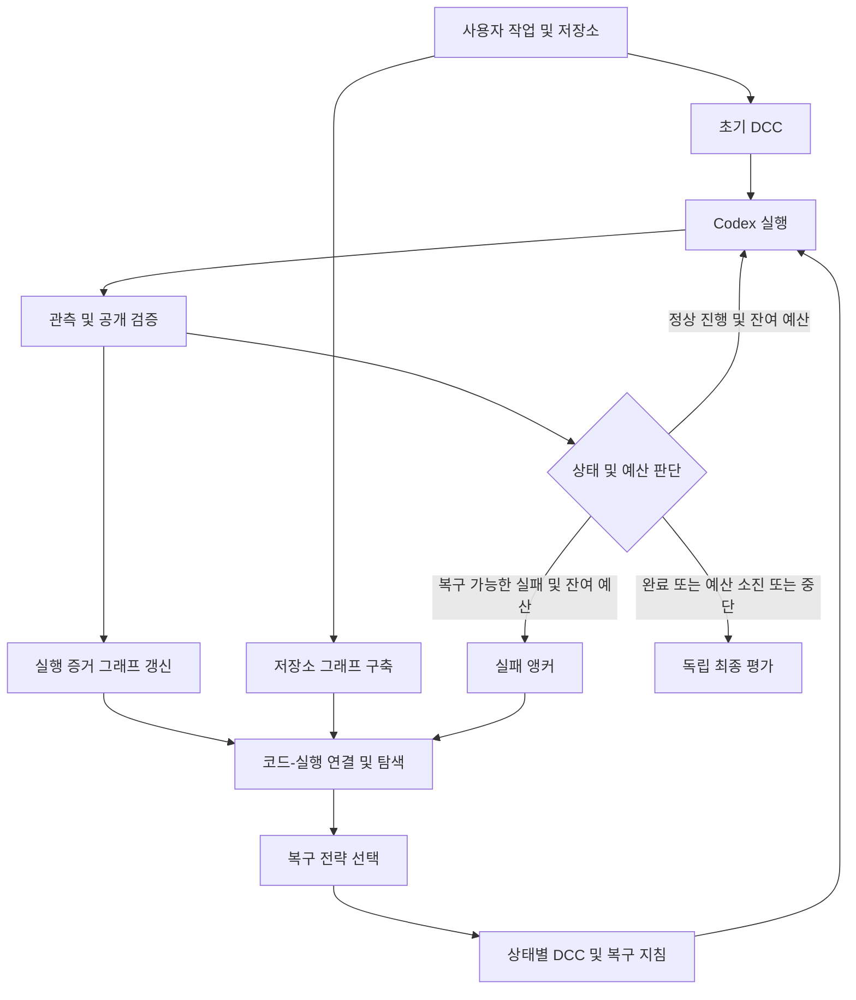

# Adaptive Agent Harness — 선행연구 분석서

## 그래프 기반 실패 복구 및 동적 컨텍스트 최적화를 통한 코딩 에이전트의 신뢰성과 실행 효율 향상

| 항목 | 내용 |
| --- | --- |
| 프로젝트 | Adaptive Agent Harness (AAH) |
| 영문 연구명 | Graph-Guided Failure Recovery and Dynamic Context Optimization for Coding Agents |
| 수행 맥락 | 잇츠 스터디 5기 · Codex 기반 AI 코딩 에이전트 구축 |
| 문서 버전 | v0.1.0 |
| 조사 기준일 | 2026-11-24 |
| 상태 | 선행연구 검토 및 연구 공백 재정의 — 구현·실험 전 |
| 상위 문서 | `RESEARCH_PROPOSAL.md`, `PROJECT_OVERVIEW.md` v0.1.0 |

> **핵심 결론:** 그래프 간 연결, 상태 기반 컨텍스트 복원, 실패 진단 및 실행 중 개입은 이미 선행연구에서 상당 부분 다루고 있다. AAH의 기여는 이 기술들의 최초 결합이 아니라, 관측 가능한 저장소 수준 실패를 기준으로 복구 전략과 컨텍스트 선택을 결합하고, 동일 Codex·공통 실패 상태·공통 예산에서 각 설계의 추가 효과와 한계를 검증하는 데 두어야 한다.

---

## 1. 조사 목적 및 방법

### 1.1. 조사 질문

1. 코딩 에이전트의 실행 환경과 컨텍스트 제공 방식은 실제 성능 및 비용에 영향을 미치는가?
2. 저장소 그래프, 실행 궤적, 그래프 간 연결을 활용한 기존 방법은 무엇인가?
3. 실패를 감지한 후 복구 전략이나 정보를 변경하는 방법은 어디까지 연구되었는가?
4. AAH의 어떤 요소가 이미 알려진 방법이며, 어떤 비교 질문이 아직 검증할 가치가 있는가?
5. 선행연구에서 사용한 평가 방법 중 제한된 시간과 비용으로 채택할 수 있는 것은 무엇인가?

### 1.2. 조사 절차

기존 JEC, DualGraph-Recover 및 통합 연구제안서의 참고문헌을 출발점으로 삼고, 2026년 11월 24일 웹 검색을 통해 관련 연구를 추가 탐색하였다. 검색 대상은 arXiv, 학회 논문 페이지, 연구기관 공식 페이지 및 OpenAI 공식 기술 자료다. 주요 검색어는 다음과 같다.

- `coding agents failure recovery execution trace graph`
- `repository graph context optimization coding agents`
- `coding agent runtime failure recovery adaptive strategy`
- `coding agent graph execution trace failure recovery repository graph context optimization 2026`
- `CodeTracer`, `PROBE`, `Rivet`, `MemTrace`, `AgentTether`

대상은 저장소 수준 코드 작업, 실행 이력 기반 진단, 보조 컨텍스트 선별, 피드백 기반 복구 및 비교 평가에 직접적으로 관련되는 연구로 한정하였다. 최신 문헌이라도 실험의 타당성이나 직접 관련성이 부족하면 보조 자료로 분류한다.

### 1.3. 근거 수준과 해석 원칙

| 수준 | 의미 |
| --- | --- |
| T | 저자 공개 원문 HTML의 초록 및 관련 방법·평가 절 확인 |
| A | 공식 논문 초록 또는 공식 서지 페이지 확인; 세부 구현 판단 보류 |
| O | 공식 기술 문서 또는 연구기관의 설명 자료 확인 |
| W | 철회 상태 확인; 성능 및 신규성 주장의 근거로 사용하지 않음 |

본 조사는 **목적 지향적 서술형 문헌 검토**다. 체계적 문헌고찰(PRISMA), 전체 인용망 분석 또는 선행 방법의 코드 재현을 수행한 것은 아니다. T는 모든 부록과 소스코드를 검증했다는 의미가 아니다. 2026년 arXiv 문헌은 별도 학회 게재가 확인되지 않는 한 preprint로 취급한다. 수치는 저자가 보고한 값이며 AAH 실험의 결과가 아니다. 검토 대상 외의 모든 연구에 특정 기능이 없다고 주장하지 않는다.

## 2. 연구의 개념적 위치

AAH는 코딩 모델의 가중치를 바꾸지 않고 공개 인터페이스를 통해 관측·제어할 수 있는 실행 환경을 연구한다. 엔지니어링 용어는 설계상의 역할을 설명하는 데 사용하며, 표준화된 학술 분류 또는 시대별 발전 단계로 가정하지 않는다.

| 개념 | 본 연구에서의 조작적 정의 | 위치 |
| --- | --- | --- |
| Harness Engineering | 실행, 관측, 권한, 상태, 예산, 복구, 평가를 연결하는 외부 환경 설계 | 전체 시스템 |
| Graph Engineering | 코드 요소와 실행 증거 사이의 관계를 명시적으로 표현하고 실제 의사결정에 사용 | 핵심 방법 |
| Context Engineering | 작업과 실패 상태에 따라 보조 정보의 관련성·유효성·중복·예산을 관리 | 핵심 방법 |
| Loop Engineering | 검증 결과를 후속 실행에 반영하는 반복과 종료 정책 | 복구 메커니즘 |
| Prompt Engineering | 선택된 전략과 근거를 모델이 실행할 수 있는 메시지로 표현 | 보조 방법 |

Workflow Graph는 제어 흐름이고 Repository Graph 및 Execution Graph는 증거를 표현하는 데이터 구조다. 상태 머신이나 반복 호출만 구현했다고 해서 그래프 기반 정보 활용의 효과가 검증된 것은 아니다.

## 3. 주요 선행연구 검토

### 3.1. 실행 환경 및 평가의 기반

#### [R01] SWE-agent — Yang et al. (2024)

- 출처: [arXiv:2405.15793](https://arxiv.org/abs/2405.15793), [원문](https://arxiv.org/html/2405.15793), NeurIPS 2024.
- 검토: T, §2–5 중심.
- 접근: 에이전트가 저장소를 탐색하고 수정하며 검증하는 데 적합한 Agent-Computer Interface를 설계하고 인터페이스의 영향을 비교한다.
- AAH 적용: 동일 모델에서 외부 도구 및 인터페이스 설계가 중요하다는 연구 동기. 다만 본 프로젝트는 Codex의 기본 도구를 대체하기보다 추가 보조 정보와 복구 제어를 평가한다.
- 유의점: 당시 모델과 현재 Codex의 절대 성능을 직접 비교하지 않는다.

#### [R02] SWE-bench — Jimenez et al. (2024)

- 출처: [arXiv:2310.06770](https://arxiv.org/abs/2310.06770), ICLR 2024.
- 검토: A.
- 접근: 실제 GitHub 이슈와 저장소를 활용해 생성한 패치를 실행 가능한 테스트로 평가한다.
- AAH 적용: 기능 테스트 및 회귀 테스트, 초기 커밋 고정, 독립적인 최종 검증 구조를 채택한다.
- 유의점: 공개 과제는 학습 데이터 노출 및 테스트 품질 문제가 있을 수 있다. 공개 점수만으로 신규 과제의 일반화 성능을 주장하지 않는다.

#### [R03] AFlow — Zhang et al. (2024/2025)

- 출처: [arXiv:2410.10762](https://arxiv.org/abs/2410.10762), [원문](https://arxiv.org/html/2410.10762), ICLR 2025.
- 검토: T, §3–5 및 부록 목차.
- 접근: 코드로 표현한 에이전트 워크플로를 탐색·평가하여 자동 최적화한다.
- AAH 적용: 워크플로의 구조와 실행 정책을 연구 대상으로 구분하는 데 참고한다.
- 범위 차이: AAH는 여러 후보 워크플로를 생성·학습하는 문제보다 고정된 제어 구조에서 개별 실패의 후속 전략을 바꾸는 문제에 집중한다. 워크플로 자체의 자동 재구성은 MVP에서 제외한다.

### 3.2. 저장소 구조 및 컨텍스트 최적화

#### [R04] RepoGraph — Ouyang et al. (2024/2025)

- 출처: [arXiv:2410.14684](https://arxiv.org/abs/2410.14684), [원문](https://arxiv.org/html/2410.14684), [공식 학회 페이지](https://proceedings.iclr.cc/paper_files/paper/2025/hash/4a4a3c197deac042461c677219efd36c-Abstract-Conference.html), ICLR 2025.
- 검토: T, §3–5.
- 접근: 저장소 수준 코드 관계를 그래프로 표현하고 관련 코드 영역을 구조적으로 탐색하도록 기존 코드 에이전트 또는 절차형 시스템에 결합한다.
- AAH 적용: 파일·함수·클래스 및 의존성 관계를 모델링하고, 평면 검색과 구조적 검색을 비교할 근거가 된다.
- 범위 차이: AAH는 특정 실패 이벤트와 이전 실행 행동을 코드 구조에 연결하는 정책을 평가한다. 코드 그래프 사용 자체는 신규성이 아니다.

#### [R05] Evaluating AGENTS.md — Gloaguen et al. (2026)

- 출처: [arXiv:2602.11988v2](https://arxiv.org/abs/2602.11988v2), [원문](https://arxiv.org/html/2602.11988v2), [연구실 공개 페이지](https://www.sri.inf.ethz.ch/publications/gloaguen2026agentsmd).
- 검토: T, §3–5. v2 기준; ICLR 2026 Memory for LLM-Based Agentic Systems 워크숍 표기는 연구실 페이지에서 확인 가능하다.
- 접근: SWE-bench와 CTXbench에서 LLM 생성 지침, 개발자 작성 지침 및 지침 미제공 조건의 해결 성능과 비용을 비교한다.
- 보고 결과: 저장소 컨텍스트 파일이 성능을 유의하게 개선하지 않는 경우에도 비용이 증가할 수 있음을 보여준다. 개발자 작성 지침과 자동 생성 지침을 구분한다.
- AAH 적용: 모든 보조 안내를 전달하는 방식 대신 작업별 정보 선택을 평가할 동기. 모든 필수 지침과 기존 자동 로딩은 그대로 유지한다.
- 유의점: 연구 결과를 AGENTS.md가 항상 불필요하다는 결론으로 확대하지 않는다. 지침 준수, 보안, 유지보수 가치와 작업 성공률은 별개의 지표다.

#### [R06] SWE Context Bench — Zhu et al. (2026)

- 출처: [arXiv:2602.08316v3](https://arxiv.org/abs/2602.08316v3), [원문](https://arxiv.org/html/2602.08316v3), preprint.
- 검토: T, §2–3 및 부록 목차.
- 접근: 서로 관련된 개발 과제와 과거 실행 경험을 이용해 컨텍스트 재사용의 정확성·효율성을 평가한다.
- AAH 적용: 관련 경험이 항상 유용하지는 않으므로 선택 기준, 노이즈 및 비용을 고려한다.
- 범위 차이: AAH의 MVP는 하나의 실행 내 실패 복구를 대상으로 한다. 과제 간 장기 기억과 과거 정답 패치 재사용은 제외한다.

#### [R07] Rivet — Pan et al. (2026)

- 출처: [arXiv:2610.34967v1](https://arxiv.org/abs/2610.34967v1), [원문](https://arxiv.org/html/2610.34967v1), 2026-10-26, preprint.
- 검토: T, §3–5.
- 접근: 어휘·의미·구조 신호로 관련 코드 앵커를 선택하고 의존성, 사용 관계, 설정을 따라 필요한 근거를 모은 뒤 중요도와 표현 수준에 따라 제한된 예산을 배분한다.
- 보고 결과: DevEval·RepoExec, 네 모델 및 두 컨텍스트 예산(4K·8K)에서 강한 비교군 대비 평균 Pass@1이 3.73–5.15%p 높았다고 보고한다.
- AAH 적용: 단순 검색 및 예산 제어가 강한 기존 방법이라는 점을 인정한다. 복구에 필요한 코드·테스트·오류 근거의 우선순위를 명시하는 설계에 참고한다.
- 구분할 질문: 사용자 요청 중심의 코드 근거 선별과 관측 실패에 따라 후속 전략을 바꾸는 제어 정책을 구분한다. Rivet의 코드 생성 환경에서 얻은 수치를 AAH의 실제 Codex 복구 개선 예상치로 사용하지 않는다.

### 3.3. 실행 궤적 분석 및 실패 복구

#### [R08] AgentRx — Microsoft Research (2026)

- 출처: [공식 연구 소개](https://www.microsoft.com/en-us/research/blog/systematic-debugging-for-ai-agents-introducing-the-agentrx-framework/), 2026-03-12.
- 검토: O. 본 문서에서는 논문 전체 대신 공식 설명을 근거로 한다.
- 접근: 도구 스키마와 도메인 정책으로부터 실행 가능한 제약을 구성해 위반 증거를 기록하고 실패의 핵심 단계를 찾는다. 공식 소개는 115개의 주석 처리된 실패 궤적을 설명한다.
- AAH 적용: 단순 오류 감지와 실제 작업 실패를 구분하고, 관측 근거를 남기는 규칙 기반 감지와 실패 분류 체계를 설계한다.
- 유의점: 모든 제약 위반이 복구 불가능한 실패는 아니다. 공개 인터페이스에서 관측 가능한 증거만 사용한다.

#### [R09] CodeTracer — Li et al. (2026)

- 출처: [arXiv:2604.11641v3](https://arxiv.org/abs/2604.11641v3), [원문](https://arxiv.org/html/2604.11641v3), [공개 코드](https://github.com/NJU-LINK/CodeTracer), preprint.
- 검토: T, §3–4.
- 접근: 여러 실행 산출물을 계층적 추적 트리와 지속 기억으로 정리하고 최초 실패 및 후속 오류의 위치를 추정한다. 진단 신호를 재실행에 제공해 복구를 평가한다.
- 보고 결과: Table 3의 GPT-5 진단 조건에서 단계 단위 macro F1은 raw-log 기반 Bare LLM 18.78% 대비 CodeTracer 48.02%다. 이 수치는 최종 버그 수정 성공률이 아니다.
- AAH 적용: 로그 정규화만으로도 개선될 수 있음을 고려하여 평면 증거 대조군을 충분히 강하게 구성한다. 실패 위치 추정과 최종 해결 여부를 구분한다.
- 차별화 후보: 실행 증거의 구조화 외에 코드 의존성으로 연결하는 정책의 추가 효과를 통제한다. 실행 이력 분석과 진단 기반 재실행 자체를 독창적인 기능으로 내세우지 않는다.

#### [R10] PROBE — Zhao et al. (2026)

- 출처: [arXiv:2605.08717v2](https://arxiv.org/abs/2605.08717v2), [원문](https://arxiv.org/html/2605.08717v2), 2026-06-05 개정, preprint.
- 검토: T, §3–4 및 §5.
- 접근: 여러 런타임 신호를 실패 앵커 중심으로 결합하고, 구조화한 진단을 검증 가능하고 실행 가능한 복구 지침으로 변환한다. 근거가 부족하면 개입을 제한한다.
- 보고 결과: 세 가지 소프트웨어 엔지니어링 환경의 최초 미해결 257개 사례에서 Top-1 진단 정확도 65.37%, 복구율 21.79%를 보고한다. 이는 환경을 합친 결과이지 Codex 단독 수치가 아니다.
- AAH 적용: 실패 원인 후보와 실제 복구 행동을 분리한다. 오류 신호, 이전 수정, 근거 출처, 후속 검증 조건을 지침에 함께 기록하고 불확실한 개입을 억제한다.
- 차별화 후보: 저장소 의존성에 연결된 실패 근거를 통해 전략을 선택하고, 같은 원천 정보와 예산에서 DCC의 추가 효과를 검증한다. 일반적인 실패 앵커 기반 복구는 이미 제안되었다.

#### [R11] AgentTether — Zhao et al. (2026) **직접 비교 우선순위 높음**

- 출처: [arXiv:2607.06273v1](https://arxiv.org/abs/2607.06273v1), [원문](https://arxiv.org/html/2607.06273v1), 2026-07-07, preprint.
- 검토: T, §III–IV.
- 접근: 실행을 Transition Unit으로 표현하고 의존성 기반 Critical Transition Graph에서 실패 구간을 찾는다. 복구 기억과 행동 지침을 재실행에 적용하며, 선택적으로 도구 반환 및 텍스트 응답 시점의 개입도 수행한다.
- AAH 적용: 반복·이탈 감지, 개입 근거 확인, 개입 간격 제한, 최소한의 지침 제공 및 개입 중단 조건을 참고한다.
- 중복 판단: 그래프를 활용한 실패 진단, 동적 개입, 반복 복구라는 전체 구상은 이미 겹친다. AAH가 이를 최초 구현한다고 주장할 수 없다.
- 구분할 질문: Python 저장소의 구체적인 코드 관계와 실행 증거를 연결한 결과가 일반 실행 그래프 기반 복구보다 유용한지, 컨텍스트 구성 정책을 바꿀 때 추가 이득이 있는지 평가한다. 실제 도구 반환 후킹을 지원하지 않는 경우 AAH는 턴 경계 개입으로 제한한다.

#### [R12] Failure as a Process — Zhao et al. (2026)

- 출처: [arXiv:2607.09510v1](https://arxiv.org/abs/2607.09510v1), [원문](https://arxiv.org/html/2607.09510v1), 2026-07-10, preprint.
- 검토: T, §II–III 중심.
- 접근: Terminal-Bench에서 수집한 CLI 코딩 에이전트 실행의 실패 발생, 전개, 복구를 분석한다. 선별한 1,794개 궤적을 수작업 주석 처리했다고 보고한다.
- AAH 적용: 최종 실패뿐 아니라 초기 오류, 반복, 복구 가능성 및 실패가 누적되는 과정을 기록하는 근거가 된다.
- 유의점: 해당 연구의 모델·스캐폴드 및 터미널 과제와 본 연구의 최신 Codex·Python 버그 수정은 동일하지 않다. 실제 개입 빈도는 AAH pilot에서 측정한다.

#### [R13] GRADE — Zhao (2026)

- 출처: [arXiv:2606.22741v3](https://arxiv.org/abs/2606.22741v3), [원문](https://arxiv.org/html/2606.22741v3), 2026-10-06 개정, preprint.
- 검토: T, 초록 및 §2–5의 범위.
- 접근: 실행 순서와 행동 의존성을 별도 엣지 층으로 표현하며, 의존성의 관측·선언·추정 근거를 구분한다. 단순 실행 규모나 연결 수를 유지한 재배선 대조군과 비교해 실제 구조 신호의 효과를 검토한다.
- AAH 적용: 그래프의 존재만으로 성능 이득을 설명하지 않는다. 직접 관측 연결과 추정 연결을 분리하고, 동일 정보량과 연결 제거 대조군을 사용한다. 여력이 있으면 의미 없는 연결 또는 degree-matched 구조를 진단용 대조군으로 추가한다.
- 유의점: 실패 예측 결과를 곧바로 실패 복구 효과로 해석하지 않는다.

### 3.4. 실행 증거와 저장소 그래프의 결합

#### [R14] MemTrace — Xu et al. (2026) **가장 중요한 중복 연구**

- 출처: [arXiv:2610.04838v3](https://arxiv.org/abs/2610.04838v3), [원문](https://arxiv.org/html/2610.04838v3), [공개 코드](https://github.com/theseus-labs-rsi/MemTrace), 2026-10-10 개정, preprint.
- 검토: T, §3.1–3.3, Algorithm 1, §4.
- 접근: Memory Trace Graph와 Repository State Graph를 분리하고, 실행 기억을 파일·심볼·테스트에 연결한다. 저장소 변경에 따른 과거 증거의 유효성을 검사하고 컨텍스트 갱신 시 관련된 기억을 예산 안에서 복원한다.
- 보고 결과: Codex CLI를 사용하는 실험에서 DeepSWE pass@1 +21.2%p, SWE-EVO Resolved Rate +4.4%p, SWE-Milestone Score +17.8%p를 보고한다. 사용 모델은 논문의 DeepSeek 계열 backbone으로, OpenAI Codex 모델의 성능 향상을 직접 입증한 것은 아니다.
- AAH 적용: 버전 식별자, 파일·심볼 연결, 테스트 결과의 유효성 조건, 중복 제거, 선택적 컨텍스트 구성의 필요성을 확인할 수 있다.
- 중복 판단: AAH의 기존 Cross-Graph Mapping과 DCC에 상당 부분 직접 대응하는 선행 방법이다. 차별화는 기억 복원 자체가 아니라 실패별 후속 행동 선택과 그 정책의 추가 효과에 두어야 한다. MemTrace가 실패와 무관한 연구라고 단정할 수 없으며, 직접 재현 및 비교는 아직 수행하지 않았다.

### 3.5. 선택적 복구 정책의 관련 연구

#### [R15] Diagnosis Before Recovery (DARC) — Wang et al. (2026)

- 출처: [arXiv:2608.11772v1](https://arxiv.org/abs/2608.11772v1), 2026-08-12, preprint.
- 검토: A.
- 접근: 개발 데이터의 실패 유형을 바탕으로 적용할 복구 개입 후보를 제한하고 검증기로 선택한 성공률-비용 정책을 배포한다.
- AAH 적용: 실패에 관계없이 동일한 정보를 늘리는 대신 유형별로 행동과 필요한 근거를 제한한다.
- 범위 차이: 공개 초록에서 제시하는 평가 환경은 ALFWorld, AppWorld, XBRL Finance다. 저장소 버그 복구에 대한 직접적인 효과로 인용하지 않는다.

#### [R16] Adaptive Skill Granularity for Coding Agents — Zhang et al. (2026)

- 출처: [arXiv:2610.31461v1](https://arxiv.org/abs/2610.31461v1), 2026-10-22, preprint.
- 검토: A 및 공개 본문 초반.
- 접근: 작업 특징과 실행 실패에 따라 macro skill과 primitive tool 사이의 실행 단위를 전환하고, 유한 상태 기반 복구로 평가한다.
- AAH 적용: 복구 전략을 말로만 바꾸지 말고 관측할 수 있는 다음 작업 및 검증 조건으로 명시한다.
- 유의점: 결정론적 프로토콜의 제한된 실험 결과를 실제 최신 Codex에 대한 일반적인 성능 보장으로 해석하지 않는다.

## 4. 핵심 선행연구 비교

표는 원문에서 확인한 주된 연구 초점과 AAH의 설계안을 비교한 것이다. `주초점 아님`은 논문에 해당 기능이 전혀 존재하지 않는다는 의미가 아니다. AAH의 항목은 구현 전 계획이며 검증된 기능이 아니다.

| 방법 | 코드 구조 활용 | 실행 이력 구조화 | 실패 대응 | 컨텍스트 선택·예산 | 주된 평가 관점 |
| --- | --- | --- | --- | --- | --- |
| RepoGraph [R04] | 저장소 그래프 | 주초점 아님 | 주초점 아님 | 구조 기반 코드 탐색 | 코드 작업 성능 |
| Rivet [R07] | 근거 관계 그래프 | 주초점 아님 | 주초점 아님 | 근거 중요도 및 예산 | 코드 생성 정확도·비용 |
| CodeTracer [R09] | 실행 산출물 활용 | 계층적 trace | 실패 위치·재실행 | 진단 근거 선별 | 진단 및 재실행 |
| PROBE [R10] | 저장소 등 실행 산출물 | 실패 중심 telemetry | 진단·제한된 지침 | 실행 가능한 근거 | 최초 실패 이후 복구 |
| AgentTether [R11] | 실행 의존성 중심 | Critical Transition Graph | 진단·런타임 개입 | 복구 지침·기억 | 복구 및 개입 |
| GRADE [R13] | 주초점 아님 | 실행·의존성 그래프 | 실패 예측 | 주초점 아님 | 구조의 추가 신호 |
| MemTrace [R14] | Repository State Graph | Memory Trace Graph | 컨텍스트 갱신 후 재개·수정 | 유효성 및 예산 기반 복원 | 장기 코딩 실행 |
| AAH (계획) | Repository Graph | Execution Graph | 실패별 전략 선택·재검증 | 초기 및 복구 DCC | 독립·결합 효과, 비용 및 오개입 |

### 4.1. 중복 위험의 재평가

| 주장 후보 | 판단 | 근거 |
| --- | --- | --- |
| 최초의 그래프 기반 코딩 에이전트 | 폐기 | RepoGraph |
| 최초의 구조화된 실행 실패 복구 | 폐기 | CodeTracer, PROBE |
| 최초의 그래프 기반 동적 실행 개입 | 폐기 | AgentTether |
| 최초의 코드·실행 이중 그래프 및 상태 기반 컨텍스트 최적화 | 폐기 | MemTrace |
| 최초의 예산 기반 코드 컨텍스트 최적화 | 폐기 | Rivet |
| 동일 실패 상태에서 그래프 기반 전략 선택과 DCC의 독립·결합 효과 검증 | 연구 질문으로 유지 | 직접 비교 실험으로 확인할 대상; 최초성 미확정 |
| 개발자가 사용할 수 있는 Codex 외부 복구 도구 | 제품·구현 기여 후보 | 실제 사용성 및 연동 검증 필요 |

### 4.2. 연구 공백의 재정의

기존 연구들은 각각 관련 메커니즘의 가능성을 보여 주지만, 그 결과만으로 AAH가 대상으로 하는 환경의 정책별 효과를 알 수는 없다. 특히 MemTrace 및 AgentTether는 통합 제안서의 차별화 가정을 약화한다. 따라서 본 프로젝트는 새로운 그래프 자료구조의 발명보다는 **실패에 조건화된 복구 의사결정의 실증적 평가**에 연구의 무게를 둔다.

> 공통 실패 체크포인트에서 같은 Codex 모델과 관측 가능한 원천 증거, 동일한 복구 기회 및 예산 상한을 제공할 때, 코드-실행 관계를 활용한 전략 선택과 상태 적응형 보조 컨텍스트 최적화는 각각 어떤 추가 효과를 가지며 두 방법을 결합할 가치가 있는가?

보조 질문은 다음과 같다.

- 현재 실패와 관련된 코드 의존성 탐색이 단순 로그 검색 대비 더 유용한 후속 행동을 선택하게 하는가?
- 후보 정보의 유효성·중복 검사 및 상태별 패킹이 이미 그래프를 사용하는 복구 정책에서도 추가 가치를 가지는가?
- 실패가 자연적으로 해결될 수 있는 상황에서 외부 개입은 어느 정도의 비용이나 회귀 오류를 유발하는가?

위 질문은 좁혀진 연구 공백 **후보**이며, 동일한 질문의 기존 검증 사례가 없다는 포괄적 문헌 증명은 아니다. 가까운 선행 방법의 공개 코드와 정확한 실험 조건을 검토하고 재현 가능하면 비교한다. 재현이 어렵다면 범위 제한을 공개하고 자체 대조군 비교를 중심으로 보고한다.

## 5. 제안 방법에 반영할 설계 원칙

| 설계 원칙 | 관련 근거 | AAH의 구체적인 반영 |
| --- | --- | --- |
| 모델과 실행 환경 구분 | R01, R03 | 모델·추론 설정·기본 도구는 유지 |
| 불필요한 보조 정보 억제 | R05, R07 | 필수 지침 보존, DCC의 보조 정보만 선별 |
| 구조 기반 정보 탐색 | R04, R14 | 실패 위치를 시작점으로 제한된 코드 의존성 탐색 |
| 근거의 출처와 버전 관리 | R08, R13, R14 | 관측·추정 엣지 구분, 스냅샷 및 심볼 ID 기록 |
| 실패 중심의 지침 생성 | R09, R10 | 오류 증거·이전 시도·다음 검증을 연결 |
| 선택적 개입 | R11, R12, R15 | 반복 실패 또는 정체에 한정, 근거 불충분 시 개입 보류 |
| 행동 가능한 전략 | R10, R16 | 전략 ID, 목표 코드 범위, 다음 검사, 종료 기준 명시 |
| 구조의 효과 검증 | R13 | 연결 제거 및 동일 원천의 평면 대조군 |
| 독립 검증 | R02 | 숨겨진 평가 테스트와 정답 패치 분리 |

### 5.1. 실패 조건 기반 복구 흐름

제어 그래프가 동적으로 재배선되어야 하는 것은 아니다. 고정 상태 머신에서도 실패 신호에 따라 후속 전략 ID와 증거 후보가 달라지고 그 결과를 검증할 수 있다. Codex 내부의 숨겨진 추론이나 도구 호출을 강제로 제어할 수 있다고 가정하지 않는다.

### 5.2. 전략과 컨텍스트의 역할 구분

전략 선택은 다음 실행에서 어떤 종류의 행동을 수행하도록 유도할지 정한다. DCC는 그 행동을 수행하는 데 필요한 보조 근거를 선택한다. 두 요소를 분리하여 다음과 같은 구조로 구현하는 것을 권장한다.

| 전략 후보 | 관측 신호 | 필요한 복구 컨텍스트 | 검증 조건 예시 |
| --- | --- | --- | --- |
| `RELOCALIZE` | 같은 오류와 동일 수정 범위 반복 | 실패 traceback, 미탐색 호출·import 관계 | 새 원인 후보에 대한 조사 결과 |
| `REVIEW_REGRESSION` | 수정 뒤 새 공개 테스트 실패 | 변경 diff, 관련 테스트, 영향 범위 | 실패 테스트 및 관련 회귀 테스트 결과 |
| `REFRESH_EVIDENCE` | 과거 증거와 현재 저장소 불일치 | 최신 코드, 버전 정보, 이전 증거의 상태 | 현재 상태에 근거한 증거 재확인 |
| `CONTINUE` | 정상 진전 또는 개입 근거 부족 | 기본 실행 정보 | 실행 지속 또는 정상 종료 |
| `STOP` | 예산 소진·복구 제한·환경 장애 | 종료 근거 | 올바른 종료 상태 기록 |

이는 AAH의 설계 후보이며 선행연구에서 직접 검증된 전략 목록을 옮긴 것이 아니다. 구체적인 조건과 임계값은 개발용 과제에서 정하고 본실험 전에 고정한다. 단순히 다음 메시지에서 코드 목록을 바꾸는 것과 검증 가능한 전략 변경을 구분하여 행동 로그를 기록한다.

## 6. 실험설계에 미치는 영향

### 6.1. 핵심 비교군 유지

통합 연구제안서의 A–E 비교군을 유지한다. B–E는 공통 감지 및 복구 환경에서 DCC와 그래프 복구의 적용 여부를 비교하는 2×2 설계다.

| ID | 방법 | DCC | 그래프 복구 |
| --- | --- | --- | --- |
| A | Vanilla Codex | X | X |
| B | Flat Retry | X | X |
| C | Context-only | O | X |
| D | Graph-only | X | O |
| E | Adaptive Agent Harness | O | O |

B의 평면 대조군은 무의미한 재시도 메시지가 아니라 실제 오류·이전 diff·관련 근거를 동일 후보 풀에서 얻을 수 있어야 한다. 단순한 로그 길이 차이를 그래프의 효과로 해석하지 않도록 보조 컨텍스트 상한, 형식, 재시도 기회와 전체 실행 한도를 통제한다. 그래프가 제안하는 후보 목록을 DCC가 받는 것은 결합 효과의 일부이며, C에는 그래프 진단 정보를 제공하지 않는다.

### 6.2. 추가 비교 및 우선순위

| 우선순위 | 비교 | 검증 대상 |
| --- | --- | --- |
| P0 | B vs D, C vs E | 그래프를 활용한 복구 정책 전체의 효과 |
| P0 | B vs C, D vs E | DCC의 독립적·조건부 추가 효과 |
| P0 | A vs E | 일반적인 Codex 사용 대비 실제 가치 |
| P1 | E vs Unlinked | 원천 정보가 동일할 때 명시적 그래프 간 연결의 추가 효과 |
| P1 | 동일 그래프·동일 후보·동일 DCC에서 일반 복구 지침 vs 유형별 전략 | 전략 선택 그 자체의 추가 효과 |
| P1 | 초기 DCC만 / 복구 DCC만 / 모두 | 초기 및 복구 시점의 효과 분리 |
| P2 | Graph-only vs Repository-only / Execution-only | 각 그래프의 역할 |
| P2 | DCC 유효성·중복 제거 ablation | 세부 선별 정책의 효과 |
| P2 | 연결 수를 맞춘 재배선 대조군 | 관계의 의미가 구조 신호에 기여하는지 탐색 |
| 조건부 | MemTrace 또는 AgentTether 재현·비교 | 가까운 선행 방법 대비 상대 효과 |

P1의 전략 선택 분리 실험은 선행연구 검토로 새롭게 제안한 항목이다. 시간·비용이 부족할 경우 최우선 공통 실패 상태에서 최소 규모로 검토하고, 수행하지 않았다면 전략의 순수 효과를 주장하지 않는다. 전체 A–E 실험만으로 그래프 기반 전략 선택과 그래프 기반 증거 선택을 서로 분리하여 추정할 수는 없다.

### 6.3. 두 평가 프로토콜

- **End-to-end:** 모든 과제를 포함한다. 초기 성공 사례도 포함해 비용, 개입률 및 성능을 평가한다. 초기 DCC의 성공률 변화가 실패 집단을 바꿀 수 있으므로 조건별 실패 집단의 복구율을 인과 효과로 단순 비교하지 않는다.
- **공통 실패 체크포인트:** 같은 초기 실행에서 관측 가능한 실패 상태를 확보해 작업 트리, 공개 로그, 사용자 요청, 잔여 예산을 동일하게 복제한다. 내부 세션 복제가 불가능하면 동일한 외부 스냅샷과 이력으로 새 세션을 실행한다. 이 경우 내부 상태까지 동일하다고 주장하지 않는다.

자연 발생 실패와 인위적 실패 주입을 구분한다. 평가용 hidden test의 실패 내용을 진단이나 복구 컨텍스트에 넣지 않는다. 실패 체크포인트는 공개 검사 및 실행 신호로 사전에 정의한다.

### 6.4. 평가 지표의 해석

| 지표 | 정의 및 해석 | 연결 연구 |
| --- | --- | --- |
| Task Success Rate | 독립 평가 통과 비율 | R01, R02 |
| Failure Recovery Rate | 공통 최초 실패 상태의 최종 통과 비율 | R09–R11 |
| Cost per Success | 실패를 포함한 전체 비용 합 / 성공 수 | R05, R07 |
| End-to-end Tokens / Time | 그래프 구축, 추가 모델, 초기 및 복구 실행 전체 | R05, R07, R14 |
| Strategy Adherence | 지시한 전략의 관측 가능한 행동 수행 여부 | R10, R11, R16 |
| Fault Localization | 검증 가능한 원인 위치가 있는 사례의 top-k 후보 포함 | R08, R09 |
| Intervention Rate / Harm | 개입 빈도 및 공통 상태 대조군 대비 추가 실패 | R11, R12 |
| Instruction Compliance | 고정된 필수 지침 검사 통과 비율 | R05 |

추가된 Strategy Adherence는 복구 지침이 실제 행동 변화로 이어졌는지 분석하는 보조 지표다. 실패 진단 정확도가 높다고 해서 해결률이 높다고 단정하지 않으며, 그래프 연결 자체가 인과관계의 증명은 아니다. 토큰의 단위, 캐시, 과금 집계는 실제 런타임에서 확인한다. 성공 수가 0인 조건은 성공당 비용을 유한값으로 표시하지 않는다.

### 6.5. 벤치마크 선택과 재현성

OpenAI의 2026년 2월 공식 분석 [R17]은 SWE-bench Verified에 테스트 품질 및 데이터 오염 문제가 있음을 지적한다. 따라서 공개 벤치마크는 보조 평가로 사용하고, 신규 자체 과제와 독립 테스트를 핵심 비교에 포함한다. 공개 과제 사용 시 라이선스와 재현 가능성을 먼저 확인한다.

작은 표본에서의 결과는 탐색적 효과 크기와 과제 단위 paired 불확실성 구간을 중심으로 보고한다. 조건의 실행 순서를 균형화하고 초기 커밋, 모델, 추론 설정, 권한, 검사 및 전체 제한을 고정한다. 선행연구의 서로 다른 모델·과제·평가 지표를 한 표에서 성능 순위로 비교하지 않는다.

## 7. Codex 구현 가능성과 문헌의 구분

공식 Codex SDK API Reference [R18] 및 평가 안내 [R19]는 실제 구현을 위한 기술 자료다. 이 자료를 학술적 성능 개선의 근거로 사용하지 않는다.

MVP 기술 검증에서는 다음을 확인해야 한다.

- 고정한 SDK 또는 CLI 버전에서 실행 이벤트, 도구 호출 결과, 작업 트리 변경 및 사용량 수집 여부.
- 새 턴에 복구 지침을 전달하거나 필요한 경우 새 세션에서 공통 실패 상태를 재실행할 수 있는지.
- 취소, 시간 제한, 턴 제한 및 토큰 예산의 실제 강제 가능성.
- 필수 저장소 지침 자동 로딩, 권한 정책, 원본 도구 접근과 숨겨진 평가 테스트의 분리.

공식 문서 열람은 실제 계정에서의 기능·권한 검증을 대신하지 않는다. 세밀한 tool-return hook이나 내부 세션 복제는 지원을 확인하기 전에는 약속하지 않는다. 초기 구현은 턴 단위 복구로 충분하다.

## 8. 연구 기여 및 발표 메시지 수정 권고

### 8.1. 주장할 수 있는 연구 기여 후보

1. 관측 가능한 코드-실행 증거에 기초한 선택적 복구 전략을 실제 Codex 외부 실행 환경에 구현한다.
2. 동일 실패 상태에서 복구 전략과 보조 컨텍스트 정책의 추가 효과를 분리하고 비용·부작용을 함께 평가한다.
3. 초기 실행과 실패 복구를 모두 포함하는 평가 프레임워크 및 재현 가능한 실행 로그를 구축한다.
4. 개발자가 직접 저장소에 적용하고 복구 근거를 확인할 수 있는 CLI 프로토타입을 제공한다.

### 8.2. 피해야 할 표현

| 피할 표현 | 대체 표현 |
| --- | --- |
| 최초의 이중 그래프 기반 코딩 에이전트 | 코드 구조와 실행 증거를 연결한 Codex 복구 하네스 |
| 기존 연구에는 동적 복구가 없다 | 기존 동적 복구 연구를 참고하고 저장소 수준 정책의 추가 효과를 평가한다 |
| AI가 실패 원인을 정확히 찾아 스스로 복구한다 | 관측 가능한 실패 근거에서 원인 후보를 추정하고 후속 행동을 검증한다 |
| 그래프와 컨텍스트의 결합으로 성능 향상이 보장된다 | 결합 정책의 효과 및 적용 조건을 비교 실험으로 검증한다 |
| 모든 엔지니어링 기법을 통합한 최초 프레임워크 | 필요한 정보와 후속 행동을 조정하는 외부 실행 환경 |

### 8.3. 심사 기준에 연결할 근거

| 평가 항목 | 제시할 근거 |
| --- | --- |
| 문제정의·필요성 (15) | 관련 연구의 실패 및 컨텍스트 문제, 자체 pilot에서 확인한 실제 Codex 사례 |
| AI 기술 활용도 (25) | Codex 런타임 연동, 관측 정보 기반 실행 전략 및 컨텍스트 구성 |
| 구현 완성도 (25) | 자동화된 end-to-end 실행 및 검증, 실패 처리, 테스트 기록 |
| 실용성 (15) | 자체 저장소 외의 적용 사례, 비용 및 성공률, CLI 사용 방법 |
| 학습과정·협업 (10) | 논문 검토 기록, 역할별 구현과 검증, 의사결정 및 PR |
| 차별성·확장성 (10) | 가까운 선행연구를 인정한 비교표, 재현 가능한 검증, 향후 적용 조건 |

발표에서는 최신 용어의 개수보다 관측된 실패를 어떤 정보와 행동으로 해결했는지 보여준다. 데모의 성공 사례 외에도 전체 비교군 결과와 실패한 사례를 제시해야 한다.

## 9. 문헌 검토 한계 및 후속 작업

- 검색은 목적 지향적이므로 누락된 유사 연구가 있을 수 있다. 학술 최초성은 확정하지 않는다.
- MemTrace, AgentTether, PROBE, Rivet, CodeTracer의 원문 주요 절은 검토했으나 공개 구현 설치, 전체 부록 검증 및 같은 조건의 재현 실험은 수행하지 않았다.
- 2026년 preprint의 주장과 성능 수치는 동료 심사를 거친 확정 사실과 구분한다. 각 논문의 모델·예산·벤치마크가 달라 직접 수치 비교가 불가능하다.
- `CodeRescue: Budget-Calibrated Recovery Routing for Coding Agents`는 [arXiv:2607.19338v2](https://arxiv.org/abs/2607.19338v2)에서 철회 상태를 확인했다(W). 후속 버전 또는 정식 게재를 확인하기 전까지 주요 성능·신규성 근거에서 제외한다.
- 기존 두 제안서에 있던 일부 부가 참고문헌은 이번 핵심 비교의 범위에서 제외했다. 공개 벤치마크의 최신 후보와 Codex 문서 버전은 후속 벤치마크·기술 명세 단계에서 확인한다.
- 연구계획서 및 프로젝트 설명서는 현재 버전을 그대로 유지했다. 본 검토에서 발견한 중복과 새 비교 권고를 반영할지는 팀 합의 후 변경 기록에 남기고 상위 문서를 갱신한다.

## 10. 후속 문서 반영 사항

| 문서 | 반영 권고 |
| --- | --- |
| RESEARCH_PROPOSAL.md | MemTrace, AgentTether 및 GRADE 추가; 연구 공백을 정책별 효과 검증으로 좁힘 |
| PROJECT_OVERVIEW.md | 실제 실행 제어 범위와 관측 근거 기반 복구 표현 유지; 최초성 주장 금지 |
| METHODOLOGY.md | 실패 앵커, 관측·추정 엣지, 전략 ID, 검증 조건, DCC와 전략 선택의 분리 |
| SYSTEM_ARCHITECTURE.md | 턴 경계 제어 및 공개 증거 수집, 상태 갱신, 선택적 개입 |
| TECHNICAL_SPEC.md | 그래프 및 증거의 버전 식별자, 정책 인터페이스, 개입 로그, 세션 복원 한계 |
| EXPERIMENT_DESIGN.md | 강한 Flat Retry, 전략 선택 분리, 동일 후보 풀의 연결 제거 비교 |
| BENCHMARK_SPEC.md | 공개 과제 오염·검사 품질 점검, 자체 신규 과제, 공통 실패 체크포인트 |
| EVALUATION_PROTOCOL.md | 복구율 분모, 전체 비용, 전략 수행 여부 및 유효 실행 정의 |

다음 문서인 `METHODOLOGY.md`에서는 비교군 A–E와 일관성을 유지하면서 위 권고를 구현 가능한 규칙, 스키마, 의사코드로 구체화한다. 방법론 확정 전 팀이 확인할 사항은 전략 분리 실험의 우선순위, 직접 선행 방법의 재현 가능성, 실제 가용 실행 비용 및 Codex 제어 범위다.

## 11. 참고문헌 및 확인 자료

문헌 ID는 이 문서 내부에서만 사용한다. 기존 연구제안서의 숫자 인용과 혼동하지 않는다. 조회 기준일은 2026-11-24다.

| ID | 문헌 | 공개 상태 및 근거 수준 |
| --- | --- | --- |
| R01 | Yang et al. (2024). *SWE-agent: Agent-Computer Interfaces Enable Automated Software Engineering*. [arXiv](https://arxiv.org/abs/2405.15793) | NeurIPS 2024 / T |
| R02 | Jimenez et al. (2024). *SWE-bench: Can Language Models Resolve Real-World GitHub Issues?* [arXiv](https://arxiv.org/abs/2310.06770) | ICLR 2024 / A |
| R03 | Zhang et al. (2024/2025). *AFlow: Automating Agentic Workflow Generation*. [arXiv](https://arxiv.org/abs/2410.10762) | ICLR 2025 / T |
| R04 | Ouyang et al. (2024/2025). *RepoGraph: Enhancing AI Software Engineering with Repository-level Code Graph*. [arXiv](https://arxiv.org/abs/2410.14684) | ICLR 2025 / T |
| R05 | Gloaguen et al. (2026). *Evaluating AGENTS.md: Are Repository-Level Context Files Helpful for Coding Agents?* [arXiv v2](https://arxiv.org/abs/2602.11988v2) | 워크숍 및 preprint / T |
| R06 | Zhu et al. (2026). *SWE Context Bench: A Benchmark for Context Learning in Coding*. [arXiv v3](https://arxiv.org/abs/2602.08316v3) | Preprint / T |
| R07 | Pan et al. (2026). *Rivet: Utility-Preserving Context Control for Repository-Level Coding Agents*. [arXiv v1](https://arxiv.org/abs/2610.34967v1) | Preprint / T |
| R08 | Microsoft Research (2026). *Systematic debugging for AI agents: Introducing the AgentRx framework*. [공식 자료](https://www.microsoft.com/en-us/research/blog/systematic-debugging-for-ai-agents-introducing-the-agentrx-framework/) | 연구기관 설명 / O |
| R09 | Li et al. (2026). *CodeTracer: Towards Traceable Agent States*. [arXiv v3](https://arxiv.org/abs/2604.11641v3) | Preprint / T |
| R10 | Zhao et al. (2026). *Debugging the Debuggers: Failure-Anchored Structured Recovery for Software Engineering Agents*. [arXiv v2](https://arxiv.org/abs/2605.08717v2) | Preprint / T |
| R11 | Zhao et al. (2026). *AgentTether: Graph-Guided Diagnosis and Runtime Intervention for Reliable LLM Agent Operations*. [arXiv v1](https://arxiv.org/abs/2607.06273v1) | Preprint / T |
| R12 | Zhao et al. (2026). *Failure as a Process: An Anatomy of CLI Coding Agent Trajectories*. [arXiv v1](https://arxiv.org/abs/2607.09510v1) | Preprint / T |
| R13 | Zhao, Y. (2026). *GRADE: Graph Representation of LLM Agent Dependency and Execution*. [arXiv v3](https://arxiv.org/abs/2606.22741v3) | Preprint / T |
| R14 | Xu et al. (2026). *MemTrace: State-Consistent Memory for Long-Horizon Coding Agents*. [arXiv v3](https://arxiv.org/abs/2610.04838v3) | Preprint / T |
| R15 | Wang et al. (2026). *Diagnosis Before Recovery: Turning Agent Failures into Selective Self-Correction*. [arXiv v1](https://arxiv.org/abs/2608.11772v1) | Preprint / A |
| R16 | Zhang et al. (2026). *Adaptive Skill Granularity for Coding Agents: Runtime Routing and Macro-to-Micro Recovery*. [arXiv v1](https://arxiv.org/abs/2610.31461v1) | Preprint / A |
| R17 | OpenAI (2026-02-23). *Why SWE-bench Verified no longer measures frontier coding capabilities*. [공식 분석](https://openai.com/index/why-we-no-longer-evaluate-swe-bench-verified/) | 공식 분석 / O |
| R18 | OpenAI. *Codex SDK — Python API Reference*. [공식 저장소](https://github.com/openai/codex/blob/main/sdk/python/docs/api-reference.md) | 변경 가능한 기술 문서 / O |
| R19 | OpenAI. *Testing Agent Skills Systematically with Evals*. [공식 자료](https://developers.openai.com/blog/eval-skills) | 기술 자료 / O |

---

**최종 판단:** 연구의 전체 방향은 유지하되, 그래프 연결과 컨텍스트 최적화의 조합 자체를 신규성으로 주장하지 않는다. 동일한 실패 상태에서 전략 전환과 컨텍스트 구성의 추가 가치, 실제 비용 및 오개입을 측정하는 실험 중심 연구로 정체성을 명확히 한다. 연구 성과는 앞으로 수행할 실험의 결과에 따라 결정한다.
