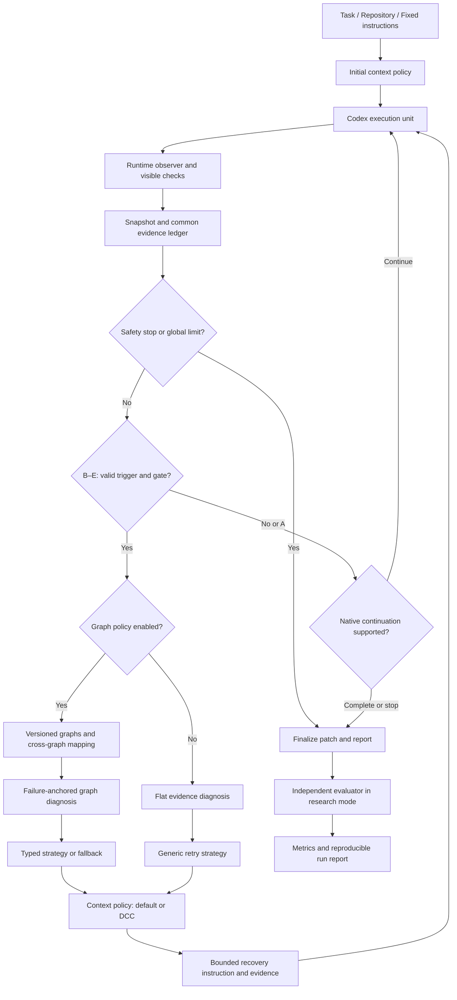
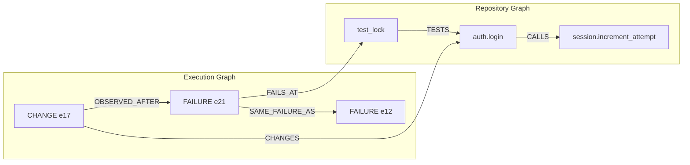

# Adaptive Agent Harness — 연구 방법론

## 그래프 기반 실패 복구 및 동적 컨텍스트 최적화를 통한 코딩 에이전트의 신뢰성과 실행 효율 향상

**Adaptive Agent Harness: Graph-Guided Failure Recovery and Dynamic Context Optimization for Coding Agents**

| 항목 | 내용 |
| --- | --- |
| 프로젝트 | Adaptive Agent Harness (AAH, 가칭) |
| 수행 맥락 | 잇츠 스터디 5기 · Codex 기반 AI 코딩 에이전트 구축 |
| 연구 대상 | 단일 Codex 에이전트, Python 저장소의 테스트 가능한 버그 수정 |
| 문서 버전 | v0.1.0 |
| 작성일 | 2026-11-24 |
| 상태 | 방법론 설계 초안 — 구현 및 예비실험 전 |
| 상위 문서 | `RESEARCH_PROPOSAL.md`, `PROJECT_OVERVIEW.md`, `LITERATURE_REVIEW.md` |

> 핵심 질문: 동일한 실패 상태와 실행 제한에서 코드-실행 관계를 활용한 복구 전략 선택과 상태 적응형 컨텍스트 최적화는 각각 어떤 추가 가치를 가지며, 두 정책의 결합은 일반 재시도보다 효과적인가?

---

## 1. 방법론의 목적과 설계 원칙

### 1.1. 연구의 위치

AAH는 Codex의 모델 가중치나 내부 추론 방식을 변경하지 않는 외부 실행 하네스다. 에이전트가 실제로 생성한 공개 실행 증거를 관찰하고, 실패 또는 정체가 발생했을 때에만 필요한 개입을 수행한다. 초기 실행 및 복구 실행에 제공할 보조 정보를 상태별로 최적화한다.

기존 JEC의 정보 유효성·관련성·예산 기반 컨텍스트 구성과 DualGraph-Recover의 코드-실행 그래프 연결을 통합한다. 다만 `LITERATURE_REVIEW.md`에서 검토한 MemTrace, AgentTether, Rivet 등의 접근과 중복 가능성이 있으므로 그래프의 사용이나 두 기술의 결합 자체를 최초의 방법이라고 주장하지 않는다. 연구의 중심은 **실패에 조건화된 전략 선택 및 컨텍스트 구성의 효과를 공정하게 분리하여 검증하는 것**이다.

### 1.2. 필수 원칙

- 필수 지침, 도구 권한, 원본 저장소 탐색 가능 범위를 모든 비교군에서 유지한다.
- 그래프의 관계 구조는 실제 탐색과 복구 판단에 사용한다. 그래프 시각화 자체는 핵심 알고리즘이 아니다.
- 전략 선택(다음에 무엇을 할 것인가)과 컨텍스트 구성(어떤 증거를 제공할 것인가)을 별도 정책으로 정의한다.
- 공개적으로 관측된 증거와 추정된 관계를 구분한다. 시간적 선후 관계만으로 인과성을 주장하지 않는다.
- 정상 진행에는 추가 복구 지침을 보내지 않는다. 관측이 부족하면 판단을 보류하거나 일반 재시도로 대체한다.
- 독립 평가의 정답 패치와 hidden test는 실행 정책, 후보 수집 및 그래프 구축에서 완전히 제외한다.
- 세밀한 내부 실행 중단이나 세션 복제는 전제하지 않는다. 지원되는 턴 경계에서만 제어한다.

본 문서의 알고리즘, 점수, 전략 우선순위 및 기본값은 상위 문서를 구현 가능하게 구체화한 **신규 설계안**이다. 선행연구의 알고리즘을 그대로 재현한 것이 아니며 검증된 최적값도 아니다. 정책 값은 개발용 pilot에서 검증한 후 평가 전에 고정한다.

## 2. 문제의 형식화

### 2.1. 입력 및 관측 상태

하나의 과제를 다음과 같이 정의한다.

$$
\mathcal{P}=(q,R_0,M,C,\mathcal{T},B)
$$

| 기호 | 의미 |
| --- | --- |
| $q$ | 자연어 버그 수정 요청 |
| $R_0$ | 초기 저장소 스냅샷 |
| $M$ | 변경 불가능한 필수 지침과 실행 권한 |
| $C$ | 허용된 보조 정보 원천 및 메타데이터 |
| $\mathcal{T}$ | 에이전트에 허용된 도구 및 공개 검사 |
| $B$ | 전체 실행 한도 벡터 |

턴 $t$의 실행 결과를 관찰한 후 상태를 구성한다.

$$
S_t=(q,R_t,H_t,G_r^{(t)},G_e^{(t)},E_c^{(t)},b_t)
$$

$H_t$는 누적 공개 실행 이력·diff·검증 결과, $G_r^{(t)}$는 현재 코드 구조와 조회 가능한 역사 스냅샷, $G_e^{(t)}$는 실행 증거 그래프, $E_c^{(t)}$는 그래프 간 연결, $b_t$는 잔여 실행 한도다. 그래프 비활성 조건에서는 그래프 필드를 비우고 그래프 계산 결과를 정책에 노출하지 않는다. 별도 실험 로그는 가능하지만 정책 입력에는 사용하지 않으며 공통 측정 비용과 방법별 비용을 구분한다.

### 2.2. 정책 분리

$$
z_t=d(H_t,R_t),\qquad D_t=\rho_g(S_t,z_t),\qquad a_t=\pi_g(S_t,z_t,D_t),\qquad K_t=\kappa_c(S_t,a_t,D_t,C)
$$

- $d$: B–E에서 동일한 실패·정체 감지 정책. 그래프 전용 신호를 사용하지 않는다.
- $\rho_g$: 실패 관련 증거 및 원인 후보를 찾는 진단 정책. $g=0$이면 평면 검색, $g=1$이면 연결 그래프 탐색.
- $\pi_g$: 개입 시 후속 전략을 선택하는 정책. $g=0$이면 일반 재시도, $g=1$이면 근거에 따른 유형별 전략 선택.
- $\kappa_c$: 보조 컨텍스트 구성 정책. $c=0$이면 기본 패키징, $c=1$이면 DCC.
- $D_t$: 진단 결과 및 증거 후보. 원인에 대한 정답이나 숨겨진 상태가 아니다.
- $a_t$: 전략 ID, 목표, 대상 코드 후보, 공개 검증 계획 및 개입 이유.
- $K_t$: 실제 후속 턴에 제공하는 제한된 보조 정보 패키지.

초기 실행에는 실패 앵커와 복구 전략이 없다. 초기 DCC는 $q,R_0,C$만 사용한다. 그래프 정책은 최초 실행의 보조 정보에 영향을 주지 않도록 하여 B/D 및 C/E의 초기 컨텍스트 구성을 각각 일치시킨다.

### 2.3. 연구 목적과 비용

최종 패치 $p$의 독립 평가를 $Y(p)\in\{0,1\}$로 정의한다.

$$
\max_{\pi,\kappa}\ \mathbb{E}[Y(p)] \quad \text{subject to}\quad \mathbf{c}(\pi,\kappa)\preceq B
$$

비용 벡터에는 실행 시간, 모델 호출·턴, 관측 토큰 및 필요한 경우 실제 과금액을 기록한다. 토큰 상한을 정확히 강제할 수 없으면 공통 시간·턴 제한을 적용하고 토큰을 측정량으로 취급한다. 성공률과 성공당 비용의 trade-off를 별도로 분석한다. 위 목적식은 정책의 설계 목표이며 학습 기반 최적화나 최적성 보장을 의미하지 않는다.

## 3. 전체 알고리즘 구조



그래프 갱신은 활성 조건에서만 수행하며 예산에 포함한다. 실패 감지와 그래프 탐색의 책임을 분리한다. Workflow Graph는 고정 상태 및 조건부 전이의 제어 구조이고, Repository/Execution Graph는 실행 의사결정의 데이터 구조다. 워크플로 재배선, 멀티에이전트 및 모델 학습은 MVP에서 제외한다.

## 4. 공통 증거 수집 및 스냅샷 관리

### 4.1. Evidence Ledger

모든 B–E 조건은 같은 원천 증거에 접근할 수 있다. 로그 정규화는 공통 모듈로 제공하며 그래프를 쓰는 조건만 추가 관계를 계산한다.

| 증거 유형 | 수집 원천 | 필수 식별 정보 |
| --- | --- | --- |
| 실행 이벤트 | 지원되는 Codex 이벤트 | run, turn, event ID, 시간, 이벤트 종류 |
| 명령·결과 | 명령 및 출력 중 관측 가능한 부분 | 종료 코드, 명령 ID, 출력 참조 |
| 파일 접근 | 명시적 접근 이벤트 또는 신뢰 가능한 명령 증거 | 경로, 접근 근거, 관측 상태 |
| 변경 | Git diff 및 현재 작업 트리 | before/after snapshot, 변경 경로 및 범위 |
| 공개 검사 | 승인된 공개 테스트·정적 검사 | check ID, 테스트 ID, 상태, 실패 지문 |
| 보조 문서 | 저장소 내 허용된 문서·가이드 | 출처, 범위, 버전, 내용 해시 |
| 사용량 | 런타임 및 하네스 계측 | 토큰 종류, 시간, 호출 수, 결측 여부 |

관측 여부는 `observed`, `inferred`, `unknown`을 구분한다. 파일을 읽었는지 확인할 수 없다면 읽지 않았다고 단정하지 않는다. 테스트 명령의 비정상 종료만으로 테스트 assertion 실패라고 분류하지 않는다. 파싱 오류, 테스트 환경 문제, 타임아웃을 별도 기록한다.

### 4.2. 코드 버전 식별

- 초기 커밋과 현재 파일 내용 및 삭제 상태를 반영하여 재현 가능한 `snapshot_id`를 계산한다. 관련 untracked 파일도 포함하되 허용 범위와 제외 규칙을 고정한다.
- 파일 식별자는 저장소 ID, 정규화된 상대 경로, 스냅샷 ID를 포함한다.
- 심볼 식별자는 파일 ID, qualified name, 종류, 정의 위치를 포함한다. 중복 정의는 위치 등으로 구별한다.
- 이벤트 시점의 정확한 버전을 확보하지 못하면 `snapshot_unknown` 또는 턴 전후 구간으로 기록한다. 사후 스냅샷에 강제로 연결하지 않는다.
- 역사 증거는 당시 버전에서 유효했던 정보로 보존한다. 현재 증거처럼 사용하려면 현재 심볼과의 일치 여부를 확인한다.

## 5. Repository Graph 구축

### 5.1. 그래프 정의

$$
G_r^{(t)}=(V_r^{(t)},E_r^{(t)})
$$

| 노드 유형 | 예시 | 주요 속성 |
| --- | --- | --- |
| FILE | `src/auth.py` | path, snapshot_id, content_hash |
| FUNCTION | `auth.login` | qualified_name, span, file_id |
| CLASS | `auth.AuthService` | qualified_name, span |
| TEST_FUNCTION | `tests.test_auth.test_lock` | test_id, span |

| 엣지 | 방향 | 근거 및 제한 |
| --- | --- | --- |
| CONTAINS | 파일/클래스 → 심볼 | AST 정의 구조 |
| IMPORTS | 파일 → 내부 모듈 파일 | 모듈 해석 결과, 외부 모듈은 범위 밖 표시 |
| CALLS | 호출자 → 피호출자 | 명시적 이름/정적 바인딩. 동적 dispatch는 추정 또는 미해결 |
| INHERITS | 하위 클래스 → 상위 클래스 | AST 및 가능한 이름 해석 |
| TESTS | 테스트 → 코드 요소 | 명시적 호출·import, 확보된 coverage 등; 관계 근거를 별도 기록 |

`IMPORTS`나 `CALLS`가 존재한다고 해당 코드가 실패의 원인이라는 의미는 아니다. `TESTS`는 테스트와 대상의 관련성을 나타내며 테스트의 완전한 커버리지를 의미하지 않는다.

### 5.2. 구축 절차

```text
BUILD_REPOSITORY_GRAPH(snapshot):
    files = allowed_python_files(snapshot)
    index = parse_definitions_and_imports(files)
    graph = add_file_and_symbol_nodes(index)
    for file in sorted(files):
        if AST parsing failed:
            retain file node; record parse_error; continue
        add CONTAINS edges
        resolve internal imports using module index
        resolve explicit calls and inheritance where supported
        add test relations from permitted evidence
        store relation origin and confidence status
    return versioned graph and unresolved-reference report
```

MVP는 AST 기반의 파일·함수·import 및 해석 가능한 호출 관계를 우선한다. 작은 저장소는 변경 감지 후 전체 재구축을 허용한다. 증분 갱신은 성능상 필요할 때만 도입하고 전체 재구축과 동일 관계가 나오는지 검증한다. 평가용 테스트는 색인 대상이 아니다.

## 6. Execution Graph와 그래프 간 연결

### 6.1. Execution Graph

$$
G_e^{(t)}=(V_e^{(t)},E_e^{(t)})
$$

| 노드 | 내용 |
| --- | --- |
| SEARCH / FILE_ACCESS | 관측된 검색 또는 파일 접근 |
| COMMAND | 명령 실행 |
| CHANGE | diff에서 확인된 변경 |
| TEST | 공개 테스트 실행 |
| FAILURE | 구조화된 공개 실패 결과 |
| INTERVENTION | 하네스의 복구 지침 및 전략 ID |

| 엣지 | 의미 |
| --- | --- |
| NEXT | 관측 순서 |
| RETURNS | 명령 또는 테스트와 결과 연결 |
| RETRIES | 명시적으로 확인된 재실행 관계 |
| OBSERVED_AFTER | 변경 또는 개입 이후 관측된 사건(인과 주장 아님) |
| SAME_FAILURE_AS | 동일한 정규화 실패 지문을 가진 관측 |

이벤트의 중복 수집은 원천 ID로 제거한다. 동일 실패 관계는 지문별 직전 사건에 연결하여 불필요한 완전 연결을 피한다. 순서가 불확실한 이벤트에는 시간적 순서를 추정해 삽입하지 않는다.

### 6.2. Cross-Graph Mapping

$$
G_d^{(t)}=(V_r^{(t)}\cup V_e^{(t)}, E_r^{(t)}\cup E_e^{(t)}\cup E_c^{(t)})
$$

역사 스냅샷 노드는 명시적인 버전 구분으로 유지한다. 현재 코드 탐색의 끝점은 최신 스냅샷의 코드 후보로 제한하며 확인되지 않은 버전 대응은 역사 증거로만 남긴다.

| 연결 | 방향 | 연결 근거 | 해석 |
| --- | --- | --- | --- |
| READS | 실행 접근 → 파일/심볼 | 직접 관측 또는 명시적 경로 증거 | 실제 관측 범위만 |
| CHANGES | 변경 → 이전/현재 코드 요소 | Git diff hunk와 AST span | 변경 전후 역할을 속성으로 표시 |
| TESTS_TARGET | 테스트 실행 → 테스트/코드 | 테스트 ID, 공개 coverage | 확인 가능한 범위 |
| FAILS_AT | 실패 → 코드 위치 | traceback 또는 assertion 위치 | 오류 표면화 위치, 원인 보장 없음 |
| SUSPECTS | 실패 → 코드 후보 | 제한된 관계 탐색 | 가설적 관련성, 별도 표시 |

`SUSPECTS`는 진단 결과의 파생 엣지로만 기록하고 기본 탐색에서는 제외한다. 그렇지 않으면 이전 추정이 다시 직접 근거로 사용되어 순환적 확신이 발생할 수 있다. 관측 엣지와 추정 엣지를 같은 신뢰도로 취급하지 않는다.

### 6.3. 연결 예시 (가상 데이터)



실패한 테스트에서 테스트 대상과 호출 관계를 따라 이동하면 이전 수정 대상 밖의 세션 관련 함수에 도달할 수 있다. 이는 조사 후보일 뿐이며 실제 원인인지는 후속 코드 조사 및 테스트로 검증한다.

## 7. 실패 및 정체 감지 정책

### 7.1. 실패 지문

공개 검사 결과에서 다음 튜플을 구성한다.

$$
\phi(e)=(check\_id,test\_id,error\_type,normalized\_message,stable\_frame)
$$

시간, 임시 경로, 메모리 주소처럼 실행마다 변하는 값을 고정 규칙으로 정규화하되 assertion의 의미 있는 값은 유지한다. 테스트 ID가 다르면 기본적으로 다른 실패로 처리한다. stable frame은 확인된 프로젝트 내부 위치이며 미관측이면 별도 표시한다. 지문 일치 여부는 같은 원인의 증명이 아니다.

### 7.2. 감지 규칙 (B–E 공통)

| ID | 신호 | 조건 후보 | 처리 |
| --- | --- | --- | --- |
| T1 | REPEATED_FAILURE | 서로 다른 공개 검사 실행에서 같은 지문이 연속 $k$회 발생하고 검증 개선 없음 | 복구 검토 |
| T2 | STAGNATION | 최근 $w$개의 관측 가능한 탐색 행동에서 중복 비율이 $\theta$ 이상이고 새 증거·검증 개선·실질 코드 진전이 없음 | 복구 검토 |
| T3 | REGRESSION | 비교 가능한 공개 검사가 이전 통과에서 현재 실패로 전이 | 복구 검토 |
| T4 | INCOMPLETE_AT_DONE | Codex 완료 선언 시 공개 필수 검사가 실패한 상태 | 복구 검토 (B–E 한도 내) |
| T5 | UNKNOWN / INFRA | 사건 또는 검사 결과의 분류 불가, 환경 장애 | 감지 보류 또는 환경 오류 처리 |

T4는 완료 선언이 최종 성공을 뜻하지 않는다는 상위 원칙을 구체화한 신규 규칙 후보이다. A에는 외부 복구 지침을 제공하지 않는다. 최초 공개 검사 실패 자체는 정상적인 수정 과정일 수 있으므로 T1은 반복 증거를 요구한다. T3은 이전 성공 기록과 비교 가능한 테스트 조건이 있어야 한다. 실행하지 않은 테스트는 실패 또는 통과로 보지 않는다.

탐색 행동의 정규화 키(종류·경로·검색 질의·범위)가 같고 관련 코드 버전 또는 새로운 반환 증거가 없을 때 중복으로 센다. 최근 구간에서 관측된 비교 가능 행동 수를 $n$, 중복 행동 수를 $r$이라 하면 $r/n$을 사용한다. 관측이 충분하지 않으면 T2는 UNKNOWN으로 처리한다. 그래프에서 계산한 거리나 미탐색 후보 여부는 감지 규칙이 아니라 복구 전략에만 사용한다.

완료의 근거·snapshot 귀속, 공개 검사 provenance와 연속성, POST_COMPLETION-only에서 관측 가능한 범위는 [TECHNICAL_SPEC §6.2–6.3·9](../design/TECHNICAL_SPEC.md)를 따른다. 동일 실질 관측의 중복 예약은 공통 gate가 차단한다. 실제 공통 검사 일정·정규화 및 관측 대리지표는 Pilot 검토 사항이다.

### 7.3. 개입 게이트

```text
DETECT(common_ledger, current_snapshot, config):
    if runtime error prevents safe progress: return INFRA
    signals = evaluate T1, T2, T3, T4 using observable evidence
    if no supported signal: return NO_TRIGGER (or UNKNOWN)
    anchor = select most recent relevant observed event(s)
    return trigger IDs + anchor IDs + evidence + confidence status

CAN_INTERVENE(trigger, budget, attempts, last_intervention):
    require observed trigger and remaining executable turn
    require recovery count below cap and enough time for cleanup
    require a new observation since last intervention
    require no duplicate intervention at the identical checkpoint
    return true or a reason for denial
```

여러 트리거가 동시에 발생하면 회귀 오류 → 반복 실패 → 정체 → 완료 후 공개 실패의 순서를 초기 후보로 사용하고 모든 발생 신호를 함께 기록한다. 이 순서는 pilot에서 변경 가능하며 본실험에는 고정한다. 개입 후 새로운 관측 결과가 없다면 같은 상태에서 개입을 연속 발행하지 않는다. 실패 지문이나 진전 판단을 도구 미관측 상태에서 임의로 보완하지 않는다.

## 8. 실패 앵커 기반 그래프 탐색 및 진단

### 8.1. 실패 앵커

앵커 집합 $A_t$는 트리거를 뒷받침하는 공개 실패·변경·반복 행동 이벤트다. 오류 지문, 관련 테스트 ID, 최근 변경 참조, 현재 스냅샷 및 증거 수준을 포함한다. 정체는 실패 결과 대신 실제 반복 탐색 이벤트를 앵커로 사용할 수 있다. hidden test나 기준 패치 위치는 앵커로 사용하지 않는다.

### 8.2. 제한된 관계 탐색

탐색은 실패 노드에서 출발하며 관계의 정방향·역방향 이동을 허용 목록으로 관리한다. 원래 엣지 방향과 역방향 조회 여부를 결과 경로에 보존한다.

| 탐색 단계 | 허용 관계 예시 | 목적 |
| --- | --- | --- |
| 실행 증거 | RETURNS 역방향, SAME_FAILURE_AS, RETRIES, OBSERVED_AFTER 역방향 | 실패 검사, 이전 시도, 최근 변경 증거 파악 |
| 그래프 간 이동 | FAILS_AT, TESTS_TARGET, CHANGES, READS | 관련 테스트 및 코드 위치 매핑 |
| 코드 관계 확장 | CALLS 양방향, IMPORTS 양방향, TESTS 양방향, CONTAINS | 직접 의존성과 테스트 대상 및 파일 범위 확인 |

MVP는 깊이와 확장 노드 수를 제한한 가중치 탐색을 사용한다. `NEXT`는 필요 시 최근의 제한된 이벤트만 연결하는 보조 관계로 사용하고 무제한 이력 순회를 금지한다. CONTAINS 역방향 후 모든 sibling을 무차별 확장하는 대신 경로 관련성 및 분기 상한을 적용한다.

경로 $P$의 비용 후보는 다음과 같다.

$$
L(P)=\sum_{e\in P}(w_{type(e)}+\eta[\mathrm{inferred}(e)])
$$

모든 기본 관계 비용은 양수이며 $\eta\ge0$이다. 확인된 관계보다 추정 관계에 높은 이동 비용을 줄 수 있다. 탐색은 길이 $h$ 및 최대 방문 상태 수 $N$ 제약을 가진다. 깊이가 다른 동일 노드를 구별하기 위해 탐색 상태는 `(node_id, depth)`로 관리하고, 제한 안에서 최소 비용 경로를 후보별로 보존한다.

$$
d_t(v)=\min_{a\in A_t, P:a\leadsto v, |P|\le h} L(P)
$$

방문 상한에서 중단된 경우 완전한 최단 경로가 아니라 탐색된 범위의 근사 거리임을 표시한다. 경로 부재는 무관함 또는 원인 아님을 뜻하지 않는다.

### 8.3. 후보 순위

최신 코드 요소 $v$의 점수를 다음처럼 구성한다.

$$
Q_t(v)=\frac{w_d}{1+d_t(v)}+w_o o_t(v)+w_m m_t(v)+w_u u_t(v)
$$

| 항 | 범위 및 의미 |
| --- | --- |
| 거리 항 | 실패 앵커와 관계상 가까울수록 높은 점수 |
| $o_t(v)$ | [0,1], 경로 근거의 관측 수준. 초기 후보: 직접 확인 1, 추정 0.5, 미확인 0 |
| $m_t(v)$ | [0,1], 현재 실패와 관련된 최근 수정 증거 여부 |
| $u_t(v)$ | [0,1], 관측 범위 내 아직 조사된 기록이 없는 인접 의존성 여부. 관측 부족이면 0 및 unknown 표기 |

가중치는 비음수이며 합을 1로 설정한다. `m` 및 `u`는 원인 확률이 아니라 조사 우선순위의 휴리스틱이다. 근거가 없는 추정 관계를 확정 원인으로 승격하지 않는다. 동일 점수의 후보는 정규화 경로와 심볼 ID 순으로 정렬한다. 실패 위치 및 테스트 증거는 원인 후보 순위와 별개로 보존한다.

```text
GRAPH_DIAGNOSE(state, trigger, config):
    anchors = observed anchors from trigger
    frontier = priority queue ordered by path cost, depth, stable ID
    seed frontier with anchors at depth 0
    while frontier nonempty and visit budget remains:
        pop lowest-cost state (node, depth)
        skip dominated (node, depth) states
        record trace and eligible current code candidate
        expand only allowed edges within depth/branch caps
        exclude SUSPECTS and unsupported version mappings
    score and rank reached current code candidates
    build top-k candidates + exact supporting path IDs + evidence IDs
    classify insufficient or uncertain evidence explicitly
    return diagnosis
```

### 8.4. 강한 평면 대조군

Graph 비활성 조건 B/C도 같은 공개 원천 증거(로그·오류·diff·허용 코드·문서)에 접근한다. 지문 및 경로 일치와 BM25 등의 텍스트 검색을 이용해 관련 로그와 코드 후보를 정렬하고 같은 후보 수 및 컨텍스트 상한을 적용한다. 직접 traceback 위치와 최근 변경은 그래프 없이도 사용할 수 있다.

평면 조건에는 계산된 이중 그래프 경로, 거리 및 그래프 유래 전략을 전달하지 않는다. 원본 코드 및 명령은 계속 접근 가능하다. 강한 대조군과 그래프 방식의 차이는 정보 접근 권한이 아니라 관계를 구성하고 탐색하는 정책이다. 그래프 계산이 추가로 유도한 파생 증거는 별도로 기록한다.

## 9. 복구 전략 선택 (Recovery Controller)

### 9.1. 전략 객체

전략은 단순한 코드 목록과 구별되는 후속 행동 계획이다. 출력은 다음 정보를 가진다.

```yaml
strategy_id: RELOCALIZE
trigger_ids: [T1]
objective: "이전 수정 범위 밖의 관련 의존성을 조사한다."
targets: ["src/session.py::increment_attempt"]
evidence_ids: ["event-21", "diff-17"]
path_refs: ["path-04"]
next_checks: ["visible-auth-tests"]
completion_observation: "새 후보의 조사 여부와 공개 검사 결과"
confidence_status: supported_candidate
reason: "반복 실패와 연결된 아직 조사 기록이 없는 호출 관계"
```

위는 설명용 데이터이며 실제 실행 결과가 아니다. 검사 ID는 사전 허용된 공개 검사 목록에 있는 값이어야 한다. 생성 지침은 권한 변경이나 강제 도구 실행을 의미하지 않는다.

### 9.2. 전략 카탈로그 및 결정 규칙

| 전략 ID | 선택 조건 후보 | 지시하는 행동 | 검증 가능한 결과 |
| --- | --- | --- | --- |
| `REVIEW_REGRESSION` | T3 및 관련 변경·테스트 연결 | 변경 영향 범위와 기존 동작을 검토 | 관련 공개 실패 및 회귀 검사 결과 |
| `RELOCALIZE` | T1/T2 및 근거가 있는 대안 코드 후보 | 이전 수정 가정 재검토, 관련 의존성 조사 | 대상 코드 접근 또는 관련 diff, 공개 검사 |
| `REFRESH_EVIDENCE` | 개입 트리거가 있으며 현재 코드 참조의 버전 불일치로 진단이 제한됨 | 최신 코드와 근거를 재확인 | 현재 스냅샷 참조와 새로운 관측 |
| `GENERIC_RETRY` | 트리거는 유효하나 특정 전략 근거 불충분; B/C 기본 복구 | 오류, 변경 및 요구사항 재검토 후 수정·검증 | 후속 실행 및 공개 검사 |
| `CONTINUE` | 정상 진행 또는 개입 근거 부족 | 외부 복구 지침 없이 가능한 정상 진행 | 후속 관측 또는 완료 |
| `STOP` | 안전한 실행 불가, 전체 한도 소진, 정상 종료 | 실행 종료 및 결과 보존 | 종료 이유와 최종 패치 |

초기 전략 결정 순서는 회귀 오류의 근거가 충분하면 REVIEW_REGRESSION, 관련 근거가 오래되어 현재 후보 판단이 불가능하면 REFRESH_EVIDENCE, 반복 실패/정체 및 대안 후보가 있으면 RELOCALIZE, 그 외 유효 트리거는 GENERIC_RETRY다. 동일 실패에 전략이 반복된 경우 신규 증거 없이 같은 구체적 개입을 강제하지 않는다. 전략을 바꿀 근거가 없으면 일반 복구 또는 정상 종료로 대체한다. 모든 조건에는 같은 최대 복구 기회가 적용된다.

구체적인 행동 지침과 대상 코드 후보를 결정하는 단계와 후보의 길이·유효성·중복을 최적화하는 DCC 단계는 별도 모듈이다. DCC는 전략 ID를 임의 변경하지 않는다. 선택한 전략을 뒷받침할 근거가 예산상 전달 불가능하면 기본 복구로 되돌리는 공통 안전 규칙을 사용하고 이유를 기록한다.

### 9.3. 전략 수행 여부

전략 ID가 변경되었다고 실제 Codex의 행동이 바뀌었다고 가정하지 않는다. 관측 가능한 목표 행동을 사전에 정의하여 `performed / not_observed / contradicted / unknown`으로 기록한다. `not_observed`는 충분히 계측된 범위에서 해당 행동의 증거가 없다는 뜻이고, 계측 자체가 부족하면 unknown이다. 수행 여부와 최종 복구 성공은 별개로 분석한다.

## 10. Dynamic Context Compiler (DCC)

### 10.1. 입력 및 출력

DCC는 동일한 컴파일러를 초기 실행과 복구 실행에서 재사용한다. 상태별로 후보와 관련성 평가 기준만 달라진다. 필수 지침 $M$은 DCC가 삭제하거나 압축할 수 없는 영역이다.

| 단계 | 초기 실행 | 복구 실행 |
| --- | --- | --- |
| 입력 | 작업 요청, 현재 저장소, 보조 안내 | 작업 요청, 현재 저장소, 실패 앵커, 이전 시도, 전략, 진단 결과 |
| 후보 | 보조 문서, 코드 참조, 공개 검사 안내 | 초기 후보 + 오류 증거, diff, 실패 관련 코드 및 실행 증거 |
| 그래프 사용 | 없음 (B/D, C/E 초기 정책 일치) | D/E에서 진단 후보를 제공받음. B/C는 평면 증거만 사용 |
| 목적 | 작업에 적합한 보조 정보 제공 | 선택한 전략 수행에 필요한 유효한 증거 제공 |
| 결과 | 제한된 초기 정보 패키지 | 제한된 복구 정보 패키지 |

DCC가 수정하는 범위는 외부 보조 정보뿐이다. Codex 내부 대화 이력을 삭제하거나, 내부 컨텍스트의 정확한 구성·압축 방식을 통제한다고 가정하지 않는다. 실제 추가 입력을 줄여도 전체 토큰이 줄어드는지는 별도 검증한다.

### 10.2. 후보 표현과 필수 정보 분리

```yaml
candidate_id: auth-guide-001
kind: optional_guidance
source: docs/auth-guide.md
scope: src/auth/
revision: v2
snapshot_id: snap-03
content_hash: example-hash
validity: current
provenance: observed
text: "인증 모듈의 공개 검사는 tests/test_auth.py를 참고한다."
evidence_ids: []
```

후보 종류는 `optional_guidance`, `code_reference`, `code_excerpt`, `failure_evidence`, `change_evidence`, `prior_attempt`, `relation_evidence` 등으로 구분한다. C와 E의 DCC 구현은 동일하며, E만 그래프 관계 근거를 제공받는다. 모든 비교군은 동일한 원본 증거 저장소에서 필요한 정보를 가져올 수 있고 원본 파일 탐색을 허용한다.

필수 지침은 사용자가 승인한 요구사항, 저장소 강제 규칙 및 권한 설정이다. 필수 여부가 불명확하면 보조 후보로 이동하지 않는다. [TECHNICAL_SPEC §10.4](../design/TECHNICAL_SPEC.md)의 A–E 공통 경로에서 한 번 전달하며 자동 로딩과 보조 패키징의 중복·순서·해시는 RT05에서 확인한다. 전략은 별도 보조 영역에서 보호된 권한을 재정의하지 않는다.

### 10.3. 출처 및 유효성 검사

| 상태 | 판단 예시 | 기본 정책 |
| --- | --- | --- |
| CURRENT | 현재 코드와 참조 경로가 일치하고 폐기 표시 없음 | 후보 유지 |
| INVALID | 현재 버전의 지침으로 명시적으로 폐기되었거나 존재하지 않는 대상에 대한 확정적 설명 | 보조 후보 제외, 이유 기록 |
| HISTORICAL | 과거 스냅샷의 로그·코드·diff로서 당시 증거 | 역사 정보로 유지, 현재 사실과 구분 |
| UNCERTAIN | 적용 범위 또는 버전 일치 여부가 불명확 | 경고 표시, 관련도 점수와 함께 제한적으로 고려 |

오래된 날짜만으로 정보를 무효라고 판정하지 않는다. 이전 실패나 패치의 역사 증거는 현재와 다르다는 이유만으로 삭제하지 않는다. 위험하거나 권한과 충돌하는 지침은 모든 비교군의 공통 입력 경계에서 처리하며 DCC 효과로 계산하지 않는다. 평가를 위한 노이즈 문서도 실행 권한을 바꿀 수 없다.

### 10.4. 관련성 점수

후보 $i$의 초기 점수 설계는 상위 연구제안서의 수식을 유지한다.

$$
s_i=\alpha r_i(q)+\beta a_i(R_t)+\gamma v_i(R_t)+\delta f_i(S_t,a_t)
$$

| 항 | 계산 후보 |
| --- | --- |
| $r_i$ | BM25 기반 작업 관련도를 고정 규칙으로 [0,1] 정규화. 모든 원점수가 0이면 0 |
| $a_i$ | 대상 경로·심볼·작업 범위 일치도. 직접 일치 1, 상위 범위 일치 0.5, 미일치/불명 0 |
| $v_i$ | 현재 유효하거나 명확히 표시된 역사 증거 1, 불확실 0.5, 명시적 무효는 사전 제외 |
| $f_i$ | 실패·전략 관련도. 오류 지문·테스트·대상 심볼 및 근거 ID 일치 정도 |

초기 실행은 $\delta=0$으로 두고 나머지 가중치를 정규화한다. 복구 실행에서는 네 항을 사용한다. 모든 가중치는 비음수이며 합은 1이다. 예시로 $f_i$는 직접 실패 앵커 관련도와 전략 대상 관련도의 평균으로 계산할 수 있다. 두 값은 각각 직접 근거 ID/심볼 일치 1, 간접 관련 후보 0.5, 불일치 0으로 시작한다. C는 평면 검색이 제공한 근거·대상만 사용하고 E는 그래프 진단 결과도 사용할 수 있다. 이 값은 pilot에서 고정하며 점수는 확률이 아니다.

### 10.5. 중복 제거와 예산 기반 패킹

$$
\max_{x_i\in\{0,1\}} \left(\sum_i s_ix_i-\lambda\sum_{i<j}d_{ij}x_ix_j\right),\qquad
\sum_i t_ix_i\le B_{ctx,t}
$$

$d_{ij}$는 내용 중복 정도로, 정규화한 본문 해시 일치 및 토큰 집합의 Jaccard 유사도를 초기 후보로 사용한다. 코드와 traceback의 의미가 달라지는 숫자·식별자를 과도하게 정규화하지 않는다. 동일 내용이라도 다른 버전 또는 증거 관계가 의미를 가지면 병합하지 않거나 출처를 모두 보존한다.

MVP는 정확 최적해 탐색 대신 greedy packing을 적용한다. 선택 집합을 $K$라고 할 때 다음 한계 효용 밀도를 사용한다.

$$
U(i\mid K)=\frac{s_i-\lambda\sum_{j\in K}d_{ij}}{\max(1,\Delta t_i(K))}
$$

$\Delta t_i(K)$는 패키지에 추가한 후 직렬화 길이의 증가량 추정치다. 높은 $U$의 후보부터 평가하고 실제 직렬화 결과가 상한 이내일 때만 채택한다. 한계 효용이 양수가 아닌 후보는 생략한다. 점수 동률은 후보 ID로 해소한다. 정확히 동일한 보조 후보는 대표 하나를 선택하고 출처 목록을 보존한다.

복구 시 최소한의 공개 실패 설명, 선택된 전략을 뒷받침하는 핵심 근거 및 다음 검증 지침의 공간을 우선 확보한다. 동일한 공통 요구를 기본 패키징에도 적용한다. 핵심 증거는 원문 참조를 포함하며 선택·제외 근거를 기록한다. 한 후보가 예산을 초과하면 구조적 경계(문단·함수·로그 레코드)에 따라 결정적으로 분할할 수 있다. 의미가 손상되거나 유효하지 않은 부분만 남는다면 제외한다. 필수 지침이나 사용자 요청을 자르지 않는다.

### 10.6. 기본 패키징과 DCC의 차이

기본 정책도 제한된 컨텍스트를 전달한다. DCC가 꺼졌다는 것은 보조 정보가 아예 없다는 뜻이 아니다. B/D는 공통 최소 근거와 진단 정책에서 반환한 순위에 따라 후보를 단순하게 배치하며 동일 상한을 적용한다. 추가적인 유효성 점수, DCC 중복 제거 및 한계 효용 기반 패킹은 수행하지 않는다. 보안 경계와 역사 증거의 표시는 공통 유지한다. 초기 B/D는 동일 작업 관련도 기반의 기본 검색과 패킹을 사용한다. A는 외부 보조 정보 및 복구 지침이 없는 기본 Codex 참조군이다.

```text
COMPILE_CONTEXT(state, strategy, diagnosis, mode, cap):
    fixed = immutable mandatory instructions and user task
    candidates = collect_allowed_candidates(state, diagnosis)
    core = common minimum evidence required by this stage
    if core cannot fit with strategy within allowed limits:
        use common fallback or stop; never truncate mandatory instructions
    if mode == DEFAULT:
        ordered = common ranking or graph diagnosis ranking
        selected = pack_in_order(core, ordered, cap)
    else:
        candidates = inspect_validity_and_provenance(candidates)
        candidates = merge_exact_duplicates_preserving_sources(candidates)
        scores = score_task_scope_validity_failure(candidates, state, strategy)
        selected = core
        while feasible positive-utility candidates remain:
            choose highest marginal utility density
            add only if serialized package fits cap
    verify cap and fixed-instruction invariants
    log selected / excluded IDs, reasons, token estimator, actual length
    return render(fixed, strategy, selected)
```

예산은 보조 패키지의 출처 라벨, 구분자, 전략 지침 등 외부 추가 메시지 오버헤드를 포함한다. 필수 지침·사용자 요청은 별도 고정 영역이며 전체 실행 비용에는 포함한다. 정확한 모델 토크나이저를 확보하지 못하면 공통 추정기를 사용하고 추정 상한과 실제 계측을 구분한다. DCC의 로컬 계산 시간도 전체 비용에 포함한다.

### 10.7. 복구 메시지 구조

```text
[Fixed requirements and permissions — unchanged]
[Original task — unchanged]
[Recovery strategy ID and objective]
[Observed failure and relevant previous attempts]
[Selected supplementary evidence with source and snapshot]
[Hypotheses, marked as hypotheses]
[Suggested next actions and approved visible checks]
```

B–E는 같은 메시지 역할·섹션 순서·전달 인터페이스를 사용한다. Graph-only도 전략과 기본 증거는 제공한다. 컨텍스트 선택에서 제외된 보조 후보는 원본 저장소 접근을 막지 않는다. 내부 프롬프트 템플릿을 제어하지 못하는 경우 실제 전달한 외부 메시지만 기록한다.

## 11. 피드백 기반 실행 및 종료 정책

### 11.1. 상태 전이

| 상태 | 조건 | 다음 상태 |
| --- | --- | --- |
| INIT | 새 실행 또는 공통 checkpoint 분기 준비 | INITIAL_CONTEXT / A의 RUN / RESTORE_VERIFY |
| RESTORE_VERIFY | 동결 트리거와 외부 상태·한도 검증 | DECIDE 또는 FINALIZE |
| INITIAL_CONTEXT | 초기 보조 정보 구성 완료 | RUN |
| RUN | 지원되는 실행 단위 종료 | OBSERVE |
| OBSERVE | 공개 증거 및 사용량 기록 | DECIDE |
| DECIDE | 전체 한도 소진, 중단, 복구 불가능 | FINALIZE |
| DECIDE | 유효 트리거 및 공통 개입 게이트 통과 | DIAGNOSE |
| DECIDE | 완료 선언 및 개입 미필요 | FINALIZE |
| DECIDE | 정상 진행이며 실행 지속 가능 | RUN |
| DIAGNOSE | 증거 후보 추출 | SELECT_STRATEGY |
| SELECT_STRATEGY | 유형별 또는 일반 전략 결정 | RECOVERY_CONTEXT |
| RECOVERY_CONTEXT | 보조 정보 구성과 한도 검증 | RUN |
| FINALIZE | 결과 패치 및 종료 이유 저장 | REPORT |

종료 시점의 전체 한도·안전 중단 조건은 항상 우선한다. 완료 선언에 공개 필수 검사 실패가 남아 있고 개입 조건과 예산이 충족되면 T4로 복구한다. 정상 종료는 REPORT로 반환하고 연구 실행기가 이후 독립 판정을 요청한다. 복구 횟수 상한에 도달하면 추가 개입은 금지하며, 정상 실행 지속이 가능한 경우에만 남은 공통 전체 한도 내 진행한다. 동일 상태에서 무한 반복하지 않도록 모든 실행 단위와 하네스 전이에 상한을 둔다.

### 11.2. 전체 알고리즘

```text
AAH_RUN(task, initial_snapshot, condition, config):
    workspace = create_isolated_workspace(initial_snapshot)
    policy = resolve_condition(A, B, C, D, E)
    budget = start_common_budget(config)
    ledger = initialize_common_evidence()
    if policy.graph_enabled:
        repository_graph = BUILD_REPOSITORY_GRAPH(initial_snapshot)
    if condition == A:
        pending = native_task_input(task, fixed_instructions)
    else:
        pending = COMPILE_CONTEXT(initial_state, none, none,
                                  policy.context_mode, initial_context_cap)

    while budget.permits_next_execution():
        result = runtime.run_supported_unit(workspace, pending, budget)
        observe public events, workspace diff, visible checks and usage
        update ledger, snapshot, budget and execution counter
        if fatal_error or cancellation or global_limit_reached:
            break with termination reason
        if condition == A:
            follow native completion / continuation only
            continue or break
        trigger = DETECT(ledger, snapshot, config)
        if CAN_INTERVENE(trigger, budget, attempts, last_intervention):
            if policy.graph_enabled and budget.permits_graph_work():
                prepare versioned graphs using the observed evidence
                diagnosis = GRAPH_DIAGNOSE(state, trigger, config)
                if diagnosis supports graph-guided selection:
                    strategy = select_typed_strategy(diagnosis, trigger)
                else:
                    diagnosis = FLAT_DIAGNOSE(state, trigger)
                    strategy = GENERIC_RETRY
            else:
                diagnosis = FLAT_DIAGNOSE(state, trigger)
                strategy = GENERIC_RETRY
            pending = COMPILE_CONTEXT(state, strategy, diagnosis,
                                      policy.context_mode, recovery_context_cap)
            if pending invalid or budget cannot permit next execution:
                break with termination reason
            log intervention, charge its cost, increment attempts
            continue
        if result.completed or native continuation unsupported:
            break with termination reason
        pending = native_continuation_without_recovery_instruction()

    finalize patch, observed validation, logs and budget accounting
    return report  # Experimental runner alone may evaluate the frozen patch later.
```

`CAN_INTERVENE`는 공통 게이트로서 그래프 유무와 무관한 조건을 사용한다. 그래프 계산 중 제한이 소진되면 해당 실행의 실제 비용 및 종료를 기록하며, 비용이 큰 방법을 유리하게 만들기 위해 평가에서 제외하지 않는다. 그래프 구축이 부분 실패하면 지원되는 평면 복구로 전환하고 실패 및 fallback을 기록한다. 활성 조건에서 발생한 fallback 실행도 배정된 조건의 결과에 포함한다.

### 11.3. Codex 제어 가능성에 따른 구현 분기

1. 지원되는 동일 세션 후속 턴을 사용할 수 있다면 복구 지침을 후속 턴으로 전달한다.
2. 동일 세션 사용이 불가능하다면 고정된 외부 이력 요약과 작업 트리를 제공하는 새 세션 방식의 가능성을 검증한다. B–E에서 동일한 세션 정책을 적용한다.
3. 지원되는 실행 단위가 작업 완료 시점뿐이면, 개입은 작업 종료 이후의 재실행으로 한정된다. 이 경우 도구 호출 중 실시간 제어로 표현하지 않는다.
4. 취소·시간 제한·사용량 계측 등이 제한된 경우 실제 보장 범위를 문서화한다. 사용량이 미관측이라고 0으로 처리하지 않는다.

Codex SDK/CLI의 정확한 버전 및 이벤트 기능은 실제 기술 검증에서 확정한다. 상위 문헌 분석에서 언급된 공식 기술 자료의 존재만으로 계정 내 모든 기능을 사용 가능하다고 단정하지 않는다.

## 12. 전체 작동 예시 (가상의 설계 사례)

**작업:** 로그인 실패 횟수에 따른 계정 잠금 정책의 오류 수정.

| 단계 | 관측 또는 결정 | 기록 |
| --- | --- | --- |
| 초기 DCC | 인증 관련 보조 문서 선택, 폐기된 선택적 안내 제외 | 후보 ID, 근거, 크기 |
| Codex 실행 | 인증 함수 수정 이후 공개 계정 잠금 테스트 실패 반복 | 공개 실패 지문, 변경 이벤트 |
| 감지 | T1 충족 (가정한 예시) | anchor ID 및 비교 검사 결과 |
| 그래프 진단 | 실패 테스트 → 인증 함수 → 세션 상태 갱신 함수 관계 탐색 | 경로, 후보 점수, 현재 버전 |
| 복구 선택 | `RELOCALIZE`: 이전 수정 범위 밖의 관련 함수를 조사 | 전략 ID, 대상, 다음 공개 검사 |
| 복구 DCC | 최신 코드, 실패 로그, 이전 diff와 관련 근거를 예산 내 구성 | 포함·제외 후보 및 길이 |
| 후속 실행 | Codex가 제안된 함수를 실제 조사했는지 관찰하고 공개 검사 재실행 | 행동 계측, 새 상태 및 검사 결과 |
| 종료 | 완료/한도에 따라 패치 고정 | 종료 이유 |
| 독립 평가 | 기능, 회귀, 필수 제약 검사 | 성공 여부 및 비용 |

이 사례에서 세션 함수는 조사 후보이지 실제 원인으로 확정된 코드가 아니다. 후속 실행이 성공할 수도 실패할 수도 있으며, 실패 후 반복해서 그래프 진단을 수행하는 것이 항상 도움이 된다고 가정하지 않는다.

## 13. 비교군과 정책별 효과의 검증

### 13.1. 기본 A–E 정책 매핑

| 조건 | 초기 컨텍스트 | 실패 감지 | 복구 진단/전략 | 복구 컨텍스트 |
| --- | --- | --- | --- | --- |
| A Vanilla Codex | 기본 네이티브 | 외부 개입 없음 | 자체 실행 | 자체 실행 |
| B Flat Retry | 기본 패키징 | 공통 | 평면 검색 / GENERIC_RETRY | 기본 패키징 |
| C Context-only | DCC | 공통 | 평면 검색 / GENERIC_RETRY | DCC |
| D Graph-only | 기본 패키징 | 공통 | 연결 그래프 / 유형별 전략 | 기본 패키징 |
| E Adaptive Agent Harness | DCC | 공통 | 연결 그래프 / 유형별 전략 | DCC |

B–E에서 2×2 요인 설계를 구성한다. 원천 정보 접근 범위, 메시지 형식, 감지 규칙, 최대 복구 기회 및 실행 상한을 동일하게 유지한다. 실제 컨텍스트 길이, 호출 횟수, 탐색 범위는 정책의 결과일 수 있으므로 측정한다. A와 E의 차이는 통합 하네스의 실제 효용이지 단일 구성요소 효과는 아니다.

### 13.2. 연구 질문별 비교와 추가 실험

| 연구 질문 | 핵심 비교 | 해석 범위 |
| --- | --- | --- |
| RQ1 컨텍스트 최적화 | B–C, D–E | 초기 및 복구 DCC를 함께 적용하는 정책 효과 |
| RQ2 그래프 복구 | B–D, C–E | 그래프 증거 선택과 전략 결정의 묶음 효과 |
| RQ3 결합 효과 | B/C/D/E | 단독 대비 개선 및 가법적 상호작용 |
| RQ4 연결 및 세부 정책 | 연결 제거, 전략 분리, DCC ablation | 각각 제거한 요소의 조건부 효과 |
| RQ5 적용 조건·부작용 | 실패 유형, 개입률, 공통 상태의 대조군 비교 | 탐색적 효과 및 오개입 가능성 |

성공률에 대한 가법적 상호작용은 다음과 같이 계산한다.

$$
\Delta_{int}=(p_E-p_D)-(p_C-p_B)
$$

E가 C/D보다 높다고 반드시 양의 상호작용이 있는 것은 아니다. 표본 규모와 신뢰구간을 함께 보고한다.

### 13.3. 선행연구 검토 결과를 반영한 우선 ablation

[EXPERIMENT_DESIGN §8](../evaluation/EXPERIMENT_DESIGN.md)의 AB ID·조작·순서를 따른다. AB1/AB2 우선, AB3/AB4는 가용한 경우 수행하며 나머지 AB는 확장 후보로 둔다. AB1은 두 그래프·원천을 유지하고 명시적 연결 탐색만 제외한다. AB2는 공통 증거의 동일 바이트와 전략 렌더만 비교한다. H4의 근거 품질을 보고하려면 독립적으로 확인 가능한 위치·근거 평가 기준을 Pilot에서 사전 승인한다. FRR이나 자기 보고만으로 품질 연구 가설을 판정하지 않는다.

### 13.4. 평가 프로토콜

- **End-to-end:** 모든 평가 과제와 최초 성공 사례를 포함하며, 전체 성공률 및 비용을 비교한다.
- **Common Failure Checkpoint:** 별도의 공통 초기 정책에서 사전 정의된 첫 실패 상태를 확보한다. 작업 트리, 공개 이력, 실패 앵커, 잔여 한도, 필수 지침, 요청을 복제해 B–E로 분기한다. 그래프는 동일한 원본 증거에서 재구성한다. 내부 세션을 복제할 수 없다면 모두 동일한 외부 상태 및 요약을 이용한 새 세션으로 실행한다.

체크포인트를 최종 hidden test 결과에 따라 선정하지 않는다. 초기 DCC 적용 유무로 실패 집단 자체가 달라질 수 있으므로 end-to-end 조건별 실패 집단의 복구율을 인과 효과로 단순 비교하지 않는다. 자연 실패와 인위적 실패 주입은 별도 보고한다. 평가 과제 수·반복 횟수·통계 분석은 `EXPERIMENT_DESIGN.md`에서 고정한다.

## 14. 계측, 복잡도 및 오버헤드

### 14.1. 주요 로그

| 로그 유형 | 필수 기록 |
| --- | --- |
| Run | condition, 모델/런타임·설정 버전, 초기 커밋, 실행 한도, 종료 이유 |
| Observation | 이벤트 ID, 스냅샷, 공개 검사, 관측 범위 및 결측 |
| Graph diagnosis | 앵커, 방문 수, 경로·후보 점수, 관측/추정 관계, 탐색 중단 사유 |
| Intervention | 트리거, 전략, 근거, 전달 여부, 후속 행동 관측, fallback |
| Context selection | 후보 및 출처, 점수, 제외 이유, 패키지 크기, 추정기 |
| Cost | 단계별 로컬 시간, 모델 사용량, 실제 과금 또는 추정치, 결측 |
| Final evaluation | 독립 평가 판정, 실패 또는 환경 장애 분류 (에이전트 접근 제외) |

토큰 사용량과 실제 과금은 구분하며 캐시와 중복 집계 방지 방식을 기록한다. 성공당 비용은 실패를 포함한 전체 비용 합을 성공 수로 나눈 값이다. 성공 수가 0이면 계산 불가로 표시한다. 세부 집계 및 통계는 후속 평가 프로토콜을 따른다.

### 14.2. 계산 복잡도 (구현 후보의 개략 분석)

| 구성 요소 | 비용 특성 |
| --- | --- |
| AST 파싱 | 전체 소스 길이 및 AST 노드 수에 비례하는 파싱 비용 + 심볼 해석 비용 |
| 그래프 저장 | 노드·엣지 수에 비례. 역사 스냅샷 보존 및 원시 로그는 별도 비용 |
| 제한된 탐색 | 확장된 상태의 후보 엣지 수 $E_h$, 상태 수 $V_h$에 대해 힙 탐색은 대략 $O((E_h+V_h)\log(E_h+V_h+1))$; 제한 깊이·분기 및 방문 상한 적용 |
| 후보 점수 | 후보 수 및 검색 인덱싱 비용에 의존 |
| DCC 중복·패킹 | 후보 $n$개의 모든 쌍을 비교하면 $O(n^2)$ 유사도 계산. 한계 효용을 캐시하면 최대 $O(n^2)$ 후보 갱신; 문자열 직렬화 및 토큰화 비용 별도 |

이는 알고리즘 구조에 따른 개략적 분석이다. 실제 구현의 상수, 정적 분석 해석 비용, 런타임 API 대기 시간, 그래프 갱신 횟수 등에 따라 달라진다. 단순한 로컬 그래프가 모델 실행 비용을 상쇄할 수 있는지는 측정해야 한다. 예산이 부족한 경우 그래프 탐색·컨텍스트 크기를 제한하고, 계측 결과로 성능 병목을 확인한다.

## 15. Pilot 정책 값 및 고정 계획

다음은 개발 착수를 위한 **임시 시작값**이다. 검증된 최적값 또는 확정 실험 조건이 아니다. 실제 runtime 기능 및 가용 비용에 맞춰 개발용 과제에서 조정하고 설정 파일을 버전 관리한다.

| 설정 | 초기 후보 | 조정 목적 |
| --- | --- | --- |
| 반복 실패 $k$ | 2회 | 정상 수정 과정에 대한 오개입 검토 |
| 탐색 구간 $w$ | 관측 행동 6개 | 충분한 비교 가능 이벤트 확보 |
| 중복 비율 $\theta$ | 0.67 | 정상 재탐색과 정체 구분 |
| 최대 그래프 깊이 $h$ | 4 | 실행→코드→인접 의존성 탐색 |
| 최대 방문 상태 $N$ | 200 | 탐색 오버헤드 제한 |
| 노드별 분기 상한 | 20 | 고차수 노드의 무차별 확장 방지 |
| 진단 후보 top-k | 8 | 전략 선택 및 패키징 규모 제한 |
| 엣지 비용 $w_{type}$ | 기본 1 | 초기 관계 유형 간 동등 비용 |
| 추정 엣지 추가 비용 $\eta$ | 1 | 관측 근거 우선 |
| 후보 점수 $(w_d,w_o,w_m,w_u)$ | (0.4, 0.3, 0.15, 0.15) | 관계 근접성과 근거 중심 순위 |
| DCC 초기 가중치 $(\alpha,\beta,\gamma,\delta)$ | (0.5, 0.3, 0.2, 0) | 작업·범위·유효성 |
| DCC 복구 가중치 | (0.25, 0.2, 0.2, 0.35) | 실패·전략 관련성 반영 |
| 중복 패널티 $\lambda$ | 0.2 | 중복 정보 억제 |
| 보조 컨텍스트 상한 | 초기·복구 각각 2,048 토큰 추정 | 공통 조건에서 정보량 제한, 사용량 검증 |
| 최대 복구 개입 | 2회 | 반복 복구 제한 |
| 전체 실행 제한 | Pilot에서 결정 | 모든 조건의 공통 시간·턴 상한 |

Pilot에서는 감지 가능한 자연 실패의 빈도, 정확한 실행 단위 및 제어 가능성, 예상 비용, 그래프 연결 품질, 보조 패키지의 최소 근거 포함 가능 여부를 확인한다. 실패 유형 분류와 가중치 변경은 이유 및 데이터 집합을 기록한다. 본실험에 들어가면 정책·과제·모델·제한의 설정을 동결하며 결과가 좋지 않다는 이유로 사후 변경하지 않는다. 수정이 필요하면 별도 실험 버전으로 보고한다.

## 16. 검증 및 구현 완료 기준

| ID | 방법론 검증 | 확인 방법 | 상위 수용 기준 |
| --- | --- | --- | --- |
| M01 | 필수 지침 보존 | 초기/복구 패키지에서 강제 지침 및 권한 불변 확인 | AC02 |
| M02 | 버전 일치 | 코드 수정·이름 변경·삭제 후 역사 엣지 오연결 방지 테스트 | AC03 |
| M03 | 관계 기반 탐색 | 알려진 소형 그래프에서 앵커→관련 코드 경로 재현, 제한 준수 | AC03 |
| M04 | 관측 불완전 처리 | 파일 접근 누락, 로그 파싱 실패, 모호한 traceback 입력 테스트 | AC06 |
| M05 | 감지 공통성 | 같은 ledger에서 B–E의 트리거와 앵커가 일치하는지 확인 | AC04 |
| M06 | 정책 독립성 | C에 그래프 파생 정보 없음, D에 DCC 전용 점수·패킹 없음 | AC08 |
| M07 | 컨텍스트 상한 | 경계값, 거대 후보, 중복, 역사 증거 및 최소 근거 검증 | AC02, AC04 |
| M08 | 실제 후속 실행 | 관측 실패 후 전략·패키지를 지원되는 후속 턴에 전달 | AC01, AC04 |
| M09 | 종료 및 장애 처리 | 정상 완료, 제한 도달, 취소, 미관측 및 fallback | AC05, AC06 |
| M10 | 독립 평가 격리 | 숨겨진 평가 자료에 정책·에이전트가 접근하지 못함 | AC08 |
| M11 | 재현 및 리포트 | 실행 ID로 설정·그래프·선택 근거·종료·비용 연결 | AC07, AC09 |

M01–M11은 구현 정확성의 기준이다. 실제 복구율 또는 효율 개선은 별도의 연구 성능 평가이며 단위 테스트 통과만으로 입증되지 않는다. 핵심 기능이 연결된 한 건의 실제 Codex 실행을 우선 확보하고 실험 자동화로 확장한다.

## 17. 한계 및 후속 문서에서 결정할 사항

- Python 정적 분석은 동적 호출, 런타임 상태 및 외부 시스템 의존성을 완전히 표현하지 못한다.
- 공개 실행 이벤트의 부족으로 반복 탐색과 전략 수행을 정확하게 계측하기 어려울 수 있다.
- 그래프가 제시한 후보가 실제 원인일 필요는 없고, 유효성 검사 또한 중요한 보조 정보를 잘못 제외할 수 있다.
- 선택적 개입이 Codex의 자체 복구를 방해할 수 있으며, 그래프 구축 및 컨텍스트 선별 자체에 비용이 든다.
- 공통 실패 상태에서의 외부 스냅샷 복제는 비공개 모델 상태의 동일성을 보장하지 않는다.
- 가까운 선행연구와의 학술적 차별성 및 성능 우위는 아직 확정되지 않았다.

| 후속 문서 | 확정할 내용 |
| --- | --- |
| `SYSTEM_ARCHITECTURE.md` | 모듈 경계, 제어 상태, 데이터 흐름, 저장 및 격리, runtime adapter의 예외 처리 |
| `TECHNICAL_SPEC.md` | 구체적 클래스·함수·설정 필드, 이벤트/그래프/후보 스키마, CLI 및 수용 테스트 |
| `EXPERIMENT_DESIGN.md` | 실제 과제 수·반복·공통 한도, 비교군 및 ablation 우선순위, 통계 분석 |
| `BENCHMARK_SPEC.md` | 자체·공개 과제, 공개 검사, 독립 평가 테스트, 개발/평가 분리 |
| `EVALUATION_PROTOCOL.md` | 계측 방식, 복구 성공 분모, 전략 수행 관측 기준, 인프라 오류 처리 |
| `IMPLEMENTATION_PLAN.md` | 모듈 구현 순서, 팀원별 역할, 단계별 완료 조건 |

## 18. 출처 및 설계 추적성

본 문서는 다음 프로젝트 내부 문서를 근거로 작성했다. 새로운 외부 문헌 조사나 실제 Codex 실행은 수행하지 않았다. 외부 연구의 근거와 공개 상태는 `LITERATURE_REVIEW.md`의 참고문헌 및 해석 원칙을 따른다.

| 근거 문서 | 참조 위치 | 본 방법론 반영 |
| --- | --- | --- |
| `RESEARCH_PROPOSAL.md` | §3, §5–6, §8 | 관측 상태, 연구 질문, 핵심 모듈, A–E 및 공통 실패 평가 |
| `PROJECT_OVERVIEW.md` | §4–5, §9, §11 | 기능 F01–F14, 상태, 평가 및 AC01–AC09 |
| `LITERATURE_REVIEW.md` | §4–7, §10 | 중복 위험, 실패 앵커, 전략 ID, 유효성·버전, 전략 분리 ablation |
| `RESEARCH_PROPOSAL_context.md` | §7 | JEC의 관련성·유효성·중복·예산 기반 컴파일러 |
| `RESEARCH_PROPOSAL_graph.md` | §7 | 이중 그래프, cross-graph mapping 및 실패 중심 탐색 |

문헌 분석에서 사용한 R04 (RepoGraph), R05 (Evaluating AGENTS.md), R07 (Rivet), R09–R11 (CodeTracer, PROBE, AgentTether), R13–R15 (GRADE, MemTrace, DARC)는 방법론의 관련 배경이다. 본 문서의 구체적인 수식·규칙·정책 값은 해당 연구의 재현 결과로 인용하지 않는다. 해당 논문의 서지정보와 원문 링크는 `LITERATURE_REVIEW.md` §11에서 관리한다.

---

**최종 방법론:** 공개 실행 증거 기반 공통 감지 → 연결 그래프 또는 평면 진단 → 복구 전략 선택 → 상태 적응형 보조 컨텍스트 구성 → 지원되는 Codex 후속 실행 → 독립 평가.

**연구 기여의 판단 기준:** 각 구성요소를 도입했다는 사실이 아니라 동일한 실행 조건에서 그 추가 가치, 적용 가능성, 비용 및 부작용을 검증했는가.
