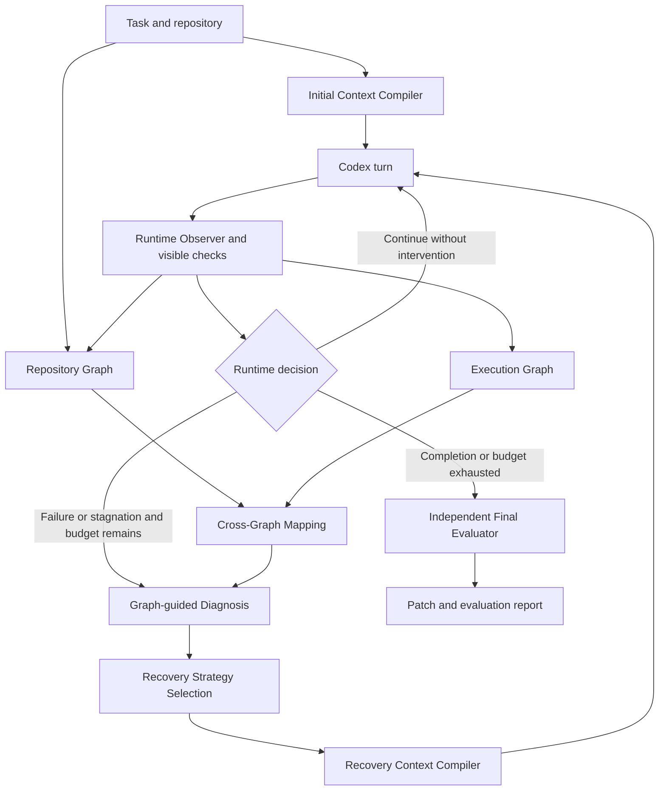

# Adaptive Agent Harness — 연구제안서

## 그래프 기반 실패 복구 및 동적 컨텍스트 최적화를 통한 코딩 에이전트의 신뢰성과 실행 효율 향상

**English title:** Adaptive Agent Harness: Graph-Guided Failure Recovery and Dynamic Context Optimization for Coding Agents

| 항목 | 내용 |
| --- | --- |
| 프로젝트명 | Adaptive Agent Harness (AAH, 가칭) |
| 수행 맥락 | 잇츠 스터디 5기 · Codex 기반 AI 코딩 에이전트 구축 |
| 연구 분야 | Coding Agents, Agent Harness, Graph-based Recovery, Context Engineering, Agent Evaluation |
| 연구 유형 | 실험적 시스템 연구 및 오픈소스 소프트웨어 구현 |
| 연구 대상 | OpenAI Codex 단일 에이전트 |
| 작성일 | 2026-11-24 |
| 문서 버전 | v0.1.0 |
| 상태 | 통합 연구 방향 확정안 / 구현·실험 전 제안 단계 |
| 기반 문서 | `RESEARCH_PROPOSAL_context.md` (Just Enough Context), `RESEARCH_PROPOSAL_graph.md` (DualGraph-Recover) |

> **핵심 연구 질문:** 코딩 에이전트의 코드 의존성과 실행 증거를 연결하고, 실패 상태에 적합한 복구 전략 및 컨텍스트를 동적으로 구성하면 동일한 모델과 공통 실행 예산 아래에서 작업 성공률, 실패 복구율 및 실행 효율을 개선할 수 있는가?

---

## 1. 연구 개요 (Abstract)

코딩 에이전트는 자연어 요구사항을 바탕으로 저장소를 탐색하고, 코드를 수정하며, 테스트를 실행하는 일련의 개발 작업을 수행한다. 그러나 복합적인 코드 의존성이 존재하거나 보조 지침이 과도하고 오래된 환경에서는 관련 정보의 누락, 반복적인 탐색, 유사한 수정의 반복 및 회귀 오류가 발생할 수 있다. 이러한 문제는 모델의 자체 능력뿐 아니라 에이전트가 활용하는 정보와 실행 환경의 설계에도 영향을 받는다. 외부 개입이 항상 유익한 것은 아니며, 불필요한 개입은 오히려 실행 비용과 오류를 증가시킬 수 있다.

본 연구는 OpenAI Codex의 모델이나 내부 추론 구조를 변경하지 않고, 관측 가능한 실행 증거를 활용하는 외부 실행 프레임워크 **Adaptive Agent Harness(AAH)**를 제안한다. 제안 시스템은 저장소의 코드 구조를 표현하는 Repository Graph와 에이전트의 행동 및 결과를 표현하는 Execution Graph를 연결한다. 반복적인 실패 또는 실행 정체가 감지되면 연결된 그래프를 탐색하여 실패 관련 증거와 미탐색 의존성을 찾아내고, 근거에 따라 후속 복구 전략을 선택한다. Dynamic Context Compiler(DCC)는 최초 실행 전과 복구 시점에 작업 및 실행 상태에 맞는 보조 정보를 선별하고, 유효성 검사와 중복 제거, 예산 기반 패키징을 수행한다. 실행 결과는 다시 관측되어 다음 복구 판단에 반영된다.

동일한 Codex 모델과 공통 실행 제한 아래에서 기본 Codex, 일반 재시도, 컨텍스트 최적화 단독, 그래프 기반 복구 단독 및 통합 시스템을 비교한다. 전체 작업 평가와 공통 실패 체크포인트 평가를 구분하고, 그래프 간 연결 및 컨텍스트 최적화의 추가 효과를 분석한다. 주요 지표는 작업 성공률, 실패 복구율 및 성공당 비용이며, 외부 개입의 오버헤드와 부작용도 기록한다.

최종 목표는 특정 엔지니어링 용어를 모두 적용하는 것이 아니라, 코딩 에이전트가 실패했을 때 더 근거 있는 다음 행동과 필요한 정보를 선택하도록 지원하는 실행 구조를 설계하고 그 효과와 적용 한계를 검증하는 것이다. 결과물은 개발자가 Python 저장소의 버그 수정 작업에 사용할 수 있는 CLI 기반 프레임워크, 재현 가능한 평가 하네스, 실행 비교 시각화 및 연구보고서로 구성한다.

**Keywords:** Coding Agent, Codex, Adaptive Agent Harness, Repository Graph, Execution Graph, Failure Recovery, Dynamic Context Compiler, Feedback Loop, Agent Evaluation

## 2. 연구 배경 및 필요성 (Background and Motivation)

### 2.1. 연구 동기

코딩 에이전트의 발전으로 단순한 코드 생성에서 저장소 수준의 자율적인 소프트웨어 개발로 활용 범위가 확대되고 있다. 에이전트의 실질적인 성능은 모델의 코딩 능력뿐 아니라 저장소 접근, 도구 사용, 프로젝트 지침, 실행 결과 관측, 테스트 및 복구 방식에 의해 달라질 수 있다. SWE-agent [1]는 에이전트와 컴퓨터 사이의 인터페이스 설계가 연구할 가치가 있는 요소임을 보여 주는 선행 사례다.

잇츠 스터디의 기존 질문인 'Codex와 같은 코딩 에이전트를 어떻게 효과적으로 활용할 수 있는가?'를 단순한 사용법 비교가 아니라, 개선된 실행 구조의 설계 및 통제된 평가 문제로 확장한다.

### 2.2. 해결 대상 문제

| 문제 | 관측 가능한 징후 | 잠재적 영향 |
| --- | --- | --- |
| 컨텍스트 과잉 | 무관한 보조 문서, 중복 안내, 긴 입력 | 토큰 소비 및 탐색 비용 증가 |
| 컨텍스트 불일치·부족 | 폐기된 안내, 현재 코드와 불일치하는 경로, 관련 정보 누락 | 잘못된 수정 또는 추가 탐색 |
| 탐색 정체 | 동일 검색·파일 접근 반복 및 새로운 증거 부족 | 시간·토큰 예산 소진 |
| 수정 실패 반복 | 동일 오류 지문과 유사 패치의 반복 | 작업 완료 지연 |
| 의존성 누락 | 관련 호출자·테스트·변경 영향을 충분히 조사하지 않음 | 불완전한 수정 |
| 회귀 오류 | 수정 후 이전에 통과하던 공개 검증이 실패 | 기존 기능 손상 |
| 실패 증거 분산 | 로그·변경 이력·테스트 결과의 관계를 파악하기 어려움 | 복구 방향 판단의 어려움 |

위 항목은 연구 대상 문제의 후보이며 최신 Codex에서 항상 발생한다고 전제하지 않는다. 반복 행동 자체도 실패를 의미하지 않는다. 예비실험을 통해 실제 발생 빈도, 관측 가능성, 비용 및 개입 필요성을 확인한다.

### 2.3. 두 기존 연구의 통합 근거

| 기존 연구 | 핵심 질문 | 통합 연구에서의 역할 |
| --- | --- | --- |
| Just Enough Context (JEC) | 어떤 보조 정보를 얼마나 제공해야 하는가? | Dynamic Context Compiler의 관련성·유효성·중복·예산 정책 |
| DualGraph-Recover | 언제 개입하고 어떤 근거로 복구해야 하는가? | 코드 구조와 실행 증거의 연결, 실패 진단 및 전략 선택 |
| Adaptive Agent Harness | 현재 실행 상태에서 어떤 행동과 정보가 필요한가? | 그래프 기반 복구와 상태 적응형 컨텍스트를 결합한 실행 시스템 |

DualGraph-Recover의 기존 복구 절차에는 실패 관련 코드와 실행 증거를 선별하고 제한된 컨텍스트로 구성하는 단계가 포함되어 있다. JEC의 DCC를 이 단계에 적용하면 동일한 문제를 해결하는 연속적인 메커니즘이 된다.

기존 JEC의 MVP는 최초 실행 전 보조 컨텍스트 최적화였으므로, 통합 연구에서는 DCC가 실패 증거, 현재 작업 트리 및 복구 전략도 입력받도록 확장한다. 기존 DualGraph-Recover의 턴 단위 외부 복구 정책은 유지한다. 두 제안서에 포함된 모든 독립적인 연구 범위와 실험을 그대로 합산하지 않는다.

## 3. 문제 정의 및 연구 범위 (Problem Statement and Scope)

### 3.1. 문제의 형식화

저장소 초기 상태 $R_0$, 자연어 작업 요청 $q$, 변경할 수 없는 필수 지침 $M$, 보조 컨텍스트 후보 $C$, 허용된 도구 집합 $\mathcal{T}$ 및 실행 예산 상한 집합 $B$가 주어졌다고 가정한다.

시점 $t$에서 외부 하네스의 관측 상태는 다음과 같다.

$$
S_t=(q,R_t,H_t,G_r^{(t)},G_e^{(t)},E_c^{(t)},b_t)
$$

- $R_t$: 현재 작업 트리와 코드 스냅샷
- $H_t$: 공개 실행 이벤트와 검증 결과
- $G_r^{(t)}$: Repository Graph
- $G_e^{(t)}$: Execution Graph
- $E_c^{(t)}$: 두 그래프 사이의 연결 관계
- $b_t$: 잔여 실행 예산

복구 정책 $\pi$는 현재 상태를 입력받아 개입 여부 및 복구 전략 $a_t$를 선택한다. 컨텍스트 정책 $\kappa$는 해당 상태와 전략에 적합한 보조 컨텍스트 패키지 $K_t$를 생성한다.

$$
a_t=\pi(S_t),\qquad K_t=\kappa(S_t,a_t,C)
$$

최종 패치 $p$의 독립 평가 성공 여부를 $Y(p)\in\{0,1\}$이라 할 때, 주된 목표는 공통 실행 제한 아래에서 기대 성공률을 높이고 전체 실행 비용을 개선하는 것이다.

$$
\max_{\pi,\kappa}\;\mathbb{E}[Y(p)]\quad\text{subject to}\quad \mathbf{c}(\pi,\kappa)\preceq B
$$

여기서 $\mathbf{c}$는 관측 가능한 토큰, 실행 시간, 턴 또는 호출 수 등 비용 벡터다. 별도로 성공당 비용을 분석해 성공률과 효율 간 trade-off를 평가한다. 위 수식은 연구 목적을 형식화한 것이며, 강화학습이나 최적 정책 학습을 구현한다는 의미는 아니다.

### 3.2. 조작적 정의

| 용어 | 본 연구에서의 의미 |
| --- | --- |
| 적응형 실행 | 관측 상태에 따라 개입 여부, 후속 작업 및 보조 정보 구성을 변경하는 외부 실행 정책 |
| 동적 컨텍스트 | 최초 작업 또는 후속 복구 상태에 맞추어 턴 경계에서 구성되는 보조 정보 집합 |
| 실패 | 사전에 정의된 공개 검증 실패 또는 최종 독립 평가 실패. 두 종류를 구분한다. |
| 실행 정체 | 반복된 관측 행동과 새로운 증거·검증 진전의 부족을 결합한 사전 정의 조건 |
| 복구 | 관측된 실패 상태 이후에 후속 실행을 통해 독립 평가를 통과하는 것 |
| 그래프 기반 복구 | 그래프의 연결 관계를 실제로 탐색하여 복구 증거 또는 전략을 선택하는 방식 |
| 필수 지침 | 사용자 요구, 권한 정책 및 저장소 강제 규칙 등 모든 조건에서 보존할 정보 |
| 보조 컨텍스트 | 코드 위치, 참고 문서, 구현 안내, 오류 증거 등 선택적으로 제공할 정보 |

동적 컨텍스트는 Codex 내부 컨텍스트 창의 임의 삭제나 실시간 재배치를 뜻하지 않는다. 외부에서 제공하는 보조 정보만 최적화한다.

### 3.3. MVP 범위

| 영역 | 포함 범위 | 후속 확장 또는 제외 |
| --- | --- | --- |
| 에이전트 | Codex 단일 에이전트 | 멀티에이전트 협업, 모델 학습·파인튜닝 |
| 대상 | Python 저장소의 테스트 가능한 버그 수정 | 대규모 기능 개발, 다중 언어 및 UI 작업 |
| 실행 제어 | 외부 상태 머신 및 턴 단위 개입 | 내부 추론 제어, 임의 시점 세션 복원 |
| 그래프 | 파일·함수·테스트·실행 사건과 명시적 연결 | 완전한 동적 분석, 그래프 신경망 |
| 복구 정책 | 규칙 기반 감지·전략 선택, 제한된 관계 탐색 | 강화학습 기반 정책, 워크플로 자동 합성 |
| 컨텍스트 | 초기 및 복구 시점 보조 정보 구성 | 장기 경험 메모리 및 내부 컨텍스트 압축 |
| 제품 | CLI, 결과 리포트, 대표 실행 시각화 | 범용 IDE 플러그인, 대규모 서비스 UI |

## 4. 선행연구 및 연구 공백 (Related Work and Research Gap)

### 4.1. 관련 연구의 위치

아래는 기존 두 제안서가 검토한 문헌을 통합한 예비 분류다. 신규 문헌 검색이나 원문 재검증을 수행한 결과가 아니며, 특히 2026년 자료의 서지 정보와 세부 메커니즘은 후속 `LITERATURE_REVIEW.md`에서 확인한다.

| 연구·자료 | 기존 제안서에서 정리한 접근 | 본 연구와의 관계 |
| --- | --- | --- |
| SWE-agent [1] | 에이전트-컴퓨터 인터페이스 | 외부 실행 환경 설계의 연구 동기 |
| RepoGraph [2] | 저장소 수준 그래프를 활용한 코드 탐색 | 코드 관계 표현과 탐색의 직접 관련 연구 |
| AFlow [3] | 에이전트 워크플로 생성 및 최적화 | 실행 구조 설계의 관련 연구; 본 연구는 실패 상태별 복구에 집중 |
| Evaluating AGENTS.md [4] | 저장소 지침 파일의 효과와 비용 평가 | 보조 컨텍스트 제공 효과의 실증적 검토 필요성 |
| SWE Context Bench [5] | 관련 개발 경험의 검색·재사용 | 상태 및 관련성 기반 정보 선택의 연구 동기 |
| Rivet [6] | 저장소 수준 코드 근거 검색 및 예산 기반 컨텍스트 제어 | 컨텍스트 선택과 예산 최적화 측면의 직접 비교 대상 후보 |
| AgentRx [7] | 관측 실행 궤적을 활용한 실패 진단 | 관측 증거와 실패 진단의 설계 참고 |
| CodeTracer [8] | 실행 추적 구조 및 진단 기반 재실행 | 구조화된 실패 복구 측면의 직접 비교 대상 후보 |
| PROBE [9] | 실패 중심의 구조화된 증거 및 복구 지침 | 실패 관련 증거 선택과 후속 개입 측면의 직접 비교 대상 후보 |
| SWE-bench [10] | 실제 저장소 이슈의 테스트 기반 평가 | 평가 과제 및 독립 검증 설계의 참고 |

MemTrace의 상태 일관성, AgentTether의 그래프 진단·개입, GRADE의 실행·의존 그래프는 AAH와 겹치는 선행이다. 비교 대상의 실행 환경·과제·개입·비용 귀속과 직접 재현 여부는 [LITERATURE_REVIEW §4·11](LITERATURE_REVIEW.md)을 따른다. AAH는 공개 실패 상태에서 정책의 독립·결합 효과를 평가하며 기존 기법 조합 자체의 최초성이나 미실행 비교의 우월성을 가정하지 않는다.

### 4.2. 잠정 연구 공백

그래프 기반 코드 탐색, 실행 궤적 기반 실패 진단, 예산 기반 컨텍스트 최적화는 이미 관련 연구가 존재한다. 따라서 이러한 기술의 사용이나 단순 결합 자체를 학술적 최초성으로 주장하지 않는다.

본 연구의 구체적인 차별화 후보는 다음의 메커니즘과 검증 질문이다.

1. 실패 이벤트에서 버전이 식별된 코드 요소 및 이전 실행 행동으로 이어지는 타입이 있는 연결을 구성한다.
2. 해당 연결을 탐색하여 복구 전략과 보조 정보 후보를 결정하고, 유효성·중복·예산을 고려한 컨텍스트로 변환한다.
3. 같은 원본 증거, 공통 감지 조건, 재시도 기회 및 실행 제한에서 비그래프 선택, 비연결 그래프 및 DCC 적용 여부를 비교한다.
4. 최초 실행에서의 정보 최적화와 실패 후 정보 재구성을 구분하고, 전체 실행 비용과 오개입 비용까지 측정한다.

이러한 차별화가 실제 선행연구와 중복되지 않는지 원문 및 공개 구현을 비교해야 한다. 중복이 확인되면 연구 질문을 연결 기반 증거 선택의 효과나 특정 실행 조건의 비교 평가로 좁힌다.

## 5. 연구 목적, 질문 및 가설 (Objectives and Hypotheses)

### 5.1. 연구 목적

- 관측 가능한 실행 증거와 코드 의존성을 활용하는 외부 복구 메커니즘을 설계한다.
- 작업 및 복구 상태에 적응하는 보조 컨텍스트 최적화 모듈을 구현한다.
- 각 모듈의 독립 효과와 결합 효과를 통제 실험으로 평가한다.
- 개입이 유효한 과제 및 실패 유형과 오버헤드·부작용을 분석한다.
- 개발자가 재사용할 수 있는 실행 도구와 재현 가능한 평가 자산을 구축한다.

### 5.2. 연구 질문 및 가설

| ID | 연구 질문 | 사전 가설 | 우선순위 |
| --- | --- | --- | --- |
| RQ1 / H1 | 동적 컨텍스트 최적화는 전체 실행 효율을 개선하는가? | 일반 정보 제공 정책보다 성공당 비용을 낮추고 성공률·지침 준수의 실질적인 저하를 최소화한다. | 핵심 |
| RQ2 / H2 | 그래프 기반 복구는 일반 재시도보다 효과적인가? | 공통 실패 체크포인트에서 최종 복구율이 높다. | 핵심 |
| RQ3 / H3 | 그래프 복구와 DCC를 결합하면 추가 이득이 발생하는가? | 통합 방식은 단독 방식 대비 성공률 또는 성공당 비용을 개선한다. | 핵심 |
| RQ4 / H4 | 명시적 그래프 간 연결 및 컨텍스트 정책은 어떤 추가 효과를 제공하는가? | 동일한 증거 및 컨텍스트 상한에서 비연결 그래프나 단순 검색보다 효과적인 증거 선택이 가능하다. | 구성요소 분석 |
| RQ5 | 어떤 실패 유형에서 유용하며 부작용은 무엇인가? | 복합 의존성 및 반복 실패에서 더 큰 효과가 나타날 수 있으나 오개입은 비용 또는 실패를 증가시킬 수 있다. | 탐색적 |

가설은 검증 대상이지 달성한 성과가 아니다. 성공률의 차이가 유의하지 않다는 사실만으로 비열등성을 주장하지 않는다. 실질적 허용 손실 폭이 필요하면 본실험 전에 정당화해 지정하고 표본이 부족하면 결론 불충분으로 보고한다. 결합 방식의 단독 대비 우위와 통계적 상호작용은 구분한다.

실험 설계 §2와 평가 프로토콜 §11에서 주요 대비와 해석을 승인한다. RQ5의 기대는 탐색적이다. 자연 checkpoint의 최종 PASS 대비가 무개입 대비 인과적 효과나 선정 순간의 hidden FAIL→PASS 변화를 검증하지는 않는다.

## 6. 제안 방법 (Proposed Method)

### 6.1. 전체 실행 구조



외부 워크플로는 고정된 상태와 조건부 분기를 가지며, 그래프 구조 자체를 동적으로 재작성할 필요는 없다. 정상적인 실행에는 외부 복구 개입을 최소화한다. Codex가 완료를 선언했을 때와 시간·턴·복구 횟수 상한에 도달했을 때 독립 평가를 실행한다. 모든 경로에 종료 조건을 적용한다.

| 모듈 | 책임 |
| --- | --- |
| Runtime Adapter | Codex 실행, 지원되는 이벤트 및 사용량 수집, 작업 트리 관리 |
| Workflow Controller | 상태 전이, 실행 제한, 정상 진행 및 복구 분기 |
| Graph Builder | 저장소·실행 그래프 구축과 변경 반영 |
| Cross-Graph Mapper | 행동·실패 이벤트와 해당 코드 스냅샷 연결 |
| Failure Detector | 관측 가능한 실패·정체 조건 평가 |
| Recovery Controller | 제한된 관계 탐색, 원인 후보 및 후속 전략 선택 |
| Dynamic Context Compiler | 초기 및 복구 시점 보조 정보 선별·패키징 |
| Evaluation Harness | 격리된 최종 검증, 비용 집계 및 결과 기록 |

### 6.2. Repository Graph — 코드 구조 표현

현재 저장소 스냅샷의 코드 구조를 $G_r^{(t)}=(V_r^{(t)},E_r^{(t)})$로 표현한다.

| 요소 | 초기 스키마 |
| --- | --- |
| 노드 | 파일, 함수, 클래스, 테스트 함수 |
| 엣지 | CONTAINS, IMPORTS, CALLS, INHERITS, TESTS |
| 속성 | 경로, 심볼, 위치, 스냅샷 ID, 관계 추출 근거, 신뢰도 |

Python AST와 명시적인 import 관계를 우선 사용한다. 동적 호출처럼 확정할 수 없는 의존성은 추정 관계로 표시하며, traceback 또는 사용 가능한 커버리지 정보로 보완할 수 있다. 변경 파일이 발생하면 관련 구조를 갱신하거나 소규모 저장소에서는 재구축한다.

### 6.3. Execution Graph — 실행 증거 표현

시점 $t$까지의 관측 가능한 행동 및 결과를 $G_e^{(t)}=(V_e^{(t)},E_e^{(t)})$로 표현한다.

| 요소 | 초기 스키마 |
| --- | --- |
| 노드 | 검색, 파일 접근, 명령 실행, 변경, 테스트, 실패 결과, 복구 개입 |
| 엣지 | NEXT, RETURNS, RETRIES, OBSERVED_AFTER, SAME_FAILURE_AS |
| 속성 | 이벤트·턴 ID, 시각, 명령, 경로, 종료 코드, 오류 지문, diff 참조 |

실제 이벤트에서 파일 접근 또는 행동을 확인할 수 없으면 미관측으로 남긴다. 시간적 선후 관계는 인과관계의 증거로 과대 해석하지 않는다. Codex의 비공개 내부 추론을 수집하거나 재구성하지 않는다.

### 6.4. Cross-Graph Mapping — 실행과 코드의 연결

두 그래프를 연결한 증거 그래프는 다음과 같다.

$$
G_d^{(t)}=\left(V_r^{(t)}\cup V_e^{(t)},\ E_r^{(t)}\cup E_e^{(t)}\cup E_c^{(t)}\right)
$$

| 연결 타입 | 근거 |
| --- | --- |
| READS | 관측된 파일 접근과 경로 |
| CHANGES | Git diff 및 AST 위치 매핑 |
| TESTS_TARGET | 확인된 테스트 ID와 대상/커버리지 근거. 명령 문자열만 있으면 후보 또는 미해결 |
| FAILS_AT | traceback·assertion 위치 |
| SUSPECTS | 의존성 탐색으로 도출한 관련 후보, 확정 원인은 아님 |

각 연결은 해당 이벤트 시점의 코드 스냅샷에 대응시킨다. 변경 전 코드 위치가 변경 후 다른 심볼에 잘못 연결되는 것을 방지한다. 추정 관계와 관측 관계를 구분하며, 연결 근거를 기록한다.

Workflow Graph는 실행 제어 구조이고, Repository Graph 및 Execution Graph는 의사결정에 사용하는 데이터 구조다. 워크플로에 그래프 라이브러리를 적용하는 것 자체가 연구 기여는 아니다.

### 6.5. Failure-Aware Recovery Controller

실패 감지는 개발용 과제에서 정의한 공개 이벤트 및 검증 규칙으로 수행한다. 본실험 전에 임계값을 고정한다. 감지된 실패 노드를 기준으로 제한된 깊이의 관계 탐색을 수행하고, 실패 근접성, 증거 신뢰도, 변경 이력, 미탐색 여부 등을 고려하여 원인 후보와 후속 전략을 결정한다.

| 관측 상태 | 복구 전략 예시 |
| --- | --- |
| 동일 실패 지문 반복 | 이전 패치와 오류 위치 재검토, 관련 의존성 조사 |
| 탐색 정체 | 조사하지 않은 인접 코드 요소의 확인 |
| 회귀 오류 | 변경 코드의 영향 범위와 기존 검증 재점검 |
| 의존성 누락 의심 | 관련 호출자·피호출자·테스트 관계 탐색 |
| 근거 부족 | 추가 관측 또는 일반 재시도; 강한 원인 단정 금지 |
| 정상 진행 | 추가 개입 없음 |

복구 컨트롤러는 전략과 선택 근거를 기록하고 DCC에 전달한다. Codex의 개별 내부 행동을 강제한다고 가정하지 않으며, 후속 턴에 제공하는 지침과 정보로 실행 방향을 유도한다. 사용 가능한 예산을 초과하거나 충분한 근거가 없으면 복구를 제한한다.

### 6.6. Dynamic Context Compiler (DCC)

DCC의 목표는 정보의 무조건적인 최소화가 아니라 현재 작업에 충분한 정보를 적절한 비용으로 제공하는 것이다. 필수 지침 $M$은 모든 조건에서 유지한다.

| 단계 | 기능 |
| --- | --- |
| 후보 수집 | 저장소 보조 안내, 코드 위치, 공개 오류 증거, 변경 이력 등 수집 |
| 유효성·출처 검사 | 명시적으로 폐기된 안내, 버전 불일치, 존재하지 않는 참조 식별 |
| 관련성 평가 | BM25 등 텍스트 관련도, 적용 경로·심볼, 실패 증거·전략 일치도 |
| 중복 제거 | 동일하거나 과도하게 반복되는 보조 후보의 정리 |
| 예산 기반 선택 | 중요 근거를 우선 배치하고 설정된 보조 토큰 예산 안에 패키징 |
| 전달 및 기록 | 고정 지침과 분리된 보조 패키지 전달, 선택·제외 근거와 크기 기록 |

초기 실행에서는 사용자 요청과 현재 저장소를 입력받는다. 복구 실행에서는 여기에 실패 증거, 현재 패치 및 선택된 전략이 추가된다. 그래프가 활성화된 조건에서는 탐색으로 추출한 코드 요소와 관계 증거를 후보 집합 구성 및 관련성 평가에 사용한다.

후보 $i$의 점수는 예를 들어 다음처럼 구성할 수 있다.

$$
s_i=\alpha r_i(q)+\beta a_i(R_t)+\gamma v_i(R_t)+\delta f_i(S_t,a_t)
$$

$r_i$는 작업 관련도, $a_i$는 적용 범위 일치도, $v_i$는 유효성, $f_i$는 실패 및 전략 관련도다. 초기 실행에는 실패 관련 항을 사용하지 않는다. Context-only 조건의 실패 관련도는 평면 로그와 동일한 비그래프 증거를 사용한다. 그래프 정보는 Graph 조건에서만 사용한다.

보조 컨텍스트 선택은 다음 목적의 근사 문제로 정의한다.

$$
\max_{x_i\in\{0,1\}}\left(\sum_i s_ix_i-\lambda\sum_{i<j}d_{ij}x_ix_j\right),\qquad\sum_i t_ix_i\le B_{ctx,t}
$$

$t_i$는 후보의 토큰 길이, $d_{ij}$는 중복도, $B_{ctx,t}$는 해당 턴의 보조 컨텍스트 상한이다. 직렬화 비용을 포함하며 필수 지침은 제거하지 않는다. 명시적으로 무효인 보조 정보는 제외하고 불확실한 정보는 경고하거나 검토 대상으로 표시한다. MVP는 재현 가능한 규칙과 greedy packing을 사용한다. 가중치와 상한은 예비실험에서 확정한다.

### 6.7. Feedback-driven Execution Loop

```text
initialize task, repository, fixed instructions, common limits
build repository graph if enabled
compile initial supplementary context if enabled

while execution budget remains:
    run Codex for a supported execution unit
    observe public events, diff and visible validation results
    update execution evidence and enabled graphs

    if unsafe, cancelled, global limit reached or runtime cannot safely continue:
        break
    if assigned condition is A or no eligible trigger passes the common gate:
        stop on normal completion or continue natively if supported
        # Exhausting only the recovery cap still permits supported native work.

    choose recovery strategy using the assigned policy
    build supplementary recovery context using the assigned policy
    submit the next turn and record the intervention

return frozen patch and report
# Separate experimental runner may request independent evaluation afterward.
record success, cost, evidence and termination reason
```

반복의 목적은 단순 재시도가 아니라 이전 실행 증거를 다음 전략 및 보조 컨텍스트에 반영하는 것이다. 실패 횟수 제한, 증거 부족, 진행 여부 및 잔여 예산에 따라 개입을 중단한다. 독립 평가 결과는 에이전트의 후속 수정에 사용하지 않는다.

### 6.8. 엔지니어링 개념의 적용 원칙

| 개념 | 실제 해결하는 문제 | 연구 내 위치 |
| --- | --- | --- |
| Harness Engineering | 에이전트의 실행·관측·제어·평가를 어떻게 구성할 것인가? | 전체 실행 시스템 |
| Graph Engineering | 코드와 실행 증거 사이의 관계를 어떻게 활용할 것인가? | 핵심 방법론 |
| Context Engineering | 현재 상태에 필요한 보조 정보를 어떻게 선택할 것인가? | 핵심 방법론 |
| Loop Engineering | 실행 결과를 어떻게 후속 실행에 반영하고 종료할 것인가? | 피드백 기반 복구 메커니즘 |
| Prompt Engineering | 선택된 전략과 증거를 어떤 지침으로 전달할 것인가? | 보조 구현 수단 |

위 분류는 본 연구의 설계상 역할이며, 학계의 표준화된 포함 관계를 주장하지 않는다. 모든 용어를 연구 제목이나 개별 연구 기여에 포함할 필요도 없다. 그래프·컨텍스트 메커니즘을 핵심 연구 대상으로 두고 나머지는 문제 해결에 필요한 범위에서 활용한다.

## 7. 예상 연구 기여 (Expected Contributions)

1. **Coupled Graph-based Recovery:** 실패 이벤트, 이전 실행 행동 및 코드 의존성을 명시적으로 연결하여 복구에 필요한 증거와 전략을 구성하는 방법.
2. **State-Adaptive Context Optimization:** 작업과 실패 상태에 따라 보조 정보의 관련성·유효성·중복 및 예산을 고려하여 컨텍스트를 구성하는 방법.
3. **Adaptive Agent Harness:** 두 방법을 선택적인 개입 및 피드백 기반 재실행 구조에 결합한 재사용 가능한 Codex 외부 하네스.
4. **Empirical Evaluation:** 동일 모델 및 공통 실행 제한 아래에서 각 방법의 독립 효과, 결합 효과, 적용 조건 및 비용을 비교하는 평가 자산과 결과.

이는 연구 기여의 후보이며, 방법의 독창성과 성능 개선은 원문 검토 및 실험 이후 확정한다.

## 8. 실험 설계 및 검증 전략 (Evaluation Design)

### 8.1. 핵심 비교군

A를 실제 기본 사용 방식의 참조점으로 설정하고, B–E는 동일한 외부 실행 구조에서 두 핵심 요소의 적용 여부만 변경하는 2×2 요인 설계로 구성한다.

| ID | 비교군 | DCC | 그래프 기반 복구 | 설명 |
| --- | --- | --- | --- | --- |
| A | Vanilla Codex | 미적용 | 미적용 | Codex의 기본 실행과 자체 반복 기능. 별도 복구 지침 없음 |
| B | Flat Retry | 미적용 | 미적용 | 공통 감지 조건에서 평면 증거와 일반 재시도 지침을 제공 |
| C | Context-only | 적용 | 미적용 | 초기 및 복구 컨텍스트를 최적화하되 평면 증거와 일반 복구 정책 사용 |
| D | Graph-only | 미적용 | 적용 | 연결 그래프로 복구 전략과 증거를 선택하되 기본 패키징 사용 |
| E | Adaptive Agent Harness | 적용 | 적용 | 초기·복구 컨텍스트 최적화와 그래프 기반 복구 전략 결합 |

B–E의 일반 컨텍스트 정책은 동일한 보조 후보 풀에서 정해진 기본 순서·단순 검색 규칙과 공통 상한을 사용한다. D의 그래프 기반 증거 선택은 복구 방법의 일부이므로 허용하되, DCC의 추가적인 유효성 점수·중복 제거·상태 적응형 패킹은 적용하지 않는다. C에는 그래프 및 그래프에서 생성된 진단 결과가 제공되지 않는다. 이 구분을 통해 단순한 정보 제공과 제안하는 최적화 정책의 차이를 검증한다.

모든 비교군은 같은 필수 지침과 원본 저장소 접근 권한을 가진다. B–E에서는 공통 감지 규칙, 복구 기회, 기본 메시지 형식, 잔여 실행 예산 및 보조 컨텍스트 최대량을 통제한다. 실제 주입량은 정책의 결과이므로 다를 수 있다. A 역시 동일한 전역 실행 제한을 적용하되 외부 복구 절차가 없으므로, A와 E의 차이를 순수한 그래프 또는 DCC 효과로 해석하지 않는다.

### 8.2. 연구 질문별 비교

| 비교 | 검증 목적 |
| --- | --- |
| A vs E | 실제 기본 Codex 대비 통합 시스템의 실용적 가치 |
| B vs C | 비그래프 조건에서 DCC 정책의 효과 |
| B vs D | 기본 패키징 조건에서 그래프 기반 복구의 효과 |
| D vs E | 그래프 조건에서 DCC를 추가한 효과 |
| C vs E | DCC 조건에서 그래프 기반 복구를 추가한 효과 |
| B, C, D, E | 두 요소의 주효과와 상호작용 추정 |

예를 들어 성공률에 대한 가법적 상호작용은 $(p_E-p_D)-(p_C-p_B)$로 정의할 수 있다. 통합 방식이 단독 방식보다 성능이 높다는 사실과 양의 상호작용이 있다는 사실은 서로 다른 주장이다. 표본이 작으면 상호작용은 탐색적으로 보고한다.

### 8.3. 실험 프로토콜

**Protocol 1 — End-to-end Evaluation**

동일한 초기 저장소와 요청에서 각 조건을 독립적으로 실행한다. 초기 실행이 이미 성공하는 과제도 모두 포함한다. 전체 성공률, 비용 및 개입 부작용을 비교하여 개발자 관점에서의 실제 효용을 평가한다. 조건 실행 순서는 무작위화하거나 균형화하며, 각 실행은 새 작업 트리와 세션에서 시작한다.

**Protocol 2 — Common Failure Checkpoint Evaluation**

별도의 공통 초기 정책으로 수행한 실행에서 사전 정의된 개입 조건을 처음 충족하는 실패 상태를 확보한다. 작업 트리, 공개 로그, 현재 패치, 코드 스냅샷, 사용자 요청 및 잔여 실행 예산을 동일하게 복제하여 B–E 복구 정책으로 분기한다. 초기 DCC가 실패의 유형과 빈도에 영향을 줄 수 있으므로, 각 end-to-end 조건에서 자연적으로 발생한 서로 다른 실패를 비교해 복구 정책의 인과 효과라고 주장하지 않는다.

Codex 내부 세션 복제가 지원되지 않으면 모든 조건에 동일한 외부 이력 요약과 작업 트리를 제공하는 새 세션으로 실행한다. 이 경우 원래 세션의 완전한 복원이 아니라 공통 외부 상태에서의 재실행 실험임을 명시한다. 실패 체크포인트는 감지 신호에 기반해 선정하고 평가용 hidden test 결과로 선택하지 않는다. 자연 실패와 인위적 실패 주입 사례는 별도로 보고한다.

### 8.4. 구성 요소 분석 (Ablation Study)

핵심 비교군 평가 후 예산이 허용하는 범위에서 수행한다.

| 분석 | 비교 방식 | 목적 |
| --- | --- | --- |
| Cross-Graph Mapping | 통합 방식 vs 두 그래프를 연결하지 않는 방식 | 명시적 연결의 추가 가치 |
| Graph Structure | 연결된 그래프 vs 동일 원본 증거를 평면으로 전달·검색 | 정보량과 관계 구조 효과 분리 |
| Context Timing | 초기 DCC만 / 복구 DCC만 / 두 시점 적용 | 초기 및 복구 컨텍스트 효과 분리 |
| Context Validity | DCC vs 유효성 검사 제거 | 오래되거나 불일치하는 보조 안내의 영향 |
| Context Deduplication | DCC vs 중복 제거 미적용 | 중복 정보 제거 효과 |
| Context Baselines | 정적 보조 안내 / 관련도 검색 / DCC | 기존 JEC의 컨텍스트 정책별 차이 확인 |
| Single Graph | Repository-only / Execution-only | 두 정보 구조의 개별 기여 |

세부 대비·순서는 [EXPERIMENT_DESIGN §8](../evaluation/EXPERIMENT_DESIGN.md)을 따른다. AB1(연결), AB2(전략)를 우선하고 AB3(적용 시점)과 AB4(같은 증거의 탐색 방식)는 가용하면 검토한다. 실행한 비교가 지지하는 범위에서 결과를 주장하고 모든 ablation에서 필수 지침 및 안전 정책을 유지한다.

### 8.5. 평가 과제 및 데이터 구성

- **자체 신규 과제:** 소규모 Python 저장소에 현실적인 버그를 구성한다. 단일 파일 버그, 파일 간 의존성, 복합 수정, 회귀 위험 등을 포함한다. 원본 저장소와 공개 검증 도구를 제공하되 정답 패치와 평가 테스트는 분리한다.
- **공개 과제:** SWE-bench 계열에서 실행 환경, 비용, 라이선스 및 테스트 타당성이 확인된 Python 과제를 사용한다. 기존 공개 벤치마크의 학습 데이터 노출 가능성을 고려해 자체 신규 과제의 결과와 구분한다.
- **문서 상태:** 정상 안내, 중복·무관한 안내, 명시적으로 오래된 보조 안내가 있는 조건을 개발용 및 평가용 계획에 포함한다. 의도적으로 생성한 노이즈 조건은 일반 저장소 환경과 구분하여 보고한다.
- **데이터 분리:** 감지 임계값과 DCC 점수 조정에 사용하는 개발용 과제와 최종 평가 과제를 분리한다. 기준 패치와 버그 상태에서 테스트 유효성을 사전 확인하고, 합리적인 대안 패치도 통과할 수 있도록 검토한다.

### 8.6. 실험 규모 및 예산 (잠정 계획)

| 단계 | 규모 후보 | 목적 |
| --- | --- | --- |
| 기술 검증 | 자체 저장소 1개, 과제 1~2개 | 실제 Codex 이벤트 수집, 턴 제어 및 독립 평가 확인 |
| Pilot | 개발용 과제 5~8개 | 감지·복구 사례 수집, 정책 설정, 실행당 비용 추정 |
| 본실험 | 평가 과제 20~24개, 5개 조건, 조건별 2회 반복 | end-to-end 비교, 총 200~240회 실행 후보 |
| Checkpoint | 예비 결과 및 자원에 따라 확보 가능한 공통 자연 실패 상태 | B–E의 복구 성능 비교 |
| Ablation | 사전 확정한 평가 부분집합 | 그래프 연결 및 DCC 구성 요소 분석 |

위 규모는 기존 제안서와 달리 통합 비교군을 적용한 잠정적인 설계안이며 실행을 완료했다는 의미가 아니다. 실제 표본 수와 예산은 pilot을 기반으로 본실험 시작 전에 확정한다. 24개 과제에서 5개 조건을 2회씩 실행하면 240회이며, pilot, checkpoint, ablation 및 개발용 호출은 별도다.

예산이 부족하면 평가 결과를 확인하기 전에 반복 수 또는 평가 과제 수를 줄이고, 우선 A–E 핵심 비교와 가능한 공통 실패 체크포인트를 확보한다. 독립 평가의 완성도를 유지하고 확장 ablation과 UI 고도화를 먼저 줄인다. 실패 사례가 적으면 개발용 복합 과제를 보완하되 이미 결과를 확인한 평가 과제를 사후 교체하지 않는다. 작은 표본은 제한된 결론만을 뒷받침할 수 있다.

### 8.7. 평가 지표

| 지표 | 조작적 정의 | 역할 |
| --- | --- | --- |
| Task Success Rate | 기능·회귀·필수 제약을 모두 통과한 독립 판정을 과제 내 평균 후 공통 유효 과제별 동등 가중으로 집계 | 주 지표 |
| Failure Recovery Rate | 대비별 공통 유효 체크포인트 분기의 최종 독립 PASS 비율. 선정 및 관측 결측은 별도 집계 | 주 지표 |
| Cost per Success | 실패를 포함한 전체 실행 비용 합 / 성공한 실행 수 | 주 효율 지표 |
| End-to-End Token Usage | 초기 실행, 후속 실행, 추가 모델 호출의 전체 관측 토큰 | 효율 지표 |
| End-to-End Time | 컨텍스트 구성, 그래프 구축, 실행, 복구 및 평가를 포함한 시간 | 효율 지표 |
| Instruction Compliance | 사전 정의한 필수 제약 검사를 만족한 실행의 비율 | 신뢰성 |
| Tool Calls | 관측 가능한 도구 호출 수 | 행동 효율 |
| Exploration Redundancy | 사전 정의된 중복 탐색 기준을 충족한 관측 행동의 비율 | 행동 분석 |
| Selected Context Tokens | 최초 및 복구 턴에 제공한 외부 보조 컨텍스트 토큰 수 | 메커니즘 분석 |
| Harmful Intervention | 개입 이후 새 실패가 나타나거나 기존 공개 검증이 악화된 사례 | 부작용 분석 |
| Fault Localization (선택) | 검증된 원인 위치가 있는 과제에서 후보 Top-k 적중률 | 진단 품질 |

성공당 비용은 관측 토큰 기준과 실제 측정 가능한 비용 기준을 각각 산출한다. 실제 과금과 환산 추정치는 구분한다. 성공 건수가 0이면 성공당 비용은 계산 불가로 표시하고 효율 우위를 주장하지 않는다. Harmful Intervention은 우선 관측상의 악화로 기록하며, 인과적 해석은 공통 상태에서 대조군과 비교할 수 있는 범위로 제한한다.

### 8.8. 통제 및 통계 분석

모델 ID, 추론 설정, SDK·CLI 버전, 초기 커밋, 의존성, 실행 이미지, 기본 지침, 도구 권한, 공통 시간·턴·호출 상한, 평가 테스트 및 사용량 수집 정책을 고정한다. B–E에서 감지 조건과 복구 기회도 동일하게 유지한다. 캐시, 재사용 세션 여부, 원격 모델 변경 가능성 및 외부 하네스 자체의 처리 비용을 기록한다.

정확한 전체 토큰 상한을 강제할 수 없으면 공통 시간·턴 상한과 관측 토큰 사용량을 기록하며 엄밀한 동일 토큰 예산 실험이라고 표현하지 않는다. 실험 실패와 타임아웃은 성능 평가에 포함하고, 플랫폼 장애 등 사전 정의된 인프라 오류만 별도 처리한다.

과제 단위 paired 비교를 사용한다. 성공률의 절대 차이, 성공당 비용, 과제 단위 paired bootstrap 신뢰구간 등을 보고하고, 충분한 표본이 있으면 요인별 효과와 상호작용을 분석한다. 동일 과제에서 반복한 실행을 독립 과제처럼 취급하지 않는다. 확증적 분석과 실패 유형별 탐색 분석을 구분하며 다중 비교 및 작은 표본의 한계를 기록한다.

### 8.9. 연구 성공 기준

| 구분 | 완료 또는 검증 기준 |
| --- | --- |
| 구현 | 실제 Codex 실행에서 공개 실패 신호를 감지하고, 그래프 근거 및 DCC 패키지를 생성하여 후속 턴에 전달할 수 있다. |
| 평가 | 고정된 평가 과제와 설정에서 모든 핵심 비교군의 유효 결과를 기록하고 재현 가능한 집계 절차를 제공한다. |
| 연구 목표 | 일반 재시도 대비 복구율 향상 여부, DCC의 성공당 비용 개선 여부, 두 방법의 결합 효과를 검증한다. |
| 실용성 | 최소 한 개 이상의 검증된 Python 저장소에서 CLI를 사용해 전체 실행과 평가 결과를 확인할 수 있다. |
| 해석 | 개선이 나타나지 않는 경우에도 실패 유형, 비용, 오개입 및 적용 조건을 보고한다. |

성능 목표와 구현 완료 기준을 분리한다. 실험 결과가 가설을 지지하지 않더라도 공정한 평가와 한계 분석은 연구의 유효한 결과다.

## 9. 프로젝트 구현 및 실용성 (Implementation and Practical Use)

### 9.1. 실제 사용자 및 사용 시나리오

핵심 사용자는 Codex로 저장소 수준의 개발 작업을 수행하는 개발자다. 반복 오류가 발생할 때 사람이 전체 로그와 코드 의존성을 직접 재검토하는 부담을 줄이고, 일반 재시도보다 근거 있는 후속 작업을 지원하는 것이 제품 가치다.

CLI 사용 예시(인터페이스 설계안, 현재 미구현):

```bash
adaptive-codex run \
  --repo ./my-project \
  --task "로그인 실패 횟수에 따른 계정 잠금 오류 수정" \
  --config configs/default.yaml
```

사용자는 대상 저장소와 요청을 제공하고, 실행 한도 및 공개 검증 명령을 설정한다. 하네스는 실행과 선택적 복구를 수행하며 패치, 종료 사유, 선택된 증거, 개입 이력 및 비용 정보를 반환한다. 연구 평가용 hidden test는 일반 사용자 실행에 노출하지 않는다. 사용자 저장소 적용에서는 승인된 검증 명령과 최소 권한 정책을 사용하며, 결과 패치를 자동 배포하거나 원격 저장소에 자동 푸시하지 않는다.

### 9.2. 기술 후보

| 영역 | 기술 후보 |
| --- | --- |
| Agent runtime | Codex SDK 또는 CLI의 구조화된 이벤트 인터페이스 |
| Workflow | Python 기반 상태 머신; 필요 시 LangGraph |
| Graph | Python AST, NetworkX |
| Context | BM25, 경로·심볼 메타데이터, 규칙 기반 검증 및 greedy packing |
| Environment | Git, Docker 또는 격리된 작업 디렉터리 |
| Evaluation | pytest, 독립 검증 스크립트 |
| Data | JSONL, CSV, 필요 시 SQLite |
| Analysis | pandas, NumPy, SciPy, Matplotlib |
| Demo | CLI 리포트, 정적 결과 뷰어 또는 간단한 Streamlit 화면 |

구체적인 SDK·CLI 버전과 모델 ID는 기술 검증 이후 고정한다. 공식 인터페이스 [11–14]에서 관측 이벤트, 후속 턴, 세션 재개, 사용량 및 취소 기능의 실제 지원 여부를 확인한다. 지원이 확인되지 않은 내부 동작을 가정하지 않는다. LangGraph, 그래프 데이터베이스 또는 별도의 LLM API 호출은 반드시 도입해야 하는 구성 요소가 아니다.

### 9.3. 실행 및 복구 예시

다음은 설계를 설명하기 위한 가상 사례이며 실제 실험 성과가 아니다.

1. 로그인 실패에 따른 계정 잠금 오류 수정 요청을 받는다.
2. 초기 DCC는 인증 관련 최신 안내, 테스트 위치 및 상태 저장 설명을 선별한다.
3. Codex가 `auth.py`를 수정하고 공개 테스트를 실행하나 동일한 오류가 반복된다.
4. 감지 정책이 개입 조건을 충족한 것을 확인한다. 이중 그래프를 통해 실패 테스트와 이전 수정, 관련 호출 관계를 연결한다.
5. 아직 조사되지 않은 `session.py`를 원인 후보로 찾고, 세션 상태 갱신 로직을 검토하는 전략을 선택한다.
6. 복구 DCC는 해당 코드 위치, 오류 증거, 이전 수정 내역 및 관련 지침을 패키징해 후속 턴에 전달한다.
7. Codex가 다시 실행되고 결과가 관측된다. 완료 또는 예산 소진 시 독립 평가를 수행한다.

해당 탐색 결과가 실제 원인과 일치하는지, 최종 패치가 성공하는지는 실험을 통해 판단한다.

## 10. 수행 계획 및 협업 (Roadmap and Collaboration)

### 10.1. 단계별 일정

기존 JEC 제안서의 11월 30일 활동 종료 및 12월 16일 발표 예정 일정을 잠정 기준으로 사용한다. 해당 일정과 결과물 제출 마감, 활동 종료 이후 크레딧 사용 가능 여부는 운영 공지를 통해 별도로 확인한다. 아래 일정은 통합 연구의 제안 일정이며 확정된 운영 일정이 아니다.

| 기간 (2026년, 잠정) | 주요 작업 | 완료 조건 |
| --- | --- | --- |
| 11/24–11/26 | 연구 설계, 관련 연구 상세 검토, 런타임 기술 검증 | 최소 한 과제 자동 실행·평가, 이벤트 및 후속 턴 가능 범위 확인 |
| 11/27–11/30 | 그래프·DCC·기본 복구 모듈 및 통합 MVP | 실패 사례에서 후속 턴까지 연결된 end-to-end 실행, pilot 시작 |
| 12/01–12/04 | 개발용 정책 조정, 비교군 완성, 평가 과제 검증 | 모델·설정·평가 집합·실험 상한 고정 |
| 12/05–12/09 | 본실험 및 공통 실패 체크포인트 평가 | 비교군별 원시 로그와 판정 결과 저장 |
| 12/10–12/12 | 우선 ablation, 결과 분석 | 비교 결과, 불확실성, 사례 및 오개입 분석 |
| 12/13–12/15 | 최종 보고서, 시연, 재현 가이드 및 리허설 | 작동하는 결과물과 측정 데이터 기반 발표 준비 |
| 12/16 | 발표 (예정) | 연구 결과, 구현 및 실제 비교 사례 발표 |

일정이 촉박한 경우 UI, 추가 언어, 학습 기반 정책, 장기 메모리 및 확장 ablation을 제외한다. 공식 활동 기간 안에 최소 통합 실행과 초기 비교 결과 확보를 우선한다. 활동 종료 후 자원을 사용할 수 없다면 본실험 규모를 사전에 축소한다.

### 10.2. 3인 팀 기준 역할 분담안

| 담당 영역 | 책임 | 학습 및 산출물 |
| --- | --- | --- |
| Runtime & Harness | Codex 어댑터, 상태 머신, 공통 감지 및 자동 실행 | 실행 제어·이벤트 수집 학습, 런타임 모듈, 통합 테스트 |
| Graph & Recovery | 코드 그래프, 실행 그래프, 연결 및 복구 전략 | 정적 분석·그래프 탐색 학습, 그래프 모듈 및 진단 사례 |
| Context & Evaluation | DCC 정책, 사용량·비용 계측 및 실험 집계 | 검색·컨텍스트 최적화·평가 학습, DCC 모듈 및 분석 코드 |
| 공동 수행 | 연구 질문, 평가 과제·테스트 리뷰, 통합 검증, 실험 및 발표 | 교차 코드 리뷰, 실험 기록, 연구보고서 및 데모 |

실제 팀원 이름과 책임 배정은 합의 후 `TEAM_ROLES.md`에 기록한다. 평가용 정답과 hidden test 작성자는 가능한 범위에서 정책 튜닝을 담당하지 않고, 팀 규모상 완전 분리가 어려우면 접근 권한과 리뷰 기록을 관리한다. 모듈별 입출력 계약을 먼저 합의하고 GitHub 이슈·PR 및 통합 테스트로 협업한다.

학습·협업 기록은 개념 학습 → 선행연구 검토 → 문제 발견 → 설계 결정 → 구현 → 비교 실험 → 개선의 연결이 드러나도록 작성한다. 활동일지에는 팀원별 실제 담당 작업, 참고 자료, 구현 또는 실험 결과, 다음 계획을 포함한다.

### 10.3. 자원 및 비용 관리

Pilot에서 실행당 토큰·시간·실제 차감량과 그래프 구축 및 추가 처리 비용을 측정한 후 전체 예산을 확정한다. 본실험 240회에 대한 비용은 측정된 평균 실행 비용을 기반으로 추산하며, 추가 모델 호출, checkpoint 및 ablation 비용은 별도로 합산한다. Codex 크레딧과 API 환산 비용을 동일한 단위로 간주하지 않는다.

실행별 상한, 프로젝트 전체 예산 및 중단 조건을 설정한다. 비용 한계에 도달할 경우 평가 결과를 바탕으로 선택적으로 실행을 제외하지 않고, 사전에 정의한 축소 또는 중단 규칙을 따른다.

## 11. 심사 기준 대응 (Evaluation Rubric Alignment)

아래 대응은 사용자가 제공한 잇츠 스터디 심사 기준에 기초하며 예상 심사 점수나 수상 가능성의 보장을 의미하지 않는다.

| 평가 항목 | 배점 | 대응 전략 | 제출·발표 근거 |
| --- | ---: | --- | --- |
| 문제정의·필요성 | 15 | 실제 Codex 실행에서 발생하는 반복 실패와 정보 비효율을 정의하고 측정 가능한 목표 설정 | 문제 사례, pilot 로그, 연구 질문 및 평가지표 |
| AI 기술 활용도 | 25 | Codex를 단순 개발 보조 도구가 아닌 실제 실행 엔진 및 실험 대상으로 사용 | SDK/CLI 연동, 실제 후속 턴 개입, 컨텍스트 선택 및 실행 로그 |
| 구현 완성도 | 25 | 관측·진단·전략 선택·컨텍스트 구성·재실행을 하나의 시스템으로 연결 | 작동하는 CLI, 통합 테스트, 실제 버그 수정 및 복구 시연 |
| 실용성 | 15 | 개발자의 기존 Python 저장소에 적용할 수 있는 도구와 실행 보고서 제공 | 사용 가이드, 재현 가능한 적용 사례, 성공률·성공당 비용 비교 |
| 학습과정·협업 | 10 | 개인별 학습이 모듈 구현 및 통제 실험으로 연결되도록 역할과 기록 관리 | 활동일지, 역할 분담, PR, 코드 리뷰, 결정 및 실험 기록 |
| 차별성·확장성 | 10 | 그래프 간 연결과 상태 적응형 정보 제공의 효과 분리 검증, 모듈형 구조 | 선행연구 비교, 핵심 ablation, 어댑터 기반 확장 방향 |
| 합계 | 100 | | |

AI 기술 활용도와 구현 완성도는 총 50점이며 실용성까지 합하면 65점이다. 이에 따라 발표용 UI나 기술 용어의 개수보다는 실제 Codex 실행과 자동 복구가 연결된 MVP, 정량적 결과 및 재현 가능성을 우선한다. 수상 여부는 실험 결과 및 심사에 따라 달라진다.

## 12. 한계 및 위험 관리 (Limitations and Risks)

| 위험 | 대응 |
| --- | --- |
| 선행연구와의 중복 | Rivet, CodeTracer, PROBE 등 원문·코드 검토 후 구체적인 실험 질문으로 차별화 |
| 기본 Codex의 높은 성공률 | pilot에서 실제 실패 빈도 확인, 복합 과제 포함, 성공 및 효율을 함께 평가 |
| 정적 그래프의 불완전성 | 관측·추정 관계 구분, 스냅샷 추적, 근거 부족 시 일반 실행으로 복귀 |
| 이벤트 및 런타임 제어 제한 | 지원되는 공개 이벤트와 턴 단위 제어만 사용, 미관측 값 표시 |
| 잘못된 복구 개입 | 공통 감지 조건, 근거 부족 시 무개입, 오개입 비용 및 악화 사례 보고 |
| 컨텍스트 누락·유효성 오판 | 필수 지침 보존, 원본 접근 유지, 불확실한 안내의 자동 삭제 금지 |
| 정보와 재시도 효과 혼재 | 공통 예산, flat retry, 공통 실패 상태 및 비연결 그래프 비교 |
| 표본 부족 및 모델 비결정성 | 과제 단위 paired 분석, 반복 실행, 신뢰구간 및 제한된 일반화 |
| 평가 데이터 오염 | 자체 신규 과제 및 공개 과제 분리 보고, hidden test 및 정답 격리 |
| 일정 및 비용 초과 | 핵심 MVP·비교군 우선, 사전 축소 기준, 확장 기능 제외 |
| 권한 및 보안 | 격리 작업 공간, 승인된 명령, 최소 권한, 비밀정보 및 평가 데이터 분리 |

실행 로그에 자격 증명·개인정보가 포함되지 않도록 관리한다. 공개 저장소 및 평가 데이터의 라이선스를 검토하고, 공개 전 로그와 코드의 민감정보를 확인한다. 평가 과정에서 에이전트가 테스트 판정기나 정답을 변경할 수 없도록 환경을 분리한다.

단일 에이전트와 제한된 Python 과제에서 얻은 결과를 모든 코딩 에이전트에 일반화하지 않는다. 인위적인 노이즈 조건이나 선별된 실패 체크포인트는 일반적인 개발 환경 전체를 대표하지 않는다. 제안 방식이 실패율을 낮춘다는 결과는 실험 전 보장되지 않는다.

## 13. 최종 산출물 및 기대 효과 (Deliverables and Outcomes)

| 산출물 | 내용 |
| --- | --- |
| Adaptive Agent Harness | 실제 Codex 연동, 상태 관리 및 피드백 기반 복구 실행 |
| Dynamic Context Compiler | 초기·복구 보조 정보 구성, 유효성 검사 및 예산 정책 |
| Graph-guided Recovery Controller | 이중 그래프, 연결 기반 진단 및 복구 전략 |
| Benchmark Suite | 검증된 평가 과제, 초기 저장소 스냅샷 및 독립 평가 테스트 |
| Evaluation Harness | 비교군 자동 실행, 환경 초기화, 결과 및 비용 기록 |
| Experiment Dataset | 실험 설정, 실행 로그, 지표, 분석 및 재현 스크립트 |
| Demo / Result Viewer | 대표 실행 비교, 실패 관련 서브그래프와 복구 근거 시각화 |
| Research Report | 연구 질문, 방법론, 실제 실험 결과, ablation 및 한계 |
| GitHub Repository | 구현·테스트·문서 및 사용·재현 가이드 (공개 검토 후) |
| Presentation | 문제, 제안 방법, 구현 시연, 정량 평가 및 협업 과정 |

기대 효과는 코드 관계와 실행 증거의 활용이 유효한 조건을 이해하고, 개발자의 재작업 및 반복 탐색 부담을 줄일 수 있는 방법을 검증하는 것이다. 발표는 실제로 수집한 대표 실패·복구 사례와 전체 평가 결과를 함께 제시한다. 단일 시연 사례를 일반적인 성능 향상의 증거로 사용하지 않는다. 라이브 데모의 변동성에 대비해 실제 실행 로그 또는 녹화 시연을 준비한다.

## 14. 후속 문서 및 의사결정 (Document Roadmap)

본 제안서는 상위 연구 방향을 정의한다. 상세 구현과 본실험 사양은 아래 문서에서 확정한다.

| 순서 | 문서 | 역할 |
| ---: | --- | --- |
| 1 | `RESEARCH_PROPOSAL.md` | 통합 연구의 문제, 목적, 범위 및 가설 |
| 2 | `PROJECT_OVERVIEW.md` | 사용자, 제품 가치, 핵심 기능 및 활용 시나리오 |
| 3 | `LITERATURE_REVIEW.md` | 선행연구 원문 확인, 연구 공백 및 차별성 검토 |
| 4 | `METHODOLOGY.md` | 그래프 탐색, 실패 판단, 전략 선택 및 DCC 알고리즘 구체화 |
| 5 | `SYSTEM_ARCHITECTURE.md` | 모듈 경계, 데이터 흐름, 상태 전이 및 예외 처리 |
| 6 | `TECHNICAL_SPEC.md` | 스키마, 모듈 인터페이스, CLI 및 테스트 요구사항 |
| 7 | `EXPERIMENT_DESIGN.md` | 비교군별 정책, 예산, 표본, 반복 및 분석 계획 확정 |
| 8 | `BENCHMARK_SPEC.md` | 과제 구성, 개발·평가 분리, 평가 데이터 및 환경 |
| 9 | `EVALUATION_PROTOCOL.md` | 성공 판정, 비용 집계, 실패 처리 및 재현 절차 |
| 10 | `IMPLEMENTATION_PLAN.md` | 작업 순서, 담당, 완료 기준 및 일정 |
| 11 | `TEAM_ROLES.md`, `AGENTS.md` | 역할 분담, 학습 기록 및 Codex 개발 규칙 |
| 12 | `EXPERIMENT_LOG.md`, `DECISION_LOG.md` | 실제 진행 및 변경 근거 기록 |
| 13 | `RESULTS_ANALYSIS.md`, `DEMO_SCENARIO.md`, `FINAL_REPORT.md`, `README.md` | 실험 이후 결과 분석, 발표 및 공개 산출물 |

본실험 전에 연구 질문, 주 지표, 비교군, 평가 집합, 공통 제한 및 통계 계획을 Git 커밋으로 고정한다. 이후 변경사항은 변경일, 사유 및 결과 확인 전후 여부를 기록한다. 세부 문서가 본 제안서와 충돌하면 변경 근거를 기록하고 상위 계획도 갱신한다.

**미확정 사항:** Codex 런타임의 실제 제어·관측 범위, 모델·SDK 버전, 비용 상한, 평가 과제와 반복 수, 감지 임계값, 그래프 탐색 깊이, DCC 가중치 및 예산, 팀원별 실제 담당, 활동 종료 이후 사용 가능 자원, 제출·발표 일정. 이 사항들은 기술 검증·pilot·팀 합의 및 운영 안내에 따라 결정한다.

## 15. 참고문헌 및 기술 자료 (References)

아래 서지는 첨부된 두 기존 연구제안서에서 승계한 후보 목록이다. 본 통합 문서 작성 과정에서 외부 원문 및 최신 버전을 독립적으로 재검증하지 않았다. 특히 2026년 preprint의 정확한 서지 정보, 동료 심사 상태 및 직접 비교 가능성은 `LITERATURE_REVIEW.md`에서 확인한다.

1. Yang et al. (2024). *SWE-agent: Agent-Computer Interfaces Enable Automated Software Engineering*. <https://arxiv.org/abs/2405.15793>
2. Ouyang et al. (2024/2025). *RepoGraph: Enhancing AI Software Engineering with Repository-level Code Graph*. <https://arxiv.org/abs/2410.14684>
3. Zhang et al. (2024/2025). *AFlow: Automating Agentic Workflow Generation*. <https://arxiv.org/abs/2410.10762>
4. Gloaguen et al. (2026). *Evaluating AGENTS.md: Are Repository-Level Context Files Helpful for Coding Agents?* <https://arxiv.org/abs/2602.11988v2>
5. Zhu et al. (2026). *SWE Context Bench: A Benchmark for Context Learning in Coding*. <https://arxiv.org/abs/2602.08316v3>
6. Pan et al. (2026). *Rivet: Utility-Preserving Context Control for Repository-Level Coding Agents*. <https://arxiv.org/abs/2610.34967>
7. Microsoft Research (2026). *Systematic debugging for AI agents: Introducing the AgentRx framework*. <https://www.microsoft.com/en-us/research/blog/systematic-debugging-for-ai-agents-introducing-the-agentrx-framework/>
8. Li et al. (2026). *CodeTracer: Towards Traceable Agent States*. <https://arxiv.org/abs/2604.11641>
9. Zhao et al. (2026). *Debugging the Debuggers: Failure-Anchored Structured Recovery for Software Engineering Agents*. <https://arxiv.org/abs/2605.08717>
10. Jimenez et al. (2024). *SWE-bench: Can Language Models Resolve Real-World GitHub Issues?* <https://arxiv.org/abs/2310.06770>
11. OpenAI. *Codex — open source repository*. <https://github.com/openai/codex>
12. OpenAI. *Codex SDK — Python API Reference*. <https://github.com/openai/codex/blob/main/sdk/python/docs/api-reference.md>
13. OpenAI. *Codex App Server*. <https://learn.chatgpt.com/docs/app-server>
14. OpenAI (2026). *Testing Agent Skills Systematically with Evals*. <https://developers.openai.com/blog/eval-skills>

**기반 내부 문서:**

- `RESEARCH_PROPOSAL_context.md` — Just Enough Context: A Task-Adaptive, Budget-Aware Context Compiler for Coding Agents (v0.1)
- `RESEARCH_PROPOSAL_graph.md` — DualGraph-Recover: Failure-Aware Runtime Recovery of Coding Agents via Coupled Repository and Execution Graphs (v0.1.0)

---

**연구의 최종 지향점:** 더 강력한 모델을 사용하는 것만으로 문제를 해결하려 하기보다, 현재 모델이 실행 상태에 맞는 정보와 근거 있는 다음 행동을 선택하도록 지원하는 실행 환경을 설계하고 그 효과를 검증한다.

**문서 상태:** 통합 제안서 초안. 구현, 실험, 신규성 및 성능 개선은 아직 확인되지 않았다.
