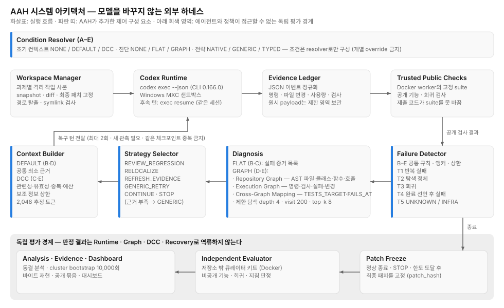
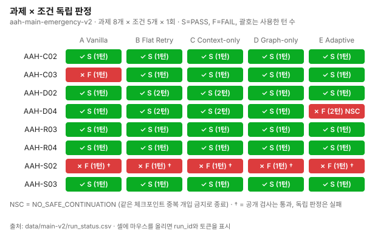
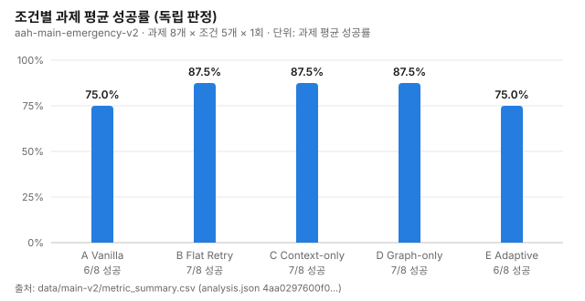
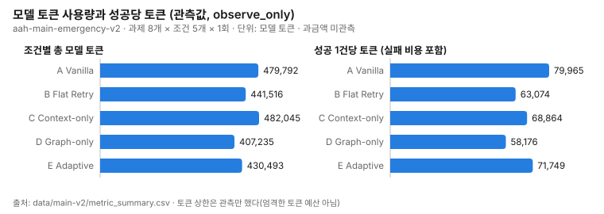
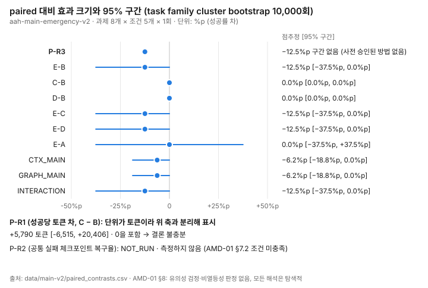
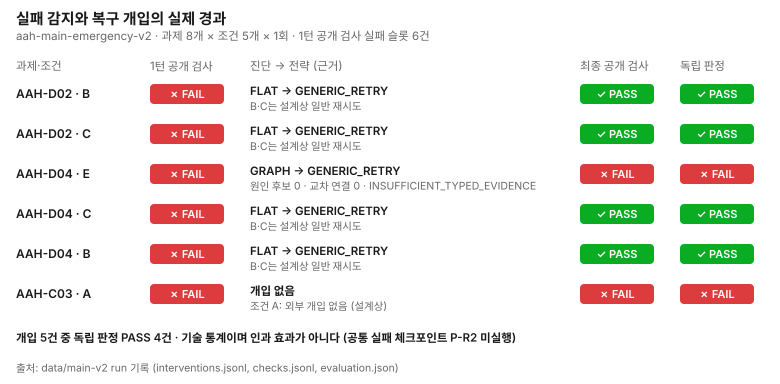
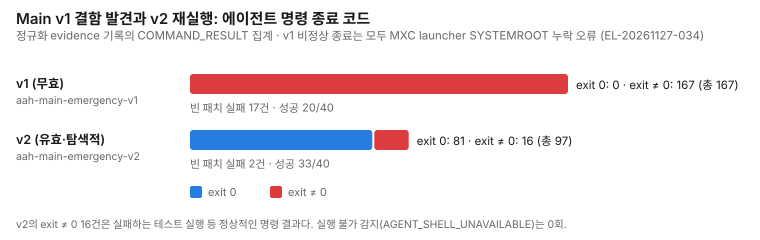

# AAH 심사 증빙 자료 (Evidence Pack)

| 항목 | 내용 |
| --- | --- |
| 기준 실험 | `aah-main-emergency-v2` (Main v2, 유효·탐색적). v1은 무효 이력으로만 인용 |
| 데이터 묶음 | [`data/aah-public-bundle.json`](data/aah-public-bundle.json). SHA-256은 대시보드 상단과 `<meta name="aah-bundle-sha256">`에 표시 |
| 대시보드 | [`dashboard.html`](dashboard.html). 브라우저로 열면 되고, 설치·서버·네트워크가 필요 없음 |
| 실행·확인 방법 | [JUDGE_GUIDE.md](JUDGE_GUIDE.md) |
| 생성 방법 | `python -m analysis.submission_bundle build`. 원시 기록(`results/`, 로컬 제한 자료)에서 화이트리스트 필드만 추출 |
| 공개 제외 | 에이전트 메시지·명령 원문·출력(`restricted/`), 스냅샷·패치 본문, 큐레이터 키트, 비공개 검사·정답 패치, 인증 정보 |

이 문서의 모든 수치는 동결된 분석 산출물(`analysis.json`)과 실행 기록에서 왔다. 그림도 같은 데이터 묶음으로 생성했다. **사후 기술 분석**으로 표시한 항목은 사전 등록 분석이 아니며, 가설 판단에 쓰지 않는다.

## E01. 시스템 아키텍처

| 구성 요소 | 역할 | 구현 위치 |
| --- | --- | --- |
| Condition Resolver | A–E 정책을 하나의 resolver로만 구성하고 개별 override를 금지한다 | `src/aah/experiments`, `src/aah/domain` |
| Workspace Manager | 과제별 격리 작업 사본, snapshot·diff, 최종 패치 고정 | `src/aah/workspace` |
| Codex Runtime | `codex exec --json`(CLI 0.166.0)을 Windows MXC 샌드박스에서 실행하고, 후속 턴은 `exec resume`으로 같은 세션에 전달 | `src/aah/runtime` |
| Evidence Ledger | Codex JSON 이벤트를 명령·변경·검사·사용량으로 정규화한 append-only 원장 | `src/aah/evidence` |
| Trusted Public Checks | 고정된 공개 suite를 Docker worker에서 실행한다. 제출 코드가 suite를 바꿀 수 없다 | `src/aah/workspace/checks.py`, `benchmarks/main_public/public_runner.py` |
| Failure Detector | T1 반복 실패·T2 정체·T3 회귀·T4 완료 선언 후 실패·T5 UNKNOWN을 B–E 공통 규칙으로 판정 | `src/aah/diagnosis/detector.py` |
| Repository Graph | AST로 파일·클래스·함수·호출·import·테스트 관계를 추출 | `src/aah/graphs/repository.py` |
| Execution Graph | 명령·검사·실패·변경 관측을 연결 (관측 순서를 인과로 바꾸지 않음) | `src/aah/graphs/execution.py` |
| Cross-Graph Mapping | 테스트 ID·traceback frame·diff 범위가 검증될 때만 TESTS_TARGET·FAILS_AT·CHANGES를 만든다 | `src/aah/graphs/mapping.py` |
| Graph Diagnosis | 깊이 4·방문 200·분기 20·top-k 8 제한 탐색, 후보·경로·중단 사유 기록 | `src/aah/diagnosis/graph.py` |
| Strategy Selector | REVIEW_REGRESSION·RELOCALIZE·REFRESH_EVIDENCE·GENERIC_RETRY·CONTINUE·STOP | `src/aah/recovery` |
| DEFAULT / DCC | 보조 정보 구성. DCC는 관련성(BM25)·유효성·범위·실패 연관성 점수와 예산(2,048 추정 토큰) 안의 한계 효용으로 선택 | `src/aah/context` |
| Independent Evaluator | 고정 패치를 저장소 밖 큐레이터 키트(Docker)에서 비공개 기능·회귀·지침 판정 | `evaluation/` (키트 본체는 저장소 밖) |
| Analysis·Dashboard | 동결 분석(cluster bootstrap 10,000회), 바이트 재현, 공개 묶음·대시보드 | `analysis/` |

## E02. A–E 비교군 구성

| 조건 | 초기 컨텍스트 | 진단 | 전략 | 복구 컨텍스트 | 외부 개입 | 확인하려는 것 |
| --- | --- | --- | --- | --- | --- | --- |
| A Vanilla | NONE | NONE | NATIVE | NONE | 없음 | 기본 Codex 기준선 |
| B Flat Retry | DEFAULT | FLAT | GENERIC | DEFAULT | 있음 | 강한 일반 재시도 비교군 |
| C Context-only | DCC | FLAT | GENERIC | DCC | 있음 | DCC의 추가 가치 (B→C) |
| D Graph-only | DEFAULT | GRAPH | TYPED | DEFAULT | 있음 | 그래프 복구의 추가 가치 (B→D) |
| E Adaptive | DCC | GRAPH | TYPED | DCC | 있음 | 결합 이득 (C/D→E) |

B–E는 같은 감지 규칙·앵커·개입 상한(복구 2회)·보조 정보 상한·필수 지침 전달 경로를 쓴다. 라이브 기록에서 이를 다시 확인한 결과는 E08에 있다.

## E03. Main v2 전체 실행 결과

| 항목 | 값 | 출처 |
| --- | --- | --- |
| 계획 / 실행 / 독립 판정 | 40 / 40 / 40슬롯 (8과제 × A–E × 1회), 결측 0, 대체 실행 0 | `data/main-v2/run_status.csv` |
| 성공 / 실패 | 33 / 7 | `analysis.json` dispositions |
| 턴 / 복구 전달 | 45턴 (상한 104) / 5회 | `run_status.csv` |
| 모델 토큰 | 2,241,081 (관측값, `observe_only`) | `metric_summary.csv` |
| 실행 시간 합계 / 독립 판정 시간 | 20.7분 / 49.0초 | `run_status.csv` |
| 에이전트 셸 명령 | 97개, exit 0 81개, 실행 불가 0건 | 정규화 증거 원장 (E11) |
| 모델 / runtime | `gpt-6-luna`, 추론 강도 low, Codex CLI 0.166.0, SAME_SESSION | 동결 manifest |
| 동결 / 승인 / 분석 | `5ef565bd…` / `2af2d58a…` / `analysis.json` `4aa02976…` | `configs/main/`, `data/main-v2/` |
| 추가 결제 | 0원 (기존 구독). 과금액은 관측하지 않음 | 승인 기록 |

| 조건 | 성공 / 유효 | 과제 평균 성공률 | 모델 토큰 | 성공당 토큰 | 평균 실행 시간 | 복구 전달 |
| --- | ---: | ---: | ---: | ---: | ---: | ---: |
| A Vanilla | 6/8 | 75.0% | 479,792 | 79,965 | 32.4초 | 0 |
| B Flat Retry | 7/8 | 87.5% | 441,516 | 63,074 | 30.4초 | 2 |
| C Context-only | 7/8 | 87.5% | 482,045 | 68,864 | 33.3초 | 2 |
| D Graph-only | 7/8 | 87.5% | 407,235 | 58,176 | 28.3초 | 0 |
| E Adaptive | 6/8 | 75.0% | 430,493 | 71,749 | 30.8초 | 1 |

## E04. 조건별 성공률

## E05. 토큰 사용량과 성공당 토큰

성공당 토큰은 실패 슬롯의 토큰까지 포함해 성공 건수로 나눈 값이다. 토큰은 관측만 했고(`observe_only`), 엄격한 토큰 예산으로 집행하지 않았다.

## E06. 효과 크기와 95% 구간

task family cluster bootstrap 10,000회, seed 20261126, 95% percentile 구간. AMD-01 §8에 따라 유의성 검정과 비열등성 판정은 하지 않았다.

| 연구 질문 | 대비 | 점추정 | 95% 구간 | 판단 |
| --- | --- | ---: | --- | --- |
| RQ1 DCC 비용 효율 | P-R1 = CPS(C) − CPS(B) | +5,790 토큰 | [−6,515, +20,406] | 결론 불충분 (0 포함) |
| RQ2 그래프 복구 | P-R2 공통 실패 체크포인트 복구율 | **미측정** | — | NOT_RUN (AMD-01 §7.2 조건 미충족) |
| RQ3 결합 이득 | P-R3 = E − max(C, D) | −12.5%p | 구간 없음 (사전 승인 방법 없음) | 결론 불충분 |
| RQ4 구성 요소 | AB1–AB4 | **미측정** | — | NOT_RUN |
| 참고 | E − B | −12.5%p | [−37.5%p, 0.0%p] | 결론 불충분 |
| 참고 | C − B / D − B | 0.0%p / 0.0%p | [0.0%p, 0.0%p] / [0.0%p, 0.0%p] | 결론 불충분 |
| 참고 | E − A | 0.0%p | [−37.5%p, +37.5%p] | 결론 불충분 |
| 참고 | CTX_MAIN / GRAPH_MAIN | −6.2%p / −6.2%p | [−18.8%p, 0.0%p] / [−18.8%p, 0.0%p] | 결론 불충분 |
| 참고 | INTERACTION | −12.5%p | [−37.5%p, 0.0%p] | 결론 불충분 |

**해석에 필요한 사후 기술 분석 (사전 등록 아님).**

- 그래프 진단은 v2에서 1회 호출됐고, 유형별 전략을 낸 경우는 0회다(E10).
- B/D, C/E의 첫 턴 메시지는 8/8 과제에서 바이트 단위로 같았다. 따라서 B–D, C–E의 차이는 그래프 전략 효과로 귀속할 수 없다.
- 입력이 같은 16쌍 중 첫 턴 공개 검사 결과가 갈린 쌍은 3개, 최종 판정이 갈린 쌍은 1개다. 그 1개(AAH-D04의 C·E)는 2개 턴 모두 바이트 동일 메시지(`3a4110…`, `828e49…`)를 받았는데 C는 PASS, E는 FAIL이었다.
- v2에서 E가 C·D보다 낮게 나온 차이(E − C, E − D, P-R3의 −12.5%p)는 모두 이 D04-E 한 슬롯의 실패에서 생겼다. 1회 반복 설계에서는 모델 비결정성이 조건 간 차이와 같은 크기로 나타난다.

## E07. 자동 테스트

| 항목 | 값 |
| --- | --- |
| 명령 | `python -m pytest tests -q -p no:cacheprovider` (`PYTHONPATH=src;.`) |
| 결과 | **303개 통과**, 실패 0, 건너뜀 0 (기록: [`data/verification-record.json`](data/verification-record.json), 2026-11-27) |
| 범위 | 단위·계약·통합·격리 테스트 (그래프·트리거·전략·컨텍스트·스키마·정책 parity·누출·체크포인트·독립 평가·artifact). 이번 제출 정리에서 공개 묶음·대시보드·문서 정합성·공개 데이터 내보내기·웹 대시보드 테스트 40개 추가 (정적 페이지 테스트 포함, 웹 대시보드 화면 테스트는 Streamlit 1.67.0 환경에서 실행) |
| 모델 호출 | 0 (live 테스트는 별도 승인 대상이라 수집되지 않음) |

계약 테스트 CT03(B/D·C/E 초기 바이트 동일), CT04(공통 trigger), CT05(graph off), CT06(DCC off), CT07(A 외부 주입 금지)이 회귀 테스트로 유지된다.

## E08. 실험 동결과 재현성

| 검증 | 명령 | 결과 | 필요 자료 |
| --- | --- | --- | --- |
| Main v2 동결 manifest 재생성 | `python -m benchmarks.main_public.main_freeze --check` | `MAIN_FREEZE_REPRODUCED 5ef565bd…` | `results/` (로컬) |
| v2 분석 재계산 (원시 기록 → 분석) | `python -m analysis.main_analysis --experiment results/main-live/aah-main-emergency-v2 --output results/analysis/aah-main-emergency-v2-amd01 --amd01 --verify` | `ANALYSIS_REPRODUCED` (바이트 일치, EP30) | `results/` |
| v1 분석 재계산 | 같은 명령, v1 경로 | `ANALYSIS_REPRODUCED` | `results/` |
| 공개 자료만으로 재계산 | `python -m analysis.submission_bundle verify-public` | `SUBMISSION_PUBLIC_VERIFIED` | 저장소만 |
| 공개 묶음 재생성 | `python -m analysis.submission_bundle check` | `SUBMISSION_BUNDLE_REPRODUCED` | `results/` |

`verify-public`은 `run_status.csv`에서 동결 AMD-01 분석 함수(bootstrap 10,000회 포함)를 다시 실행한다. 결과로 나온 `metric_summary.csv`·`paired_contrasts.csv`를 바이트 단위로 대조하고, `analysis.json`의 출력 해시와 대시보드 내장 데이터도 함께 확인한다.

**정책 격리 (라이브 기록에서 다시 확인, v2).** B/D 최초 메시지 동일 8/8, C/E 동일 8/8, B와 C는 8/8 과제에서 다름, 필수 지침 해시 A–E 동일 8/8. 그래프 진단은 D·E에서만, DCC 패키지는 C·E에서만 기록됐고 A의 보조 영역은 비어 있다.

## E09. 실패 감지와 복구 사례

| 슬롯 | 과제·조건 | run_id | 1턴 공개 검사 | 감지 → 진단 → 전략 | 결과 |
| --- | --- | --- | --- | --- | --- |
| slot-0012 | AAH-D02 · B | `60828887-df4f-4a6c-b2e2-68c28d7dd814` | FAIL | T1 → FLAT → GENERIC_RETRY | 2턴 PASS, 독립 PASS |
| slot-0015 | AAH-D02 · C | `9f1259a7-fb6e-431b-bfb2-3498132da083` | FAIL | T1 → FLAT → GENERIC_RETRY | 2턴 PASS, 독립 PASS |
| slot-0018 | AAH-D04 · C | `2b2066dd-559d-431c-a58d-a86b8029cdbd` | FAIL | T1 → FLAT → GENERIC_RETRY | 2턴 PASS, 독립 PASS |
| slot-0019 | AAH-D04 · B | `ecb89528-d656-456d-bf1f-ca05c5d19c5c` | FAIL | T1 → FLAT → GENERIC_RETRY | 2턴 PASS, 독립 PASS |
| slot-0017 | AAH-D04 · E | `6dbae23e-f630-4457-9fb3-6f7da060cc87` | FAIL | T1 → GRAPH(후보 0) → GENERIC_RETRY | 2턴 FAIL, NO_SAFE_CONTINUATION, 독립 FAIL |
| slot-0007 | AAH-C03 · A | `750fa0d4-ff8b-4004-8351-b45784f909a7` | FAIL | 개입 없음 (조건 A 설계) | 빈 패치, 독립 FAIL |

- **기술 통계 (인과 효과 아님).** 1턴 공개 검사에 실패한 B–E 슬롯은 모두 5개이고, 모두 복구 1회를 전달했다. 그중 4건이 독립 판정 PASS로 끝났다. 같은 상태에서 개입이 없었을 때의 결과는 측정하지 않았다(P-R2 미실행).
- **D04-E 실패 경과.** 에이전트가 PowerShell here-string으로 쓴 파일 쓰기 명령의 인용이 깨져, 파일이 바뀌지 않았다. 복구 턴에서도 같은 방식을 반복해 snapshot이 그대로였다. 하네스는 새 관측 없는 같은 체크포인트에 다시 개입하지 않는 규칙에 따라 안전 종료했다. 출처는 `docs/reports/RESULTS_ANALYSIS.md` §2.5이며, 명령 원문은 제한 자료라 공개 묶음에 없다.
- **AAH-S02 (다섯 조건 모두 공개 PASS·독립 FAIL).** 공개 검사가 통과해 트리거가 없었다. 하네스는 공개 결과만 복구에 쓰므로 이 실패를 알 수 없다. 이는 설계상 경계이며, 큐레이터 측 사후 검토 대상이다.
- 대시보드 **복구 Replay**에서 위 사례를 단계별로 재생할 수 있다. v1(무효) 19건과 S3 합성 3건도 포함한다.

## E10. 그래프 기반 진단 근거

**라이브 (v2, AAH-D04 · E, `6dbae23e…`).** 결합 그래프는 노드 22개(코드 12, 실행 10)와 엣지 21개로 이뤄졌고, 교차 연결은 0개다. 미해결 연결은 6건이다(TESTS_TARGET `unresolved_test_id` 4, FAILS_AT `unverified_frame_or_version` 2). 앵커에서 4개 노드를 방문한 뒤 탐색이 끝났고(exhausted), 후보는 0개였다. 그래서 `INSUFFICIENT_TYPED_EVIDENCE` → `GENERIC_RETRY`로 대체됐다.

- **원인 (기록에서 확인).** Main 공개 검사 파서 `main-unittest-counts-v1`(`benchmarks/main_public/public_runner.py`)는 suite 단위 결과만 남긴다. 테스트 ID가 검사 ID(`AAH-D04-P-FUNC`)이고 traceback frame이 없다. 매핑 규칙은 근거 없는 연결을 만들지 않으므로(AGENTS §5.2), 실패 앵커에서 코드 노드로 갈 수 없었다.
- **전체 라이브 기록.** v2 1회, v1 8회(무효), Dev Pilot(`results/s5-live`) 5회, S4 라이브(`results/s4-live`) 1회의 그래프 진단이 모두 같은 사유로 일반 재시도로 대체됐다. 라이브 실행에서 유형별 전략이 선택된 경우는 0회다.
- **v1 부수 확인.** v1 AAH-R04에서 D의 복구 메시지는 B와 바이트 동일했다. 그래프가 대체되면 D는 B와 같은 패키지를 받는다는 것을 보여 준다(정책 누출 없음).

**합성 검증 (S3, 스크립트 어댑터, 모델 호출 0, 라이브 아님).** 테스트 함수 단위 ID가 있으면 같은 코드가 교차 연결을 만들고 유형별 전략을 선택한다.

| run_id | 시나리오 | 교차 연결 | 후보 / 경로 | 전략 |
| --- | --- | ---: | ---: | --- |
| `cd8c853f-96d0-403a-8cbc-e69444f8f990` | 같은 실패 반복 | 2 | 4 / 4 | RELOCALIZE → `labels.py` |
| `975f9c54-81b4-444c-bdc5-f21db7b36c3e` | 통과하던 검사 회귀 | 6 | 4 / 10 | REVIEW_REGRESSION → `labels.py` |
| `1b382372-a4b8-4697-817a-1f9a631f8ca0` | 완료 선언 후 실패 | 0 | 0 / 0 | GENERIC_RETRY |

이 대비가 **최종 발표 전 1순위 개선 과제**의 근거다. 공개 검사 결과를 테스트 함수·frame 단위로 기록해 라이브에서도 교차 연결이 생기게 한다(아래 E14와 `submission.md` §7). 대시보드 **그래프 탐색** 탭에서 노드·엣지·미해결 기록·탐색 경로를 직접 확인할 수 있다.

## E11. DCC 컨텍스트 구성 사례 (v2, AAH-D04)

| 조건 | 단계 | 정책 | 보조 정보 추정 토큰 (상한 2,048) | 선택 / 후보 | 제외 사유 | 메시지 해시 |
| --- | --- | --- | ---: | ---: | --- | --- |
| A | 최초 | NONE | 0 | 0 / 0 | — | `7ad4879a…` |
| B, D | 최초 | DEFAULT | 557 | 8 / 8 | — | `9218ab87…` (B=D) |
| C, E | 최초 | DCC | 483 | 7 / 8 | NON_POSITIVE_UTILITY 1 | `3a4110d2…` (C=E) |
| B | 복구 | DEFAULT | 770 | 9 / 9 | — | `37c76c1b…` |
| C, E | 복구 | DCC | 607 | 7 / 9 | NON_POSITIVE_UTILITY, MERGED_DUPLICATE | `828e4915…` (C=E) |

DCC는 `restore.py` 코드 발췌(관련성 1.00, 점수 1.000)를 우선 선택했다. 관련성이 0이고 한계 효용이 음수인 `public_checks/test_functional.py` 참조(−0.0007)는 제외했다. 복구 단계에서는 공개 검사 실패 증거를 핵심 근거(CORE_REQUIRED)로 유지하고, 중복된 이전 시도 기록은 합쳤다. 최초 패키지는 입력이 같으므로 직접 비교할 수 있다. DCC가 DEFAULT보다 보조 정보 추정 토큰 74개(483 대 557)를 덜 썼다. 복구 패키지(607 대 770)는 실행 이력이 달라 참고값이다. 이 절감이 성공당 비용 절감으로 이어졌다는 근거는 없다(P-R1, E06). 출처: run `6dbae23e…`·`ecb89528…`의 `context.jsonl`. 대시보드 **컨텍스트** 탭에서 모든 슬롯을 확인할 수 있다.

## E12. Main v1 결함 발견과 개선

| 단계 | 기록 | 내용 |
| --- | --- | --- |
| v1 실행 | EL-20261127-032 | 40/40 실행·판정. 겉보기 결과는 E 87.5% 대 A 0% |
| 결함 발견 | EL-20261127-034 | 실행 후 원시 로그 검토. 에이전트 셸 명령 167/167이 MXC launcher `SYSTEMROOT` 누락 오류로 실행되지 않음. 원인은 턴 설정 `shell_environment_policy.inherit="none"`. 사전 격리 검사는 `codex sandbox` 경로라 이 설정을 거치지 않음. 실패 20건 중 17건이 빈 패치 |
| 무효 판정 | RESULTS_ANALYSIS §2.4 | 슬롯을 골라 빼지 않고 실험 전체를 INFRA_COMPROMISED로 표기. 기록은 보존 |
| 수정 | EL-20261127-035 | 모델 호출 없이 sandbox로 재현해 원인 확인. 셸에 SYSTEMROOT·WINDIR·COMSPEC·PATH·PATHEXT만 전달. 실행 중 `AGENT_SHELL_UNAVAILABLE` 자동 감지 추가. 접근 검사가 에이전트와 같은 셸 환경을 쓰도록 변경, 8/8 재검사 PASS |
| 재실행 | EL-20261127-036–038 | 과제·조건·예산·분석은 동일하게 두고 새 동결로 v2 실행. 명령 97개 중 실행 불가 0 |

v1의 그림과 표는 대시보드에서 "무효" 표시와 함께 볼 수 있다. 연구 질문의 근거로는 쓰지 않는다.

## E13. 공개 재계산용 데이터

| 파일 | 내용 | 검증 |
| --- | --- | --- |
| `data/main-v2/run_status.csv` | 40슬롯 판정·토큰·시간·턴·복구 | `analysis.json` outputs 해시 `2495b0bc…` |
| `data/main-v2/metric_summary.csv` | 조건별 지표 | `49888cee…` |
| `data/main-v2/paired_contrasts.csv` | 대비·구간 | `0309a46b…` |
| `data/main-v2/analysis.json` | 설정·코드·입력 해시·결과 | SHA-256 `4aa02976…` |
| `data/main-v1-invalid/*` | v1 같은 형식 (무효 이력) | `analysis.json` `4de4eb3c…` |
| `data/aah-public-bundle.json` | 대시보드 데이터 (Main run 80개와 S3 합성 run 3개의 정규화 기록, 그래프 진단 12건, 입력 파일 1,025개의 SHA-256) | `verify-public` |

## E14. 측정 결과와 미측정 항목

| 구분 | 항목 |
| --- | --- |
| 측정함 | A–E 성공률·토큰·성공당 토큰·실행 시간 (v2), paired 대비 11개 (P-R3 점추정만), 복구 전달 5회의 경과, 셸 정상 여부, 정책 격리 (라이브 기록) |
| 측정하지 않음 | P-R2 공통 실패 체크포인트, Ablation AB1–AB4, leave-one-repository-out 민감도, 과금액(`cost_kind=UNKNOWN`), 엄격한 토큰 예산 |
| 한계 | 8과제 × 1회·저장소 3개·천장 효과(A가 6/8 해결). 사람 동료 리뷰 없이 AMD-01 AI 리뷰로 편입(검사 수정·리뷰 모두 `claude-opus-5-5`, 변형본 작성 세션과 같은 모델). 1인이 세 역할 승인 겸임. 5과제 비공개 검사 1회 수정. 셸 수정 후 Pilot 재실행 없음. v2 전 v1 열람. `analysis_sets.json` 설정 해시 표기 결함(수치 영향 없음) |

## E15. 심사위원용 실행 가이드와 웹 대시보드

[JUDGE_GUIDE.md](JUDGE_GUIDE.md)를 본다. 웹 대시보드(GitHub Pages용 정적 페이지 `docs/dashboard/index.html`과 Streamlit)는 `public_data/`의 release `submission-2026-11-27`을 기본으로 보여 준다. 이 release의 실험 데이터는 이 문서의 공개 묶음과 같다(테스트 `test_submission_release_equals_the_frozen_submission_snapshot`). 배포 절차는 [DASHBOARD_DEPLOYMENT.md](../../DASHBOARD_DEPLOYMENT.md)에 있다.
